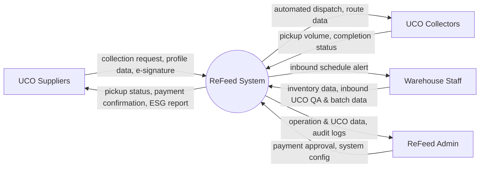

# Context Diagram: ReFeed

> Context Diagram specification for ReFeed System (Lesson 3). ReFeed is modeled as a single black-box system surrounded by 4 external actors/entities interacting with it.

| Field | Value |
|---|---|
| Version | v2.1 (4 External Actors) |
| Built from | [CVCA](cvca.md) & Context Diagram Revision |
| System Boundary | `ReFeed System` |
| External Entities | UCO Suppliers · UCO Collectors · Warehouse Staff · ReFeed Admin |

## 1. Diagram

## 2. Data crossing the boundary

| Data group | Kept by | Reaches ReFeed from | Reaches Actor from ReFeed |
|---|---|---|---|
| Pickup & Supplier Profile | ReFeed System | UCO Suppliers | UCO Collectors, Warehouse Staff |
| Dispatch & Route Planning | ReFeed System | ReFeed Admin | UCO Collectors |
| Collection & Handover Record | ReFeed System | UCO Collectors | UCO Suppliers, Warehouse Staff, ReFeed Admin |
| Warehouse Inbound & QA Data | ReFeed System | Warehouse Staff | ReFeed Admin |
| Operation & Financial Approvals | ReFeed System | ReFeed Admin | UCO Suppliers |

## 3. Change log

| Version | When | Change | Why |
|---|---|---|---|
| v1.0 | Lesson 3 | Initial 4-actor Context Diagram (Suppliers, Collectors, Warehouse Staff, Admin) | Based on initial scope and Use Case Diagram |
| v2.0 | Lesson 7 | Draft with 5 entities (added Eco Oil System) | External refinery integration attempt |
| v2.1 | Lesson 7 | Reverted to 4 External Actors (Suppliers, Collectors, Warehouse Staff, Admin) | Aligned with updated 4-actor Context Diagram requirement |