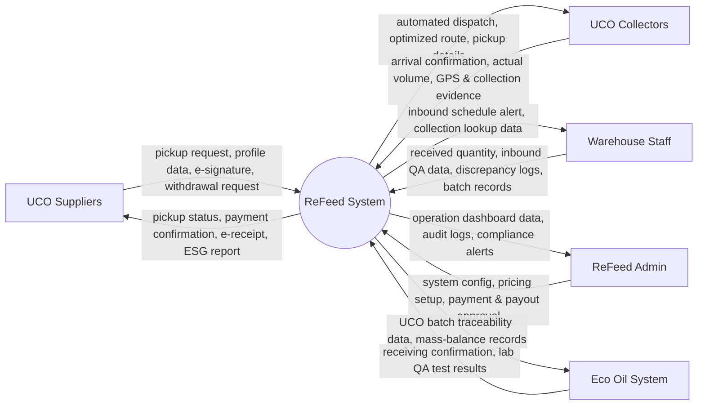

# Context Diagram: ReFeed

> Context Diagram specification for Lesson 3 (DBIZ2). ReFeed is represented as a single black box in the middle; external entities and actors exchange direct data flows with the central system.

| Field | Value |
|---|---|
| **Version** | v2.0 (Updated from Lesson 3 & Lesson 7) |
| **Built from** | [CVCA](cvca.md): Every stakeholder exchanging information directly with ReFeed |
| **System Boundary** | `ReFeed System` (Centralized ReFeed System) |
| **External Entities** | UCO Suppliers · UCO Collectors · Warehouse Staff · ReFeed Admin · Eco Oil System |

---

## 1. Diagram

> **Notes on System Boundary:**
> * **Time Event:** Time is not an external entity. Timed behavior (such as automated data synchronization or reminder notifications) is represented as time-triggered use cases in the Use Case Diagram.
> * **Indirect Stakeholders (EU Regulators, Certification Bodies, EU SAF Producers):** These entities exchange information via **Eco Oil** and do not directly communicate with the ReFeed System; hence, they are excluded from the ReFeed Context Diagram.
> * **Black-box Principle:** The entire ReFeed system is unified into a single central node `ReFeed System` (without splitting into Web App, Mobile App, Backend, or Database components at the context level).

---

## 2. Data crossing the boundary

These data groups correspond to the internal logical files (ILF) and external interface files (EIF) defined in the system scope inventory (W0 Table 4).

| Data group | Kept by | Reaches ReFeed System from | Reaches Actor / External System |
|---|---|---|---|
| **Supplier Profile & Pickup Requests** | ReFeed System | UCO Suppliers | UCO Collectors, Warehouse Staff |
| **Dispatch & Route Optimization Data** | ReFeed System | ReFeed Admin | UCO Collectors |
| **Field Collection Results & Evidence** | ReFeed System | UCO Collectors | UCO Suppliers, Warehouse Staff, ReFeed Admin |
| **Warehouse Inbound & Quality Data** | ReFeed System | Warehouse Staff | ReFeed Admin, Eco Oil System |
| **Batch Traceability & Mass-Balance Records** | ReFeed System | Warehouse Staff / ReFeed System | Eco Oil System |
| **ESG Reports & Payment Confirmations** | ReFeed System | ReFeed Admin / Eco Oil System | UCO Suppliers |

---

## 3. Change log

| Version | When | Change | Why |
|---|---|---|---|
| **v1.0** | Lesson 3 | Initial context diagram (4 actors: Suppliers, Collectors, Warehouse Staff, ReFeed Admin). | First draft derived directly from initial Use Case Diagram. |
| **v2.0** | Lesson 7 | Added **Eco Oil System** as an independent External System exchanging batch traceability data (`Traceability & Batch Data`). Standardized central node to a Black-box `ReFeed System`. | Inputs check cross-verification from end-to-end Sustainable Aviation Fuel (SAF) supply chain compliance requirements. |