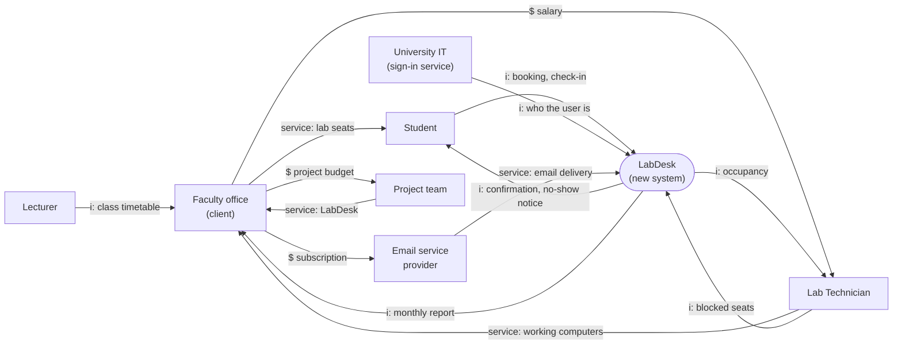

# CVCA: LabDesk

> Worked example for teaching (LabDesk). Not a student submission and not a real product.

Lesson 3 (Prof. Seki, CVCA to Context Diagram). The Customer Value Chain Analysis lists every
stakeholder of the lab seats and what flows between them: money (`$`), information (`i`) and
goods or services. It is drawn before the system is designed, to find the problems and
opportunities.

| Field | Value |
|---|---|
| Version | v1.0 (Lesson 3) |
| Next | [Context Diagram](context-diagram.md) |

## 1. Value chain (with the new system)

Today (before LabDesk) the booking information goes from students to a paper sheet at the lab
door, and nobody passes usage information to the faculty office.

## 2. Problems and opportunities

| # | Stakeholder | Problem or opportunity |
|---|---|---|
| P-1 | Student | Popular slots fill in minutes on the paper sheet; students queue at the door without knowing if a seat is left. |
| P-2 | Student, Faculty office | Students who signed up often do not come; their seats stay empty while others wait. |
| P-3 | Lab Technician | Faulty computers are found only when a student complains; the seat is booked again the next slot. |
| P-4 | Faculty office | No data on how labs are used, so opening hours and new equipment are planned by guess. |

## 3. Stakeholder requirements

Written as "<stakeholder> shall be able to ...", as in Prof. Seki's Lesson 4 design process. They
become system requirements in [the architecture](../architecture/architecture.md).

| ID | Stakeholder requirement | From |
|---|---|---|
| StR-01 | Students shall be able to secure a lab seat before they come to the lab. | P-1 |
| StR-02 | Students shall be able to give back a seat they no longer need. | P-2 |
| StR-03 | The faculty shall be able to reuse seats that booked students do not come for. | P-2 |
| StR-04 | Lab Technicians shall be able to take a faulty seat out of booking until it is repaired. | P-3 |
| StR-05 | The faculty shall be able to see how each lab is used. | P-4 |

