# CVCA: ReFeed

Lesson 3 (Prof. Seki, CVCA to Context Diagram). The Customer Value Chain Analysis lists every
stakeholder of the used cooking oil (UCO) chain and what flows between them: money (`$`),
information (`i`) and goods or services. It is drawn before the system is designed, to find the
problems and opportunities.

| Field | Value |
|---|---|
| Version | v1.0 (Lesson 3) |
| Next | [Context Diagram](context-diagram.md) |

## 1. Value chain (with the new system)

```mermaid
flowchart LR

    %% UCO SUPPLIERS
    S["UCO Suppliers<br/>(Large-scale hospitality<br/>and F&B chains<br/>+ small and medium-sized<br/>food businesses)"]

    %% REFEED AFTER
    subgraph RF["ReFeed — AFTER"]
        direction LR

        C["UCO collectors"]

        A["ReFeed app<br/>(Receive requests,<br/>dispatch vehicles+drivers,<br/>collection confirmation,<br/>agreement & e-signature,<br/>loyalty & payout balance,<br/>green profile, traceability<br/>data.)"]

        W["Warehouse<br/>(Sediment & water separation<br/>Scan / retrieve Collection ID<br/>Initial quality check<br/>Invoice data entry<br/>Aggregate UCO batches)"]

        O["ReFeed Office"]

        ST["ReFeed Staff<br/>(Manage app)"]

        %% Collector - App flows
        C -->|"!: Confirm"| A
        A -->|"!: Request"| C

        %% Collector - Warehouse flow
        C -->|"UCO"| W

        %% App - Office flows
        O -->|"!: System config &<br/>Approvals"| A
        A -->|"!: Operation Data"| O

        %% Staff - App flow
        ST --> A
    end

    %% EXTERNAL STAKEHOLDERS
    E["Eco Oil<br/>(Re-inspect & deep-process UCO<br/>Compile sustainability reports<br/>Apply for ISCC / RSB certification<br/>File EU customs & RED II docs)"]

    R["EU regulators<br/>(RED II,...)"]

    B["Certification bodies<br/>(ISCC / RSB scheme audit<br/>SGS / Bureau Veritas<br/>GHG emission verification<br/>Chain-of-custody audit)"]

    P["EU SAF producer / buyer<br/>(Converts UCO to sustainable<br/>aviation fuel<br/>Reports GHG savings to EU<br/>aviation authority)"]

    %% SUPPLIER FLOWS
    S -->|"UCO"| C
    S -->|"!: Pickup Request"| A
    A -->|"$: Payment"| S

    %% WAREHOUSE - ECO OIL
    W -->|"UCO"| E

    %% OFFICE - ECO OIL
    O <-->|"!: Data Sharing"| E

    %% EU REGULATORS - ECO OIL
    R -->|"approval"| E
    E -->|"!: information<br/>sharing"| R

    %% ECO OIL - CERTIFICATION BODIES
    E -->|"--"| B
    B -->|"Certificate"| E

    %% ECO OIL - EU SAF PRODUCER / BUYER
    E -->|"UCO"| P
    P -->|"$: Payment"| E

    %% STYLING
    style RF fill:#ffffff,stroke:#e5c34b,stroke-width:3px,stroke-dasharray:10 5
    style A fill:#ffffff,stroke:#18ad8b,stroke-width:5px
    style O fill:#ffffff,stroke:#18ad8b,stroke-width:2px
    style ST fill:#ffffff,stroke:#18ad8b,stroke-width:2px
    style S fill:#ffffff,stroke:#18ad8b,stroke-width:2px
    style C fill:#ffffff,stroke:#000000,stroke-width:2px
    style W fill:#ffffff,stroke:#000000,stroke-width:2px
    style E fill:#ffffff,stroke:#000000,stroke-width:2px
    style R fill:#ffffff,stroke:#000000,stroke-width:2px
    style B fill:#ffffff,stroke:#000000,stroke-width:2px
    style P fill:#ffffff,stroke:#000000,stroke-width:2px
```

Today (before the ReFeed app) suppliers arrange each pickup with ReFeed by phone call or Zalo
message, and the schedule is planned by hand. The quantity collected, the price and the payment
are agreed and noted manually at the supplier's door, so nothing links a warehouse batch back to
the suppliers and collections it came from.

## 2. Problems and opportunities

| # | Stakeholder | Problem or opportunity |
|---|---|---|
| P‑1 | UCO Suppliers, ReFeed Office | Pickups are arranged by phone or Zalo and scheduled by hand; the supplier does not know when the driver will come. |
| P-2 | ReFeed Office, UCO collectors / Drivers | Small suppliers are scattered across the city; dispatching each request by hand makes routes long and each small pickup expensive. |
| P-3 | UCO Suppliers, ReFeed Office | The collected quantity, price and payment are recorded manually, so there is no signed record when the two sides disagree. |
| P-4 | Warehouse | A difference between the quantity collected and the quantity received at the warehouse is noticed late or not at all. |
| P-5 | Eco Oil, Certification bodies, EU regulators | A UCO batch cannot be traced back to its Point of Origin, while ISCC / RSB certification and RED II need chain of custody and mass balance. |
| P-6 | UCO Suppliers, ReFeed Office | Small suppliers switch to another collector that offers a higher price. |
| P-7 | UCO Suppliers | Business and SME suppliers have no proof that their UCO was handled responsibly (opportunity). |

## 3. Stakeholder requirements

Written as "<stakeholder> shall be able to ...", as in Prof. Seki's Lesson 4 design process. They
become system requirements in [the architecture](../architecture/architecture.md).

| ID | Stakeholder requirement | From |
|---|---|---|
| StR‑01 | UCO Suppliers shall be able to request a pickup and follow its status without calling ReFeed. | P-1 |
| StR-02 | The ReFeed Office shall be able to group pickup requests and send drivers on planned routes. | P-2 |
| StR-03 | UCO Suppliers and the ReFeed Office shall be able to confirm the collected quantity and the amount of each handover in a signed record. | P-3 |
| StR-04 | Warehouse staff shall be able to compare the received quantity with the collected quantity of each collection. | P-4 |
| StR-05 | Eco Oil shall be able to trace each UCO batch back to the collections and suppliers it came from. | P-5 |
| StR-06 | UCO Suppliers shall be able to earn a better price the more UCO they sell to ReFeed. | P-6 |
| StR-07 | UCO Suppliers shall be able to show their verified UCO contribution. | P-7 |
