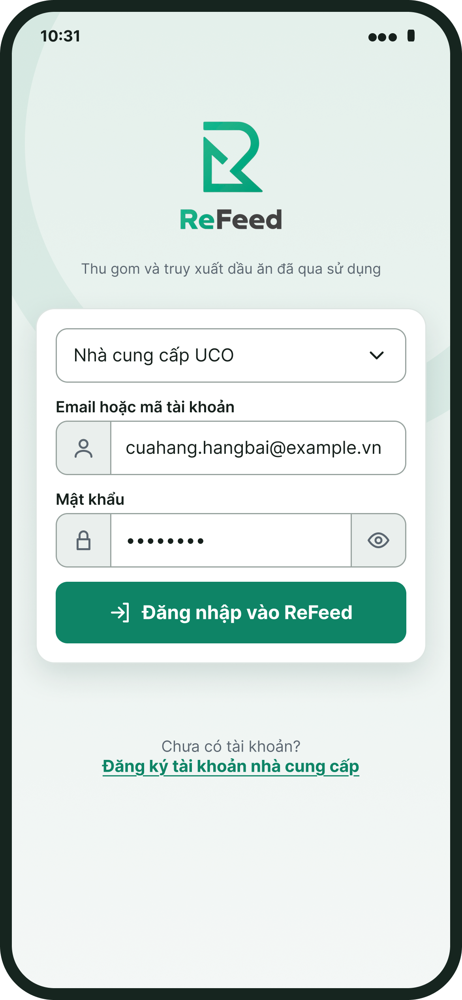
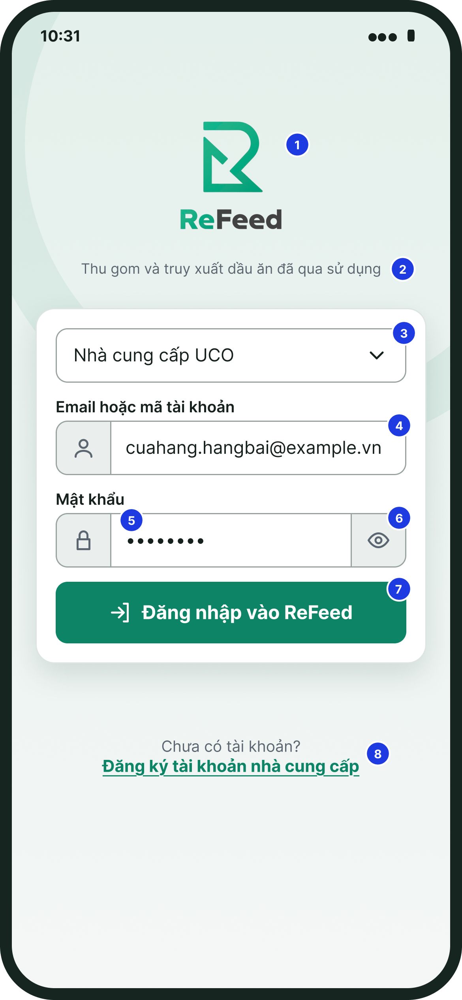
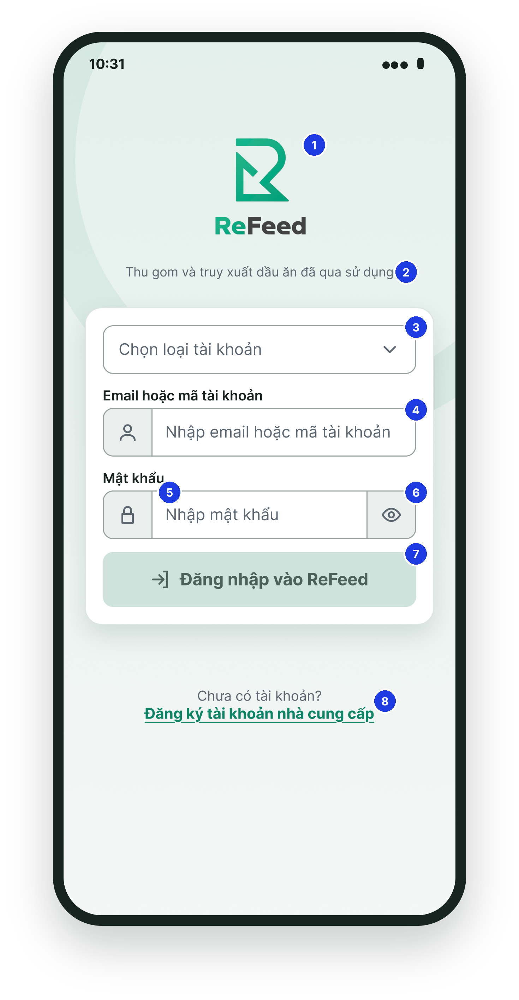
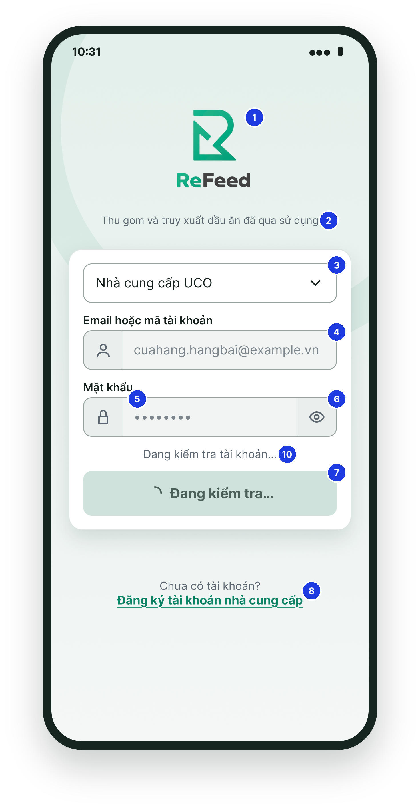
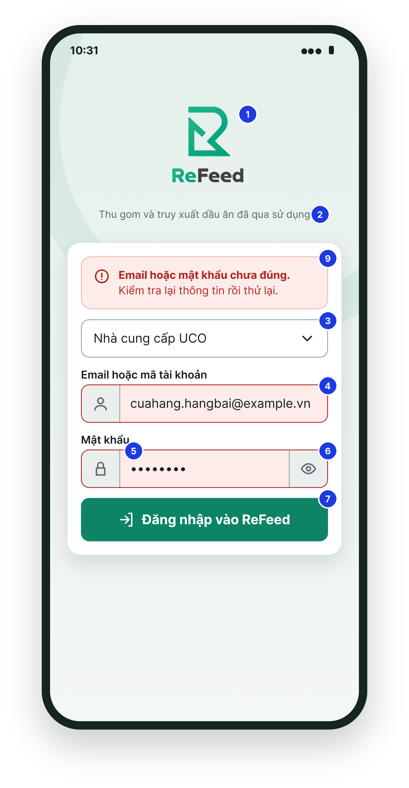
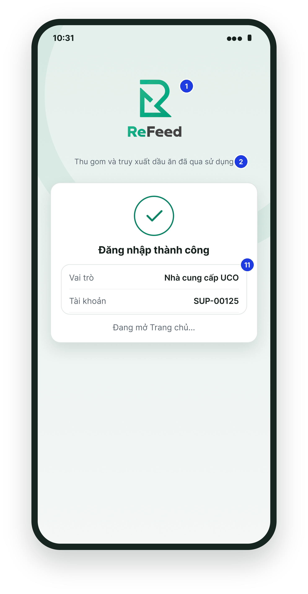
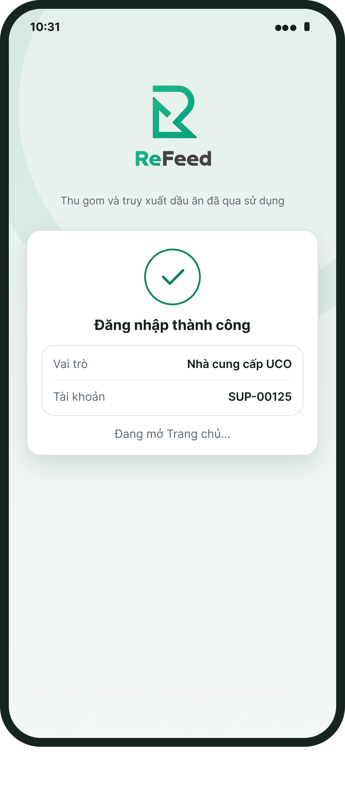
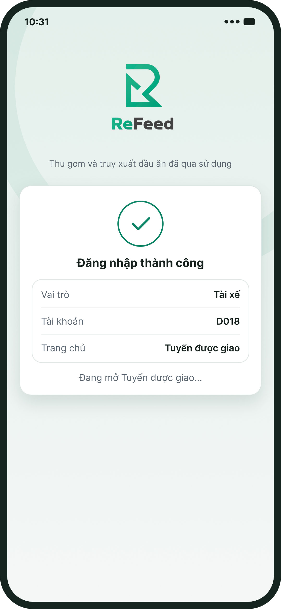
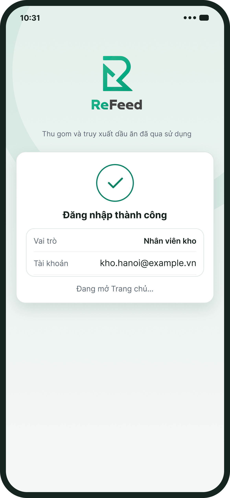
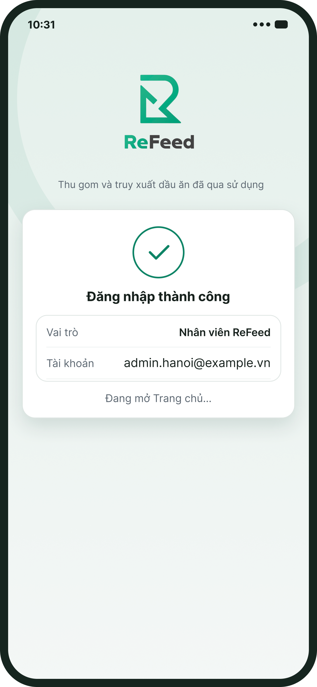

# Screen Spec: S-F00-01 Sign in
 
| Field | Value |
|---|---|
| Screen ID | S-F00-01 |
| Screen name | Sign in |
| Actor | Supplier; Driver / Collector; Warehouse Staff; ReFeed Staff |
| Priority | Must |
| Feature | F-00 Shared screens |
| Activity diagrams | AD-UC-01 (action "Submit Credentials or Registration Data" — the credentials part, decision `d1` "Authentication valid?" and its [No] outcome `s2` "Display Error Message & Prompt Retry") |
| Mockup images | `img/S-F00-01-default.png` (default), `img/S-F00-01-default-numbered.png`, four state images and four numbered state images (section 2), and three success images for the other roles (section 4) |
| Frame width | 390 × 844 px device frame (minimum supported width 360 px) |
| Figma frame | Figma file "S-F00-01 · Sign in" in the ReFeed Figma file |
| Status | Draft |
 
## 1. Purpose
 
**Shown when:** a user who is not signed in opens ReFeed (system launch), signs out, or the session expires. A signed-out user who opens a notification link also sees this screen first.
 
**The user leaves this screen when:** the credentials are valid and the home of the user's role opens automatically, or the user taps "Đăng ký tài khoản nhà cung cấp" to register.
 
## 2. Mockup
 

 
**Numbered:** each number is the # of the element inventory in section 3. Element 8 (register link) is hidden in the error and success states, element 9 (error banner) appears only in the error state, and element 10 (loading text) only in the loading state. In the success state the form is replaced by the success card, numbered 11; only the logo (1), the tagline (2) and the card (11) are numbered on that image.
 
| Default, numbered | Empty, numbered | Loading, numbered | Error, numbered | Success, numbered |
|---|---|---|---|---|
|  |  |  |  |  |
 
| State | Image |
|---|---|
| Default | [`img/S-F00-01-default.png`](img/S-F00-01-default.png) |
| Empty | [`img/S-F00-01-empty.png`](img/S-F00-01-empty.png) |
| Loading | [`img/S-F00-01-loading.png`](img/S-F00-01-loading.png) |
| Error | [`img/S-F00-01-error.png`](img/S-F00-01-error.png) (invalid credentials, AD-UC-01 `d1` [No]) |
| Success | [`img/S-F00-01-success.png`](img/S-F00-01-success.png) |
 
All colours, fonts and corners come from the design tokens in
[ui-conventions.md](../ui-conventions.md#6-design-tokens).
 
## 3. Element inventory
 
| # | Element | Type | Content / data source | Required | Validation |
|---|---|---|---|---|---|
| 1 | Logo | Image | static ReFeed logo | Yes | none |
| 2 | Tagline | Text | static "Thu gom và truy xuất dầu ăn đã qua sử dụng" | Yes | none |
| 3 | Account type | Select | `account.role`; options "Nhà cung cấp UCO", "Tài xế", "Nhân viên kho", "Nhân viên ReFeed"; placeholder "Chọn loại tài khoản" | Yes | exactly one option selected; must match the role of the account (FR-06-03) |
| 4 | Email or account code | Text input with person icon | `account.email` or the account code; label "Email hoặc mã tài khoản"; placeholder "Nhập email hoặc mã tài khoản" | Yes | not empty |
| 5 | Password | Password input with lock icon | `account.password`, shown as dots; label "Mật khẩu"; placeholder "Nhập mật khẩu" | Yes | not empty |
| 6 | Show / hide password | Icon button (eye) | static | No | none |
| 7 | Đăng nhập vào ReFeed | Primary button | static label; "Đang kiểm tra…" with a spinner while checking | Yes | disabled until 3, 4 and 5 are filled, and while checking |
| 8 | Đăng ký tài khoản nhà cung cấp | Link | static "Chưa có tài khoản?" + link text | No | none |
| 9 | Error banner | Banner | "Email hoặc mật khẩu chưa đúng." + "Kiểm tra lại thông tin rồi thử lại." (AD-UC-01 `s2`) | No | icon + text + colour (ui-conventions §5) |
| 10 | Loading text | Text | static "Đang kiểm tra tài khoản…" | No | none |
| 11 | Success card | Card | check mark, "Đăng nhập thành công", row "Vai trò" (role name of `account.role`), row "Tài khoản" (`account.id` for Supplier and Driver, `account.email` for Warehouse Staff and ReFeed Staff); for the Driver also row "Trang chủ" ("Tuyến được giao"); line "Đang mở …" with the name of the destination (see "Success by role" in section 4) | No | none |
 
## 4. States
 
| State | What the user sees | Trigger |
|---|---|---|
| Default | Logo and tagline; card with "Nhà cung cấp UCO" selected, "cuahang.hangbai@example.vn" in the account field, the password as dots and the eye button; button "Đăng nhập vào ReFeed" enabled; below the card "Chưa có tài khoản? Đăng ký tài khoản nhà cung cấp". The mockup shows this state. | The screen is open and the account type, account and password are filled |
| Empty (no data) | Same layout; the select shows "Chọn loại tài khoản", the fields show the placeholders "Nhập email hoặc mã tài khoản" and "Nhập mật khẩu"; button "Đăng nhập vào ReFeed" disabled; register link visible | First open: system launch, sign out or session expired |
| Loading | The select, the account field and the password field are greyed and not editable, with the entered values kept; text "Đang kiểm tra tài khoản…" between the password and the button; button "Đang kiểm tra…" with a spinner, disabled; register link visible | The user taps "Đăng nhập vào ReFeed" and the credentials are being checked |
| Error | Red banner at the top of the card "Email hoặc mật khẩu chưa đúng. Kiểm tra lại thông tin rồi thử lại."; the account and password fields with a red border and light red fill, values kept; account type kept; button enabled; the register link is not shown | Credentials rejected (AD-UC-01 `d1` [No: Invalid Data/Credentials] → `s2`) |
| Success / confirmation | The form is replaced by a card with a check mark, "Đăng nhập thành công", "Vai trò: Nhà cung cấp UCO", "Tài khoản: SUP-00125" and the line "Đang mở Trang chủ…"; no buttons and no register link. The screen closes by itself. The mockup shows the Supplier; the card differs slightly for the other three roles ("Success by role" below). | Credentials valid and role matches (AD-UC-01 `d1` [Yes], FR-01-01, FR-06-03) |
 
### Success by role
 
Only the success card changes with the role of the account; the logo, the tagline and the layout stay the same, and the other four states are identical for every role.
 
| Role (select value) | "Tài khoản" row | Rows in the card | Line under the card | Opens | Image |
|---|---|---|---|---|---|
| Nhà cung cấp UCO | `SUP-00125` | Vai trò, Tài khoản | "Đang mở Trang chủ…" | Supplier main menu | [`img/S-F00-01-success.png`](img/S-F00-01-success.png) |
| Tài xế | `D018` | Vai trò, Tài khoản, Trang chủ ("Tuyến được giao") | "Đang mở Tuyến được giao…" | S-F02-03 | [`img/S-F00-01-success-Driver.png`](img/S-F00-01-success-Driver.png) |
| Nhân viên kho | `kho.hanoi@example.vn` | Vai trò, Tài khoản | "Đang mở Trang chủ…" | Warehouse main menu | [`img/S-F00-01-success-ReFeed-Warehouse Staff.png`](img/S-F00-01-success-ReFeed-Warehouse_Staff.png) |
| Nhân viên ReFeed | `admin.hanoi@example.vn` | Vai trò, Tài khoản | "Đang mở Trang chủ…" | S-F06-01 | [`img/S-F00-01-success-ReFeed Staff.png`](img/S-F00-01-success-ReFeed_Staff.png) |
 
| Nhà cung cấp UCO | Tài xế | Nhân viên kho | Nhân viên ReFeed |
|---|---|---|---|
|  |  |  |  |
 
The Driver's home is the assigned route, so its card has the extra row "Trang chủ: Tuyến được giao" and the line under the card names that screen. The "Tài khoản" row shows the account ID for Supplier and Driver and the email for Warehouse Staff and ReFeed Staff, because only those two have an ID format in ui-conventions §2.
 
## 5. Interactions and navigation
 
| # | Element | User action | System response | Goes to screen |
|---|---|---|---|---|
| 1 | Account type | tap | Opens the list of the four account types; the chosen type replaces the placeholder | stays |
| 2 | Email or account code | type | Opens the keyboard; the red border of the error state clears when the value changes | stays |
| 3 | Password | type | Opens the keyboard; characters are shown as dots; the red border of the error state clears when the value changes | stays |
| 4 | Show / hide password | tap | Switches the password between dots and plain text | stays |
| 5 | Đăng nhập vào ReFeed | tap | Disables the form and shows the loading state; checks the credentials (FR-01-01) and that the role of the account matches the chosen account type (FR-06-03); then shows the success or the error state | stays (loading, then success or error state) |
| 6 | Đăng ký tài khoản nhà cung cấp | tap | Opens the supplier registration form | S-F01-01 |
| 7 | Success card | none (automatic) | Opens the home of the signed-in role; if the user came from a notification link, opens the screen the link points to instead (SR-004) | Supplier → Supplier main menu; Driver / Collector → S-F02-03; Warehouse Staff → Warehouse main menu; ReFeed Staff → S-F06-01 |
 
## 6. Screen-level rules
 
| Rule ID | Rule | Source |
|---|---|---|
| SR-001 | The screen that opens after sign-in is decided by the role of the account, never by the chosen account type alone; a type that does not match the account is treated as invalid credentials. | FR-06-03 |
| SR-002 | The account type, the account and the password are all required; "Đăng nhập vào ReFeed" stays disabled until all three are filled. | FR-01-01 |
| SR-003 | The error message does not say whether the account or the password is wrong; both fields are marked. | AD-UC-01 `d1` [No] → `s2` |
| SR-004 | A signed-out user who opens a notification link (dispatch notification, draft-agreement notification) sees this screen first and, after signing in, is taken to the screen the link points to (S-F02-03 or S-F03-01) instead of the home. | screen-transition.md, checks |
| SR-005 | While the credentials are being checked, the fields and the button cannot be changed or tapped again. | FR-01-01 |
| SR-006 | The success card shows the role and the account of the user who signed in; the line under the card names the destination ("Tuyến được giao" for Tài xế, "Trang chủ" for the other roles). | screen-transition.md; ui-conventions §2 |
| SR-007 | Errors are shown with text and icon, never by colour alone. | ui-conventions §5 |
 
## 7. Linked requirements
 
| FR ID | What this screen does for it |
|---|---|
| FR-01-01 | Takes the credentials of the user, checks them, and shows the error message and a retry when they are invalid (supplier login) |
| FR-06-03 | Opens only the home that belongs to the role of the account; the other roles' screens are not reachable from this screen |
 
## 8. Responsive and accessibility notes
 
- Smallest supported width: 360px; the card keeps its side margins and shrinks in width, the logo and the tagline stay centred and the tagline may wrap to two lines.
- The screen scrolls when the keyboard is open so that the card and the button stay visible.
- Touch targets at least 44 × 44: the select and the inputs about 46px high, the show / hide button 46 × 46, the primary button 52px high, the register link row at least 44px high.
- Both fields have a visible label above them; the placeholders are examples only.
- The password is hidden by default and the eye button switches it.
- Field errors use a red border and a light red fill, and the banner has an icon and text.
- Body text contrast at least 4.5:1.
## 9. Open questions
 
| # | Question | Blocking? | Status |
|---|---|---|---|
| 1 | [NEEDS CLARIFICATION: AD-UC-01 describes the supplier only. Driver / Collector, Warehouse Staff and ReFeed Staff have no activity diagram for signing in; FR-06-03 is the only source for them.] | No | Open. Default: the same flow as AD-UC-01 `d1` for every role, with the destination chosen by role (section 5, row 7). |
| 2 | [NEEDS CLARIFICATION: is the "account type" select needed, or can the system read the role from the account?] | No | Open. Default: the select stays and is checked against the role of the account (SR-001); the success card shows the role of the account. |
| 3 | [NEEDS CLARIFICATION: "Supplier main menu" and "Warehouse main menu" have no Screen ID in screen-transition.md.] | No | Open. Default: they are named as in screen-transition.md; add Screen IDs when the menus are listed in the Screen List. |
 
---
 
## Completion checklist
 
- [x] The mockup is a separate cropped image file, named with the Screen ID, at the frame width.
- [x] The numbered image exists, and its numbers match the # column of the element inventory.
- [x] Every visible element in the mockup appears in the element inventory.
- [ ] Every colour in the mockup is a design token from ui-conventions.md.
- [x] Every input element has a validation rule or an explicit "none".
- [x] All five states are filled in.
- [ ] Every navigation target is a Screen ID that exists in the Screen List (Supplier main menu and Warehouse main menu have none, open question 3).
- [x] Every element that displays data names the field it displays.
- [ ] Every linked FR exists in the Function List, and every action of this screen in AD-UC-01 is
      covered by an interaction row.
 
