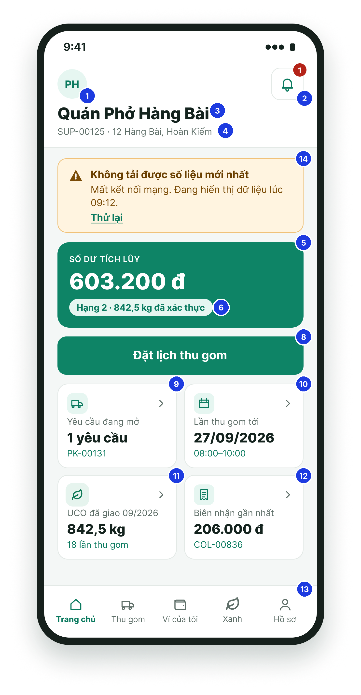

# Screen Spec: S-F00-02 Home (Trang chủ)

> Items marked **[TBC]** are not visible in the mockups and must be confirmed against the Function List, Screen List, data dictionary and ui-conventions.md before status changes to Reviewed.

| Field | Value |
|---|---|
| Screen ID | S-F00-02 |
| Screen name | Home (Trang chủ) |
| Actor | Supplier (food business that delivers used cooking oil, UCO) |
| Priority | Must [TBC] |
| Feature | F-00 [TBC: feature name] |
| Activity diagrams | [TBC: AD ID and action names] |
| Mockup images | `img/S-F00-02.png` (default), `img/S-F00-02-numbered.png`, four state images (section 2) |
| Frame width | [TBC: 360px, exported at 3x?] |
| Figma frame | [TBC] |
| Status | Draft |

## 1. Purpose

**Shown when:** the supplier opens the app after signing in, or taps the "Trang chủ" tab. It gives a one-screen summary of the supplier's accumulated balance, membership tier, pending actions and recent collection activity.

**The user leaves this screen when:** they start a collection booking, sign a pending transaction, open one of the four summary cards, open notifications or profile, or switch to another tab.

## 2. Mockup

**Numbered:** each number is the # of the element inventory in section 3. Numbers are fixed across states: an element keeps its number in every state where it appears. Elements 7 and 8 appear only in Default, 19 and 20 only in Error, 21 and 22 only in Success, 23 only in Empty, 24 only in Loading.

| Default, numbered | Loading, numbered |
|---|---|
|  |  |

| Error, numbered | Success, numbered | Empty, numbered |
|---|---|---|
|  |  |  |

| State | Image |
|---|---|
| Default | `img/S-F00-02.png` (pending transaction banner shown, time 9:41) |
| Empty | `img/S-F00-02-empty.png` |
| Loading | `img/S-F00-02-loading.png` |
| Error | `img/S-F00-02-error.png` (network failure, stale data shown) |
| Success | `img/S-F00-02-success.png` (transaction signed, time 9:45) |

All colours, fonts and corners come from the design tokens in [ui-conventions.md](../ui-conventions.md#6-design-tokens) [TBC: verify every colour].

## 3. Element inventory

Field names in the "Content / data source" column are proposed; align them with the data dictionary.

| # | Element | Type | Content / data source | Required | Validation |
|---|---|---|---|---|---|
| 1 | Avatar | Image (initials) | initials of `supplier.name` (example: "PH") | Yes | none |
| 2 | Notification bell | Button with badge | `notification.unread_count`; badge hidden when 0 (example: 1) | Yes | badge shows count only when greater than 0 |
| 3 | Business name | Header | `supplier.name` (example: "Quán Phở Hàng Bài") | Yes | |
| 4 | Supplier code and address | Text | `supplier.code` · `supplier.address` (example: "SUP-00125 · 12 Hàng Bài, Hoàn Kiếm") | Yes | |
| 5 | Balance card | Card | label "SỐ DƯ TÍCH LŨY"; `wallet.balance` (example: "603.200 đ") | Yes | currency format from ui-conventions; "0 đ" when no balance |
| 6 | Tier chip | Chip | "Hạng " + `member.tier` + " · " + `member.verified_kg` + " kg đã xác thực" (example: "Hạng 2 · 58 kg đã xác thực") | Yes | weight with decimal comma |
| 7 | Pending transaction banner | Banner (amber, clock icon) | "1 giao dịch chờ bạn ký"; `transaction.code`, `transaction.weight_kg`, `transaction.amount` (example: "COL-00891 · 32,5 kg · 334.750 đ") | No | shown only when at least one transaction awaits the supplier's signature |
| 8 | Sign transaction link | Link | label "Ký giao dịch" | Yes (inside 7) | none |
| 9 | Schedule collection | Primary button | label "Đặt lịch thu gom" | Yes | none; not tappable while loading |
| 10 | Open requests card | Card (tappable) | label "Yêu cầu đang mở"; `request.open_count` + " yêu cầu"; `request.code` (example: "1 yêu cầu", "PK-00131") | No | hidden in Empty state |
| 11 | Next collection card | Card (tappable) | label "Lần thu gom tới"; `collection.next_date`, `collection.next_time_from`–`next_time_to` (example: "27/09/2026", "08:00–10:00") | No | date dd/MM/yyyy; time 24h range with en dash |
| 12 | UCO delivered card | Card (tappable) | label "UCO đã giao (" + MM/yyyy + ")"; `uco.delivered_kg_month`; `uco.collection_count_month` (example: "58,0 kg", "3 lần thu gom") | No | weight with one decimal and decimal comma |
| 13 | Latest receipt card | Card (tappable) | label "Biên nhận gần nhất"; `receipt.amount`; `receipt.code` (example: "206.000 đ", "COL-00836") | No | currency format from ui-conventions |
| 14 | Tab: Trang chủ | Tab | static; active on this screen | Yes | none |
| 15 | Tab: Thu gom | Tab | static | Yes | none |
| 16 | Tab: Ví của tôi | Tab | static | Yes | none |
| 17 | Tab: Xanh | Tab | static | Yes | none |
| 18 | Tab: Hồ sơ | Tab | static | Yes | none |
| 19 | Load error banner | Banner (amber, warning icon) | title "Không tải được số liệu mới nhất"; body "Mất kết nối mạng. Đang hiển thị dữ liệu lúc " + `cache.loaded_at` (example: "09:12") | No | Error state only |
| 20 | Retry link | Link | label "Thử lại" | Yes (inside 19) | none |
| 21 | Signed confirmation banner | Banner (green, check icon) | "Đã ký giao dịch " + `transaction.code`; "+" + `transaction.amount` + " đã được cộng vào số dư tích lũy." | No | Success state only |
| 22 | View receipt link | Link | label "Xem biên nhận" | Yes (inside 21) | none |
| 23 | Empty state card | Card | icon; title "Bạn chưa có lần thu gom nào"; text "Đặt lịch thu gom đầu tiên để bắt đầu tích lũy. Số dư và hạng thành viên tăng sau mỗi lần thu gom bạn ký xác nhận." | No | Empty state only |
| 24 | Loading text | Text | static: "Đang tải trang chủ..." | No | Loading state only |

## 4. States

| State | What the user sees | Trigger |
|---|---|---|
| Default | Header (1 to 4), balance card (5, 6), pending transaction banner (7, 8), Schedule collection button (9), four summary cards (10 to 13), tab bar (14 to 18). Bell shows badge "1". | Screen opened, data loaded, at least one transaction awaits signature |
| Empty (no data) | Header; balance "0 đ" with "Hạng 1 · 0 kg đã xác thực" (5, 6); button 9; empty state card (23) replaces banner and cards 10 to 13; no bell badge | The supplier has no collection yet |
| Loading | Header and tab bar stay visible. Grey placeholders replace the balance card (5), the button area (9) and the four cards (10 to 13); text "Đang tải trang chủ..." (24). No banners, no bell badge | Screen is opened or retry is tapped and data is being fetched |
| Error | Amber banner (19) with link "Thử lại" (20) above the balance card. Last loaded data stays visible (balance 603.200 đ, tier, button 9, cards 10 to 13) | Network failure while loading; message shows the time of the data on screen |
| Success / confirmation | Green banner (21) "Đã ký giao dịch COL-00891" with link "Xem biên nhận" (22) replaces the pending banner. Balance, tier, UCO delivered and latest receipt are updated (937.950 đ, "Hạng 2 · 90,5 kg đã xác thực", 90,5 kg and 4 lần thu gom, 334.750 đ and COL-00891). Bell badge is gone | The supplier signs the pending transaction and returns to Home |

## 5. Interactions and navigation

Target screen IDs are not visible in the mockups. Fill them from the Screen List.

| # | Element | User action | System response | Goes to screen |
|---|---|---|---|---|
| 1 | Avatar (1) | tap | Opens the profile [TBC] | [TBC] |
| 2 | Notification bell (2) | tap | Opens the notification list | [TBC: Notifications] |
| 3 | Ký giao dịch (8) | tap | Opens the signing flow for the pending transaction | [TBC: Sign transaction] |
| 4 | Đặt lịch thu gom (9) | tap | Starts a collection booking | [TBC: Schedule collection] |
| 5 | Open requests card (10) | tap | Opens the open request (PK-00131) | [TBC: Request detail] |
| 6 | Next collection card (11) | tap | Opens the upcoming collection | [TBC: Collection detail] |
| 7 | UCO delivered card (12) | tap | Opens the delivered UCO summary for the month | [TBC] |
| 8 | Latest receipt card (13) | tap | Opens the receipt (COL-00836) | [TBC: Receipt detail] |
| 9 | Tab Trang chủ (14) | tap | Nothing; already active | stays |
| 10 | Tab Thu gom (15) | tap | Switches tab | [TBC] |
| 11 | Tab Ví của tôi (16) | tap | Switches tab | [TBC] |
| 12 | Tab Xanh (17) | tap | Switches tab | [TBC] |
| 13 | Tab Hồ sơ (18) | tap | Switches tab | [TBC] |
| 14 | Thử lại (20) | tap | Reloads the data and shows the Loading state; on success shows Default or Empty, on failure returns to Error | stays |
| 15 | Xem biên nhận (22) | tap | Opens the receipt of the signed transaction (COL-00891) | [TBC: Receipt detail] |
| 16 | Balance card (5), tier chip (6) | tap | Nothing; display only (no chevron) | stays |

## 6. Screen-level rules

| Rule ID | Rule | Source |
|---|---|---|
| SR-001 | Balance and tier are displayed as returned by the server; the screen never calculates them. | [TBC: BR] |
| SR-002 | Balance, verified weight and tier change only after the supplier signs a transaction. | Empty state text; [TBC: BR] |
| SR-003 | When loading fails, the screen keeps showing the last loaded data with its time and a retry link; it never replaces real data with zeros. | Error state |
| SR-004 | The pending banner (7) and the signed banner (21) use the same slot above the balance card; at most one top banner is shown unless open question 2 says otherwise. | Mockups |
| SR-005 | Money is shown as "603.200 đ" (dot as thousands separator), weight as "58,0 kg" (decimal comma), date as dd/MM/yyyy, time as 24h. | ui-conventions [TBC] |
| SR-006 | Banner types differ by icon and text, never by colour alone: clock (pending), warning triangle (error), check mark (success). | ui-conventions §5 [TBC] |
| SR-007 | While loading, the Schedule collection button and the cards are not tappable. | Loading state |

## 7. Linked requirements

| FR ID | What this screen does for it |
|---|---|
| [TBC: FR-00-xx] | Displays the supplier summary: name, code, address, balance and tier |
| [TBC: FR-00-xx] | Shows the pending transaction and links to signing |
| [TBC: FR-00-xx] | Shows the confirmation after signing and links to the receipt |
| [TBC: FR-00-xx] | Provides the entry to schedule a collection and shows open requests and the next collection |
| [TBC: FR-00-xx] | Shows the notification badge and the main navigation |

## 8. Responsive and accessibility notes

- Smallest supported width: [TBC]; the four summary cards stay in a 2-column grid.
- The tab bar is fixed at the bottom; the header is not scrolled away [TBC].
- Banner state is carried by icon plus text, not colour alone (SR-006).
- Body text contrast at least 4.5:1, including brown text on the amber banner and white text on the green card [TBC: verify].
- Bell button needs an accessible label with the unread count, for example "Thông báo, 1 chưa đọc".
- Loading text (24) is announced to screen readers.

## 9. Open questions

| # | Question | Blocking? | Status |
|---|---|---|---|
| 1 | [NEEDS CLARIFICATION: when two or more transactions await signature, does banner 7 show the count and the oldest one, or a list?] | No | Open. Default: show the count and the oldest transaction. |
| 2 | [NEEDS CLARIFICATION: the Error mockup shows no pending banner. Should banner 7 appear from cached data together with banner 19?] | No | Open. Default: show only banner 19 (as in the mockup). |
| 3 | [NEEDS CLARIFICATION: does the signed banner (21) disappear by itself or on the next visit?] | No | Open. Default: until the screen is reopened. |
| 4 | [NEEDS CLARIFICATION: what do cards 10, 11 and 12 show when the supplier has data but no open request, no next collection, or no delivery this month?] | No | Open. Default: card shows "Chưa có". |
| 5 | [NEEDS CLARIFICATION: what does tapping the avatar do?] | No | Open. Default: opens the profile. |
| 6 | [NEEDS CLARIFICATION: what are the rules for tier levels (Hạng 1, Hạng 2) by verified kg?] | No | Open. Default: display only, rule lives in the BR list. |
| 7 | [NEEDS CLARIFICATION: should Home refresh by itself or by pull-to-refresh?] | No | Open. Default: refresh on open and on Thử lại only. |
| 8 | [NEEDS CLARIFICATION: frame width, Screen IDs of targets, FR IDs and AD actions] | Yes | Open. Fill from project documents. |

---

## Completion checklist

- [ ] The mockup is a separate cropped image file, named with the Screen ID, at the frame width (current images include the phone bezel).
- [x] The numbered image exists for every state, and its numbers match the # column of the element inventory.
- [x] Every visible element in the mockup appears in the element inventory.
- [ ] Every colour in the mockup is a design token from ui-conventions.md.
- [x] Every input element has a validation rule or an explicit "none".
- [x] All five states are filled in.
- [ ] Every navigation target is a Screen ID that exists in the Screen List.
- [x] Every element that displays data names the field it displays (proposed names).
- [ ] Every linked FR exists in the Function List, and every action of this screen in the activity diagram is covered by an interaction row.
