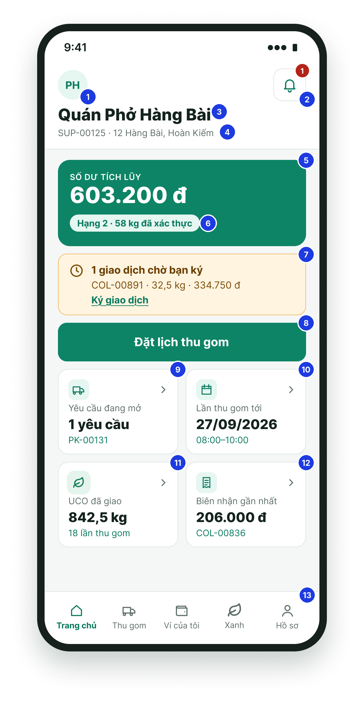
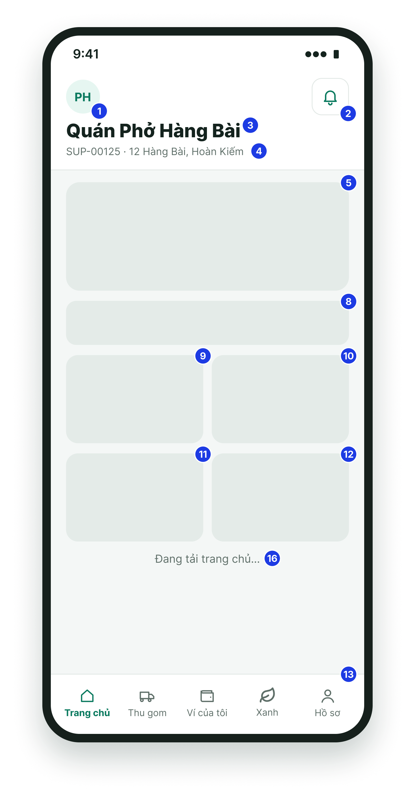

# Screen Spec: S-F00-02 Supplier home

| Field             | Value                                                                                                                                  |
| ----------------- | -------------------------------------------------------------------------------------------------------------------------------------- |
| Screen ID         | S-F00-02                                                                                                                               |
| Screen name       | Supplier main home                                                                                                                          |
| Actor             | Supplier                                                                                                                               |
| Priority          | Must                                                                                                                           |
| Feature           | F-00 Navigation & Home                                                                                                                 |
| Activity diagrams | None: main entry screen after login for Supplier; routes to the pickup request, signing, balance and receipt screens             |
| Mockup images     | `img/S-F00-02-default.png` (default), `img/S-F00-02-default-numbered.png`, four state images and four numbered state images (section 2) |
| Frame width       | [370px screen inside a 390 × 844 device frame, exported at 3x with a 50px shadow margin, 1470 × 2832 pixels]    |
| Figma frame       | Frames "S-F00-02 / 1" to "S-F00-02 / 5", page "4 màn × 5 trạng thái" in the ReFeed Figma file                                                                                   |
| Status            | Draft                                                                                                                                  |

## 1. Purpose

**Shown when:** the supplier logs in successfully, taps the "Trang chủ" tab, or returns to home after signing a transaction.

**The user leaves this screen when:** they tap the notifications icon, tap "Ký giao dịch" on the pending transaction banner, tap "Đặt lịch thu gom" to book a collection, tap "Xem biên nhận" on the success banner, tap one of the four summary cards, or tap another tab of the bottom bar.

## 2. Mockup

**Numbered:** each number is the # of the element inventory in section 3. A number stays the same in every state. Elements 7 and 8 (Pending transaction banner and its link) appear only in the default state when a transaction waits for the supplier's signature; element 19 and 20 (Network error banner and "Thử lại") appear only in the error state; element 21 and 22 (Success banner and "Xem biên nhận") appear only in the success state after signing; element 23 (Empty collection card) appears only in the empty state; element 24 (Loading text) appears only in the loading state. The loading image numbers the header (1 to 4), shows grey skeleton blocks in place of elements 5, 9 and 10 to 13, and numbers the bottom bar (14 to 18).

| Default, numbered | Empty, numbered | Loading, numbered | Error, numbered | Success, numbered |
| --- | --- | --- | --- | --- |
|  |  |  |  |  |

| State   | Image |
| ------- | ----- |
| Default | [`img/S-F00-02-default.png`](img/S-F00-02-default.png) (has a transaction awaiting signature, COL-00891) |
| Empty   | [`img/S-F00-02-empty.png`](img/S-F00-02-empty.png) (new supplier, no collection yet) |
| Loading | [`img/S-F00-02-loading.png`](img/S-F00-02-loading.png) |
| Error   | [`img/S-F00-02-error.png`](img/S-F00-02-error.png) (network lost, showing cached data from 09:12) |
| Success | [`img/S-F00-02-success.png`](img/S-F00-02-success.png) (just signed COL-00891, balance updated) |

All colours, fonts and corners come from the design tokens in [ui-conventions.md](../ui-conventions.md#6-design-tokens) [TBC: verify after ui-conventions is finalised].

## 3. Element inventory

Data field names are proposed; align them with the data dictionary.

| #  | Element                       | Type                   | Content / data source                                                                                                                                                                                                  | Required | Validation                                                  |
| -- | ----------------------------- | ---------------------- | ---------------------------------------------------------------------------------------------------------------------------------------------------------------------------------------------------------------------- | -------- | ----------------------------------------------------------- |
| 1  | Supplier avatar               | Badge                  | initials of `supplier.business_name` (example: "PH")                                                                                                                                                                   | Yes      | 2 letters                                                   |
| 2  | Notifications                 | Icon button            | static bell icon; red count `notification.unread_count` on the top-right corner only when greater than 0 (example: 1)                                                                                                  | Yes      | none                                                        |
| 3  | Business name                 | Header                 | `supplier.business_name` (example: "Quán Phở Hàng Bài")                                                                                                                                                                | Yes      |                                                             |
| 4  | Context line                  | Text                   | `supplier.id` · `supplier.address` (example: "SUP-00125 · 12 Hàng Bài, Hoàn Kiếm")                                                                                                                                     | Yes      | `SUP-` + 5 digits                                           |
| 5  | Balance card                  | Metric card (primary)  | Label: "SỐ DƯ TÍCH LŨY"; Value: `wallet.balance` (example: "603.200 đ")                                                                                                                                                | Yes      | integer >= 0; `.` as thousands separator + " đ"             |
| 6  | Tier pill                     | Pill                   | "Hạng " + `loyalty.tier` + " · " + `loyalty.verified_weight` + " kg đã xác thực" (example: "Hạng 2 · 58 kg đã xác thực")                                                                                              | Yes      | tier is a whole number; weight shown as in the mockup       |
| 7  | Pending transaction banner    | Warning banner         | Title: `pending.count` + " giao dịch chờ bạn ký"; Body: `collection.id` + " · " + `collection.actual_quantity` + " kg · " + `collection.amount` + " đ"                                                                 | No       | shown while at least one transaction awaits the signature   |
| 8  | Ký giao dịch                  | Link (inside banner 7) | static label                                                                                                                                                                                                           | Yes      | none                                                        |
| 9  | Đặt lịch thu gom              | Primary button         | static label                                                                                                                                                                                                           | Yes      | none; not tappable while loading                           |
| 10 | Open requests card            | Summary card           | icon + label "Yêu cầu đang mở"; Value: `pickup_request.open_count` + " yêu cầu"; Subtext: `pickup_request.id` (example: "1 yêu cầu", "PK-00131"); chevron                                                             | No       | integer >= 0; hidden in the empty state                     |
| 11 | Next collection card          | Summary card           | icon + label "Lần thu gom tới"; Value: `next_collection.date`; Subtext: `next_collection.time_from` + "–" + `next_collection.time_to` (example: "27/09/2026", "08:00–10:00"); chevron                                   | No       | `dd/MM/yyyy`; `HH:mm`; hidden in the empty state            |
| 12 | UCO delivered card            | Summary card           | icon + label "UCO đã giao (" + `MM/yyyy` + ")"; Value: `uco.delivered_weight_month` + " kg"; Subtext: `uco.collection_count_month` + " lần thu gom" (example: "58,0 kg", "3 lần thu gom"); chevron                     | No       | 1 decimal + " kg"; integer count; hidden in the empty state |
| 13 | Latest receipt card           | Summary card           | icon + label "Biên nhận gần nhất"; Value: `receipt.amount` + " đ"; Subtext: `collection.id` (example: "206.000 đ", "COL-00836"); chevron                                                                                | No       | `COL-` + 5 digits; hidden in the empty state                |
| 14 | Tab "Trang chủ"               | Tab                    | static; active (bold, green) on this screen                                                                                                                                                                            | Yes      | none                                                        |
| 15 | Tab "Thu gom"                 | Tab                    | static                                                                                                                                                                                                                 | Yes      | none                                                        |
| 16 | Tab "Ví của tôi"              | Tab                    | static                                                                                                                                                                                                                 | Yes      | none                                                        |
| 17 | Tab "Xanh"                    | Tab                    | static                                                                                                                                                                                                                 | Yes      | none                                                        |
| 18 | Tab "Hồ sơ"                   | Tab                    | static                                                                                                                                                                                                                 | Yes      | none                                                        |
| 19 | Network error banner          | Warning banner         | Title: "Không tải được số liệu mới nhất"; Body: "Mất kết nối mạng. Đang hiển thị dữ liệu lúc " + `cache.last_synced_at` + "."                                                                                          | No       | shown when the API fetch fails; time as `HH:mm`             |
| 20 | Thử lại                       | Link (inside banner 19)| static label                                                                                                                                                                                                           | Yes      | none                                                        |
| 21 | Success banner                | Success banner         | Check icon + Title: "Đã ký giao dịch " + `collection.id`; Body: "+" + `collection.amount` + " đ đã được cộng vào số dư tích lũy."                                                                                      | No       | shown immediately after the supplier signs a transaction    |
| 22 | Xem biên nhận                 | Link (inside banner 21)| static label                                                                                                                                                                                                           | Yes      | none                                                        |
| 23 | Empty collection card         | Empty state card       | Truck icon + Title: "Bạn chưa có lần thu gom nào"; Description: "Đặt lịch thu gom đầu tiên để bắt đầu tích lũy. Số dư và hạng thành viên tăng sau mỗi lần thu gom bạn ký xác nhận."                                    | No       | shown only when the supplier has no collection yet          |
| 24 | Loading text                  | Text                   | static: "Đang tải trang chủ..."                                                                                                                                                                                        | No       | shown only in the loading state                             |

## 4. States

| State                  | What the user sees                                                                                                                                                                                                                                                                                                                                                                                                                                                                                | Trigger                                                                                       |
| ---------------------- | ------------------------------------------------------------------------------------------------------------------------------------------------------------------------------------------------------------------------------------------------------------------------------------------------------------------------------------------------------------------------------------------------------------------------------------------------------------------------------------------------- | --------------------------------------------------------------------------------------------- |
| Default                | Header "PH", "Quán Phở Hàng Bài", "SUP-00125 · 12 Hàng Bài, Hoàn Kiếm", bell with red count "1"; green balance card "SỐ DƯ TÍCH LŨY 603.200 đ" with pill "Hạng 2 · 58 kg đã xác thực"; amber banner "1 giao dịch chờ bạn ký — COL-00891 · 32,5 kg · 334.750 đ" with link "Ký giao dịch"; button "Đặt lịch thu gom"; four cards ("1 yêu cầu · PK-00131", "27/09/2026 · 08:00–10:00", "58,0 kg · 3 lần thu gom", "206.000 đ · COL-00836"); bottom bar with "Trang chủ" active. | Screen opened with data and at least one transaction awaiting the supplier's signature        |
| Empty (no data)        | Header without bell count; balance card "0 đ" with pill "Hạng 1 · 0 kg đã xác thực"; button "Đặt lịch thu gom"; below it a white card with truck icon "Bạn chưa có lần thu gom nào — Đặt lịch thu gom đầu tiên để bắt đầu tích lũy. Số dư và hạng thành viên tăng sau mỗi lần thu gom bạn ký xác nhận." in place of the banner and the four cards; bottom bar stays.                                                                                                                                | The supplier has no collection yet                                                            |
| Loading                | Header (avatar, name, context line, bell without count) and bottom bar visible; the balance card, the button area and the four cards are replaced by grey rounded blocks; centered text "Đang tải trang chủ..." below them. No banner.                                                                                                                                                                                                                                                              | Initial screen load, or "Thử lại" tapped, while fetching the home data                        |
| Error                  | Amber banner at the top: "Không tải được số liệu mới nhất — Mất kết nối mạng. Đang hiển thị dữ liệu lúc 09:12." with link "Thử lại"; balance card, button "Đặt lịch thu gom" and the four cards stay visible and show the last cached snapshot (603.200 đ, Hạng 2 · 58 kg); bell keeps count "1". The pending transaction banner is not shown (see open question 2).                                                                                                                          | Network connection lost or API timeout when fetching the home data                            |
| Success / confirmation | Green banner at the top with check icon: "Đã ký giao dịch COL-00891 — +334.750 đ đã được cộng vào số dư tích lũy." with link "Xem biên nhận"; the balance becomes "937.950 đ" with pill "Hạng 2 · 90,5 kg đã xác thực"; "UCO đã giao (09/2026)" becomes "90,5 kg · 4 lần thu gom"; "Biên nhận gần nhất" becomes "334.750 đ · COL-00891"; the bell count is gone. Time on the status bar 9:45.                                                                                              | Returned to home immediately after the supplier signed the transaction                        |

## 5. Interactions and navigation

Target Screen IDs other than S-F00-04 are still to be taken from the Screen List.

| #  | Element                           | User action | System response                                                              | Goes to screen                                          |
| -- | --------------------------------- | ----------- | ---------------------------------------------------------------------------- | ------------------------------------------------------- |
| 1  | Notifications (bell icon, 2)      | tap         | Opens the notifications list for the supplier                                | S-F00-04 (Notifications)                                |
| 2  | Ký giao dịch (8)                  | tap         | Opens the signing screen for the pending transaction `COL-00891`             | [TBC: Sign transaction]                                 |
| 3  | Đặt lịch thu gom (9)              | tap         | Opens the pickup request form                                                | [TBC: Create pickup request]                            |
| 4  | Open requests card (10)           | tap         | Opens the open pickup request(s)                                             | [TBC: My requests]                                      |
| 5  | Next collection card (11)         | tap         | Opens the upcoming collection                                                | [TBC: Request / collection detail]                      |
| 6  | UCO delivered card (12)           | tap         | Opens the UCO delivered summary for the month                                | [TBC]                                                   |
| 7  | Latest receipt card (13)          | tap         | Opens the receipt `COL-00836`                                                | [TBC: Receipt detail]                                   |
| 8  | Tab "Trang chủ" (14)              | tap         | Nothing; already active                                                      | stays                                                   |
| 9  | Tabs "Thu gom", "Ví của tôi", "Xanh", "Hồ sơ" (15 to 18) | tap | Switches to the selected area                                    | [TBC]                                                   |
| 10 | Thử lại (20)                      | tap         | Re-fetches the home data                                                     | stays (loading, then default/empty or error state)      |
| 11 | Xem biên nhận (22)                | tap         | Opens the receipt of the signed transaction `COL-00891`                      | [TBC: Receipt detail]                                   |
| 12 | Avatar (1), balance card (5), tier pill (6) | tap | Nothing; display only [TBC for the avatar]                           | stays                                                   |

## 6. Screen-level rules

| Rule ID | Rule                                                                                                                                                                                                      | Source              |
| ------- | --------------------------------------------------------------------------------------------------------------------------------------------------------------------------------------------------------- | ------------------- |
| SR-001  | The supplier only sees balance, tier, requests, collections and receipts that belong to their own `supplier.id`.                                                                                          | [TBC: FR / BR]      |
| SR-002  | Balance, verified weight and tier change only after the supplier signs a transaction; the screen never calculates them itself.                                                                            | [TBC: FR / BR]      |
| SR-003  | The pending transaction banner stays above the balance card until the transaction is signed; after signing, the success banner takes its place.                                                           | [TBC: FR / BR]      |
| SR-004  | Even when the supplier has no collection (Empty state), "Đặt lịch thu gom" stays active so the first booking can be made from home.                                                                       | [TBC: FR / BR]      |
| SR-005  | If fetching fresh data fails, the app falls back to the last locally cached data and shows the exact sync time (`HH:mm`) in the error banner; it never replaces real figures with zeros.                   | Offline resilience convention |
| SR-006  | While loading, the button "Đặt lịch thu gom" and the four cards are replaced by placeholders and cannot be tapped.                                                                                        | Loading state       |
| SR-007  | All status banners (warning, error, success) use an icon + bold title + descriptive text, never colour alone.                                                                                              | ui-conventions §5   |

## 7. Linked requirements

| FR ID           | What this screen does for it                                                                                                      |
| --------------- | --------------------------------------------------------------------------------------------------------------------------------- |
| [TBC: FR-xx-xx] | Shows the supplier's balance and tier and the latest figures after each signed collection                                         |
| [TBC: FR-xx-xx] | Shows the transaction awaiting signature and gives the entry to the signing screen                                                |
| [TBC: FR-xx-xx] | Gives the entry to book a collection and shows open requests and the next collection                                              |
| [TBC: FR-xx-xx] | Shows the latest receipt and the confirmation after signing, with a link to the receipt                                           |

## 8. Responsive and accessibility notes

- Smallest supported width: 360px [TBC]; the four summary cards stay in a 2-column grid with equal width and a small gap; values and subtexts do not truncate.
- Vertical scroll is enabled when banners are shown above the balance card; the bottom bar stays fixed.
- Touch targets at least 44 × 44 [TBC: verify]: bell button, "Đặt lịch thu gom" button, each summary card and each tab; inline links ("Ký giao dịch", "Thử lại", "Xem biên nhận") need extra vertical padding to reach a 44px hit area.
- Banners use different icons alongside the text: clock (pending), triangle (error), check mark (success); text contrast at least 4.5:1 [TBC: verify].

## 9. Open questions

| # | Question | Blocking? | Status |
| - | -------- | --------- | ------ |
| 1 | [NEEDS CLARIFICATION: When two or more transactions await the supplier's signature, does banner 7 show only the oldest one with "N giao dịch chờ bạn ký", stack several banners, or open a list?] | No | Open. Default: shows the count and the oldest transaction, link goes to that transaction. |
| 2 | [NEEDS CLARIFICATION: The error mockup shows no pending transaction banner. Should banner 7 still appear from cached data together with banner 19?] | No | Open. Default: only banner 19 is shown, as in the mockup. |
| 3 | [NEEDS CLARIFICATION: How long does the green success banner stay before it disappears?] | No | Open. Default: remains until the next screen refresh or navigation action. |
| 4 | [NEEDS CLARIFICATION: What do cards 10 to 13 show when the supplier has collections but no open request, no upcoming collection, or no UCO delivered this month?] | No | Open. Default: the card stays and shows "Chưa có" as its value. |
| 5 | [NEEDS CLARIFICATION: Does the screen support pull-to-refresh like the warehouse home (S-F00-03)?] | No | Open. Default: yes, pull down re-fetches the data and shows the Loading state. |
| 6 | [NEEDS CLARIFICATION: Which screens do the avatar and the tabs "Thu gom", "Ví của tôi", "Xanh", "Hồ sơ" open? The tab label in the mockup ("Ví của tôi") may differ from the name used in other documents.] | No | Open. Default: avatar opens the profile; tabs follow the Screen List. |
| 7 | [NEEDS CLARIFICATION: Why does the bell count "1" disappear in the success state: is the notification marked as read once the transaction is signed?] | No | Open. Default: yes, signing clears the related notification. |

---

## Completion checklist

- [ ] The mockup is a separate cropped image file, named with the Screen ID, at the frame width. (Images need renaming to the `S-F00-02-<state>.png` names above.)
- [x] The numbered image exists, and its numbers match the # column of the element inventory.
- [x] Every visible element in the mockup appears in the element inventory.
- [ ] Every colour in the mockup is a design token from ui-conventions.md.
- [x] Every input element has a validation rule or an explicit "none".
- [x] All five states are filled in.
- [ ] Every navigation target is a Screen ID that exists in the Screen List.
- [x] Every element that displays data names the field it displays (proposed names).
- [ ] Every linked FR exists in the Function List, and every action of this screen in its activity diagram is covered by an interaction row.
