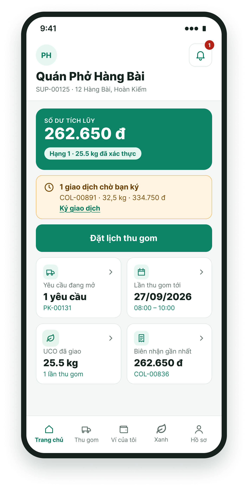
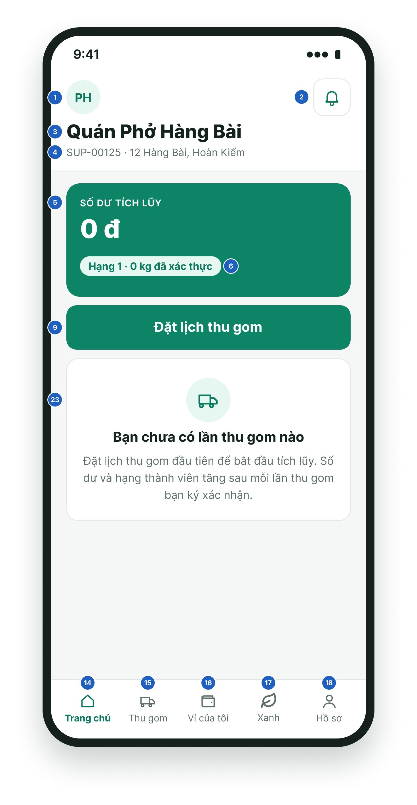
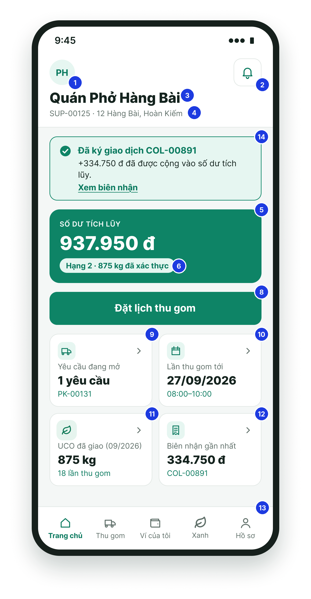

# Screen Spec: S-F00-02 Supplier home

| Field             | Value |
| ----------------- | ----- |
| Screen ID         | S-F00-02 |
| Screen name       | Supplier home |
| Actor             | Supplier |
| Priority          | Must |
| Feature           | F-00 Navigation & Home |
| Activity diagrams | None: main entry screen after login for Supplier; routes to the pickup request, signing, balance and receipt screens |
| Mockup images     | `img/S-F00-02-default.png` (default), `img/S-F00-02-default-numbered.png`, four state images and four numbered state images (section 2) |
| Frame width       | 370px screen inside a 390 × 844 device frame, exported at 3x; state images are 1410 × 2772 pixels, numbered images are 1470 × 2832 pixels (30px transparent padding so that the number badges have room) |
| Figma frame       | Frames "S-F00-02 / 1" to "S-F00-02 / 5", page "Trang chủ NCC & Kho · 5 trạng thái" in the ReFeed Figma file (not re-checked against the images in this version) |
| Status            | Draft |

## 1. Purpose

**Shown when:** the supplier logs in successfully, taps the "Trang chủ" tab, or returns to home after signing a transaction.

**The user leaves this screen when:** they tap the notifications icon, tap "Ký giao dịch" on the pending transaction banner, tap "Đặt lịch thu gom" to book a collection, tap "Xem biên nhận" on the success banner, tap one of the four summary cards, or tap another tab of the bottom bar.

## 2. Mockup

**Numbered:** each number is the # of the element inventory in section 3. An element keeps the same number in every state.

| State | Numbers shown on the image |
| ----- | -------------------------- |
| Default | 1–13 |
| Empty | 1–6, 8, 13, 15 |
| Loading | 1–4, 5, 8, 9–12 (on the skeleton blocks), 13, 16 |
| Error | 1–6, 8–14 |
| Success | 1–6, 8–14 |

In the Loading image, the number on a grey block names the element the block holds the place of; the block shows no data and cannot be tapped. The block for element 5 also covers the tier pill (6). The pending transaction banner (7) has no block.

| Default, numbered | Empty, numbered | Loading, numbered | Error, numbered | Success, numbered |
| --- | --- | --- | --- | --- |
|  |  |  |  |  |

| State   | Image |
| ------- | ----- |
| Default | [`img/S-F00-02-default.png`](img/S-F00-02-default.png) (has a transaction awaiting signature, COL-00891) |
| Empty   | [`img/S-F00-02-empty.png`](img/S-F00-02-empty.png) (new supplier, no collection yet) |
| Loading | [`img/S-F00-02-loading.png`](img/S-F00-02-loading.png) |
| Error   | [`img/S-F00-02-error.png`](img/S-F00-02-error.png) (network lost, showing cached data from 09:12) |
| Success | [`img/S-F00-02-success.png`](img/S-F00-02-success.png) (just signed COL-00891, balance updated) |

Colours, fonts and corners follow the design tokens in [ui-conventions.md](../ui-conventions.md#6-design-tokens). A pixel check of the five state images found shades that are not in the token table (see open question 8).

## 3. Element inventory

Data field names are proposed; align them with the data dictionary.

| #  | Element | Type | Content / data source | Required | Validation |
| -- | ------- | ---- | --------------------- | -------- | ---------- |
| 1  | Supplier avatar | Badge | initials of `supplier.business_name` (example: "PH") | Yes | 2 letters |
| 2  | Notifications | Icon button | static bell icon; red count `notification.unread_count` on the top-right corner only when greater than 0 (example: 1) | Yes | none |
| 3  | Business name | Header | `supplier.business_name` (example: "Quán Phở Hàng Bài") | Yes | |
| 4  | Context line | Text | `supplier.id` · `supplier.address` (example: "SUP-00125 · 12 Hàng Bài, Hoàn Kiếm") | Yes | `SUP-` + 5 digits |
| 5  | Balance card | Metric card (primary) | label "SỐ DƯ TÍCH LŨY"; `wallet.balance` (example: "262.650 đ") | Yes | integer >= 0; `.` as thousands separator + " đ" |
| 6  | Tier pill | Pill | "Hạng " + `loyalty.tier` + " · " + `loyalty.verified_weight` + " kg đã xác thực" (example: "Hạng 1 · 25,5 kg đã xác thực") | Yes | tier is a whole number; weight with 1 decimal and decimal comma (open question 11) |
| 7  | Pending transaction banner | Warning banner | clock icon; title `pending.count` + " giao dịch chờ bạn ký"; body `collection.id` + " · " + `collection.actual_quantity` + " kg · " + `collection.amount` + " đ"; link "Ký giao dịch" | No | shown while at least one transaction awaits the signature |
| 8  | Đặt lịch thu gom | Primary button | static label | Yes | none; not tappable while loading |
| 9  | Open requests card | Summary card | icon + label "Yêu cầu đang mở"; `pickup_request.open_count` + " yêu cầu"; subtext `pickup_request.id` (example: "1 yêu cầu", "PK-00131"); chevron | No | integer >= 0; hidden in the empty state |
| 10 | Next collection card | Summary card | icon + label "Lần thu gom tới"; `next_collection.date`; subtext `next_collection.time_from` + " – " + `next_collection.time_to` (example: "27/09/2026", "08:00 – 10:00"); chevron | No | `dd/MM/yyyy`; `HH:mm`; hidden in the empty state |
| 11 | UCO delivered card | Summary card | icon + label "UCO đã giao"; `uco.delivered_weight` + " kg"; subtext `uco.collection_count` + " lần thu gom" (example: "25,5 kg", "1 lần thu gom"); chevron | No | 1 decimal + " kg"; integer count; hidden in the empty state |
| 12 | Latest receipt card | Summary card | icon + label "Biên nhận gần nhất"; `receipt.amount` + " đ"; subtext `collection.id` (example: "262.650 đ", "COL-00836"); chevron | No | `COL-` + 5 digits; hidden in the empty state |
| 13 | Bottom navigation | Tab bar | tabs "Trang chủ" (active, bold, green), "Thu gom", "Ví của tôi", "Xanh", "Hồ sơ" | Yes | each tab at least 44 × 56 px |
| 14 | Status banner | Warning banner (error) / success banner (success) | error: triangle icon, "Không tải được số liệu mới nhất", "Mất kết nối mạng. Đang hiển thị dữ liệu lúc " + `cache.last_synced_at` + ".", link "Thử lại"; success: check icon, "Đã ký giao dịch " + `collection.id`, "+" + `collection.amount` + " đ đã được cộng vào số dư tích lũy.", link "Xem biên nhận" | No | error: when the fetch fails, time as `HH:mm`; success: right after the supplier signs |
| 15 | Empty collection card | Empty state card | truck icon; "Bạn chưa có lần thu gom nào"; "Đặt lịch thu gom đầu tiên để bắt đầu tích lũy. Số dư và hạng thành viên tăng sau mỗi lần thu gom bạn ký xác nhận." | No | shown only when the supplier has no collection yet |
| 16 | Loading text | Text | static: "Đang tải trang chủ..." | No | shown only in the loading state |

## 4. States

| State | What the user sees | Trigger |
| ----- | ------------------ | ------- |
| Default | Time 9:41. Header "PH", "Quán Phở Hàng Bài", "SUP-00125 · 12 Hàng Bài, Hoàn Kiếm", bell with red count "1"; balance card "262.650 đ" with pill "Hạng 1 · 25.5 kg đã xác thực"; amber banner "1 giao dịch chờ bạn ký", "COL-00891 · 32,5 kg · 334.750 đ", link "Ký giao dịch"; button "Đặt lịch thu gom"; four cards ("1 yêu cầu · PK-00131", "27/09/2026 · 08:00 – 10:00", "25.5 kg · 1 lần thu gom", "262.650 đ · COL-00836"); bottom bar with "Trang chủ" active. | Screen opened with data and at least one transaction awaiting the supplier's signature |
| Empty (no data) | Header without bell count; balance card "0 đ" with pill "Hạng 1 · 0 kg đã xác thực"; button "Đặt lịch thu gom"; white card with truck icon "Bạn chưa có lần thu gom nào" and its explanation in place of the four cards; no banner; bottom bar stays. | The supplier has no collection yet |
| Loading | Header (1–4, bell without count) and bottom bar (13) visible. Six grey skeleton blocks in the loaded layout: one large (balance card 5), one full-width (button 8), four in a 2 × 2 grid (cards 9–12). Below them, centred text "Đang tải trang chủ..." (16). No banner, no figures. | Initial screen load, or "Thử lại" tapped, while fetching the home data |
| Error | Amber banner at the top: triangle icon, "Không tải được số liệu mới nhất", "Mất kết nối mạng. Đang hiển thị dữ liệu lúc 09:12.", link "Thử lại"; balance card "262.650 đ" with pill "Hạng 1 · 25,5 kg đã xác thực", button and four cards ("25,5 kg · 1 lần thu gom", "262.650 đ · COL-00836") show the last cached data; bell keeps count "1". The pending transaction banner is not shown (open question 2). | Network connection lost or API timeout when fetching the home data |
| Success / confirmation | Time 9:45. Green banner at the top: check icon, "Đã ký giao dịch COL-00891", "+334.750 đ đã được cộng vào số dư tích lũy.", link "Xem biên nhận"; balance "597.400 đ" with pill "Hạng 2 · 58 kg đã xác thực"; "UCO đã giao" becomes "58 kg · 2 lần thu gom"; "Biên nhận gần nhất" becomes "334.750 đ · COL-00891"; the bell count and the pending banner are gone. | Returned to home immediately after the supplier signed the transaction |

**Sample data check:** balance 262.650 + 334.750 = 597.400 đ; verified weight 25,5 + 32,5 = 58,0 kg; collections 1 + 1 = 2.

## 5. Interactions and navigation

Target Screen IDs come from the Screen List and the Screen Transition diagram; where their names conflict with the spec files, the spec files are followed (open question 12).

| #  | Element | User action | System response | Goes to screen |
| -- | ------- | ----------- | --------------- | -------------- |
| 1  | Notifications (2) | tap | Opens the notifications for the supplier | [TBC: no Screen ID in the Screen List; see open question 9] |
| 2  | "Ký giao dịch" in banner 7 | tap | Opens the signing screen for the pending transaction `COL-00891` | S-F03-01 |
| 3  | Đặt lịch thu gom (8) | tap | Opens the pickup request form | S-F01-03 |
| 4  | Open requests card (9) | tap | Opens the open pickup request(s) | S-F01-04 |
| 5  | Next collection card (10) | tap | Opens the upcoming collection | S-F01-05 |
| 6  | UCO delivered card (11) | tap | Opens the supplier's Green Profile | S-F05-03 |
| 7  | Latest receipt card (12) | tap | Opens the receipt shown on the card (`COL-00836` before signing, `COL-00891` after) | S-F03-02 |
| 8  | Tab "Trang chủ" (13) | tap | Nothing; already active | stays |
| 9  | Tabs "Thu gom", "Ví của tôi", "Xanh", "Hồ sơ" (13) | tap | Switches to the selected area | "Thu gom" S-F01-03; "Ví của tôi" S-F05-01; "Xanh" S-F05-03; "Hồ sơ" S-F01-06 (Screen List; open question 6) |
| 10 | "Thử lại" in banner 14 (error) | tap | Re-fetches the home data | stays (loading, then default/empty or error state) |
| 11 | "Xem biên nhận" in banner 14 (success) | tap | Opens the receipt of the signed transaction `COL-00891` | S-F03-02 |
| 12 | Avatar (1), balance card (5), tier pill (6) | tap | Display only; the avatar opens the supplier account | stays; avatar: S-F01-06 (open question 12) |

## 6. Screen-level rules

| Rule ID | Rule | Source |
| ------- | ---- | ------ |
| SR-001 | The supplier only sees balance, tier, requests, collections and receipts that belong to their own `supplier.id`. | FR-06-04 |
| SR-002 | Balance, verified weight and tier change only after a transaction is signed; the screen never calculates them itself. | FR-05-03, FR-05-04, FR-05-05 |
| SR-003 | The pending transaction banner (7) stays above the button until the transaction is signed; after signing, the success banner (14) is shown at the top. | Screen design |
| SR-004 | In the Empty state, "Đặt lịch thu gom" stays active so the first booking can be made from home. Profile completeness is checked on submit (S-F01-03). | Screen design; FR-01-09 |
| SR-005 | If fetching fresh data fails, the app shows the last cached data with its sync time (`HH:mm`) in the error banner; it never replaces real figures with zeros. | Offline resilience convention |
| SR-006 | While loading, skeleton blocks keep the layout of the loaded screen, show one line of loading text, and cannot be tapped. | ui-conventions §3 (Skeleton) |
| SR-007 | All status banners (warning, error, success) use an icon + bold title + descriptive text, never colour alone. | ui-conventions §5 |

## 7. Linked requirements

FR IDs and names follow the [W1 Function List](../../function-list/w1-function-list.md).

| FR ID | What this screen does for it |
| ----- | ---------------------------- |
| FR-01-04 | Is the dashboard shown after a new supplier account is created (returning suppliers: see AD-UC-01 open question 2) |
| FR-05-01 | Shows the supplier's loyalty tier and accumulated payout balance (progress to the next tier is shown on S-F05-01, not here) |
| FR-06-04 | Opens only for a role that has the supplier permission |

**Related functions, entry only** (carried out on the target screen): FR-01-11 (pickup form, S-F01-03), FR-01-15 (existing pickup request, S-F01-04 / S-F01-05), FR-03-01 (draft awaiting signature, S-F03-01), FR-03-11 (receipt, S-F03-02), FR-05-07 (Green Profile, S-F05-03). No W1 function was identified that defines the figures on cards 9 to 12 for this screen (open question 10).

## 8. Responsive and accessibility notes

- Designed on a 370 × 824 screen inside a 390 × 844 device frame; smallest supported width 360 px; the four summary cards stay in a 2-column grid with equal width and a small gap; values and subtexts do not truncate.
- Vertical scroll is enabled when banners are shown above the balance card; the bottom bar stays fixed.
- Touch targets at least 44 × 44 (ui-conventions §5): bell button, "Đặt lịch thu gom" button, each summary card and each tab; inline links ("Ký giao dịch", "Thử lại", "Xem biên nhận") need extra vertical padding to reach a 44px hit area.
- Banners use different icons alongside the text: clock (pending), triangle (error), check mark (success); text contrast at least 4.5:1 (ui-conventions §5).

## 9. Open questions

| # | Question | Blocking? | Status |
| - | -------- | --------- | ------ |
| 1 | [NEEDS CLARIFICATION: When two or more transactions await the supplier's signature, does banner 7 show only the oldest one with "N giao dịch chờ bạn ký", stack several banners, or open a list?] | No | Open. Default: shows the count and the oldest transaction, link goes to that transaction. |
| 2 | [NEEDS CLARIFICATION: The error mockup shows no pending transaction banner. Should banner 7 still appear from cached data together with banner 14?] | No | Open. Default: only banner 14 is shown, as in the mockup. |
| 3 | [NEEDS CLARIFICATION: How long does the green success banner stay before it disappears?] | No | Open. Default: remains until the next screen refresh or navigation action. |
| 4 | [NEEDS CLARIFICATION: What do cards 9 to 12 show when the supplier has collections but no open request, no upcoming collection, or no verified UCO volume?] | No | Open. Default: the card stays and shows "Chưa có" as its value. |
| 5 | [NEEDS CLARIFICATION: Does the screen support pull-to-refresh like the warehouse home (S-F00-03)?] | No | Open. Default: yes, pull down re-fetches the data and shows the Loading state. |
| 6 | [NEEDS CLARIFICATION: The tab "Thu gom" opens S-F01-03 in the Screen List and ui-conventions §3, but could also open the request list S-F01-04.] | No | Open. Default: S-F01-03, as in the Screen List. |
| 7 | [NEEDS CLARIFICATION: Why does the bell count "1" disappear in the success state: is the notification marked as read once the transaction is signed?] | No | Open. Default: yes, signing clears the related notification. |
| 8 | [NEEDS CLARIFICATION: Several greys and greens in the mockup images (for example #73817C, #9BA5A1, #AFB7B4) are not in the ui-conventions §6 token table. Should the images use the tokens only?] | No | Open. Default: tokens are the rule; the images are redrawn when the Figma file is updated. |
| 9 | [NEEDS CLARIFICATION: The Screen List has no notifications screen, and the bell has no target. ui-conventions §3 describes a notification for a draft agreement.] | No | Open. Default: the bell opens the transaction awaiting signature (S-F03-01) until a notifications screen is defined. |
| 10 | [NEEDS CLARIFICATION: The Screen List cites UC-01, UC-12 and FR-01-04, FR-05-01, FR-06-04. It does not cover the pending banner or the summary cards. Should W1 or the Screen List be extended?] | No | Open. Default: keep the three FRs; list the others as entry only (section 7). |
| 11 | [NEEDS CLARIFICATION: Weight format differs from ui-conventions §2 (1 decimal, decimal comma): Default shows "25.5 kg" (pill and card 11) while Error shows "25,5 kg"; Empty shows "0 kg" and Success "58 kg".] | No | Open. Default: "25,5 kg", "0,0 kg", "58,0 kg"; fix in Figma and export again. |
| 12 | [NEEDS CLARIFICATION: The Screen List and Screen Transition diagram call S-F05-02 "Green Profile" and S-F05-03 "ESG contribution reports", but the spec files define S-F05-02 as Payout withdrawal, S-F05-03 as Green Profile and S-F05-04 as ESG reports. S-F01-06 is also "Supplier account" in the list and "Supplier profile" in its spec.] | No | Open. Default: follow the spec files (card 11 and tab "Xanh" open S-F05-03); update the Screen List and diagram. |
| 13 | [NEEDS CLARIFICATION: In Success the tier rises from 1 to 2, but the balance grows by exactly 334.750 đ. FR-05-06 awards a tier upgrade bonus. Is it zero, added later, or missing? The BR-05 threshold value was not found in the docs.] | No | Open. Default: the screen shows whatever balance the system returns. |
| 14 | [NEEDS CLARIFICATION: ui-conventions §3 names the third tab "Tích lũy" (the mockups show "Ví của tôi") and asks for the danger style on network error banners (the mockup uses the amber warning style).] | No | Open. Default: keep the mockups; align ui-conventions. |

---

## Completion checklist

- [x] The mockup is a separate cropped image file, named with the Screen ID, at the frame width (`img/S-F00-02-<state>.png`).
- [x] The numbered images exist for all five states, and their numbers match the # column of the element inventory.
- [x] Every visible element in the mockup appears in the element inventory.
- [ ] Every colour in the mockup is a design token from ui-conventions.md.
- [x] Every input element has a validation rule or an explicit "none".
- [x] All five states are filled in.
- [ ] Every navigation target is a Screen ID that exists in the Screen List. (The bell has none: open question 9. Names of S-F05-02 / 03 conflict: open question 12.)
- [x] Every element that displays data names the field it displays (proposed names).
- [x] Every linked FR exists in the Function List; the screen has no activity diagram, so every action is covered by an interaction row in section 5.
