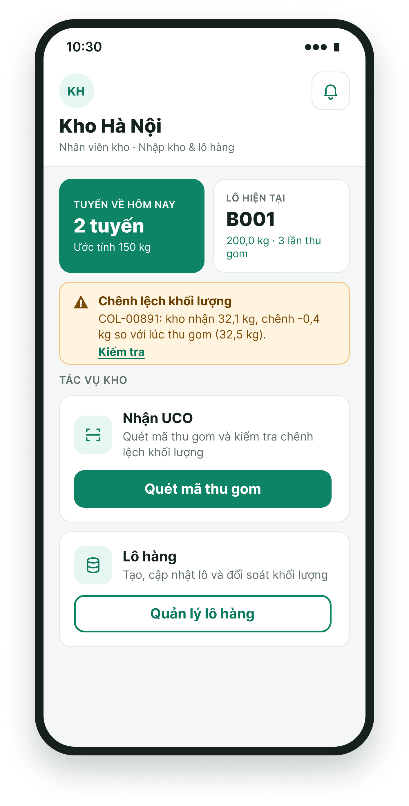
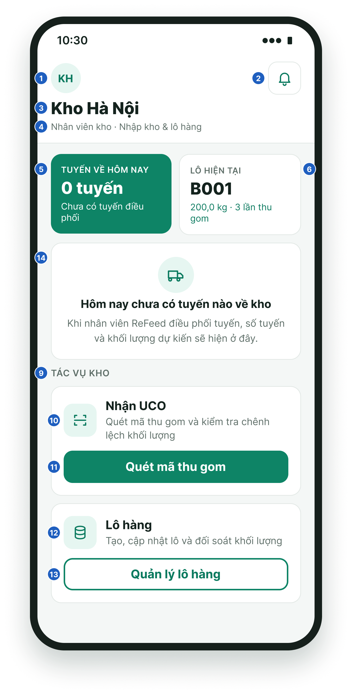

# Screen Spec: S-F00-03 Warehouse home

| Field | Value |
|---|---|
| Screen ID | S-F00-03 |
| Screen name | Warehouse home |
| Actor | Warehouse Staff |
| Priority | Must |
| Feature | F-00 Navigation & Warehouse Home |
| Activity diagrams | AD-UC-04 / AD-UC-05 (entry point to "Receive UCO at warehouse" and "Manage batches & mass balance") |
| Mockup images | `img/S-F00-03-default.png` (default), `img/S-F00-03-default-numbered.png`, four state images and four numbered state images (section 2) |
| Frame width | 390px phone frame (exported at 3x, 1470 × 2832 pixels including the device frame) |
| Figma frame | Frames "S-F00-03 / 1" to "S-F00-03 / 5", page "4 màn × 5 trạng thái" in the ReFeed Figma file |
| Status | Draft |

## 1. Purpose

**Shown when:** the warehouse staff signs in or opens the warehouse workspace to check today's incoming collection routes, active UCO batch status, discrepancy alerts, and core warehouse tasks.

**The user leaves this screen when:** the staff taps "Quét mã thu gom" to open warehouse receiving (`S-F04-01`), taps "Quản lý lô hàng" to open batch and mass-balance management (`S-F04-02`), taps "Kiểm tra" on a discrepancy banner, or opens notifications.

## 2. Mockup



**Numbered:** each number is the # of the element inventory in section 3. Elements 14–21 appear only in their respective states (14–15 in empty, 16 in loading, 17 in error, 18–21 in success), so each is numbered on that state's image. In the empty state the discrepancy alert card (8) is replaced by the no-routes card (14–15) while the task cards (9–13) remain available. In the loading state the summary cards, alert/status card, and task cards are replaced by skeleton placeholders (16). In the success state the alert card (8) is replaced by the receiving confirmation card (18) and the summary cards reflect updated figures.

| Default, numbered | Empty, numbered | Loading, numbered | Error, numbered | Success, numbered |
|---|---|---|---|---|
|  |  |  |  |  |

| State | Image |
|---|---|
| Default | [`img/S-F00-03-default.png`](img/S-F00-03-default.png) |
| Empty | [`img/S-F00-03-empty.png`](img/S-F00-03-empty.png) |
| Loading | [`img/S-F00-03-loading.png`](img/S-F00-03-loading.png) |
| Error | [`img/S-F00-03-error.png`](img/S-F00-03-error.png) (refresh failed because network connection was lost; cached data shown) |
| Success | [`img/S-F00-03-success.png`](img/S-F00-03-success.png) |

All colours, fonts and corners come from the design tokens in
[ui-conventions.md](../ui-conventions.md#6-design-tokens).

## 3. Element inventory

| # | Element | Type | Content / data source | Required | Validation |
|---|---|---|---|---|---|
| 1 | Avatar / role badge | Badge | static: "KH" | Yes | none |
| 2 | Notification bell | Icon button | static bell icon | Yes | opens notifications |
| 3 | Warehouse title | Header | `warehouse.name` (e.g., "Kho Hà Nội") | Yes | |
| 4 | Role & scope subtitle | Text | static: "Nhân viên kho · Nhập kho & lô hàng" | Yes | |
| 5 | Today's incoming routes card | Metric card | label "TUYẾN VỀ HÔM NAY"; count `routes.today_count` + " tuyến"; subtitle `routes.summary_note` (e.g., "Ước tính 150 kg" / "Chưa có tuyến điều phối" / "Còn 1 tuyến chưa về") | Yes | integer `>= 0` |
| 6 | Active batch card | Metric card | label "LÔ HIỆN TẠI"; code `batch.code` (e.g., "B001"); subtitle `batch.current_weight_kg` + " kg · " + `batch.collection_count` + " lần thu gom" | Yes | 1 decimal + " kg" |
| 7 | Tasks section header | Subheader | static: "TÁC VỤ KHO" | Yes | |
| 8 | Weight discrepancy banner | Alert card | warning icon, title "Chênh lệch khối lượng", body `alert.collection_id` + ": kho nhận " + `alert.received_kg` + " kg, chênh " + `alert.diff_kg` + " kg so với lúc thu gom (" + `alert.collected_kg` + " kg).", action link "Kiểm tra" | No | shown when a discrepancy alert is active |
| 9 | Receive UCO card header | Subheader | static: "Nhận UCO" | Yes | |
| 10 | Receive UCO description | Text | static: "Quét mã thu gom và kiểm tra chênh lệch khối lượng" | Yes | |
| 11 | Quét mã thu gom | Primary button | static label | Yes | none |
| 12 | Batch & mass-balance description | Text | static: "Tạo, cập nhật lô và đối soát khối lượng" | Yes | |
| 13 | Quản lý lô hàng | Secondary button | static label | Yes | none |
| 14 | No routes empty card | Card | truck icon, title "Hôm nay chưa có tuyến nào về kho", body "Khi nhân viên ReFeed điều phối tuyến, số tuyến và khối lượng dự kiến sẽ hiện ở đây." | No | shown only when `routes.today_count = 0` |
| 15 | Empty card icon badge | Icon badge | static route/truck icon | No | part of `#14` |
| 16 | Loading placeholder | Skeleton cards & text | top two skeleton metric cards, middle skeleton banner, lower skeleton task cards, and caption "Đang tải việc của kho..." | No | shown only while fetching warehouse data |
| 17 | Stale-data warning banner | Alert banner | warning icon, title "Không tải được số liệu mới nhất", body "Mất kết nối mạng. Đang hiển thị dữ liệu lúc " + `cache.last_synced_at` + ".", action link "Thử lại" | No | shown when refresh fails due to network loss |
| 18 | Receiving success banner | Status card | check icon, title "Đã nhập kho " + `last_receiving.collection_id`, body `last_receiving.received_kg` + " kg · khớp với lúc thu gom. Đã thêm vào lô " + `batch.code` + "." | No | shown immediately after a collection is received |
| 19 | UCO scan icon badge | Icon badge | static QR/scan icon inside "Nhận UCO" card | Yes | |
| 20 | Batch icon badge | Icon badge | static batch/database icon inside "Lô hàng" card | Yes | |
| 21 | Updated routes status line | Text | "Còn " + `routes.remaining_count` + " tuyến chưa về" inside `#5` (Success state) | No | integer `>= 0` |

## 4. States

| State | What the user sees | Trigger |
|---|---|---|
| Default | Header with "KH", bell icon, "Kho Hà Nội", "Nhân viên kho · Nhập kho & lô hàng"; green card "TUYẾN VỀ HÔM NAY" (`2 tuyến`, "Ước tính 150 kg") beside "LÔ HIỆN TẠI" (`B001`, `200,0 kg · 3 lần thu gom`); amber banner "Chênh lệch khối lượng" for `COL-00891` (`kho nhận 32,1 kg, chênh -0,4 kg so với lúc thu gom (32,5 kg)`) with "Kiểm tra"; "TÁC VỤ KHO" with "Nhận UCO" ("Quét mã thu gom") and "Lô hàng" ("Quản lý lô hàng"). The mockup shows this state. | Warehouse home opened with active routes, batch data, and an active discrepancy alert |
| Empty (no data) | Header (`#1`–`#4`); card "TUYẾN VỀ HÔM NAY" (`0 tuyến`, "Chưa có tuyến điều phối") beside "LÔ HIỆN TẠI" (`B001`, `200,0 kg · 3 lần thu gom`); empty card "Hôm nay chưa có tuyến nào về kho" with explanation; "TÁC VỤ KHO" cards ("Nhận UCO" and "Lô hàng") still accessible | No incoming routes are scheduled to the warehouse today (`0 tuyến`) |
| Loading | Header (`#1`–`#4`); grey skeleton placeholders for top metric cards, alert area, and task cards with caption "Đang tải việc của kho..." | Warehouse dashboard metrics and route status are being fetched |
| Error | Header (`#1`–`#4`); amber warning banner "Không tải được số liệu mới nhất — Mất kết nối mạng. Đang hiển thị dữ liệu lúc 10:12." with "Thử lại"; last cached summary cards (`2 tuyến`, `B001`) and task cards ("Nhận UCO" and "Lô hàng") kept | Refreshing latest warehouse figures fails due to network disconnection while cached data exists |
| Success / confirmation | Header (`#1`–`#4`); green confirmation banner "Đã nhập kho COL-00891 — 32,3 kg · khớp với lúc thu gom. Đã thêm vào lô B001."; updated cards ("TUYẾN VỀ HÔM NAY" `2 tuyến`, "Còn 1 tuyến chưa về"; "LÔ HIỆN TẠI" `B001`, `241,0 kg · 4 lần thu gom`); "TÁC VỤ KHO" cards ("Nhận UCO" and "Lô hàng") | Returned to home after successfully receiving and recording a collection (`S-F04-01`) |

## 5. Interactions and navigation

| # | Element | User action | System response | Goes to screen |
|---|---|---|---|---|
| 1 | Quét mã thu gom (`#11`) | tap | Opens warehouse receiving screen to scan QR or enter `Collection_ID` | S-F04-01 |
| 2 | Quản lý lô hàng (`#13`) | tap | Opens active batch and mass-balance management screen | S-F04-02 |
| 3 | Kiểm tra (`#8` action link) | tap | Opens receiving/discrepancy inspection for the flagged collection (`COL-00891`) | S-F04-01 |
| 4 | Thử lại (`#17` action link) | tap | Retries fetching the latest warehouse routes, batch, and alert data | stays (loading, then default or error state) |
| 5 | Notification bell (`#2`) | tap | Opens warehouse notifications and operational alerts | Notifications view |
| 6 | Avatar / role badge (`#1`) | tap | Opens warehouse staff profile and shift/warehouse info | Staff profile / shift info |

## 6. Screen-level rules

| Rule ID | Rule | Source |
|---|---|---|
| SR-001 | Warehouse staff see only routes, batches, and alerts assigned to their own `warehouse.id` (`WH-xx`). | FR-06-03 |
| SR-002 | When refreshing fails due to a network error (`Error` state), previously loaded figures remain displayed with their timestamp (`cache.last_synced_at`) so the staff is not left with a blank screen. | ui-conventions §4 |
| SR-003 | Core warehouse tasks ("Nhận UCO" and "Lô hàng") remain available even when there are no incoming routes scheduled for today (`0 tuyến`). | FR-04-01; FR-04-03 |
| SR-004 | Alerts and statuses ("Chênh lệch khối lượng", "Không tải được số liệu mới nhất", "Đã nhập kho") pair icons with text and never rely on colour alone. | ui-conventions §5 |

## 7. Linked requirements

| FR ID | What this screen does for it |
|---|---|
| FR-04-01 | Provides entry ("Quét mã thu gom") to scan/enter collections, surfaces discrepancy alerts ("Kiểm tra"), and confirms newly received UCO added to the batch |
| FR-04-03 | Displays the current active batch (`B001`), current weight, collection count, and entry ("Quản lý lô hàng") to manage batches and mass balance |
| FR-06-03 | Restricts dashboard data and actions to the signed-in warehouse staff's assigned warehouse |

## 8. Responsive and accessibility notes

- Smallest supported width: 360px; the two top summary cards (`TUYẾN VỀ HÔM NAY` and `LÔ HIỆN TẠI`) sit side-by-side with `tabular-nums` figures so weights and counts align cleanly.
- Designed at 390 × 844; content scrolls vertically with full-width action buttons (`48px`–`52px` touch target height) inside each task card.
- Touch targets at least 44 × 44: notification bell button 44 × 44, inline action links ("Kiểm tra", "Thử lại") spaced with accessible tap targets, primary/secondary task buttons ≥ 48px high.
- Status banners and alerts use semantic icons alongside text labels, never colour alone.
- Body text contrast at least 4.5:1.

## 9. Open questions

| # | Question | Blocking? | Status |
|---|---|---|---|
| 1 | [NEEDS CLARIFICATION: in the mockup footer labels, stage 1 says "Mặc định: có chênh lệch khối lượng", stage 2 says "Rỗng: hôm nay chưa có tuyến về kho", and stage 5 says "Thành công: vừa nhập kho COL-00938" while the card shows `COL-00891`. Align the sample ID (`COL-00891`) across stage 1 and stage 5?] | No | Open. Default: standardize on `COL-00891` as the sample collection ID. |
| 2 | [NEEDS CLARIFICATION: does tapping "Kiểm tra" on the discrepancy banner open `S-F04-01` pre-loaded with `COL-00891` or a dedicated discrepancy review view?] | No | Open. Default: opens `S-F04-01` pre-populated with `COL-00891`. |
| 3 | [NEEDS CLARIFICATION: should "Notifications view" and "Staff profile / shift info" be assigned Screen IDs in the Screen List?] | No | Open. Default: keep as external/secondary nodes until added to the Screen List. |

---

## Completion checklist

- [x] The mockup is a separate cropped image file, named with the Screen ID, at the frame width.
- [x] The numbered images exist, and their numbers match the # column of the element inventory.
- [x] Every visible element in the mockup appears in the element inventory.
- [ ] Every colour in the mockup is a design token from ui-conventions.md.
- [x] Every input element has a validation rule or an explicit "none".
- [x] All five states are filled in.
- [ ] Every navigation target is a Screen ID that exists in the Screen List.
- [x] Every element that displays data names the field it displays.
- [x] Every linked FR exists in the Function List, and every action of this screen in its activity diagram is
      covered by an interaction row.
```[cite: 7, 12, 13]

### Danh sách 6 file ảnh bạn cần đẩy vào thư mục `img/` trên GitHub cho `S-F00-03`:
1. `img/S-F00-03-default.png` *(Stage 1 chưa đánh số)*[cite: 12]
2. `img/S-F00-03-default-numbered.png` *(Stage 1 có số)*[cite: 12]
3. `img/S-F00-03-empty-numbered.png` *(Stage 2 có số)*[cite: 12]
4. `img/S-F00-03-loading-numbered.png` *(Stage 3 có số)*[cite: 12]
5. `img/S-F00-03-error-numbered.png` *(Stage 4 có số)*[cite: 13]
6. `img/S-F00-03-success-numbered.png` *(Stage 5 có số)*[cite: 13]

Bạn còn màn hình nào khác cần làm tiếp không?
