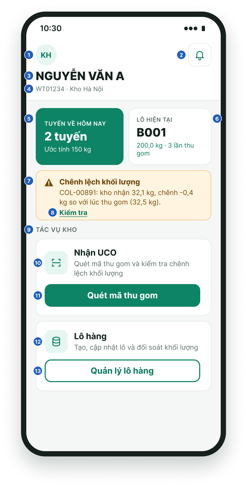
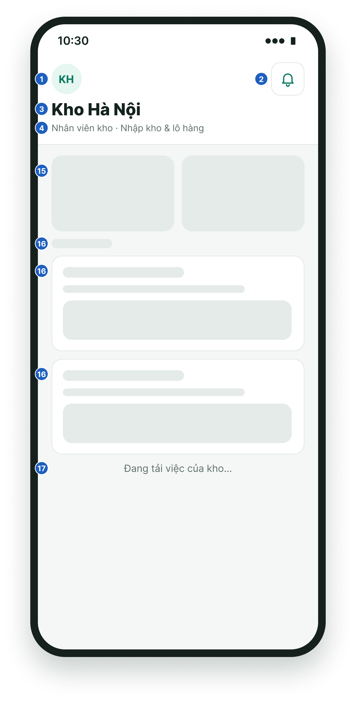
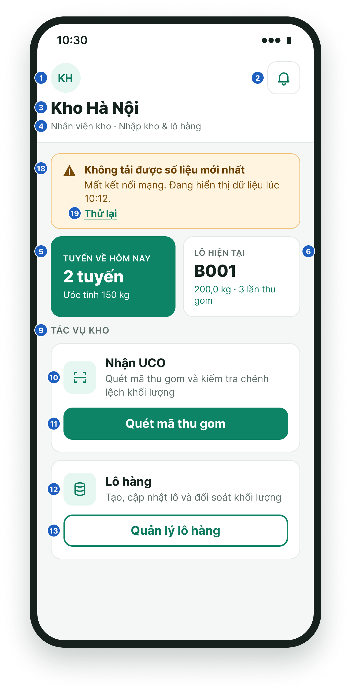
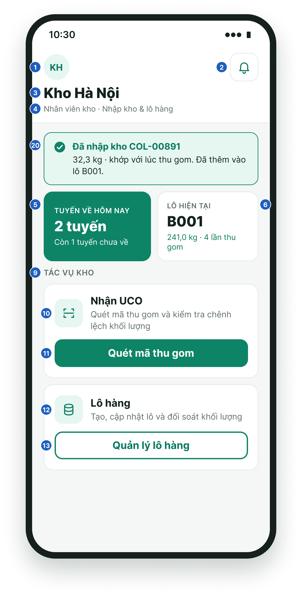

# Screen Spec: S-F00-03 Warehouse home

| Field | Value |
|---|---|
| Screen ID | S-F00-03 |
| Screen name | Warehouse home |
| Actor | Warehouse Staff |
| Priority | Must |
| Feature | F-00 Navigation & Home |
| Activity diagrams | None: main entry screen after login for Warehouse Staff; routes to F-04 (Warehouse receiving & batch management) |
| Mockup images | `img/S-F00-03-default.png` (default), `img/S-F00-03-default-numbered.png`, four state images and four numbered state images (section 2) |
| Frame width | 370px screen inside a 390 × 844 device frame (exported at 3x with a 50px shadow margin, 1470 × 2832 pixels) |
| Figma frame | Frames "S-F00-03 / 1" to "S-F00-03 / 5", page "4 màn × 5 trạng thái" in the ReFeed Figma file |
| Status | Draft |

## 1. Purpose

**Shown when:** the warehouse staff logs in successfully, or returns to home after completing UCO receiving (S-F04-01) or batch management (S-F04-02).

**The user leaves this screen when:** they tap the notifications icon, tap "Kiểm tra" on a weight discrepancy alert, tap "Quét mã thu gom" to receive UCO (S-F04-01), or tap "Quản lý lô hàng" to view/update batches (S-F04-02).

## 2. Mockup

**Numbered:** each number is the # of the element inventory in section 3. Element 5 (Discrepancy alert banner) appears only in the default state when a weight discrepancy exists; element 13 (Empty route card) appears only in the empty state; element 14 (Network error banner) appears only in the error state; element 15 (Success banner) appears only in the success state after receiving a collection. The loading image numbers the header (1–4) and shows grey skeleton placeholders for the summary cards and task cards.

| Default, numbered | Empty, numbered | Loading, numbered | Error, numbered | Success, numbered |
|---|---|---|---|---|
|  |  |  |  |  |

| State | Image |
|---|---|
| Default | [`img/S-F00-03-default.png`](img/S-F00-03-default.png) (has weight discrepancy alert) |
| Empty | [`img/S-F00-03-empty.png`](img/S-F00-03-empty.png) (no routes arriving at warehouse today) |
| Loading | [`img/S-F00-03-loading.png`](img/S-F00-03-loading.png) |
| Error | [`img/S-F00-03-error.png`](img/S-F00-03-error.png) (network lost, showing cached data from 10:12) |
| Success | [`img/S-F00-03-success.png`](img/S-F00-03-success.png) (just received collection COL-00891 / COL-00938) |

All colours, fonts and corners come from the design tokens in
[ui-conventions.md](../ui-conventions.md#6-design-tokens).

## 3. Element inventory

| # | Element | Type | Content / data source | Required | Validation |
|---|---|---|---|---|---|
| 1 | Staff avatar | Badge | static: "KH" | Yes | none |
| 2 | Staff name | Header | `user.full_name` (uppercase) | Yes | |
| 3 | Context line | Text | `warehouse.id` · `warehouse.name` | Yes | `WT` + 5 digits |
| 4 | Notifications | Icon button | static bell icon; unread indicator if applicable | Yes | none |
| 5 | Discrepancy alert banner | Warning banner | Title: "Chênh lệch khối lượng"; Body: `collection.id` + ": kho nhận " + `warehouse_receipt.weight` + ", chênh " + `discrepancy_delta` + " kg so với lúc thu gom (" + `collection.actual_quantity` + ")."; Action link: "Kiểm tra" | No | shown when an unresolved weight discrepancy exists |
| 6 | Inbound routes card | Metric card (primary) | Label: "TUYẾN VỀ HÔM NAY"; Value: `routes_today.count` + " tuyến"; Subtext: "Ước tính " + `routes_today.estimated_weight` + " kg" (or "Chưa có tuyến điều phối" when 0; or "Còn " + `routes_today.remaining` + " tuyến chưa về") | Yes | integer >= 0 |
| 7 | Current batch card | Metric card (secondary) | Label: "LÔ HIỆN TẠI"; Value: `active_batch.id`; Subtext: `active_batch.total_weight` + " kg · " + `active_batch.collection_count` + " lần thu gom" | Yes | `B` + 3 digits; 1 decimal + " kg" |
| 8 | Section title | Subheader | static: "TÁC VỤ KHO" | Yes | |
| 9 | Receive UCO card | Action card | Icon + Title: "Nhận UCO"; Description: "Quét mã thu gom và kiểm tra chênh lệch khối lượng" | Yes | |
| 10 | Quét mã thu gom | Primary button | static label | Yes | none |
| 11 | Batch management card | Action card | Icon + Title: "Lô hàng"; Description: "Tạo, cập nhật lô và đối soát khối lượng" | Yes | |
| 12 | Quản lý lô hàng | Secondary button | static label | Yes | none |
| 13 | Empty route card | Empty state card | Truck icon + Title: "Hôm nay chưa có tuyến nào về kho"; Description: "Khi nhân viên ReFeed điều phối tuyến, số tuyến và khối lượng dự kiến sẽ hiện ở đây." | No | shown only when `routes_today.count == 0` |
| 14 | Network error banner | Warning banner | Title: "Không tải được số liệu mới"; Body: "Mất kết nối mạng. Đang hiển thị dữ liệu lúc " + `cache.last_synced_at` + "."; Action link: "Thử lại" | No | shown when API fetch fails |
| 15 | Success banner | Success banner | Check icon + Title: "Đã nhập kho " + `collection.id`; Body: `warehouse_receipt.weight` + " kg · khớp với lúc thu gom. Đã thêm vào lô " + `active_batch.id` + "." | No | shown immediately after a matching UCO receipt |

## 4. States

| State | What the user sees | Trigger |
|---|---|---|
| Default | Header "KH", "NGUYỄN VĂN A", "WT01234 · Kho Hà Nội", bell icon; "TUYẾN VỀ HÔM NAY" card ("2 tuyến", "Ước tính 150 kg") and "LÔ HIỆN TẠI" card ("B001", "200,0 kg · 3 lần thu gom"); amber warning banner "Chênh lệch khối lượng — COL-00891: kho nhận 32,1 kg, chênh -0,4 kg so với lúc thu gom (32,5 kg)." with link "Kiểm tra"; section "TÁC VỤ KHO" with "Nhận UCO" ("Quét mã thu gom") and "Lô hàng" ("Quản lý lô hàng"). | Screen opened with active inbound routes and at least one unresolved weight discrepancy |
| Empty (no data) | "TUYẾN VỀ HÔM NAY" shows "0 tuyến" and "Chưa có tuyến điều phối"; "LÔ HIỆN TẠI" still shows active batch "B001" ("200,0 kg · 3 lần thu gom"); below the metric cards, a white card with truck icon displays "Hôm nay chưa có tuyến nào về kho — Khi nhân viên ReFeed điều phối tuyến, số tuyến và khối lượng dự kiến sẽ hiện ở đây."; "TÁC VỤ KHO" cards remain enabled below. | No routes are scheduled/dispatched to this warehouse for today (`routes_today.count == 0`) |
| Loading | Header (avatar, name, warehouse ID/name, bell) visible; metric cards replaced by two grey rounded blocks; "TÁC VỤ KHO" header and two action cards replaced by grey skeleton bars; centered text "Đang tải việc của kho..." at the bottom. | Initial screen load or pull-to-refresh while fetching dashboard metrics |
| Error | Amber warning banner at the top: "Không tải được số liệu mới — Mất kết nối mạng. Đang hiển thị dữ liệu lúc 10:12." with link "Thử lại"; metric cards and "TÁC VỤ KHO" remain visible and interactive using the last cached snapshot. | Network connection lost or API timeout when fetching warehouse data |
| Success / confirmation | Green banner at the top with check icon: "Đã nhập kho COL-00891 — 32,3 kg · khớp với lúc thu gom. Đã thêm vào lô B001."; "TUYẾN VỀ HÔM NAY" updates subtext to "Còn 1 tuyến chưa về"; "LÔ HIỆN TẠI" updates weight and count ("241,0 kg · 4 lần thu gom"). | Returned to home immediately after confirming a UCO receipt with no weight discrepancy |

## 5. Interactions and navigation

| # | Element | User action | System response | Goes to screen |
|---|---|---|---|---|
| 1 | Notifications (Bell icon) | tap | Opens the notifications list for warehouse staff | S-F00-04 (Notifications) |
| 2 | Kiểm tra (Discrepancy banner) | tap | Opens the discrepancy inspection/resolution detail for `COL-00891` | S-F04-01 (or Discrepancy detail) |
| 3 | Quét mã thu gom | tap | Opens the QR scanner / UCO receiving flow | S-F04-01 (Receive UCO) |
| 4 | Quản lý lô hàng | tap | Opens the batch management and reconciliation screen | S-F04-02 (Batch management) |
| 5 | Thử lại (Error banner) | tap | Re-fetches warehouse dashboard metrics and alerts | stays (loading, then default/empty or error state) |
| 6 | Screen content | pull down | Triggers manual refresh of dashboard data | stays (loading, then updated state) |

## 6. Screen-level rules

| Rule ID | Rule | Source |
|---|---|---|
| SR-001 | Warehouse staff only view inbound routes, discrepancies, and batches belonging to their assigned `warehouse.id`. | FR-06-03 |
| SR-002 | Even when inbound routes today = 0 (Empty state), the current active batch (`LÔ HIỆN TẠI`) and both task buttons ("Quét mã thu gom", "Quản lý lô hàng") remain active so staff can process unscheduled walk-ins or manage existing batches. | FR-04-01, FR-04-02 |
| SR-003 | If fetching fresh data fails, the app falls back to the last locally cached data and displays the exact sync timestamp (`HH:mm`) in the error banner. | Offline resilience convention |
| SR-004 | Weight discrepancy alerts remain pinned above "TÁC VỤ KHO" until acknowledged or resolved. | FR-04-01 |
| SR-005 | All status banners (warning, error, success) use an icon + bold title + descriptive text, never colour alone. | ui-conventions §5 |

## 7. Linked requirements

| FR ID | What this screen does for it |
|---|---|
| FR-04-01 | Displays inbound route summary, surfaces weight discrepancy warnings, and provides primary entry to UCO receiving ("Quét mã thu gom") |
| FR-04-02 | Displays the current active batch summary (`B001`, total weight, collection count) and provides entry to batch management ("Quản lý lô hàng") |
| FR-06-03 | Scopes all displayed metrics, alerts, and batches to the signed-in warehouse staff's assigned warehouse |

## 8. Responsive and accessibility notes

- Smallest supported width: 360px; the two top metric cards (`TUYẾN VỀ HÔM NAY` and `LÔ HIỆN TẠI`) share a 2-column grid with equal width and a 12px gap; subtexts wrap cleanly onto 2 lines without truncating numbers.
- Designed on a 370 × 824 screen inside a 390 × 844 device frame; vertical scroll enabled when banners expand.
- Touch targets at least 44 × 44: notification bell button 44 × 44, "Quét mã thu gom" button 48px high, "Quản lý lô hàng" button 48px high, inline links ("Kiểm tra", "Thử lại") have expanded vertical padding for 44px hit area.
- Banners use distinct semantic icons (triangle exclamation for warning/error, circle check for success) alongside high-contrast text (contrast ratio ≥ 4.5:1).

## 9. Open questions

| # | Question | Blocking? | Status |
|---|---|---|---|
| 1 | [NEEDS CLARIFICATION: In mockup S-F00-03 / 5, the banner shows `COL-00891` while the caption below the frame says `vừa nhập kho COL-00938`. Should the spec standardize on `COL-00891` across all states?] | No | Open. Default: standardized on `COL-00891` in the spec to match the screen UI text. |
| 2 | [NEEDS CLARIFICATION: When there are multiple unresolved weight discrepancies, does the banner stack multiple cards, show a carousel, or summarize "Có N chênh lệch khối lượng"?] | No | Open. Default: shows the most recent unresolved discrepancy with a link to inspect. |
| 3 | [NEEDS CLARIFICATION: How long does the green success banner ("Đã nhập kho COL-00891") stay visible on S-F00-03 before auto-dismissing or reverting to default?] | No | Open. Default: remains until the next screen refresh or navigation action. |

---

## Completion checklist

- [x] The mockup is a separate cropped image file, named with the Screen ID, at the frame width.
- [x] The numbered image exists, and its numbers match the # column of the element inventory.
- [x] Every visible element in the mockup appears in the element inventory.
- [ ] Every colour in the mockup is a design token from ui-conventions.md.
- [x] Every input element has a validation rule or an explicit "none".
- [x] All five states are filled in.
- [x] Every navigation target is a Screen ID that exists in the Screen List.
- [x] Every element that displays data names the field it displays.
- [x] Every linked FR exists in the Function List, and every action of this screen in its activity diagram is covered by an interaction row.
