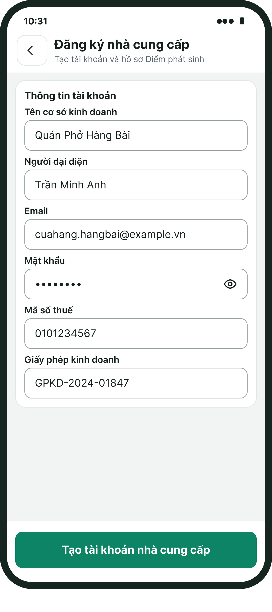
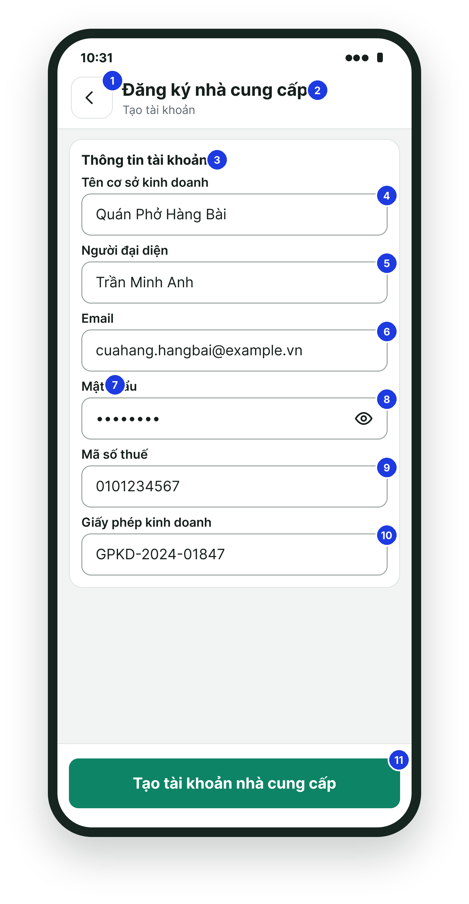
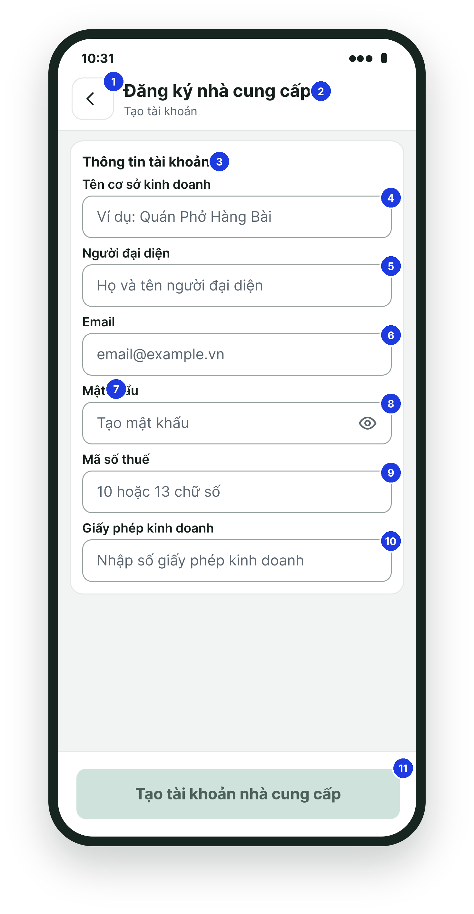
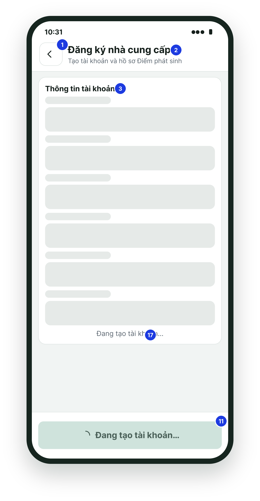
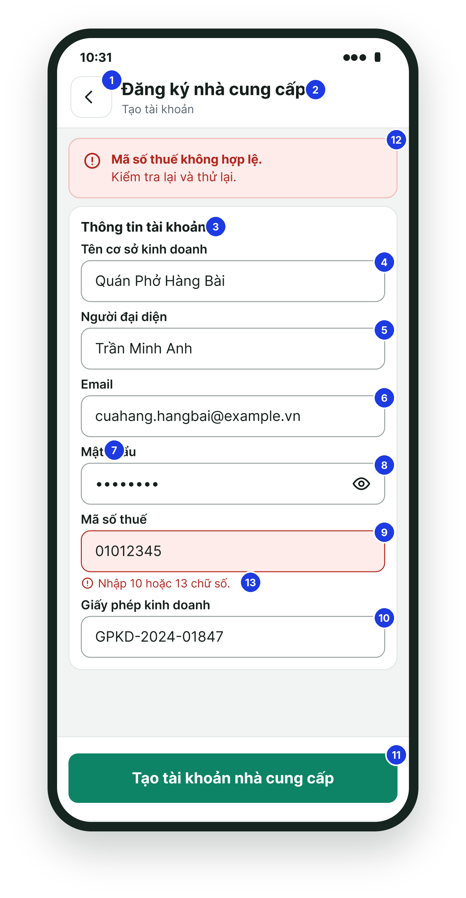
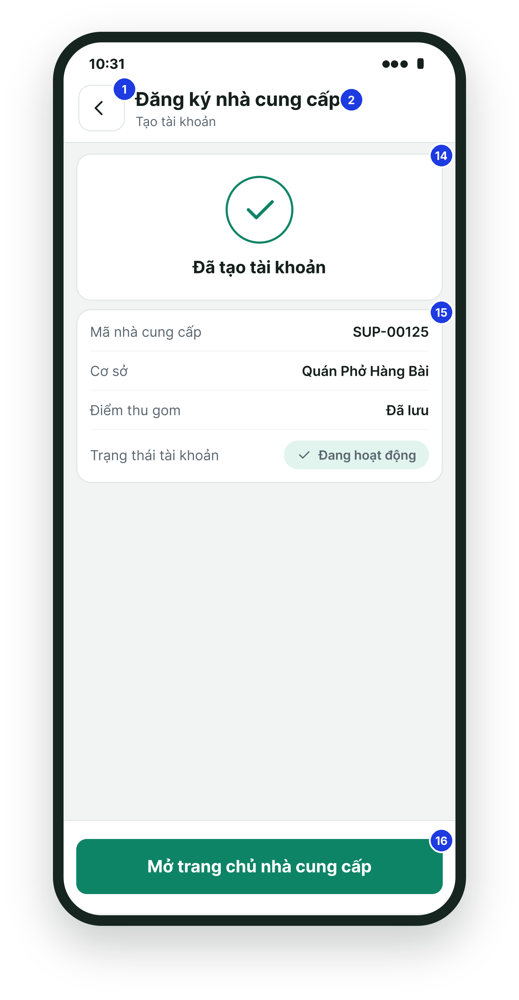

# Screen Spec: S-F01-01 Supplier registration

| Field | Value |
|---|---|
| Screen ID | S-F01-01 |
| Screen name | Supplier registration |
| Actor | Supplier |
| Priority | Must |
| Feature | F-01 Supplier Onboarding & Pickup Management |
| Activity diagrams | AD-UC-01 (action `a1` "Submit credentials or registration data" — registration part, `s1` "Validate Credentials and Compliance Data (FR-01-01)", decision `d1` "Authentication valid?" `[no]` → `s2` "Display Error Message & Prompt Retry (FR-01-05)", decision `d2` "New registration or existing supplier?" `[new registration]` → `s3` "Create Supplier Account with Unique Supplier_ID (FR-01-02)" → `o1` "Supplier Account [Active]" → `s4` "Display Dashboard & Authentication Result (FR-01-04)", and `d2` `[existing supplier]` → `s5` "Display Account Already Exists & Redirect to Login (FR-01-03)") |
| Mockup images | `img/S-F01-01-default.png` (default), `img/S-F01-01-default-numbered.png`, four state images and four numbered state images (section 2) |
| Frame width | 390 × 844 px device frame (minimum supported width 360 px) |
| Figma frame | Figma file "S-F01-01 · Supplier registration" |
| Status | Draft |

## 1. Purpose

**Shown when:** a new supplier taps "Đăng ký tài khoản nhà cung cấp" on `S-F00-01`.

**The user leaves this screen when:** the account is created and the supplier taps "Mở trang chủ nhà cung cấp" (`S-F00-02`, success state), an existing account is detected and redirected to `S-F00-01` (`AD-UC-01` `s5`, `FR-01-03`), or the supplier taps Back.

## 2. Mockup

**Numbered:** each number is the # of the element inventory in section 3. Element 7 is the password field and element 8 its show / hide button. Element 12 (error banner) and element 13 (field error message) appear only in the error state, element 17 (loading text) only in the loading state. In the loading state the fields are replaced by skeleton blocks, so only 1, 2, 3, 11 and 17 are numbered. The success image numbers the header (1, 2) and the success elements 14, 15 and 16.

| Default, numbered | Empty, numbered | Loading, numbered | Error, numbered | Success, numbered |
|---|---|---|---|---|
|  |  |  |  |  |

| State | Image |
|---|---|
| Default | [`img/S-F01-01-default.png`](img/S-F01-01-default.png) |
| Empty | [`img/S-F01-01-empty.png`](img/S-F01-01-empty.png) |
| Loading | [`img/S-F01-01-loading.png`](img/S-F01-01-loading.png) |
| Error | [`img/S-F01-01-error.png`](img/S-F01-01-error.png) (invalid tax ID, `AD-UC-01` `d1` `[no]` → `s2`, `FR-01-05`) |
| Success | [`img/S-F01-01-success.png`](img/S-F01-01-success.png) |

All colours, fonts and corners come from the design tokens in
[ui-conventions.md](../ui-conventions.md#6-design-tokens).

## 3. Element inventory

| # | Element | Type | Content / data source | Required | Validation |
|---|---|---|---|---|---|
| 1 | Back | Button | static | Yes | none |
| 2 | Title and context line | Header | static "Đăng ký nhà cung cấp" + "Tạo tài khoản" | Yes | none |
| 3 | Card title | Header | static "Thông tin tài khoản" | Yes | none |
| 4 | Business name | Text input | `supplier.business_name`; label "Tên cơ sở kinh doanh"; placeholder "Ví dụ: Quán Phở Hàng Bài" | Yes | not empty |
| 5 | Representative | Text input | `supplier.representative_name`; label "Người đại diện"; placeholder "Họ và tên người đại diện" | Yes | not empty |
| 6 | Email | Text input | `account.email`; label "Email"; placeholder "email@example.vn" | Yes | not empty; email format |
| 7 | Password | Password input | `account.password`, shown as dots; label "Mật khẩu"; placeholder "Tạo mật khẩu" | Yes | not empty |
| 8 | Show / hide password | Icon button (eye) | static | No | none |
| 9 | Tax ID | Text input | `supplier.tax_id`; label "Mã số thuế"; placeholder "10 hoặc 13 chữ số" (`BR-01`) | Yes | 10 or 13 digits |
| 10 | Business licence | Text input | `supplier.business_license_no`; label "Giấy phép kinh doanh"; placeholder "Nhập số giấy phép kinh doanh" | Yes | not empty |
| 11 | Tạo tài khoản nhà cung cấp | Primary button | static label; "Đang tạo tài khoản…" with a spinner while creating | Yes | disabled until fields 4–7, 9 and 10 are filled, and while creating |
| 12 | Error banner | Banner | "Mã số thuế không hợp lệ." + "Kiểm tra lại và thử lại." (`AD-UC-01` `s2`, `FR-01-05`) | No | icon + text + colour (ui-conventions §5) |
| 13 | Field error message | Text | "Nhập 10 hoặc 13 chữ số." with an icon, under the field in error (`FR-01-05`) | No | shown only for the field that failed |
| 14 | Success header card | Card | check mark + "Đã tạo tài khoản" (`AD-UC-01` `s4`, `FR-01-04`) | No | none |
| 15 | Account summary card | Card | rows "Mã nhà cung cấp" (`supplier.supplier_id`, e.g. `SUP-00125`, `FR-01-02`), "Cơ sở" (`supplier.business_name`), "Điểm thu gom" ("Đã lưu" = the tax ID and the business licence are saved, `FR-01-08`), "Trạng thái tài khoản" (badge "Đang hoạt động", `supplier_account.status` = `Active`, `AD-UC-01` `o1`) | No | badge text + icon (ui-conventions §3) |
| 16 | Mở trang chủ nhà cung cấp | Primary button | static label (success state only; opens `S-F00-02`) | Yes | none |
| 17 | Loading text | Text | static "Đang tạo tài khoản…" | No | none |

## 4. States

| State | What the user sees | Trigger |
|---|---|---|
| Default | Header "Đăng ký nhà cung cấp" / "Tạo tài khoản" with back button; card "Thông tin tài khoản" with the six fields filled ("Quán Phở Hàng Bài", "Trần Minh Anh", "cuahang.hangbai@example.vn", password as dots with the eye button, "0101234567", "GPKD-2024-01847"); footer button "Tạo tài khoản nhà cung cấp" enabled. The mockup shows this state. | All required fields filled |
| Empty (no data) | Same layout; the six fields show their placeholders; footer button disabled | First open from `S-F00-01` |
| Loading | Card "Thông tin tài khoản" with six label bars and six field bars (skeleton) instead of the fields, and the text "Đang tạo tài khoản…"; footer button "Đang tạo tài khoản…" with a spinner, disabled | The supplier taps "Tạo tài khoản nhà cung cấp" (`a1`) and the credentials and compliance data are being validated (`s1`, `FR-01-01`) |
| Error | Red banner above the card "Mã số thuế không hợp lệ. Kiểm tra lại và thử lại."; the tax ID "01012345" with a red border and light red fill and the message "Nhập 10 hoặc 13 chữ số." with an icon below; the other values kept; footer button enabled | Data rejected (`AD-UC-01` `d1` `[no]` → `s2`, `FR-01-05`) |
| Success / confirmation | Card with a check mark and "Đã tạo tài khoản"; summary card (Mã nhà cung cấp `SUP-00125`, Cơ sở "Quán Phở Hàng Bài", Điểm thu gom "Đã lưu", Trạng thái tài khoản "Đang hoạt động"); footer button "Mở trang chủ nhà cung cấp" | Account created (`AD-UC-01` `d1` `[yes]` → `d2` `[new registration]` → `s3` `FR-01-02` → `o1` `Supplier Account [Active]` → `s4` `FR-01-04`) |

## 5. Interactions and navigation

| # | Element | User action | System response | Goes to screen |
|---|---|---|---|---|
| 1 | Back | tap | Returns to sign in; the entered values are discarded | S-F00-01 |
| 2 | Business name, Representative, Email, Password, Tax ID, Business licence | type | Opens the keyboard; the red border and message of the error state clear when the value changes | stays |
| 3 | Show / hide password | tap | Switches the password between dots and plain text | stays |
| 4 | Tạo tài khoản nhà cung cấp | tap | Disables the form and shows the loading state; validates registration and compliance data (`FR-01-01`, `FR-01-07`, `BR-01`); if new and valid, creates the `Active` account with a unique `Supplier_ID` (`FR-01-02`), stores initial compliance data (`FR-01-08`), and shows the success state (`FR-01-04`); if invalid, shows the error state (`FR-01-05`); if account already exists, notifies and redirects to sign in (`FR-01-03`) | stays (loading, then success or error state; or redirects to `S-F00-01` if existing supplier) |
| 5 | Mở trang chủ nhà cung cấp | tap (success state) | Opens the supplier home with the new account signed in | S-F00-02 |

## 6. Screen-level rules

| Rule ID | Rule | Source |
|---|---|---|
| SR-001 | The tax ID is validated before the account is created: 10 or 13 digits. | `BR-01`; `AD-UC-01` `s1` (`FR-01-01`) |
| SR-002 | The `Supplier_ID` is generated by the system, is unique, and cannot be typed or changed on this screen. | `FR-01-02`; `BR-01`; `AD-UC-01` `s3` |
| SR-003 | A new account is created with status `Active`. | `AD-UC-01` `o1`, §4; `FR-01-02` |
| SR-004 | Invalid data are not saved; the entered values stay on the screen so the supplier can correct and resubmit. | `AD-UC-01` `d1` `[no]` → `s2` (`FR-01-05`) |
| SR-005 | While the account is being created, the fields and the button cannot be changed or tapped again. | `FR-01-01`, `FR-01-02` |
| SR-006 | Pickup location and GPS are not entered here; they are completed on `S-F01-02` (`FR-01-07`, `FR-01-08`) and are required before a pickup can be requested (`FR-01-09`, `FR-01-10` profile-completeness rule). | screen-list.md (`S-F01-02`); `FR-01-09`, `FR-01-10` |
| SR-007 | Errors are shown with text and icon, never by colour alone. | ui-conventions §5 |

## 7. Linked requirements

| FR ID | What this screen does for it |
|---|---|
| `FR-01-01` (`FR-01-01-FE`, `FR-01-01-BE`) | Captures registration and compliance data and validates them before account creation (`AD-UC-01` `s1`) |
| `FR-01-02` (`FR-01-02-BE`) | Creates an `Active` supplier account with a unique `Supplier_ID` when submitted registration data are valid (`AD-UC-01` `s3`) |
| `FR-01-03` (`FR-01-03-FE`) | Handles the existing-supplier branch (`AD-UC-01` `d2` `[existing supplier]` → `s5`) by notifying the supplier and redirecting to `S-F00-01` (see Open Question 2) |
| `FR-01-04` (`FR-01-04-FE`) | Displays the registration success summary and navigates to the supplier home `S-F00-02` (`AD-UC-01` `s4`) |
| `FR-01-05` (`FR-01-05-FE`) | Displays the error banner and field error message and prompts retry without creating an account (`AD-UC-01` `s2`) |
| `FR-01-07` (`FR-01-07-FE`, `FR-01-07-BE`) | Captures and validates initial compliance fields (tax ID, business licence) at registration; Point-of-Origin/GPS fields are completed on `S-F01-02` |
| `FR-01-08` (`FR-01-08-BE`) | Stores the validated initial compliance data against the newly created `Supplier_ID` |

## 8. Responsive and accessibility notes

- Smallest supported width: 360px; the card and the footer button keep their side margins and shrink in width.
- The card scrolls when the keyboard is open; the footer button stays fixed at the bottom.
- Touch targets at least 44 × 44: back button 44 × 44, the inputs at least 44px high, the show / hide button at least 44 × 44, the footer button 52px high.
- Every field has a visible label above it; the placeholders are examples only.
- The password is hidden by default and the eye button switches it.
- Field errors use a red border, a light red fill and an error text with an icon below the field; the banner has an icon and text.
- Body text contrast at least 4.5:1.

## 9. Open questions

| # | Question | Blocking? | Status |
|---|---|---|---|
| 1 | [NEEDS CLARIFICATION: which compliance data must a supplier give at registration — the tax ID only, or also a business licence number? `FR-01-07` / `FR-01-08` do not name the exact documents.] | No | Open. Default: both fields are required, as in the mockup. |
| 2 | [NEEDS CLARIFICATION: `AD-UC-01` `s5` "Display Account Already Exists & Redirect to Login" (`FR-01-03`) has no dedicated mockup state on this screen.] | No | Open. Default: shown as an error/notification banner following ui-conventions §4 before redirecting to `S-F00-01`. |
| 3 | [NEEDS CLARIFICATION: screen-transition.md has no arrow from `S-F01-01` back to `S-F00-01`, and the success state still shows Back.] | No | Open. Default: Back returns to `S-F00-01` in every state; add the arrow to the transition diagram. |

---

## Completion checklist

- [x] The mockup is a separate cropped image file, named with the Screen ID, at the frame width.
- [x] The numbered image exists, and its numbers match the # column of the element inventory.
- [x] Every visible element in the mockup appears in the element inventory.
- [ ] Every colour in the mockup is a design token from ui-conventions.md.
- [x] Every input element has a validation rule or an explicit "none".
- [x] All five states are filled in.
- [x] Every navigation target is a Screen ID that exists in the Screen List (`S-F00-01`, `S-F00-02`).
- [x] Every element that displays data names the field it displays.
- [x] Every linked FR exists in the Function List, and every action of this screen in `AD-UC-01` is covered by an interaction row.
