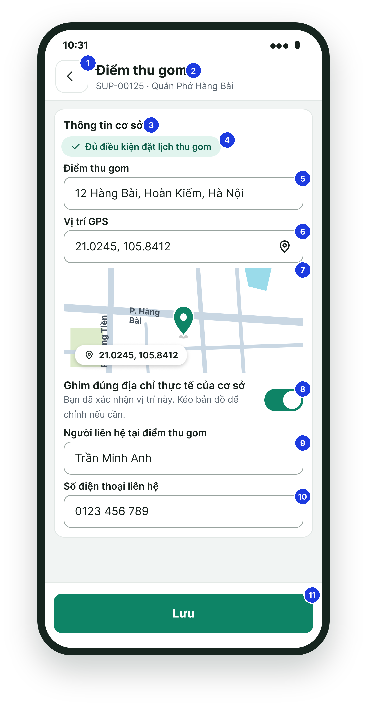
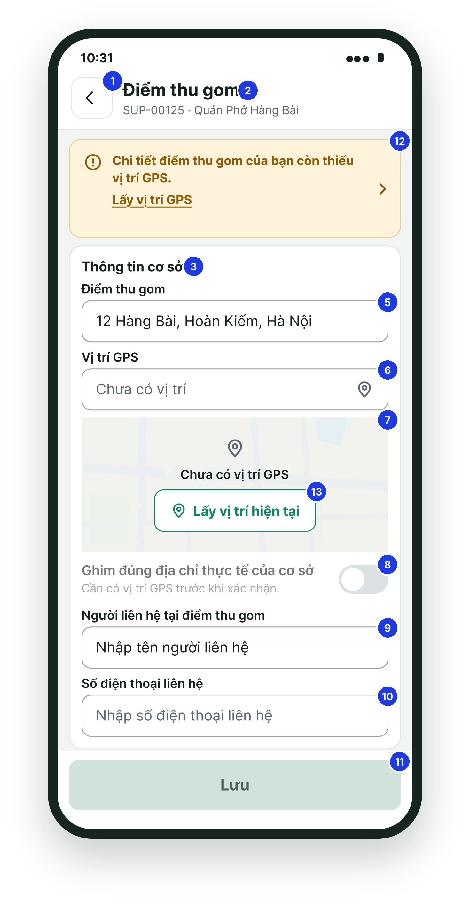
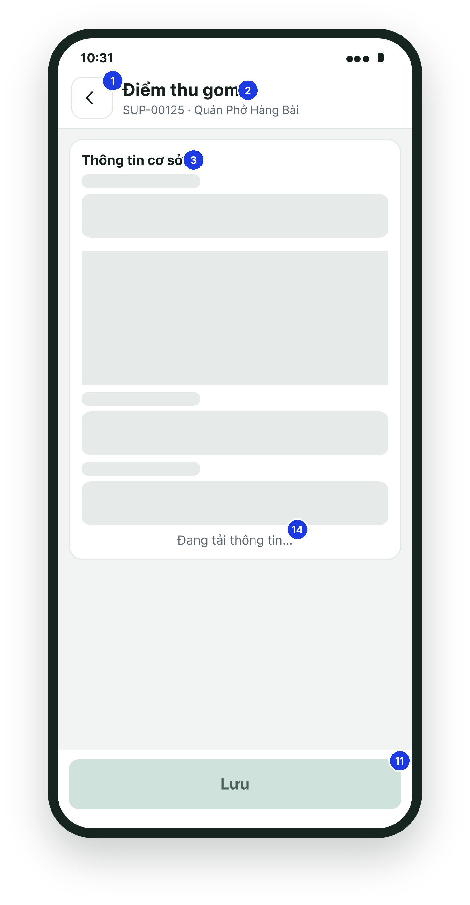
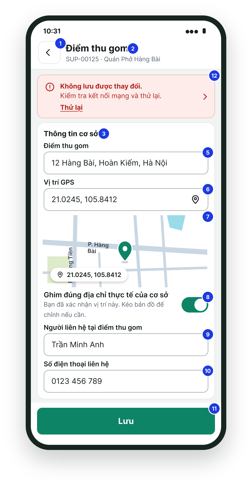

# Screen Spec: S-F01-02 Point-of-Origin and compliance profile

| Field | Value |
|---|---|
| Screen ID | S-F01-02 |
| Screen name | Point-of-Origin and compliance profile |
| Actor | Supplier |
| Priority | Must |
| Feature | F-01 Supplier Onboarding & Pickup Management |
| Activity diagrams | AD-UC-02 (primary screen for `a1` "Enter or update Point-of-Origin and compliance profile (FR-01-07-FE)", `s1` "Validate Point-of-Origin and compliance information (FR-01-07-BE)", decision `d1` "Is profile data valid?", and `s2` "Store Point-of-Origin and compliance profile (FR-01-08-BE)"); cross-references AD-UC-03 (`d1` `[No]` → `s2` `FR-01-10-BE` / `a4` `FR-01-10-FE` prompts the supplier to update the profile here) |
| Mockup images | `img/S-F01-02-default.png` (default), `img/S-F01-02-default-numbered.png`, four state images and four numbered state images (section 2) |
| Frame width | 390 × 844 px device frame (minimum supported width 360 px) |
| Figma frame | Figma file "S-F01-02 · Point-of-Origin and compliance profile" |
| Status | Draft |

## 1. Purpose

**Shown when:** the supplier taps "Thông tin điểm thu gom" or "Bổ sung hồ sơ" on `S-F01-06` (Supplier profile), or taps the profile-incomplete prompt on `S-F01-03` (`AD-UC-03` `a4`, `FR-01-10-FE`).

**The user leaves this screen when:** the supplier taps Back (returning to `S-F01-06`, or to `S-F01-03` / `S-F00-02` depending on entry point), or the profile is saved (`FR-01-08-BE`) and the supplier returns to `S-F01-06` (which displays the post-save confirmation banner).

## 2. Mockup

**Numbered:** each number is the # of the element inventory in section 3. Element 4 (eligibility pill) appears in the default and success states only. Element 12 (banner) appears in the empty state as a warning and in the error state as an error banner. Element 13 ("Lấy vị trí hiện tại") appears only in the empty state, inside the greyed map. Element 14 (loading text) appears only in the loading state and element 15 (toast) only in the success state. In the loading state the fields and the map are replaced by skeleton blocks, so only 1, 2, 3, 11 and 14 are numbered.

| Default, numbered | Empty, numbered | Loading, numbered | Error, numbered | Success, numbered |
|---|---|---|---|---|
|  |  |  |  |  |

| State | Image |
|---|---|
| Default | [`img/S-F01-02-default.png`](img/S-F01-02-default.png) |
| Empty | [`img/S-F01-02-empty.png`](img/S-F01-02-empty.png) (no GPS and no contact yet, `AD-UC-03` `d1` `[No]` / `FR-01-10`) |
| Loading | [`img/S-F01-02-loading.png`](img/S-F01-02-loading.png) |
| Error | [`img/S-F01-02-error.png`](img/S-F01-02-error.png) (validation or network error when saving, `AD-UC-02` `d1` `[Invalid]`) |
| Success | [`img/S-F01-02-success.png`](img/S-F01-02-success.png) |

All colours, fonts and corners come from the design tokens in
[ui-conventions.md](../ui-conventions.md#6-design-tokens).

## 3. Element inventory

| # | Element | Type | Content / data source | Required | Validation |
|---|---|---|---|---|---|
| 1 | Back | Button | static | Yes | none |
| 2 | Title and context line | Header | static "Điểm thu gom" + `supplier.supplier_id` · `supplier.business_name` | Yes | formats from ui-conventions §2 |
| 3 | Card title | Header | static "Thông tin cơ sở" | Yes | none |
| 4 | Eligibility pill | Pill | static "Đủ điều kiện đặt lịch thu gom" with a check icon; shown when the profile holds GPS and compliance data (`FR-01-09`) | No | text + icon (ui-conventions §5) |
| 5 | Pickup point address | Text input | `point_of_origin.address`; label "Điểm thu gom" (`FR-01-07`, `FR-01-08`) | Yes | not empty |
| 6 | GPS | Text input with pin icon | `point_of_origin.gps` (lat, lng, 4 decimals); label "Vị trí GPS"; placeholder "Chưa có vị trí" (`FR-01-07`, `FR-01-08`) | Yes | valid latitude and longitude |
| 7 | Map | Map preview | pin on `point_of_origin.gps`, with the coordinates shown on a chip; without GPS the map is greyed with "Chưa có vị trí GPS" | Yes | illustrative map; the pin is the location that is saved |
| 8 | Confirm-pin switch | Switch | label "Ghim đúng địa chỉ thực tế của cơ sở"; note "Bạn đã xác nhận vị trí này. Kéo bản đồ để chỉnh nếu cần." (on) or "Cần có vị trí GPS trước khi xác nhận." (off); `point_of_origin.location_confirmed` (`FR-01-07`, `FR-01-08`) | Yes | can be turned on only when GPS exists |
| 9 | Contact person | Text input | `point_of_origin.contact_name`; label "Người liên hệ tại điểm thu gom"; placeholder "Nhập tên người liên hệ" (`FR-01-07`, `FR-01-08`) | Yes | not empty |
| 10 | Contact phone | Text input | `point_of_origin.contact_phone`; label "Số điện thoại liên hệ"; placeholder "Nhập số điện thoại liên hệ"; shown as `0123 456 789` (`FR-01-07`, `FR-01-08`) | Yes | valid phone number |
| 11 | Lưu | Primary button | static label (`FR-01-07-FE`) | Yes | disabled while a required field is missing, while loading, and when nothing has changed |
| 12 | Banner | Banner | warning "Chi tiết điểm thu gom của bạn còn thiếu vị trí GPS." + link "Lấy vị trí GPS" (empty state, `FR-01-10`); error "Không lưu được thay đổi. Kiểm tra kết nối mạng và thử lại." + link "Thử lại" (error state) | No | the whole banner is tappable; icon + text + colour (ui-conventions §3, §5) |
| 13 | Lấy vị trí hiện tại | Secondary button (outline) | static, inside the greyed map | No | none |
| 14 | Loading text | Text | static "Đang tải thông tin…" | No | none |
| 15 | Toast | Toast | static "Đã lưu thông tin" with a check icon (`FR-01-08-BE`) | No | disappears after 4 seconds (ui-conventions §3) |

## 4. States

| State | What the user sees | Trigger |
|---|---|---|
| Default | Header "Điểm thu gom" / "SUP-00125 · Quán Phở Hàng Bài" with back button; card "Thông tin cơ sở" with the pill "Đủ điều kiện đặt lịch thu gom", the address "12 Hàng Bài, Hoàn Kiếm, Hà Nội", GPS "21.0245, 105.8412", the map with a green pin and the coordinate chip, the switch on, the contact "Trần Minh Anh" and the phone "0123 456 789"; footer button "Lưu" enabled. The mockup shows this state. | The profile is complete (`FR-01-08`, `FR-01-09`) |
| Empty (no data) | Warning banner "Chi tiết điểm thu gom của bạn còn thiếu vị trí GPS." with "Lấy vị trí GPS"; the address filled, GPS "Chưa có vị trí", the map greyed with "Chưa có vị trí GPS" and the button "Lấy vị trí hiện tại", the switch off and greyed with "Cần có vị trí GPS trước khi xác nhận.", the contact fields showing the placeholders; no pill; footer button disabled | The profile has no GPS (opened from `S-F01-06` "Bổ sung hồ sơ", or from `S-F01-03` after `AD-UC-03` `d1` `[No]` / `FR-01-10`) |
| Loading | Card "Thông tin cơ sở" with skeleton blocks instead of the address field, the map and the two contact fields, and the text "Đang tải thông tin…"; footer button disabled | The profile is being loaded |
| Error | Red banner "Không lưu được thay đổi. Kiểm tra kết nối mạng và thử lại." with "Thử lại"; all entered values kept; footer button enabled | Validation or save request failed (`AD-UC-02` `d1` `[Invalid]` or network error before `FR-01-08-BE` completes) |
| Success / confirmation | The default content with the pill and the switch on, a dark toast "Đã lưu thông tin" above the footer; footer button disabled | Profile validated (`FR-01-07-BE`) and stored against `Supplier_ID` (`FR-01-08-BE`, `AD-UC-02` `s1` → `s2`) |

## 5. Interactions and navigation

| # | Element | User action | System response | Goes to screen |
|---|---|---|---|---|
| 1 | Banner "Lấy vị trí GPS" and button "Lấy vị trí hiện tại" | tap | Asks the device for its current location, fills the GPS field (`FR-01-07-FE`) and moves the pin on the map | stays |
| 2 | Map | drag | Moves the pin and updates the GPS value (`FR-01-07-FE`) | stays |
| 3 | Switch "Ghim đúng địa chỉ thực tế của cơ sở" | tap | Turns the confirmation on or off; not available while there is no GPS (`FR-01-07-FE`) | stays |
| 4 | Address, Contact person, Contact phone | type | Opens the keyboard (`FR-01-07-FE`) | stays |
| 5 | Lưu | tap | Submits Point-of-Origin details (`FR-01-07-FE`), validates the fields (`FR-01-07-BE`, `AD-UC-02` `s1`), and stores the profile against `Supplier_ID` (`FR-01-08-BE`, `AD-UC-02` `s2`), then shows the success toast, or shows the error banner if validation/save fails (`AD-UC-02` `d1` `[Invalid]`) | stays (shows toast; tapping Back returns to `S-F01-06` in Success state) |
| 6 | Banner "Thử lại" (error state) | tap (the whole banner) | Repeats validation and save (`FR-01-07-BE`, `FR-01-08-BE`) | stays |
| 7 | Back | tap | Returns to the previous screen (if unsaved, entered changes are discarded; if saved, `S-F01-06` reflects the updated profile) | `S-F01-06` (or `S-F01-03` / `S-F00-02` depending on entry point) |

## 6. Screen-level rules

| Rule ID | Rule | Source |
|---|---|---|
| SR-001 | A pickup request is accepted only when the profile holds GPS and the compliance data given at registration; the pill is shown when this holds (`FR-01-09`), and the warning banner when GPS is missing (`FR-01-10`). | `FR-01-09`, `FR-01-10`; `AD-UC-03` `d1` |
| SR-002 | The GPS value is set by "Lấy vị trí hiện tại" or by moving the pin, and the saved location is the pin shown on the map. | `FR-01-07`, `FR-01-08`; `AD-UC-02` |
| SR-003 | The location can be confirmed with the switch only when GPS exists. | `FR-01-07`, `FR-01-08`; `AD-UC-02` `s1` |
| SR-004 | If validation or saving fails (`AD-UC-02` `d1` `[Invalid]` or network failure), the entered values stay on the screen without persisting incomplete records so the supplier can correct and retry. | `AD-UC-02` `d1` `[Invalid]`; ui-conventions §4 |
| SR-005 | Banners are tappable as a whole, and statuses and errors are shown with text and icon, never by colour alone. | ui-conventions §3, §5 |

## 7. Linked requirements

| FR ID | What this screen does for it |
|---|---|
| `FR-01-07` (`FR-01-07-FE`, `FR-01-07-BE`) | Lets the supplier view, enter, edit, and validate Point-of-Origin data (address, GPS coordinates, pinned location confirmation, and on-site contact) (`AD-UC-02` `a1`, `s1`) |
| `FR-01-08` (`FR-01-08-BE`) | Stores the validated Point-of-Origin profile against the `Supplier_ID` and confirms saving (`AD-UC-02` `s2`) |
| `FR-01-09`, `FR-01-10` (`UC-03`) | Shows whether the profile satisfies the profile-completeness prerequisite (`"Đủ điều kiện đặt lịch thu gom"` vs missing-GPS warning banner) to request a pickup (`AD-UC-03` `d1`) |

## 8. Responsive and accessibility notes

- Smallest supported width: 360px; the map keeps its height and scales in width.
- The card scrolls when the content is taller than the screen; the footer button stays fixed at the bottom.
- Touch targets at least 44 × 44: back button 44 × 44, the inputs at least 44px high, "Lấy vị trí hiện tại" about 44px high, the footer button 52px high; the switch and its label form one row at least 44px high.
- Every field has a visible label above it; the placeholders are examples only.
- Status and errors use text plus icon; the pill and the banners are never colour alone.
- Body text contrast at least 4.5:1.

## 9. Open questions

| # | Question | Blocking? | Status |
|---|---|---|---|
| 1 | [NEEDS CLARIFICATION: are the contact person and phone required for the profile to count as complete ("Đủ điều kiện đặt lịch thu gom")? `FR-01-09` / `FR-01-10` name only GPS and compliance data.] | No | Open. Default: contact fields are required to save (`FR-01-07`); only GPS blocks a pickup request (`FR-01-09`). |
| 2 | [NEEDS CLARIFICATION: `S-F01-01` no longer collects the address, but the address is already filled in the empty state. Where does it come from the first time?] | No | Open. Default: the supplier types it on this screen; the mockup shows it pre-filled. |
| 3 | [NEEDS CLARIFICATION: the screen name still says "compliance", and `FR-01-07` / `FR-01-08` cover both Point-of-Origin and compliance profile, while tax ID and business licence are captured on `S-F01-01`; this screen holds the pickup point and on-site contact.] | No | Open. Default: name kept as in the Screen List; rename to "Pickup point profile" when the Screen List is next updated. |
| 4 | [NEEDS CLARIFICATION: ui-conventions §1 asks for a verb + object on every button; the mockup says "Lưu".] | No | Open. Default: as in the mockup; suggested label "Lưu thông tin điểm thu gom". |

---

## Completion checklist

- [x] The mockup is a separate cropped image file, named with the Screen ID, at the frame width.
- [x] The numbered image exists, and its numbers match the # column of the element inventory.
- [x] Every visible element in the mockup appears in the element inventory.
- [ ] Every colour in the mockup is a design token from ui-conventions.md.
- [x] Every input element has a validation rule or an explicit "none".
- [x] All five states are filled in.
- [x] Every navigation target is a Screen ID that exists in the Screen List (`S-F01-06`, `S-F01-03`, `S-F00-02`).
- [x] Every element that displays data names the field it displays.
- [x] Every linked FR exists in the Function List (`FR-01-07`, `FR-01-08`, `FR-01-09`, `FR-01-10`), and every action of this screen in `AD-UC-02` is covered by an interaction row.
