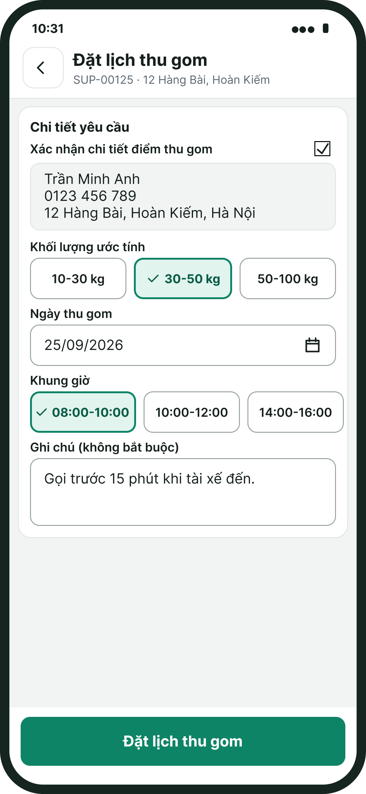
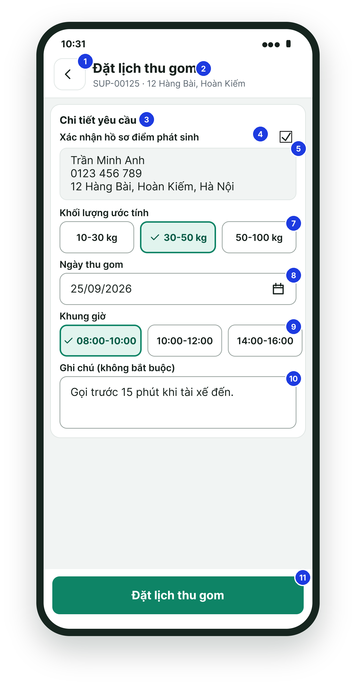
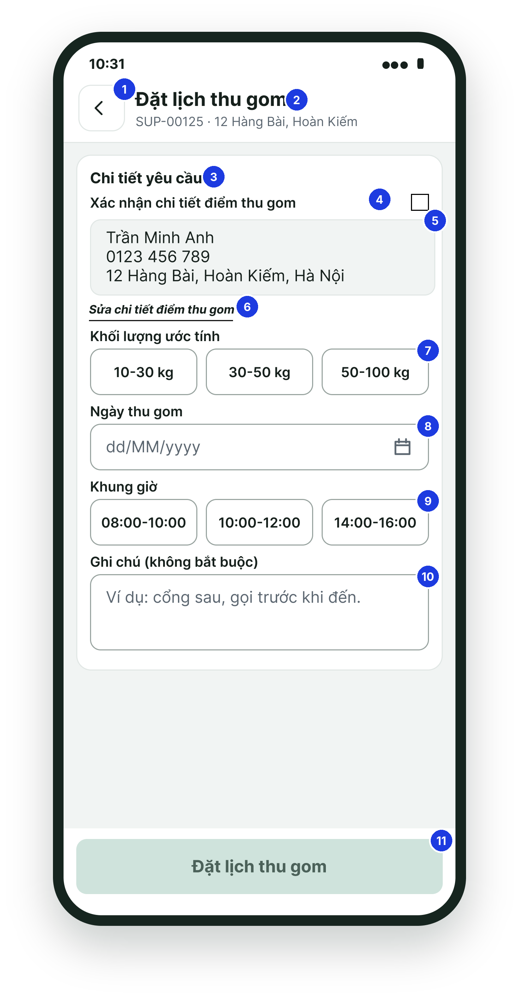
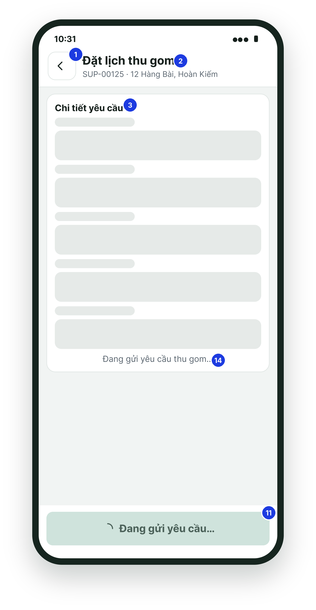
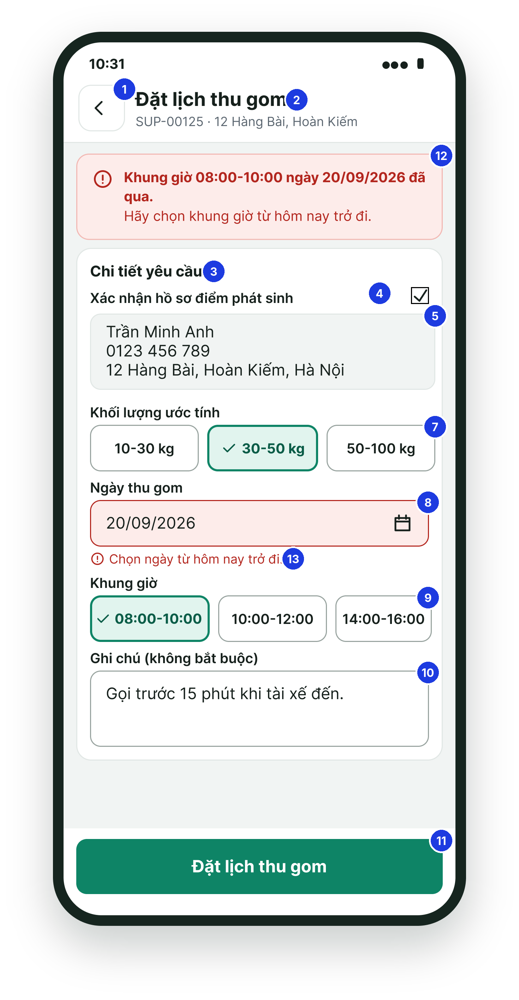
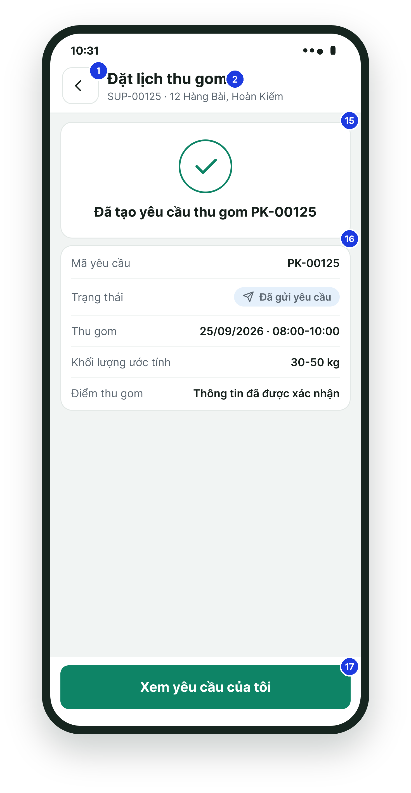

# Screen Spec: S-F01-03 Pickup request form

| Field | Value |
|---|---|
| Screen ID | S-F01-03 |
| Screen name | Pickup request form |
| Actor | Supplier |
| Priority | Must |
| Feature | F-01 Supplier Portal & Account Management |
| Activity diagrams | AD-UC-03 (actions "Open pickup request form", "Enter or correct pickup location, estimated volume, preferred time window and notes", "Submit pickup request", decision `d2` "Request details valid?" and its outcomes `s4`, `s5`, `s6`) |
| Mockup images | `img/S-F01-03-default.png` (default), `img/S-F01-03-default-numbered.png`, four state images and four numbered state images (section 2) |
| Frame width | 390 × 844 px device frame (minimum supported width 360 px) |
| Figma frame | Figma file "S-F01-03 · Pickup request form" |
| Status | Draft |

## 1. Purpose

**Shown when:** the supplier opens "Request pickup" from the Supplier main menu, or is sent here from the profile-incomplete prompt flow.

**The user leaves this screen when:** the request is created and the supplier taps "Xem yêu cầu của tôi" (success state), the supplier taps "Sửa chi tiết điểm thu gom" to change the pickup point details, or the supplier taps Back.

## 2. Mockup

**Numbered:** each number is the # of the element inventory in section 3. Element 6 (edit link) appears only in the empty state, where the confirmation box is not checked. Element 12 (error banner) and element 13 (field error message) appear only in the error state, element 14 (loading text) only in the loading state. In the loading state the fields are replaced by skeleton blocks, so only 1, 2, 3, 11 and 14 are numbered. The success image numbers the header (1, 2) and the success elements 15, 16 and 17.

| Default, numbered | Empty, numbered | Loading, numbered | Error, numbered | Success, numbered |
|---|---|---|---|---|
|  |  |  |  |  |

| State | Image |
|---|---|
| Default | [`img/S-F01-03-default.png`](img/S-F01-03-default.png) |
| Empty | [`img/S-F01-03-empty.png`](img/S-F01-03-empty.png) |
| Loading | [`img/S-F01-03-loading.png`](img/S-F01-03-loading.png) |
| Error | [`img/S-F01-03-error.png`](img/S-F01-03-error.png) (time window already passed, AD-UC-03 `d2` [No]) |
| Success | [`img/S-F01-03-success.png`](img/S-F01-03-success.png) |

All colours, fonts and corners come from the design tokens in
[ui-conventions.md](../ui-conventions.md#6-design-tokens).

## 3. Element inventory

| # | Element | Type | Content / data source | Required | Validation |
|---|---|---|---|---|---|
| 1 | Back | Button | static | Yes | none |
| 2 | Title and context line | Header | static "Đặt lịch thu gom" + `supplier.supplier_id` · short `point_of_origin.address` | Yes | formats from ui-conventions §2 |
| 3 | Card title | Header | static "Chi tiết yêu cầu" | Yes | none |
| 4 | Confirm-details checkbox | Checkbox with label | label "Xác nhận chi tiết điểm thu gom"; `pickup.details_confirmed` | Yes | must be checked to send the request |
| 5 | Pickup point details | Read-only box | `point_of_origin.contact_name`, `point_of_origin.contact_phone` and `point_of_origin.address`, as saved on S-F01-02 | Yes | read-only |
| 6 | Edit link | Link | static "Sửa chi tiết điểm thu gom" | No | none |
| 7 | Estimated volume | Chip group (one choice) | `pickup.estimated_volume`; label "Khối lượng ước tính"; options "10-30 kg", "30-50 kg", "50-100 kg" | Yes | exactly one chip selected; the selected chip shows a check icon |
| 8 | Pickup date | Date input with calendar icon | `pickup.date`; label "Ngày thu gom"; format `dd/MM/yyyy` | Yes | not in the past |
| 9 | Time window | Chip group (one choice) | `pickup.time_window`; label "Khung giờ"; options "08:00-10:00", "10:00-12:00", "14:00-16:00" | Yes | exactly one chip selected; the window must not have passed |
| 10 | Notes | Text area | `pickup.notes`; label "Ghi chú (không bắt buộc)"; placeholder "Ví dụ: cổng sau, gọi trước khi đến." | No | none |
| 11 | Đặt lịch thu gom | Primary button | static label; "Đang gửi yêu cầu…" with a spinner while sending | Yes | disabled until 4, 7, 8 and 9 are done, and while sending |
| 12 | Error banner | Banner | "Khung giờ 08:00-10:00 ngày 20/09/2026 đã qua." + "Hãy chọn khung giờ từ hôm nay trở đi." (AD-UC-03 `s4`) | No | icon + text + colour (ui-conventions §5) |
| 13 | Field error message | Text | "Chọn ngày từ hôm nay trở đi." with an icon, under the date field in error | No | shown only for the field that failed |
| 14 | Loading text | Text | static "Đang gửi yêu cầu thu gom…" | No | none |
| 15 | Success header card | Card | check mark + "Đã tạo yêu cầu thu gom" + `pickup.id` (e.g. `PK-00125`) | No | none |
| 16 | Request summary card | Card | rows "Mã yêu cầu" (`pickup.id`), "Trạng thái" (badge "Đã gửi yêu cầu", `pickup.status` = Requested), "Thu gom" (`pickup.date` · `pickup.time_window`), "Khối lượng ước tính" (`pickup.estimated_volume`), "Điểm thu gom" ("Thông tin đã được xác nhận") | No | badge text + icon (ui-conventions §3) |
| 17 | Xem yêu cầu của tôi | Primary button | static label (success state only) | Yes | none |

## 4. States

| State | What the user sees | Trigger |
|---|---|---|
| Default | Header "Đặt lịch thu gom" / "SUP-00125 · 12 Hàng Bài, Hoàn Kiếm" with back button; card "Chi tiết yêu cầu" with the box "Xác nhận chi tiết điểm thu gom" checked and the grey details ("Trần Minh Anh", "0123 456 789", "12 Hàng Bài, Hoàn Kiếm, Hà Nội"), volume "30-50 kg" selected, date "25/09/2026", time window "08:00-10:00" selected, the note "Gọi trước 15 phút khi tài xế đến."; footer button "Đặt lịch thu gom" enabled. The mockup shows this state. | The form is filled and the details are confirmed |
| Empty (no data) | The box unchecked, the same grey details and the link "Sửa chi tiết điểm thu gom"; no volume or time window selected; the date shows "dd/MM/yyyy"; the note shows its placeholder; footer button disabled | First open |
| Loading | Card "Chi tiết yêu cầu" with five label bars and five field bars (skeleton) instead of the fields, and the text "Đang gửi yêu cầu thu gom…"; footer button "Đang gửi yêu cầu…" with a spinner, disabled | The supplier taps "Đặt lịch thu gom" and the request is being sent |
| Error | Red banner above the card "Khung giờ 08:00-10:00 ngày 20/09/2026 đã qua. Hãy chọn khung giờ từ hôm nay trở đi."; the date "20/09/2026" with a red border and light red fill and the message "Chọn ngày từ hôm nay trở đi." with an icon below; all other values kept; footer button enabled | Details rejected (AD-UC-03 `d2` [No: missing/invalid request details] → `s4`) |
| Success / confirmation | Card with a check mark and "Đã tạo yêu cầu thu gom PK-00125"; summary card (Mã yêu cầu `PK-00125`, Trạng thái "Đã gửi yêu cầu", Thu gom "25/09/2026 · 08:00-10:00", Khối lượng ước tính "30-50 kg", Điểm thu gom "Thông tin đã được xác nhận"); footer button "Xem yêu cầu của tôi" | Request created (AD-UC-03 `d2` [Yes: valid] → `s5` → `s6`, FR-01-03) |

## 5. Interactions and navigation

| # | Element | User action | System response | Goes to screen |
|---|---|---|---|---|
| 1 | Confirm-details checkbox | tap | Checks or unchecks the confirmation; the footer button is enabled only while the box is checked and the other required fields are filled | stays |
| 2 | Sửa chi tiết điểm thu gom | tap | Opens the pickup point profile so the supplier can change the contact or the address | S-F01-02 |
| 3 | Estimated volume, Time window | tap | Selects the tapped chip and clears the previous one | stays |
| 4 | Pickup date | tap | Opens the date picker; the field error clears when a valid date is chosen | stays |
| 5 | Notes | type | Opens the keyboard | stays |
| 6 | Đặt lịch thu gom | tap | Disables the form and shows the loading state; checks the profile and validates the details (FR-01-03); creates the pickup request with status Requested and shows its request ID, or shows the error state | stays (loading, then success or error state) |
| 7 | Xem yêu cầu của tôi | tap (success state) | Opens the list of the supplier's pickup requests | S-F01-04 |
| 8 | Back | tap | Returns without creating a request | Supplier main menu |

## 6. Screen-level rules

| Rule ID | Rule | Source |
|---|---|---|
| SR-001 | A pickup request is accepted only when the supplier profile holds GPS and the compliance data given at registration. | FR-01-03; AD-UC-03 `d1` |
| SR-002 | Estimated volume, pickup date and time window are required; the notes are optional. | FR-01-03 |
| SR-003 | The pickup date and time window cannot be in the past. | AD-UC-03 open question 3 (default) |
| SR-004 | The pickup point details are read from the profile and cannot be edited on this screen; they must be confirmed with the checkbox before the request is sent, and changes go through S-F01-02. | FR-01-02; FR-01-03 |
| SR-005 | A new request is created with status Requested and receives an ID in the format `PK-` + 5 digits. | FR-01-03; ui-conventions §2 |
| SR-006 | Invalid details are not saved; the entered values stay on the screen so the supplier can correct and resubmit. | AD-UC-03 `d2` [No] → `s4` → `m1` |
| SR-007 | Errors and statuses are shown with text and icon, never by colour alone. | ui-conventions §5 |

## 7. Linked requirements

| FR ID | What this screen does for it |
|---|---|
| FR-01-03 | Takes the pickup location, estimated volume, preferred time window and notes, checks the profile and the details, creates the request with status Requested and returns the request ID |
| FR-01-02 | Shows the pickup point details saved on the profile and links back to S-F01-02 to change them |

## 8. Responsive and accessibility notes

- Smallest supported width: 360px; the chips share the width of the card and the labels stay on one line.
- The card scrolls when the keyboard is open; the footer button stays fixed at the bottom.
- Touch targets at least 44 × 44: back button 44 × 44, the chips and the inputs at least 44px high, the checkbox row at least 44px high, the footer button 52px high.
- Every field has a visible label above it; the placeholders are examples only.
- The selected chip is shown by a check icon, a green border and bold text, not by colour alone.
- Field errors use a red border, a light red fill and an error text with an icon below the field; the banner has an icon and text.
- Body text contrast at least 4.5:1.

## 9. Open questions

| # | Question | Blocking? | Status |
|---|---|---|---|
| 1 | [NEEDS CLARIFICATION: the profile-incomplete case (screen-transition.md `[profile incomplete] Complete profile` → S-F01-02, ui-conventions §4 message) has no state on this screen.] | No | Open. Default: an error banner with "Hồ sơ Điểm phát sinh của bạn còn thiếu vị trí GPS. Bổ sung hồ sơ để đặt lịch thu gom." and a link to S-F01-02, to be drawn. |
| 2 | [NEEDS CLARIFICATION: the screen is reused in edit mode to reschedule an existing request (Screen List, FR-01-04, AD-UC-04); the mockups show only the create mode.] | No | Open. Default: the same form pre-filled with the request's values and a different title and button, to be drawn with S-F01-05. |
| 3 | [NEEDS CLARIFICATION: ranges and windows in the mockups use a hyphen ("30-50 kg", "08:00-10:00"); ui-conventions §2 uses an en dash ("30–50 kg", "08:00–10:00").] | No | Open. Default: follow ui-conventions in the build. |

---

## Completion checklist

- [x] The mockup is a separate cropped image file, named with the Screen ID, at the frame width.
- [x] The numbered image exists, and its numbers match the # column of the element inventory.
- [x] Every visible element in the mockup appears in the element inventory.
- [ ] Every colour in the mockup is a design token from ui-conventions.md.
- [x] Every input element has a validation rule or an explicit "none".
- [x] All five states are filled in.
- [ ] Every navigation target is a Screen ID that exists in the Screen List (Supplier main menu has none, see S-F00-01 open question 3).
- [x] Every element that displays data names the field it displays.
- [ ] Every linked FR exists in the Function List, and every action of this screen in AD-UC-03 is
      covered by an interaction row.