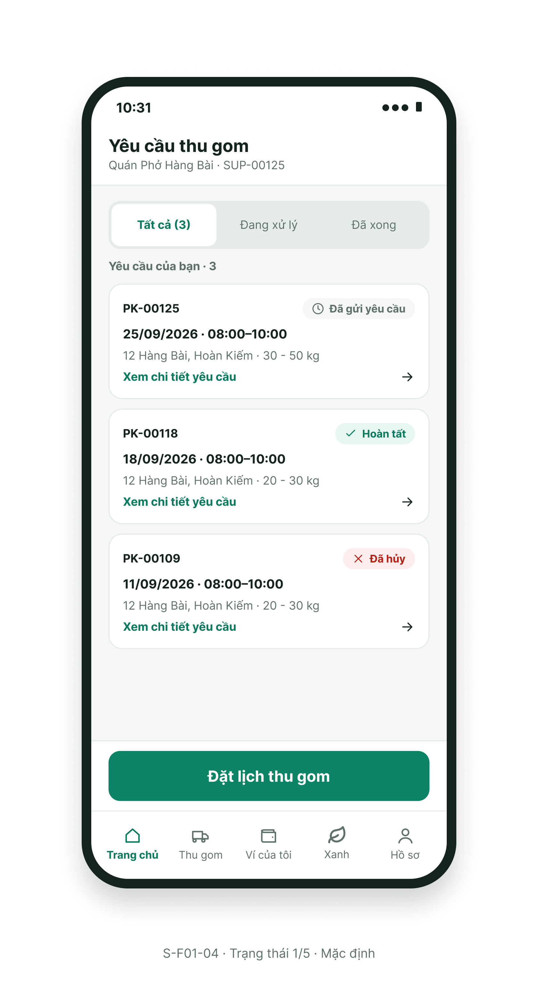
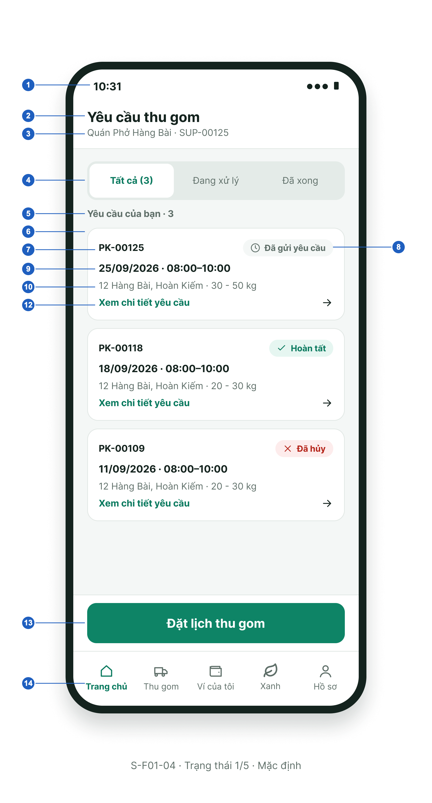
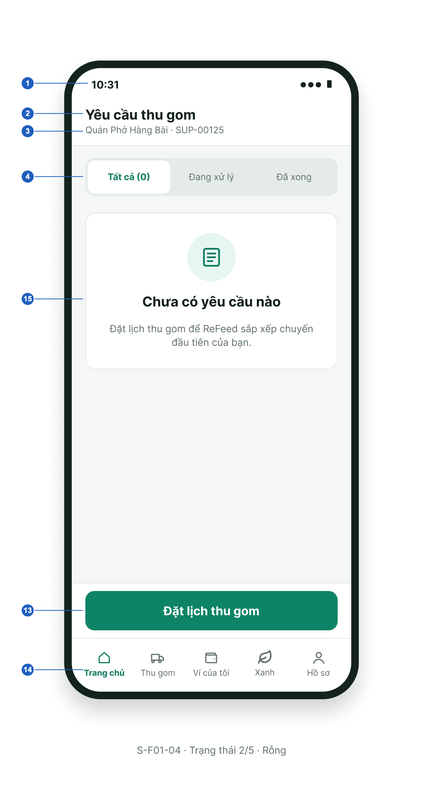
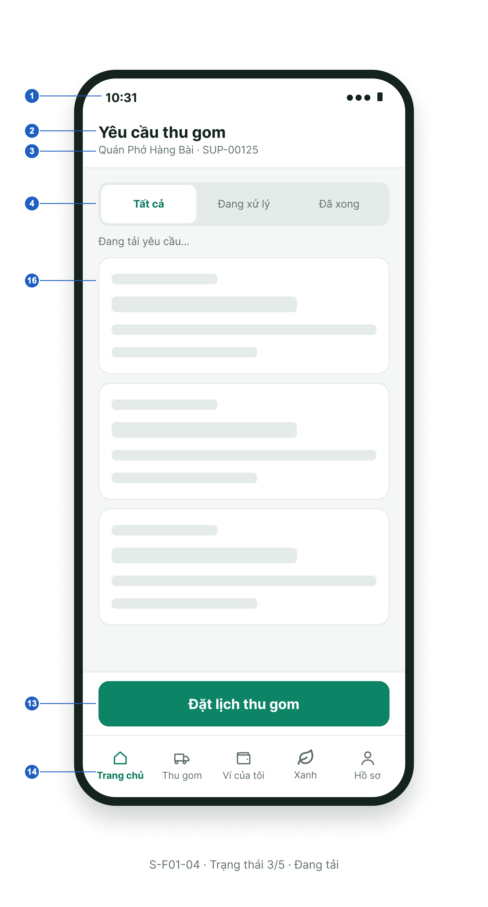
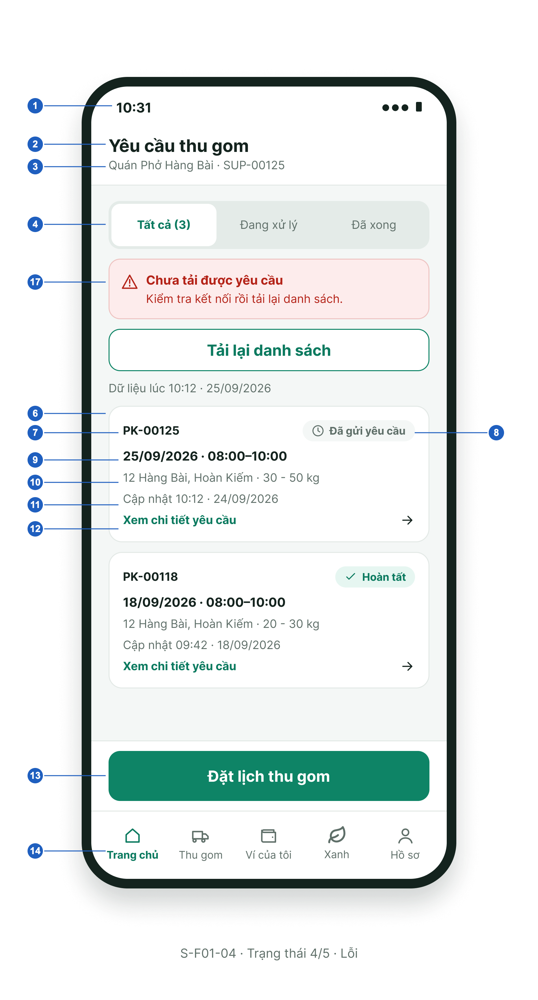
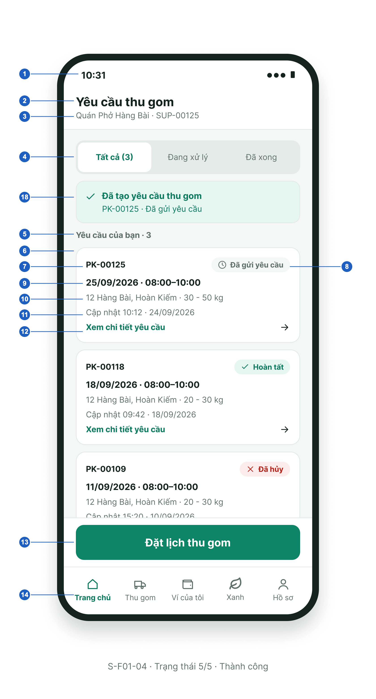

# Screen Spec: S-F01-04 My pickup requests

| Field | Value |
|---|---|
| Screen ID | S-F01-04 |
| Screen name | My pickup requests |
| Actor | Supplier |
| Priority | Could |
| Feature | F-01 Supplier Onboarding & Pickup Management |
| Activity diagrams | AD-UC-04 (select an existing request and view its status); SD-UC-04; W1 FR-01-05 |
| Mockup images | `img/S-F01-04-default.png` (default), `img/S-F01-04-default-numbered.png`, four state images and four numbered state images (section 2) |
| Frame width | 370px screen inside a 390 × 844 device frame (team convention). The five supplied exports are 1680 × 3120 pixels, including the surrounding margin and state caption. |
| Figma frame | ReFeed APP: supplied exports captioned "S-F01-04 · Trạng thái 1/5" to "S-F01-04 · Trạng thái 5/5"; the five supplied images are the visual reference for this spec |
| Status | Draft |

## 1. Purpose

**Shown when:** the supplier opens their pickup requests from the supplier home or the "Thu gom" tab, or returns from S-F01-03 after creating a request.

**The user leaves this screen when:** they select a request to open S-F01-05, tap "Đặt lịch thu gom" to open S-F01-03, or select another area in the bottom navigation. Rescheduling and cancellation are handled on S-F01-05, not on this list.

## 2. Mockup

**Numbered:** each number is the # of the element inventory in section 3. Element 15 (Empty message) appears only in Empty, element 16 (Loading placeholders) only in Loading, element 17 (Load error and recovery) only in Error, and element 18 (Creation confirmation) only in Success. Element 11 (Last status update) is visible in Error and Success, but is absent from the supplied Default image. Elements 6–12 are numbered on the first request card where present. The Success list continues below the fixed footer and can be scrolled. Numbers and leaders are documentation annotations added to copies of the supplied images; the caption below the phone is not product UI.

| Default, numbered | Empty, numbered | Loading, numbered | Error, numbered | Success, numbered |
|---|---|---|---|---|
|  |  |  |  |  |

| State | Image |
|---|---|
| Default | [`img/S-F01-04-default.png`](img/S-F01-04-default.png) |
| Empty | [`img/S-F01-04-empty.png`](img/S-F01-04-empty.png) |
| Loading | [`img/S-F01-04-loading.png`](img/S-F01-04-loading.png) |
| Error | [`img/S-F01-04-error.png`](img/S-F01-04-error.png) (refresh failed; cached requests remain visible) |
| Success | [`img/S-F01-04-success.png`](img/S-F01-04-success.png) (a newly created request is confirmed above the list) |

Colours, fonts and corners follow the design tokens in
[ui-conventions.md](../ui-conventions.md#6-design-tokens). The supplied images use "Ví của tôi" and highlight "Trang chủ" in the bottom navigation; these differences from the current shared convention are recorded in section 9. The original images are preserved without changing their wording or active-tab styling.

## 3. Element inventory

| # | Element | Type | Content / data source | Required | Validation |
|---|---|---|---|---|---|
| 1 | Status bar | Device chrome | static mockup time "10:31", three dots and the small vertical battery indicator | Yes | none; device chrome, not pickup data |
| 2 | Title | Header | static: "Yêu cầu thu gom" | Yes | none; no Back button or avatar |
| 3 | Context line | Text | `supplier.business_name` · `supplier.id`; example "Quán Phở Hàng Bài · SUP-00125" | Yes | `SUP-` + 5 digits |
| 4 | Status filters | Segmented control | "Tất cả" with `pickup_list.total_count` when known; "Đang xử lý"; "Đã xong" | Yes | one selected; processing = Requested, Driver Assigned, Arrived; done = Completed, Cancelled; omit the count while initially loading |
| 5 | List heading | Text | "Yêu cầu của bạn · " + `pickup_list.filtered_count` | No | shown in Default and Success; count is scoped to the signed-in supplier and current filter |
| 6 | Request list and cards | Scrollable list / tappable card | own `pickup` records, newest `created_at` first | No | one card per request; the whole card opens the selected request |
| 7 | Request ID | Text | `pickup.id`; example "PK-00125" | No | `PK-` + 5 digits |
| 8 | Status badge | Badge | `pickup.status`: "Đã gửi yêu cầu", "Đã phân tài xế", "Đã đến", "Hoàn tất", "Đã hủy" | No | text + icon + colour; the supplied list illustrates Requested, Completed and Cancelled |
| 9 | Pickup appointment | Text | `pickup.scheduled_date` · `pickup.time_window` | No | `dd/MM/yyyy · HH:mm–HH:mm` |
| 10 | Origin and estimate | Text | `pickup.location.address` · `pickup.estimated_volume_min/max` | No | whole-kg range, e.g. "12 Hàng Bài, Hoàn Kiếm · 30 - 50 kg"; address wraps |
| 11 | Last status update | Text | "Cập nhật " + `pickup.last_status_update_at` | No | `HH:mm · dd/MM/yyyy`; shown in the supplied Error and Success cards; not shown in Default |
| 12 | Xem chi tiết yêu cầu | Card action with arrow | static label | No | same destination as the card: S-F01-05; no direct cancel or reschedule action |
| 13 | Đặt lịch thu gom | Primary button | static label | Yes | opens S-F01-03; remains available in all five states |
| 14 | Bottom navigation | Navigation | static: "Trang chủ" · "Thu gom" · "Ví của tôi" · "Xanh" · "Hồ sơ" | Yes | supplied images highlight Trang chủ; expected active tab for this screen is Thu gom (open question 1); targets at least 44 × 56px |
| 15 | Empty message | Card | document icon; "Chưa có yêu cầu nào" — "Đặt lịch thu gom để ReFeed sắp xếp chuyến đầu tiên của bạn." | No | shown after a successful zero-result query; keep #13 available |
| 16 | Loading placeholders | Skeleton cards with text | three placeholder cards; "Đang tải yêu cầu…" | No | no real IDs, statuses or count until loaded; placeholders are not tappable |
| 17 | Load error and recovery | Banner, retry button and cache timestamp | "Chưa tải được yêu cầu" — "Kiểm tra kết nối rồi tải lại danh sách."; "Tải lại danh sách"; "Dữ liệu lúc " + `pickup_list.fetched_at` | No | keep cached data when available; timestamp uses `HH:mm · dd/MM/yyyy`; retry the current filter |
| 18 | Creation confirmation | Success banner | check icon; "Đã tạo yêu cầu thu gom"; `pickup.id` · `pickup.status` | No | shown only after server-confirmed creation on S-F01-03; does not imply driver assignment |

## 4. States

| State | What the user sees | Trigger |
|---|---|---|
| Default | Header "Yêu cầu thu gom", "Quán Phở Hàng Bài · SUP-00125"; filter "Tất cả (3)" selected; heading "Yêu cầu của bạn · 3". Three cards: PK-00125, "Đã gửi yêu cầu", 25/09/2026 · 08:00–10:00, 30 - 50 kg; PK-00118, "Hoàn tất", 18/09/2026 · 08:00–10:00, 20 - 30 kg; PK-00109, "Đã hủy", 11/09/2026 · 08:00–10:00, 20 - 30 kg. Each uses address "12 Hàng Bài, Hoàn Kiếm" and action "Xem chi tiết yêu cầu". No last-update rows are shown. Fixed "Đặt lịch thu gom" and bottom navigation; Trang chủ is highlighted in the supplied image (section 9). | Own request list loaded successfully with records |
| Empty (no data) | Same header; "Tất cả (0)" selected. Document-icon card "Chưa có yêu cầu nào" — "Đặt lịch thu gom để ReFeed sắp xếp chuyến đầu tiên của bạn." No list heading or request cards. "Đặt lịch thu gom" and bottom navigation remain. | Successful query returns no requests for this supplier |
| Loading | Same header and filters; "Tất cả" has no count. Text "Đang tải yêu cầu…" and three grey skeleton cards replace the request list; no badges or real request values. "Đặt lịch thu gom" and bottom navigation remain. Filters and skeletons do not start another list request while fetching. | Initial fetch, filter change or retry is in progress |
| Error | "Tất cả (3)" remains selected. Red banner "Chưa tải được yêu cầu" — "Kiểm tra kết nối rồi tải lại danh sách."; outlined "Tải lại danh sách"; cache label "Dữ liệu lúc 10:12 · 25/09/2026". The image shows cached PK-00125 and PK-00118 with their status and appointment, plus "Cập nhật 10:12 · 24/09/2026" and "Cập nhật 09:42 · 18/09/2026" respectively. The displayed count of 3 versus two cached cards is recorded in section 9. Creation button and navigation remain. | Refresh fails and a previously loaded list is available |
| Success / confirmation | Green check banner "Đã tạo yêu cầu thu gom" — "PK-00125 · Đã gửi yêu cầu". "Tất cả (3)", heading "Yêu cầu của bạn · 3" and the three request cards remain; PK-00125 is first. Cards show last-update rows: PK-00125 at 10:12 · 24/09/2026, PK-00118 at 09:42 · 18/09/2026, PK-00109 at 15:20 · 10/09/2026. The third card continues below the fixed footer, so the list scrolls. "Đặt lịch thu gom" and bottom navigation remain. | The supplier returns from S-F01-03 after request creation is confirmed |

## 5. Interactions and navigation

| # | Element | User action | System response | Goes to screen |
|---|---|---|---|---|
| 1 | Status filters | tap | Selects the requested group and reloads only the supplier's requests; shows Loading, then the result or Error | stays |
| 2 | Request card / Xem chi tiết yêu cầu | tap | Retrieves the selected request with an ownership check and opens its status, appointment and management actions | S-F01-05 |
| 3 | Đặt lịch thu gom | tap | Opens the pickup request form; profile eligibility is checked there | S-F01-03 |
| 4 | Tải lại danh sách | tap (error state) | Retries the current filter; replaces cached data and clears the error after a successful response | stays (loading, then default or empty) |
| 5 | Request list | scroll | Reveals the remaining cards while the header, creation button and bottom navigation remain fixed | stays |
| 6 | Trang chủ | tap | Opens the supplier home | Supplier main menu (Screen ID reconciliation in section 9) |
| 7 | Thu gom | tap | Opens or refreshes the supplier's request list | S-F01-04 |
| 8 | Ví của tôi | tap | Opens the supplier's loyalty and payout balance; the label differs from ui-conventions | S-F05-01 |
| 9 | Xanh | tap | Opens the supplier's Green Profile | S-F05-03 |
| 10 | Hồ sơ | tap | Opens the supplier's Point-of-Origin and compliance profile | S-F01-02 |

## 6. Screen-level rules

| Rule ID | Rule | Source |
|---|---|---|
| SR-001 | The supplier sees only requests belonging to their own `supplier.id`; the same scope applies to counts, filters and cached records. | FR-06-03 |
| SR-002 | Every request card opens S-F01-05. The list does not perform rescheduling or cancellation and does not open a receipt directly. | Screen List; Screen Transition, Supplier |
| SR-003 | Appointments, estimates, statuses and last-update timestamps are read-only here; detail is fetched again when a request is opened. | FR-01-05; SD-UC-04 |
| SR-004 | Filter groups use the existing pickup status catalogue. Within a group, requests are shown newest first by creation time. | ui-conventions §3; list ordering convention |
| SR-005 | Empty means a successful query with no records. A failed fetch is Error; retained data is labelled with its fetch time. | FR-01-05; ui-conventions §4 |
| SR-006 | Creation happens on S-F01-03. Show the success banner only after that request is saved successfully; a Requested pickup is not yet assigned to a driver. | FR-01-03; FR-02-01; Screen Transition |
| SR-007 | Counts and cached cards must describe the same supplier/filter result. Do not display an initial count of zero while loading. | FR-01-05; open question 3 |
| SR-008 | Badges and messages use text and icon as well as colour. IDs, dates and estimated quantities follow the shared formats. | ui-conventions §§2, 3, 5 |
| SR-009 | The request list is the Thu gom area. The supplied Trang chủ highlight and Ví của tôi label require reconciliation with the shared bottom-nav convention before implementation. | ui-conventions §3; open questions 1–2 |

## 7. Linked requirements

| FR ID | What this screen does for it |
|---|---|
| FR-01-05 | Shows the supplier's own request statuses, appointments, estimates and last-update context; opens the selected request |
| FR-01-04 | Provides the entry to request detail, where eligible rescheduling and cancellation are handled |
| FR-01-03 | Opens the request form and confirms a successfully created request after return |
| FR-06-03 | Restricts queries, counts, cards and cached data to the signed-in supplier |

## 8. Responsive and accessibility notes

- Smallest supported width: 360px; addresses and status labels wrap without obscuring the request ID or card action.
- Designed on a 370 × 824 screen inside a 390 × 844 device frame; the request list scrolls above the fixed creation button and bottom navigation. The supplied full-article exports are 1680 × 3120 pixels, so they are not the 1470 × 2832 cropped exports of the reference spec.
- Touch targets at least 44 × 44px: the whole request card is tappable, filters have full-height targets, the primary button is 52px high and each bottom-nav item is at least 44 × 56px.
- Status badges use text and icon; announce loading, errors and successful creation to screen readers. Skeletons are decorative and non-interactive; the clock and battery are device chrome.
- Body text contrast at least 4.5:1. The active tab must use the correct current-area label and selected state, not colour alone; the supplied active-tab mismatch is an open question.

## 9. Open questions

| # | Question | Blocking? | Status |
|---|---|---|---|
| 1 | [NEEDS CLARIFICATION: all five supplied S-F01-04 images highlight Trang chủ instead of Thu gom. Should the active tab be corrected?] | No for this draft; yes for final navigation styling | Open. Preserve the supplied images; expected implementation highlights Thu gom, following ui-conventions §3. |
| 2 | [NEEDS CLARIFICATION: the supplied bottom nav says Ví của tôi while ui-conventions says Tích lũy. Which shared label should be used?] | No for this draft | Open. This spec records Ví của tôi exactly as supplied; its destination remains S-F05-01. Confirm the shared label with the group. |
| 3 | [NEEDS CLARIFICATION: Error shows Tất cả (3) but only PK-00125 and PK-00118 appear in the cached list. Is the cache partial or is the count stale?] | No for this draft; yes for count/cache behaviour | Open. Do not assume an unseen third record; final count and cards must use the same result scope. |
| 4 | [NEEDS CLARIFICATION: the reference S-F03-01 spec uses S-F00-02 for Supplier home, but the current repository Screen List/Transition still uses Supplier main menu. Which catalogue is current?] | No for this draft | Open. Keep Supplier main menu here until the group's Screen List and Transition are synchronized; do not add a new ID in this spec alone. |
| 5 | [NEEDS CLARIFICATION: Default omits per-request update times while Error and Success include them. Should update times be visible in every loaded state?] | No | Open. This spec documents the supplied state images exactly; confirm a consistent loaded-card layout with the group. |
| 6 | [NEEDS CLARIFICATION: how long does the inline creation-confirmation banner remain visible?] | No | Open. Do not infer the toast's four-second timeout for this inline banner; clear it when the user leaves or explicitly refreshes the list until another duration is agreed. |
| 7 | [NEEDS CLARIFICATION: should a long request history use pagination or load more on scroll?] | No for the five-state draft | Open. Keep the current filter and creation order; the API pagination contract is not specified by the supplied images. |

---

## Completion checklist

- [x] The mockup is a separate image file, named with the Screen ID; its supplied dimensions are recorded above.
- [x] The numbered images exist, and their numbers match the # column of the element inventory.
- [x] Every visible element in the mockups appears in the element inventory.
- [ ] Every colour in the mockups is a design token from ui-conventions.md.
- [x] Every input element has a validation rule or an explicit "none".
- [x] All five states are filled in.
- [ ] Every navigation target is a Screen ID that exists in the Screen List (Supplier home ID remains open question 4).
- [x] Every element that displays data names the field it displays.
- [x] Every linked FR exists in the Function List, and the request-selection/status-view actions of AD-UC-04 served by this screen are covered by interaction rows.
