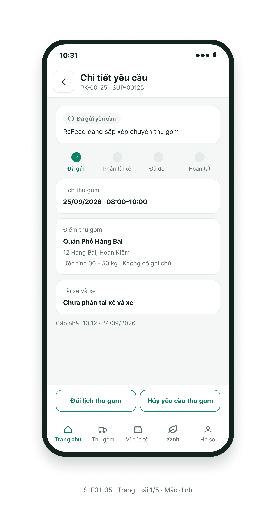
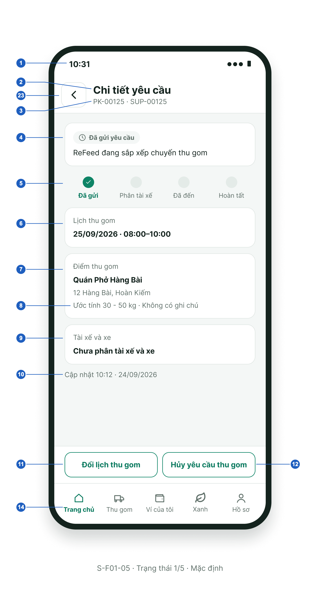
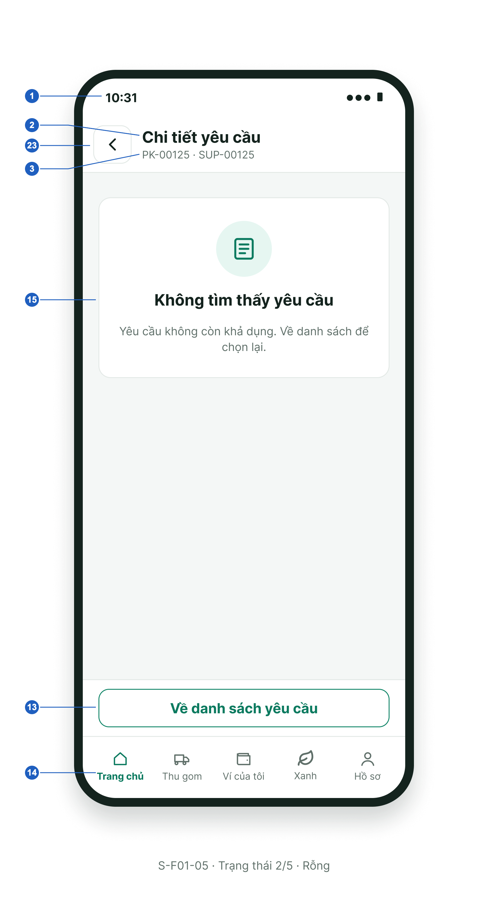
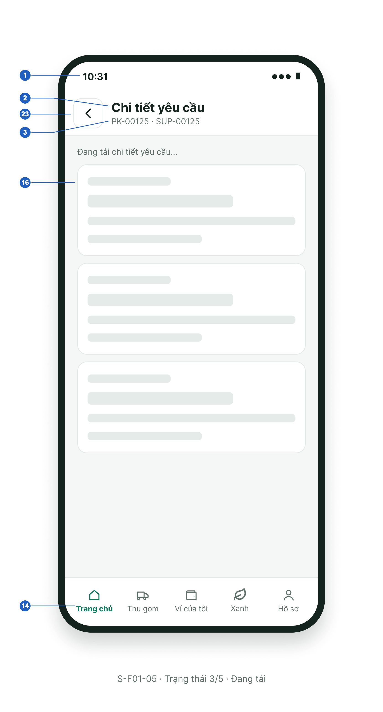
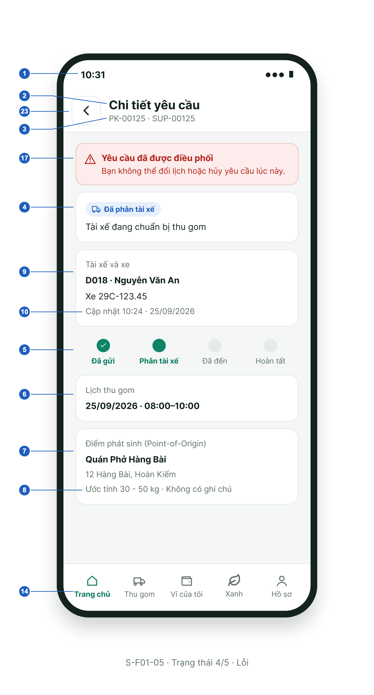
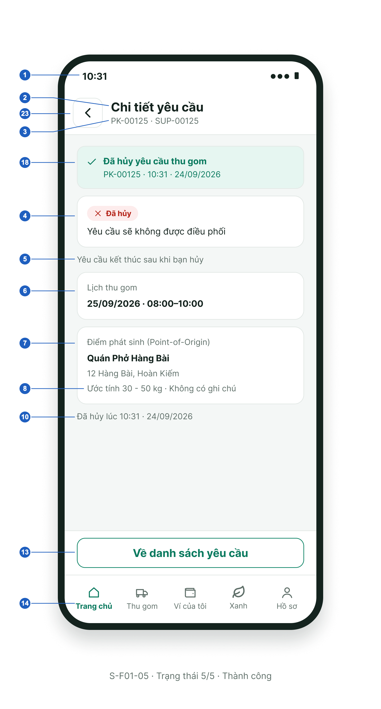

# Screen Spec: S-F01-05 Pickup request detail

| Field | Value |
|---|---|
| Screen ID | S-F01-05 |
| Screen name | Pickup request detail |
| Actor | Supplier |
| Priority | Should |
| Feature | F-01 Supplier Onboarding & Pickup Management |
| Activity diagrams | AD-UC-04 (view, reschedule, cancel and dispatch-lock branches); SD-UC-04; W1 FR-01-04, FR-01-05 |
| Mockup images | `img/S-F01-05-default.png` (default), `img/S-F01-05-default-numbered.png`, four state images and four numbered state images (section 2) |
| Frame width | 370px screen inside a 390 × 844 device frame (team convention). The five supplied exports are 1680 × 3120 pixels, including the surrounding margin and state caption. |
| Figma frame | ReFeed APP: supplied exports captioned "S-F01-05 · Trạng thái 1/5" to "S-F01-05 · Trạng thái 5/5"; the five supplied images are the visual reference for this spec |
| Status | Draft |

## 1. Purpose

**Shown when:** the supplier selects an own pickup request on S-F01-04, or returns from S-F01-03 after rescheduling it. The screen shows the selected request's current status, collection appointment, pickup location, estimated quantity, assigned driver/vehicle when available and last update.

**The user leaves this screen when:** they return to S-F01-04 using Back or "Về danh sách yêu cầu", open S-F01-03 through "Đổi lịch thu gom", or select another area in the bottom navigation. Cancellation is confirmed in a modal on this screen and then shown as Success; it is not a separate screen.

## 2. Mockup

**Numbered:** each number is the # of the element inventory in section 3. Back (23), the header (1–3) and bottom navigation (14) appear in all five states. Empty message (15), Loading placeholders (16), Dispatch-lock message (17) and Cancellation confirmation (18) appear on their respective state images. Default includes management buttons (11–12); Empty and Success have the return button (13). Success replaces the four-step timeline (5) with a terminal cancellation note and omits the assignment card (9). The cancellation modal summary and controls (19–22) are specified in section 5 but are not pictured in the five supplied states. Numbers and leaders are documentation annotations added to copies of the supplied images; the caption below the phone is not product UI.

| Default, numbered | Empty, numbered | Loading, numbered | Error, numbered | Success, numbered |
|---|---|---|---|---|
|  |  |  |  |  |

| State | Image |
|---|---|
| Default | [`img/S-F01-05-default.png`](img/S-F01-05-default.png) |
| Empty | [`img/S-F01-05-empty.png`](img/S-F01-05-empty.png) |
| Loading | [`img/S-F01-05-loading.png`](img/S-F01-05-loading.png) |
| Error | [`img/S-F01-05-error.png`](img/S-F01-05-error.png) (the request has been dispatched, so rescheduling and cancellation are locked) |
| Success | [`img/S-F01-05-success.png`](img/S-F01-05-success.png) (cancellation has been confirmed) |

Colours, fonts and corners follow the design tokens in
[ui-conventions.md](../ui-conventions.md#6-design-tokens). The supplied images highlight "Trang chủ" and use "Ví của tôi" in the bottom navigation. Default labels the origin card "Điểm thu gom", while Error and Success use "Điểm phát sinh (Point-of-Origin)". These differences are recorded in section 9; the supplied images and wording are preserved.

## 3. Element inventory

| # | Element | Type | Content / data source | Required | Validation |
|---|---|---|---|---|---|
| 1 | Status bar | Device chrome | static mockup time "10:31", three dots and the small vertical battery indicator | Yes | none; device chrome, not pickup data |
| 2 | Title | Header | static: "Chi tiết yêu cầu" | Yes | none; Back #23 immediately to its left |
| 3 | Context line | Text | `pickup.id` · `supplier.id`; example "PK-00125 · SUP-00125" | Yes | `PK-` / `SUP-` + 5 digits; retain only identifiers already known to the signed-in user while fetching |
| 4 | Current status | Card with badge and explanation | `pickup.status`; Requested: "Đã gửi yêu cầu" / "ReFeed đang sắp xếp chuyến thu gom"; Driver Assigned: "Đã phân tài xế" / "Tài xế đang chuẩn bị thu gom"; Cancelled: "Đã hủy" / "Yêu cầu sẽ không được điều phối" | No | actual recorded status; text + icon + colour |
| 5 | Pickup progress | Timeline / terminal note | "Đã gửi" → "Phân tài xế" → "Đã đến" → "Hoàn tất"; after cancellation: "Yêu cầu kết thúc sau khi bạn hủy" | No | highlight only the recorded step; cancellation is a separate terminal branch, not completed progress |
| 6 | Collection appointment | Card | "Lịch thu gom"; `pickup.scheduled_date` · `pickup.time_window` | No | `dd/MM/yyyy · HH:mm–HH:mm`; retained after cancellation as historical information |
| 7 | Pickup location | Card / text | `supplier.business_name`, `pickup.location.address`; Default label "Điểm thu gom"; Error/Success label "Điểm phát sinh (Point-of-Origin)" | No | show the selected request's location; label consistency remains open question 3 |
| 8 | Estimate and notes | Text within location card | "Ước tính " + `pickup.estimated_volume_min/max` · `pickup.notes` | No | whole-kg range, e.g. "30 - 50 kg"; no note = "Không có ghi chú" |
| 9 | Driver and vehicle | Card | "Tài xế và xe"; `driver.id`, `driver.name`, `vehicle.plate`; before assignment: "Chưa phân tài xế và xe" | No | Default has no assigned resources; Error shows D018 · Nguyễn Văn An and Xe 29C-123.45; hidden in the supplied Success image |
| 10 | Last update / cancellation time | Text | "Cập nhật " + `pickup.last_status_update_at`; after cancellation: "Đã hủy lúc " + `pickup.cancelled_at` | No | `HH:mm · dd/MM/yyyy`; Default below the cards, Error inside the assignment card, Success below the location card |
| 11 | Đổi lịch thu gom | Secondary button | static label | No | Requested only; recheck eligibility and open S-F01-03 in edit mode |
| 12 | Hủy yêu cầu thu gom | Secondary button | static label | No | Requested only; opens the cancellation modal without cancelling immediately; no destructive fill on the parent screen |
| 13 | Về danh sách yêu cầu | Secondary button | static label | No | Empty and Success; opens S-F01-04; Back #23 provides the same destination in all states |
| 14 | Bottom navigation | Navigation | static: "Trang chủ" · "Thu gom" · "Ví của tôi" · "Xanh" · "Hồ sơ" | Yes | supplied images highlight Trang chủ; expected current area is Thu gom (section 9); targets at least 44 × 56px |
| 15 | Unavailable request | Empty card | document icon; "Không tìm thấy yêu cầu" — "Yêu cầu không còn khả dụng. Về danh sách để chọn lại." | No | show after a confirmed unavailable/missing record result; do not expose another supplier's request details |
| 16 | Loading placeholders | Skeleton cards with text | three placeholder cards; "Đang tải chi tiết yêu cầu…" | No | no fabricated status, appointment, resource or eligibility; skeletons are not tappable |
| 17 | Dispatch-lock message | Error banner | alert icon; "Yêu cầu đã được điều phối" — "Bạn không thể đổi lịch hoặc hủy yêu cầu lúc này." | No | display the latest confirmed assignment/status; remove edit/cancel buttons; a rejected operation does not change the appointment |
| 18 | Cancellation confirmation | Success banner | check icon; "Đã hủy yêu cầu thu gom"; `pickup.id` · `pickup.cancelled_at` | No | server-confirmed cancellation only; do not show on modal dismissal or an unconfirmed/failed cancellation |
| 19 | Cancellation summary | Modal text | selected `pickup.id`, scheduled date/window and the consequence of cancellation | In modal | identify the selected request; explain that it will not be dispatched |
| 20 | Cancellation overlay | Modal | "Hủy yêu cầu thu gom?"; summary #19 and actions #21–22 | On cancel | overlay of this screen, not a separate Screen ID; focus trapped and background inert |
| 21 | Về chi tiết yêu cầu | Modal secondary button | static label | In modal | closes without changes and restores focus to #12 |
| 22 | Hủy yêu cầu thu gom | Modal destructive button | static label; busy "Đang hủy yêu cầu…" | In modal | recheck ownership and Requested status; prevent duplicate submission; only final confirmation submits cancellation |
| 23 | Back | Header icon button | left chevron; accessible label "Về danh sách yêu cầu" | Yes | 44 × 44px; opens S-F01-04 without modifying the request; inert behind an open modal |

## 4. States

| State | What the user sees | Trigger |
|---|---|---|
| Default | Header "Chi tiết yêu cầu", "PK-00125 · SUP-00125", and Back. Status "Đã gửi yêu cầu" — "ReFeed đang sắp xếp chuyến thu gom". Four-step progress with only "Đã gửi" checked. "Lịch thu gom": 25/09/2026 · 08:00–10:00. "Điểm thu gom": Quán Phở Hàng Bài, 12 Hàng Bài, Hoàn Kiếm, "Ước tính 30 - 50 kg · Không có ghi chú". Assignment card "Tài xế và xe" — "Chưa phân tài xế và xe". "Cập nhật 10:12 · 24/09/2026". Outlined "Đổi lịch thu gom" and "Hủy yêu cầu thu gom" above bottom navigation; no footer return button. | Own request loaded successfully with status Requested |
| Empty (no data) | Same header and known ID context. Document-icon card "Không tìm thấy yêu cầu" — "Yêu cầu không còn khả dụng. Về danh sách để chọn lại." No status, progress, appointment, location or assignment cards. Footer "Về danh sách yêu cầu" and bottom navigation remain. | Request lookup confirms that the selected record is missing or unavailable to this supplier |
| Loading | Same header and known IDs; "Đang tải chi tiết yêu cầu…" and three grey skeleton cards. No status, progress, management buttons or footer return button. Back and bottom navigation remain available while fetching. | Selected request details are being fetched or refreshed |
| Error | Red alert "Yêu cầu đã được điều phối" — "Bạn không thể đổi lịch hoặc hủy yêu cầu lúc này." Status "Đã phân tài xế" — "Tài xế đang chuẩn bị thu gom". Assignment card is placed before progress: D018 · Nguyễn Văn An, Xe 29C-123.45, "Cập nhật 10:24 · 25/09/2026". Progress highlights Đã gửi and Phân tài xế; later steps remain grey. Appointment remains 25/09/2026 · 08:00–10:00; location card label is "Điểm phát sinh (Point-of-Origin)" with the same supplier, address and 30 - 50 kg estimate. Edit/cancel and footer return buttons are absent; Back and bottom navigation remain. | A reschedule/cancel attempt is rejected because dispatch has locked the request (AD-UC-04 d2 [no]) |
| Success / confirmation | Green banner "Đã hủy yêu cầu thu gom" — "PK-00125 · 10:31 · 24/09/2026". Status card "Đã hủy" — "Yêu cầu sẽ không được điều phối"; terminal note "Yêu cầu kết thúc sau khi bạn hủy" replaces the four-step timeline. Appointment remains 25/09/2026 · 08:00–10:00 as historical data. "Điểm phát sinh (Point-of-Origin)" retains the supplier, address, estimate and notes. "Đã hủy lúc 10:31 · 24/09/2026"; no assignment or management buttons. Footer "Về danh sách yêu cầu" and bottom navigation remain. | Cancellation is confirmed and the request is saved as Cancelled |

The mockups illustrate alternative outcomes for the same example ID, not a chronological sequence: the cancellation fixture is dated 24/09/2026, while the dispatch-lock fixture is dated 25/09/2026. The five UI states do not introduce new pickup statuses.

## 5. Interactions and navigation

**Cancellation modal (not included in the five supplied images):** title "Hủy yêu cầu thu gom?"; summary #19 identifies PK-00125, 25/09/2026 and khung giờ 08:00–10:00. Body: "Yêu cầu sẽ không được đưa vào lịch điều phối. Bạn có thể đặt lịch thu gom mới sau này." Secondary "Về chi tiết yêu cầu"; destructive "Hủy yêu cầu thu gom". This specifies the cancellation overlay required by the Screen List; final visual/copy confirmation is recorded in section 9.

| # | Element | User action | System response | Goes to screen |
|---|---|---|---|---|
| 1 | Request details | open / return from rescheduling | Fetches the own request's current status, appointment, location, assignment and last update; determines eligible actions | stays (loading, then default, empty or error) |
| 2 | Đổi lịch thu gom | tap (Requested) | Rechecks eligibility and opens the form prefilled with this request | S-F01-03; returns to S-F01-05 after rescheduling |
| 3 | Hủy yêu cầu thu gom | tap (Requested) | Opens modal #20; makes no change yet | stays (modal) |
| 4 | Về chi tiết yêu cầu / Escape (modal) | dismiss | Closes the modal, leaves the request unchanged and restores focus | stays |
| 5 | Hủy yêu cầu thu gom (modal) | confirm | Rechecks ownership and Requested status, submits once, updates the request and central schedule/logs and sends the schedule-update event; shows Success or rejection | stays (submitting, then success or error) |
| 6 | Back | tap | Opens the request list without rescheduling or cancelling; refreshes changed records on return | S-F01-04 |
| 7 | Về danh sách yêu cầu | tap (empty or success) | Opens the supplier's request list | S-F01-04 |
| 8 | Detail content | scroll | Reveals long location/note content while header and available footer/navigation remain fixed | stays |
| 9 | Trang chủ | tap | Opens the supplier home | Supplier main menu (Screen ID reconciliation in section 9) |
| 10 | Thu gom | tap | Opens the supplier's request list | S-F01-04 |
| 11 | Ví của tôi | tap | Opens loyalty and payout balance; the supplied label differs from ui-conventions | S-F05-01 |
| 12 | Xanh | tap | Opens the supplier's Green Profile | S-F05-03 |
| 13 | Hồ sơ | tap | Opens Point-of-Origin and compliance profile | S-F01-02 |

## 6. Screen-level rules

| Rule ID | Rule | Source |
|---|---|---|
| SR-001 | The supplier may read or update only requests belonging to their own `supplier.id`; final writes recheck ownership. | FR-06-03 |
| SR-002 | Rescheduling and cancellation are allowed only while Requested. Recheck eligibility at final submission; a driver-dispatched/in-transit request is locked. | FR-01-04; BR-01-PICKUP-CANCELLATION; AD-UC-04 d2; SD-UC-04 |
| SR-003 | Rescheduling uses S-F01-03 in edit mode. Only confirmed saved details replace the appointment shown here. | FR-01-04; Screen Transition, Supplier |
| SR-004 | Cancellation requires the parent-screen modal; destructive styling appears only on its final confirmation button. Dismissal does not modify the request. | Screen List, Modals; ui-conventions §3 |
| SR-005 | A rejected modification/cancellation preserves the confirmed appointment and displays the latest status and assignment. Do not show cancellation success before server confirmation. | FR-01-04; SD-UC-04 |
| SR-006 | Status, appointment, assignment and last-update fields are read-only here. Do not invent driver location or ETA data absent from the response. | FR-01-05; SD-UC-04; open question 7 |
| SR-007 | Cancelled is a terminal branch, not completion of the four-step collection timeline. Retained appointment/location values describe the cancelled request and do not imply a future visit. | ui-conventions §3; FR-01-04 |
| SR-008 | Back and the footer return action open S-F01-04. This screen does not open a transaction receipt directly. | Screen List; Screen Transition, Supplier |
| SR-009 | Rescheduling preserves the agreed pickup status vocabulary; the analysis diagram's Updated state requires reconciliation before implementation. | AD-UC-04; ui-conventions §3; open question 6 |
| SR-010 | The current bottom-nav area is Thu gom. The supplied Trang chủ highlight and Ví của tôi label must be reconciled with the shared convention. | ui-conventions §3; open questions 1–2 |

## 7. Linked requirements

| FR ID | What this screen does for it |
|---|---|
| FR-01-04 | Provides rescheduling entry, cancellation confirmation, eligibility checks, dispatch-lock explanation and the confirmed cancellation result |
| FR-01-05 | Shows the selected request's status, appointment, estimated quantity, location, assigned driver/vehicle and last update |
| FR-06-03 | Restricts request detail and modifications to the signed-in supplier |

## 8. Responsive and accessibility notes

- Smallest supported width: 360px; addresses, supplier/driver names and notes wrap without hiding IDs, appointment values or actions.
- Designed on a 370 × 824 screen inside a 390 × 844 device frame; detail content scrolls above the fixed navigation and state-dependent footer. Supplied full-article exports are 1680 × 3120 pixels, including margins and captions.
- Touch targets at least 44 × 44px: Back has a 44 × 44px target, management and return buttons at least 44px high, and bottom-nav items at least 44 × 56px. Back has the accessible name "Về danh sách yêu cầu".
- Badges, lock errors and cancellation confirmation use text and icons as well as colour. Announce loading and results; skeletons are decorative and non-interactive. The cancellation modal traps focus, keeps the background inert and restores focus when dismissed.
- Body text contrast at least 4.5:1. Use an accessible selected-state label for the actual navigation area; the supplied active-tab mismatch remains an open question.

## 9. Open questions

| # | Question | Blocking? | Status |
|---|---|---|---|
| 1 | [NEEDS CLARIFICATION: all five images highlight Trang chủ, although this detail belongs to Thu gom. Should the active tab be corrected?] | No for this draft; yes for final navigation styling | Open. Preserve the supplied images; expected implementation highlights Thu gom. |
| 2 | [NEEDS CLARIFICATION: the supplied bottom nav says Ví của tôi while ui-conventions says Tích lũy. Which shared label should be used?] | No for this draft | Open. This spec records Ví của tôi exactly as supplied; destination remains S-F05-01. |
| 3 | [NEEDS CLARIFICATION: Default uses Điểm thu gom, while Error/Success use Điểm phát sinh (Point-of-Origin). Which location-card label should be shared across states?] | No for this draft | Open. Preserve the supplied wording; ui-conventions currently introduces the domain term as Điểm phát sinh (Point-of-Origin). |
| 4 | [NEEDS CLARIFICATION: the five supplied images do not show the cancellation modal. Are its summary, consequence and action labels approved?] | No for this draft; yes for final modal design | Open. Section 5 specifies the required confirmation behaviour and draft copy; it is not a supplied modal mockup. |
| 5 | [NEEDS CLARIFICATION: the reference S-F03-01 spec calls supplier home S-F00-02, while the current repository Screen List/Transition retains Supplier main menu. Which catalogue is current?] | No for this draft | Open. Keep Supplier main menu until the group's catalogue is synchronized. |
| 6 | [NEEDS CLARIFICATION: AD-UC-04 uses Updated after rescheduling, but the shared UI status catalogue omits it. Is it an event or a stored status?] | Yes for the implementation state model | Open. Default: keep Requested after an eligible reschedule and show the confirmed new appointment; do not add Updated to the UI catalogue in this spec alone. |
| 7 | [NEEDS CLARIFICATION: is live driver tracking/ETA available in Release 1 as described by AD-UC-04?] | No for these mockups | Open. The supplied images show assignment and last update only; show tracking/ETA only when the product/API supports it. |
| 8 | [NEEDS CLARIFICATION: is there a cancellation cutoff or penalty before driver dispatch?] | No for this draft | Open. Apply the documented Requested-only rule; invent no cutoff or fee. |
| 9 | [NEEDS CLARIFICATION: how long does the inline cancellation-confirmation banner remain visible?] | No | Open. Do not infer a four-second toast timeout; the Cancelled status and cancellation time remain after the banner is cleared. |
| 10 | [NEEDS CLARIFICATION: should ui-conventions document the Back-header pattern used here and on S-F02-04 / S-F03-02?] | No for this draft | Open. Back beside the title follows the approved design; the shared text-only-header note needs reconciliation by the conventions owner. |

---

## Completion checklist

- [x] The mockup is a separate image file, named with the Screen ID; its supplied dimensions are recorded above.
- [x] The numbered images exist, and their numbers match the # column of the element inventory (modal-only elements are identified separately).
- [x] Every visible element in the mockups appears in the element inventory.
- [ ] Every colour in the mockups is a design token from ui-conventions.md.
- [x] Every input element has a validation rule or an explicit "none".
- [x] All five states are filled in.
- [ ] Every navigation target is a Screen ID that exists in the Screen List (Supplier home ID remains open question 5).
- [x] Every element that displays data names the field it displays.
- [x] Every linked FR exists in the Function List, and the view / reschedule / cancel / dispatch-lock actions of AD-UC-04 are covered by interaction rows.
