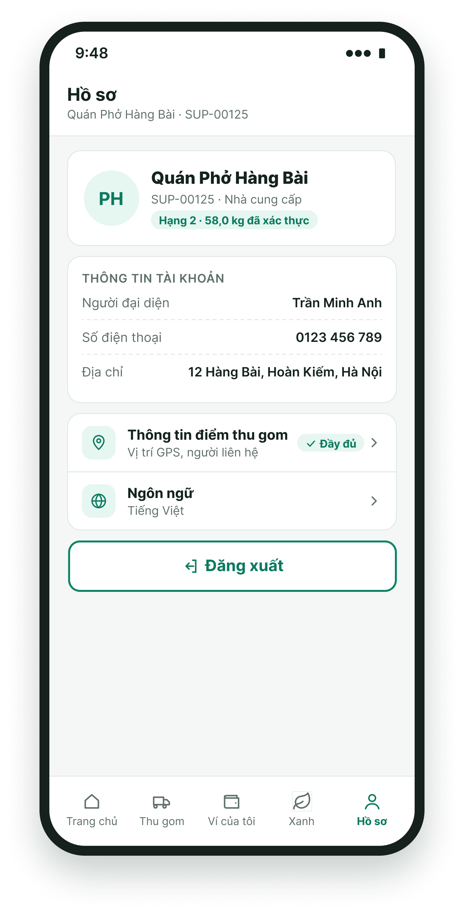
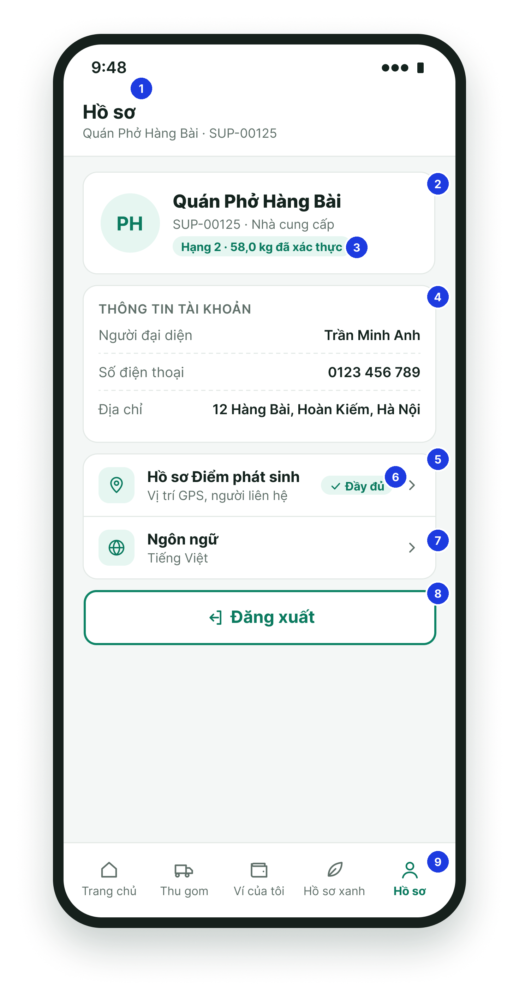
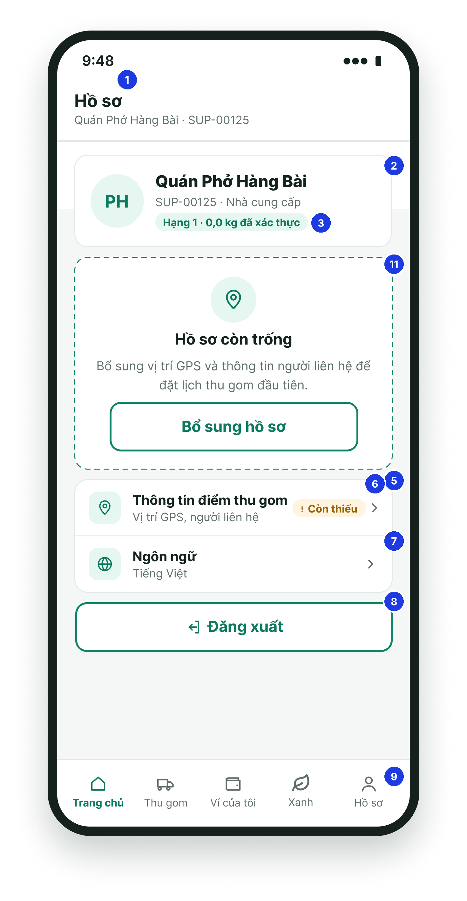
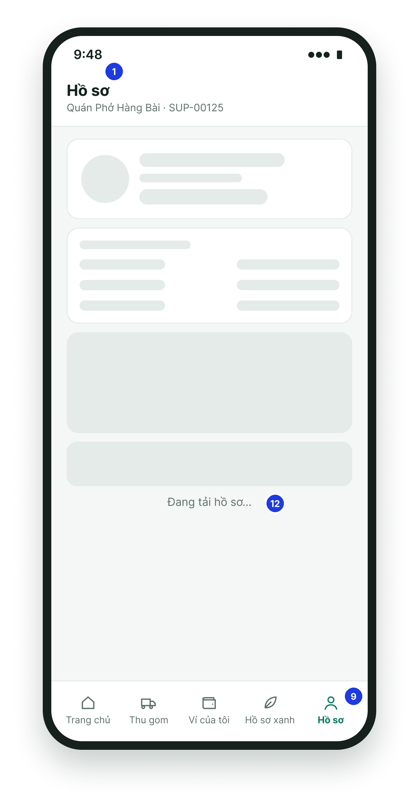
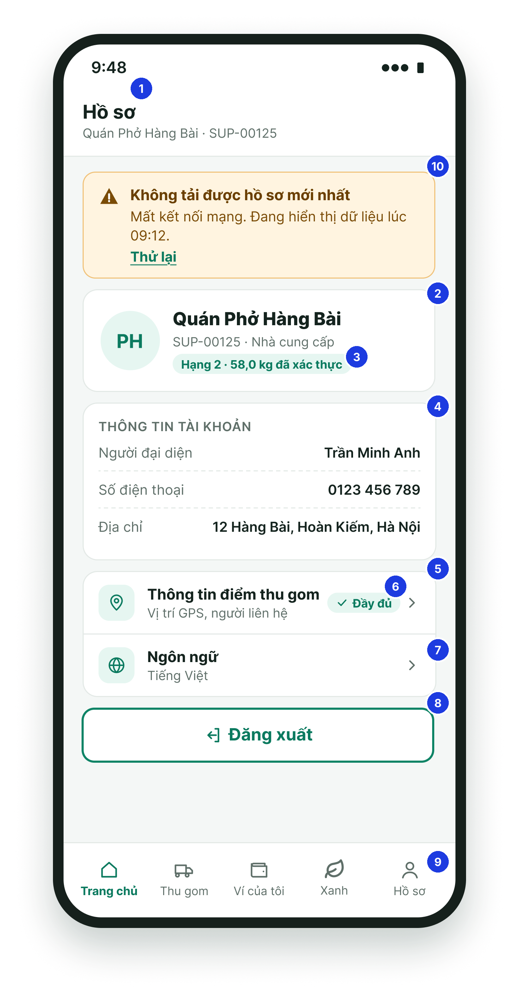
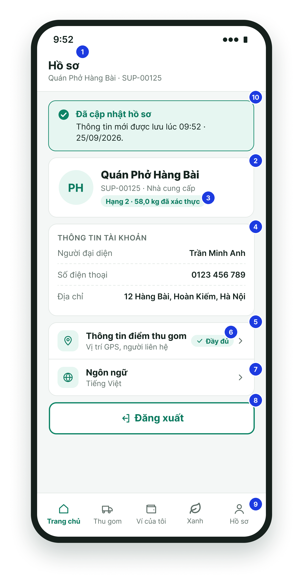

# Screen Spec: S-F01-06 Supplier profile

| Field | Value |
|---|---|
| Screen ID | S-F01-06 |
| Screen name | Supplier profile |
| Actor | Supplier |
| Priority | Must |
| Feature | F-01 Supplier Portal & Account Management |
| Activity diagrams | Not specified |
| Mockup images | `img/S-F01-06-default.png` (default), `img/S-F01-06-default-numbered.png`, four state images and four numbered state images (section 2) |
| Frame width | 390 × 844 px device frame (minimum supported width 360 px) |
| Figma frame | Figma file "S-F01-06 · Supplier profile" |
| Status | Draft |

## 1. Purpose

**Shown when:** the supplier taps the "Hồ sơ" tab in the bottom navigation bar, or returns to this screen after saving pickup point details on S-F01-02.

**The user leaves this screen when:** the supplier taps "Thông tin điểm thu gom" or "Bổ sung hồ sơ" to edit/complete pickup point details (S-F01-02), taps "Ngôn ngữ" to change app language, taps "Đăng xuất" to log out, or switches to another tab in the bottom navigation bar.

## 2. Mockup

**Numbered:** each number is the # of the element inventory in section 3. Element 4 (account information card) appears in the default, error and success states, and is replaced by element 11 (empty profile prompt card) in the empty state. Element 10 (status banner) appears only in the error state (amber offline banner) and the success state (green update confirmation banner). In the loading state the cards and button are replaced by unnumbered skeleton blocks, so only 1, 9 and 12 are numbered.

| Default, numbered | Empty, numbered | Loading, numbered | Error, numbered | Success, numbered |
|---|---|---|---|---|
|  |  |  |  |  |

| State | Image |
|---|---|
| Default | [`img/S-F01-06-default.png`](img/S-F01-06-default.png) |
| Empty | [`img/S-F01-06-empty.png`](img/S-F01-06-empty.png) |
| Loading | [`img/S-F01-06-loading.png`](img/S-F01-06-loading.png) |
| Error | [`img/S-F01-06-error.png`](img/S-F01-06-error.jpng) (network disconnected, showing cached profile data) |
| Success | [`img/S-F01-06-success.png`](img/S-F01-06-success.png) (profile updated confirmation) |

All colours, fonts and corners come from the design tokens in
[ui-conventions.md](../ui-conventions.md#6-design-tokens).

## 3. Element inventory

| # | Element | Type | Content / data source | Required | Validation |
|---|---|---|---|---|---|
| 1 | Title and context line | Header | static "Hồ sơ" + `point_of_origin.name` · `supplier.supplier_id` (e.g. `Quán Phở Hàng Bài · SUP-00125`) | Yes | formats from ui-conventions §2 |
| 2 | Supplier identity card | Card | avatar initials derived from `point_of_origin.name` (e.g. "PH"), `point_of_origin.name` ("Quán Phở Hàng Bài"), `supplier.supplier_id` · static role label "Nhà cung cấp", plus element 3 | Yes | none |
| 3 | Tier and verified volume badge | Badge | `supplier.tier` · `supplier.verified_volume_kg` + "kg đã xác thực" (e.g. "Hạng 2 · 58,0 kg đã xác thực"; "Hạng 1 · 0,0 kg đã xác thực" in empty state) | Yes | badge text + colour (ui-conventions §3) |
| 4 | Account information card | Card | section header static "THÔNG TIN TÀI KHOẢN"; rows "Người đại diện" (`point_of_origin.contact_name`), "Số điện thoại" (`point_of_origin.contact_phone`), "Địa chỉ" (`point_of_origin.address`) | No | hidden when pickup point profile is empty (replaced by 11) |
| 5 | Pickup point details row | Navigation list item | pin icon + static "Thông tin điểm thu gom" + subtitle static "Vị trí GPS, người liên hệ" + element 6 + chevron | Yes | none |
| 6 | Pickup point completion badge | Badge | static "✓ Đầy đủ" when GPS and contact details are complete; static "! Còn thiếu" in empty state | Yes | badge text + icon (ui-conventions §3) |
| 7 | Language row | Navigation list item | globe icon + static "Ngôn ngữ" + current language `user.language` (e.g. "Tiếng Việt") + chevron | Yes | none |
| 8 | Đăng xuất | Secondary outlined button | logout icon + static label "Đăng xuất" | Yes | none |
| 9 | Bottom navigation bar | Tab bar | 5 tabs: "Trang chủ", "Thu gom", "Ví của tôi", "Xanh", "Hồ sơ" (active) | Yes | none |
| 10 | Status banner | Banner | Error state: warning icon + "Không tải được hồ sơ mới nhất" + "Mất kết nối mạng. Đang hiển thị dữ liệu lúc `cached_at`." (e.g. `09:12`) + link "Thử lại". Success state: check icon + "Đã cập nhật hồ sơ" + "Thông tin mới được lưu lúc `updated_at`." (e.g. `09:52 · 25/09/2026`) | No | icon + text + colour (ui-conventions §5) |
| 11 | Empty profile prompt card | Card | pin icon + static "Hồ sơ còn trống" + static "Bổ sung vị trí GPS và thông tin người liên hệ để đặt lịch thu gom đầu tiên." + outlined button static "Bổ sung hồ sơ" | No | shown only in empty state in place of 4 |
| 12 | Loading text | Text | static "Đang tải hồ sơ..." | No | shown only in loading state |

## 4. States

| State | What the user sees | Trigger |
|---|---|---|
| Default | Header "Hồ sơ" / "Quán Phở Hàng Bài · SUP-00125"; identity card with avatar "PH", "Quán Phở Hàng Bài", "SUP-00125 · Nhà cung cấp" and badge "Hạng 2 · 58,0 kg đã xác thực"; card "THÔNG TIN TÀI KHOẢN" showing "Trần Minh Anh", "0123 456 789", "12 Hàng Bài, Hoàn Kiếm, Hà Nội"; settings card with "Thông tin điểm thu gom" (badge "✓ Đầy đủ") and "Ngôn ngữ" ("Tiếng Việt"); outlined button "Đăng xuất"; bottom navigation bar with "Hồ sơ" active. | Profile loaded and pickup point details are complete |
| Empty (no data) | Identity card shows badge "Hạng 1 · 0,0 kg đã xác thực"; account information card is replaced by a dashed card "Hồ sơ còn trống" with body text and button "Bổ sung hồ sơ"; "Thông tin điểm thu gom" shows amber badge "! Còn thiếu". | First open before GPS and contact details are added |
| Loading | Identity card, account card, settings card and logout button are replaced by grey skeleton placeholders, with centered text "Đang tải hồ sơ..." below. | Profile data is being fetched |
| Error | Amber warning banner above the identity card: "Không tải được hồ sơ mới nhất / Mất kết nối mạng. Đang hiển thị dữ liệu lúc 09:12." with underlined link "Thử lại"; last cached profile cards remain visible below. | Network request fails while refreshing profile data |
| Success / confirmation | Green banner above the identity card: "Đã cập nhật hồ sơ / Thông tin mới được lưu lúc 09:52 · 25/09/2026."; updated profile cards shown below. | Supplier saves changes on S-F01-02 and returns to this screen |

## 5. Interactions and navigation

| # | Element | User action | System response | Goes to screen |
|---|---|---|---|---|
| 1 | Thông tin điểm thu gom | tap | Opens the pickup point profile form to view or edit GPS location and contact details | S-F01-02 |
| 2 | Bổ sung hồ sơ | tap (empty state) | Opens the pickup point profile form to fill in missing GPS location and contact details | S-F01-02 |
| 3 | Ngôn ngữ | tap | Opens language selection | Language settings |
| 4 | Đăng xuất | tap | Signs the supplier out of the current session | Login screen |
| 5 | Thử lại | tap (error state) | Re-fetches the latest profile data (shows loading state, then default or error state) | stays |
| 6 | Bottom navigation bar | tap | Switches to the selected top-level section ("Trang chủ", "Thu gom", "Ví của tôi", "Xanh", or stays on "Hồ sơ") | Selected tab screen |

## 6. Screen-level rules

| Rule ID | Rule | Source |
|---|---|---|
| SR-001 | Account and pickup point fields on this screen are read-only; edits are performed on S-F01-02. | Mockup layout; S-F01-03 SR-004 |
| SR-002 | When GPS location or contact details are missing, the screen hides the account details summary, displays the empty profile prompt card ("Hồ sơ còn trống") and marks "Thông tin điểm thu gom" as "! Còn thiếu". | Empty state mockup |
| SR-003 | When profile refresh fails due to a network error, previously cached profile data remains displayed beneath the warning banner with the cached timestamp and a "Thử lại" action. | Error state mockup |
| SR-004 | Status badges and banners convey state using both icon and text, never colour alone. | ui-conventions §3, §5 |

## 7. Linked requirements

| FR ID | What this screen does for it |
|---|---|
| FR-01-02 | Displays the supplier's saved contact and pickup point completion status, and navigates to S-F01-02 to add or edit pickup point details |

## 8. Responsive and accessibility notes

- Smallest supported width: 360px; key-value rows in "THÔNG TIN TÀI KHOẢN" wrap long addresses cleanly without overlapping labels.
- Main content area scrolls vertically above the fixed bottom navigation bar.
- Touch targets at least 44 × 44: navigation list rows ("Thông tin điểm thu gom", "Ngôn ngữ") at least 48px high, "Bổ sung hồ sơ" and "Đăng xuất" buttons at least 48px high, bottom navigation tabs at least 48px high, and "Thử lại" link padded to at least 44 × 44 tap area.
- Badges ("✓ Đầy đủ", "! Còn thiếu") and banners use icons and explicit text labels in addition to semantic colours.
- Body text contrast at least 4.5:1.

## 9. Open questions

| # | Question | Blocking? | Status |
|---|---|---|---|
| 1 | [NEEDS CLARIFICATION: in the empty, loading, error and success mockups, the bottom navigation bar highlights "Trang chủ" instead of "Hồ sơ" as the active tab.] | No | Open. Default: keep "Hồ sơ" highlighted as active across all states of S-F01-06 (as shown in the default mockup). |
| 2 | [NEEDS CLARIFICATION: exact Screen IDs for "Ngôn ngữ", "Đăng xuất" target (login), and the other bottom navigation tabs ("Trang chủ", "Thu gom", "Ví của tôi", "Xanh") were not provided in the context.] | No | Open. Default: map to the corresponding Screen IDs from the project Screen List during build. |
| 3 | [NEEDS CLARIFICATION: exact FR IDs (beyond FR-01-02 referenced from S-F01-03) and Activity Diagram IDs for viewing profile, changing language and logging out were not provided.] | No | Open. Default: link corresponding F-01 FR IDs from the Function List. |

---

## Completion checklist

- [x] The mockup is a separate cropped image file, named with the Screen ID, at the frame width.
- [x] The numbered image exists, and its numbers match the # column of the element inventory.
- [x] Every visible element in the mockup appears in the element inventory.
- [ ] Every colour in the mockup is a design token from ui-conventions.md.
- [x] Every input element has a validation rule or an explicit "none".
- [x] All five states are filled in.
- [ ] Every navigation target is a Screen ID that exists in the Screen List (S-F01-02 is linked; remaining destinations use descriptive names pending Screen List IDs).
- [x] Every element that displays data names the field it displays.
- [ ] Every linked FR exists in the Function List (only FR-01-02 confirmed from S-F01-03; remaining F-01 FR IDs noted in open questions).
