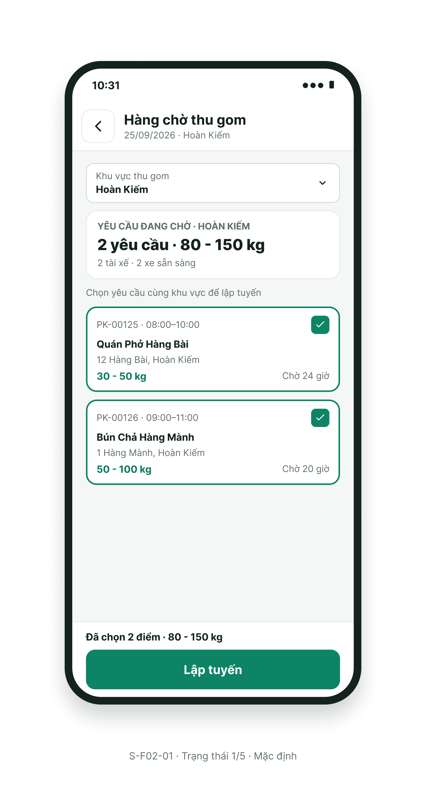
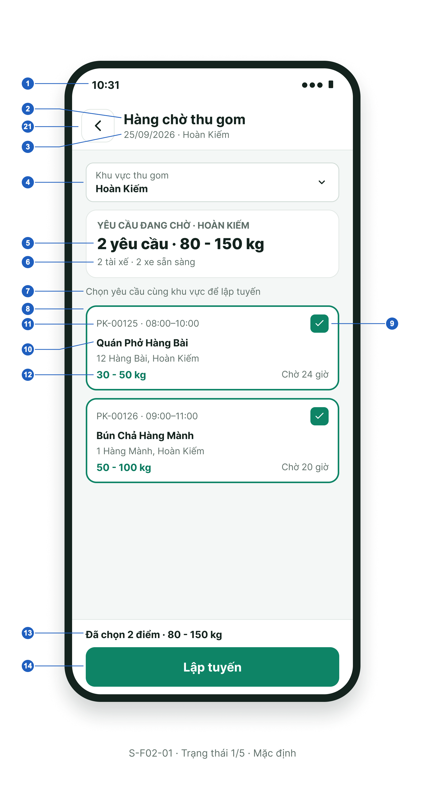
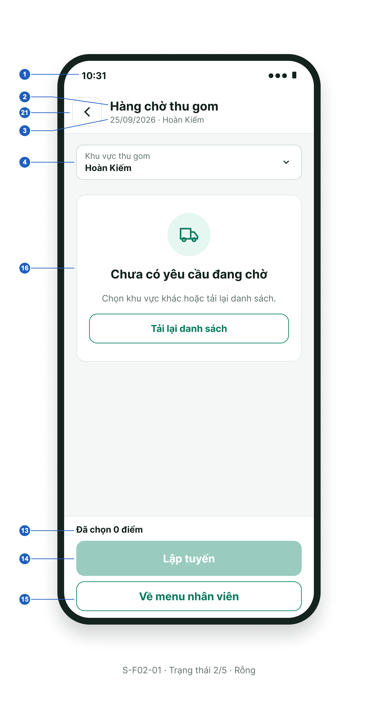
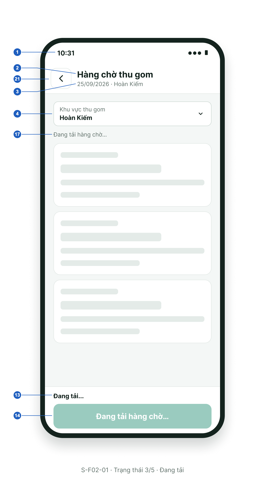
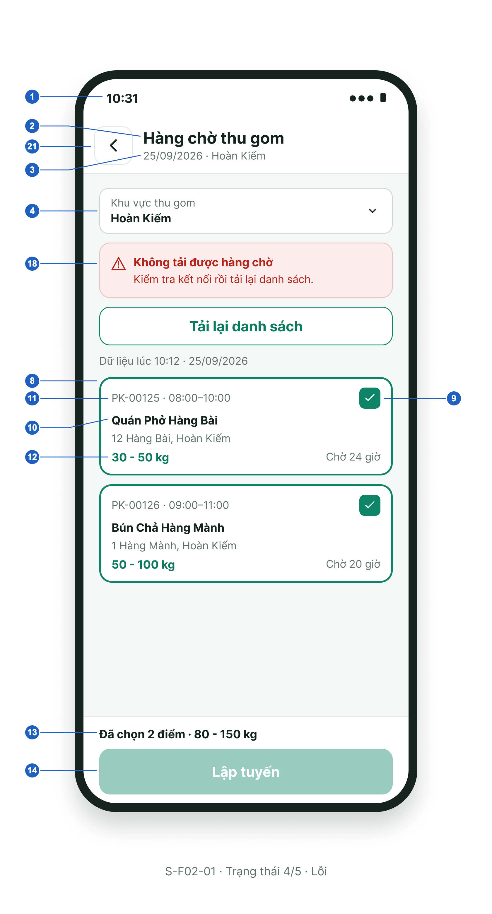
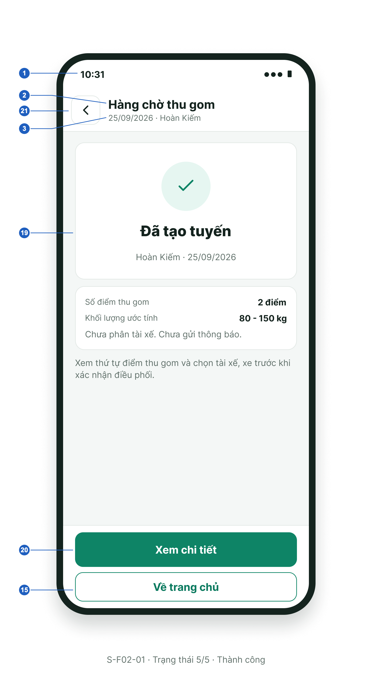

# Screen Spec: S-F02-01 Dispatch queue

| Field | Value |
|---|---|
| Screen ID | S-F02-01 |
| Screen name | Dispatch queue |
| Actor | ReFeed Staff |
| Priority | Must |
| Feature | F-02 Collection Operations & Handover |
| Activity diagrams | AD-UC-05 a1, s1–s3; SD-UC-05 (route proposal before confirmation) |
| Mockup images | `img/S-F02-01-default.png` (default), `img/S-F02-01-default-numbered.png`, four state images and four numbered state images (section 2) |
| Frame width | 370px screen inside a 390 × 844 device frame; minimum 360px. The five supplied PNG exports are 1680 × 3120 pixels, including the surrounding margin and state caption; retained at their original size. |
| Figma frame | Five supplied exports captioned "S-F02-01 · Trạng thái 1/5" through "5/5"; corresponding Figma node links were not supplied for these images. |
| Status | Draft |

## 1. Purpose

**Shown when:** authorised ReFeed Staff open "Hàng chờ thu gom" from the Staff main menu or the pending-pickup drill-down on S-F06-01. The screen shows pending pickup requests for the selected collection area and date, their estimated quantities and waiting times, and available drivers and vehicles.

**The user leaves this screen when:** they select requests, obtain a proposed route and tap "Xem chi tiết" to review it on S-F02-02, or return to the Staff main menu. Route planning on this screen does not assign a driver or vehicle, change a pickup to Driver Assigned, or send a driver notification.

## 2. Mockup

**Numbered:** each blue number is the # of the element inventory in section 3. The numbers and leader lines are documentation annotations added to copies of the supplied images; the five clean images are unchanged. Repeated cards are numbered on their first occurrence. Elements 5–7 appear only in Default, 16 only in Empty, 17 only in Loading, 18 only in Error, and 19–20 only in Success. Element 15 has different return labels in Empty and Success. Back (21) appears in all five states. The success confirmation (19) includes the route summary and next-step guidance; it replaces the selector and queue.

| Default, numbered | Empty, numbered | Loading, numbered | Error, numbered | Success, numbered |
|---|---|---|---|---|
|  |  |  |  |  |

| State | Image |
|---|---|
| Default | [`img/S-F02-01-default.png`](img/S-F02-01-default.png) |
| Empty | [`img/S-F02-01-empty.png`](img/S-F02-01-empty.png) |
| Loading | [`img/S-F02-01-loading.png`](img/S-F02-01-loading.png) |
| Error | [`img/S-F02-01-error.png`](img/S-F02-01-error.png) (refresh failed; cached requests and selection remain visible) |
| Success | [`img/S-F02-01-success.png`](img/S-F02-01-success.png) (route proposal ready; no driver assigned or notification sent) |

Colours, fonts and corners are specified by the design tokens in
[ui-conventions.md](../ui-conventions.md#6-design-tokens). The supplied exports remain the visual reference for this spec; token compliance has not been fully verified. Their export size differs from the shared 1470 × 2832 export convention. Counts, resource availability and records shown below are mockup examples, not live operational data.

## 3. Element inventory

| # | Element | Type | Content / data source | Required | Validation |
|---|---|---|---|---|---|
| 1 | Status bar | Device chrome | Mockup time "10:31", three dots and a narrow vertical indicator | Yes | None; device chrome, not application data |
| 2 | Title | Header | Static: "Hàng chờ thu gom" | Yes | None; Back (21) on the left, context (3) below |
| 3 | Context line | Text | `planning_date` · `area.name`; example "25/09/2026 · Hoàn Kiếm" | Yes | `dd/MM/yyyy`; matches the active date and area |
| 4 | Khu vực thu gom | Selector | `area.id`, `area.name`; authorised collection areas; Hoàn Kiếm selected | Conditional | Default, Empty, Loading and Error; exactly one active area; changing it clears the selection; disabled during a fetch |
| 5 | Queue summary | Stat card | "YÊU CẦU ĐANG CHỜ · " + `area.name`; `pending_count`; sums of `estimated_volume_min/max` across the active queue | Conditional | Default only; active date and area; example "2 yêu cầu · 80 - 150 kg" |
| 6 | Resource availability | Text inside summary | `available_driver_count`, `available_vehicle_count`; example "2 tài xế · 2 xe sẵn sàng" | Conditional | Default only; availability for planning, not an assignment or a guarantee that a particular grouping fits capacity |
| 7 | Selection guidance | Text | Static: "Chọn yêu cầu cùng khu vực để lập tuyến" | Conditional | Default only; above the list |
| 8 | Pickup cards | Scrollable selectable list | Active-date, active-area pending pickups; current data in Default, cached data in Error | Conditional | No cross-area selection; default order is oldest `created_at` first, pending confirmation in section 9 |
| 9 | Selection control | Checkbox | Membership of `pickup.id` in `selected_pickup_ids` | Conditional | Whole card toggles the checkbox once; green border plus white check mark indicates selection; disabled while loading or showing stale data |
| 10 | Request and supplier | Text inside card | `pickup.id`, `supplier.business_name`, `supplier.address`; e.g. PK-00125, Quán Phở Hàng Bài, 12 Hàng Bài, Hoàn Kiếm | Conditional | `PK-` + 5 digits; names and addresses wrap; each card identifies its own request |
| 11 | Appointment and waiting time | Text inside card | `pickup.time_window`; elapsed time from `pickup.created_at` to the current data snapshot | Conditional | `HH:mm–HH:mm` because the date is in the header; "Chờ " + hours + " giờ"; cached durations remain tied to the labelled snapshot |
| 12 | Estimated quantity | Text inside card | `pickup.estimated_volume_min`, `pickup.estimated_volume_max` | Conditional | Whole-kg range; minimum ≤ maximum; e.g. "30 - 50 kg"; do not convert to litres |
| 13 | Selection summary | Fixed footer text | Selected count and sums of selected estimate bounds; "Đã chọn 2 điểm · 80 - 150 kg", "Đã chọn 0 điểm", or "Đang tải…" | Conditional | Default, Empty, Loading and Error; count selected requests only; while fetching show loading text without an invented zero count |
| 14 | Lập tuyến | Primary button | Static: "Lập tuyến"; loading label "Đang tải hàng chờ…" | Conditional | Default, Empty, Loading and Error; enabled only with a nonempty, current, eligible selection and available planning inputs; disabled in Empty, Loading and Error; replaced by (20) in Success |
| 15 | Return action | Secondary button | Empty: "Về menu nhân viên"; Success: "Về trang chủ" | Conditional | Empty and Success only; intended destination is Staff main menu; the Success label needs confirmation (section 9); no dispatch side effects |
| 16 | Empty message | Card with secondary button | Truck icon; "Chưa có yêu cầu đang chờ"; "Chọn khu vực khác hoặc tải lại danh sách."; "Tải lại danh sách" | Conditional | Shown only after a successful query returns no eligible requests; reload the active area, or choose another area |
| 17 | Loading message | Text and skeleton cards | "Đang tải hàng chờ…" above three placeholder cards | Conditional | No interactive skeletons, queue totals or request selection; footer (13–14) also shows loading |
| 18 | Error, retry and cache timestamp | Banner, secondary button and text | Warning icon; "Không tải được hàng chờ"; "Kiểm tra kết nối rồi tải lại danh sách."; "Tải lại danh sách"; `queue.loaded_at` as "Dữ liệu lúc 10:12 · 25/09/2026" | Conditional | Error only; keep the active area and cached selection; disable planning until the data is successfully refreshed |
| 19 | Route-ready confirmation | Success card, summary card and guidance | Check icon; "Đã tạo tuyến"; `draft.area_name` · `draft.planning_date`; "Số điểm thu gom" / `draft.stop_count`; "Khối lượng ước tính" / summed estimate bounds; "Chưa phân tài xế. Chưa gửi thông báo."; next-step guidance | Conditional | Success only; example Hoàn Kiếm · 25/09/2026, 2 điểm, 80 - 150 kg; route proposal only, awaiting review and final dispatch confirmation |
| 20 | Xem chi tiết | Primary button | Static label; returned draft-route reference | Success | Open the same proposed route on S-F02-02; do not create or dispatch a second route |
| 21 | Back | Header icon button | Left chevron; accessible name "Về menu nhân viên" | Yes | At least 44 × 44px; present and usable in all five states; returns to Staff main menu as defined by Screen Transition |

## 4. States

| State | What the user sees | Trigger |
|---|---|---|
| Default | Header "Hàng chờ thu gom", "25/09/2026 · Hoàn Kiếm"; area Hoàn Kiếm; summary "YÊU CẦU ĐANG CHỜ · HOÀN KIẾM", "2 yêu cầu · 80 - 150 kg", "2 tài xế · 2 xe sẵn sàng"; guidance "Chọn yêu cầu cùng khu vực để lập tuyến". Two cards are selected: PK-00125 · 08:00–10:00, Quán Phở Hàng Bài, 12 Hàng Bài, Hoàn Kiếm, 30 - 50 kg, Chờ 24 giờ; PK-00126 · 09:00–11:00, Bún Chả Hàng Mành, 1 Hàng Mành, Hoàn Kiếm, 50 - 100 kg, Chờ 20 giờ. Footer "Đã chọn 2 điểm · 80 - 150 kg" and enabled "Lập tuyến". | Current queue and resource inputs loaded; the example shows staff having selected both requests, not automatic selection on every entry |
| Empty (no data) | Area selector retained. Truck card "Chưa có yêu cầu đang chờ" — "Chọn khu vực khác hoặc tải lại danh sách." with "Tải lại danh sách". No queue summary or selectable cards. Footer "Đã chọn 0 điểm", disabled "Lập tuyến", and "Về menu nhân viên". | Successful active-date, active-area query returns no eligible pending requests |
| Loading | Area Hoàn Kiếm retained; "Đang tải hàng chờ…" and three skeleton cards. Footer "Đang tải…" and disabled "Đang tải hàng chờ…". No request cards, selection count, resource totals or footer return action. Back remains available. | Initial fetch, area change or reload is in progress; area selection and planning wait for the result |
| Error | Area selector retained; red warning "Không tải được hàng chờ" — "Kiểm tra kết nối rồi tải lại danh sách."; "Tải lại danh sách"; "Dữ liệu lúc 10:12 · 25/09/2026". The same two cached cards stay selected. Footer "Đã chọn 2 điểm · 80 - 150 kg" but "Lập tuyến" is disabled. Queue summary and guidance are absent. | Queue refresh fails while a previous snapshot and selection are available; this mockup does not show a first-load failure without cached data |
| Success / confirmation | Check card "Đã tạo tuyến" — "Hoàn Kiếm · 25/09/2026". Summary "Số điểm thu gom" = "2 điểm", "Khối lượng ước tính" = "80 - 150 kg", and "Chưa phân tài xế. Chưa gửi thông báo." Guidance: "Xem thứ tự điểm thu gom và chọn tài xế, xe trước khi xác nhận điều phối." Selector, queue and selection summary are replaced. Footer "Xem chi tiết" and "Về trang chủ"; Back retained. | Planner returns a feasible proposed route and optimized visiting order; dispatch has not been confirmed |

## 5. Interactions and navigation

| # | Element | User action | System response | Goes to screen |
|---|---|---|---|---|
| 1 | Khu vực thu gom (4) | choose an authorised area | Update context; clear the old selection; fetch the new area's queue and resource inputs; show Loading, then Default, Empty or Error | stays |
| 2 | Pickup card / checkbox (8–9) | tap while current data is available | Toggle that request once; update selected count, summed quantity bounds and planning-button eligibility; do not change its business status | stays |
| 3 | Lập tuyến (14) | tap when enabled | Revalidate selected requests, date, area and capacity inputs; group demand within vehicle capacity and obtain the visiting order through the route-planning service; show Success when the proposal is ready; prevent duplicate submissions | stays (Success); subsequent "Xem chi tiết" opens S-F02-02 |
| 4 | Tải lại danh sách (16 or 18) | tap | Reload the active-date, active-area queue and resource inputs; preserve selected IDs only if still eligible after revalidation; show the resulting state | stays |
| 5 | Xem chi tiết (20) | tap in Success | Open the returned proposed route for reviewing stop order and selecting resources; final dispatch confirmation belongs there | S-F02-02 |
| 6 | Về menu nhân viên / Về trang chủ (15) | tap in Empty or Success | Return without assignment, pickup-status changes or driver notification; Success wording remains open in section 9 | Staff main menu (existing role-menu node; no Screen ID assigned) |
| 7 | Queue list (8) | scroll | Reveal further pickup cards; keep the footer visible and the last card reachable above it | stays |
| 8 | Back (21) | tap in any state | Return to the Staff main menu, including after entry from S-F06-01; ignore late fetch/planner navigation after leaving; no dispatch side effects | Staff main menu (existing role-menu node; no Screen ID assigned) |

## 6. Screen-level rules

| Rule ID | Rule | Source |
|---|---|---|
| SR-001 | Only authorised ReFeed Staff may load the queue or request planning; area choices and pickup data follow their access permissions. | FR-06-03 |
| SR-002 | A proposal uses one active collection date and area. Revalidate eligibility before planning. Default pending eligibility is Requested only; broader status policy remains open. | FR-02-01; AD-UC-05; section 9 |
| SR-003 | The queue summary counts all eligible requests in the active scope. The footer counts only selected requests. The selected cards in the Default illustration do not require automatic selection on entry. | FR-02-01; supplied Default mockup |
| SR-004 | Sum estimate minima and maxima separately in kg: the illustrated 30 - 50 kg and 50 - 100 kg yield 80 - 150 kg. Use the sum of upper bounds for capacity checking as a draft assumption until the demand-estimation policy is agreed. | UI conventions §2; FR-02-01; section 9 |
| SR-005 | The collection service groups pickups within vehicle capacity before requesting an optimized visiting order from Google Maps. Resource counts alone do not prove feasibility; an infeasible proposal cannot proceed. | AD-UC-05 s1–s3; SD-UC-05 |
| SR-006 | "Đã tạo tuyến" confirms a route proposal only. Driver/vehicle assignment, the Driver Assigned pickup status and driver notification occur only after the reviewed proposal is confirmed on S-F02-02. | AD-UC-05 confirmation gate; SD-UC-05; supplied Success mockup |
| SR-007 | Empty is a successful query with no eligible requests. A failed refresh is Error: show cache time, retain the cached selection for reference and disable "Lập tuyến" until refreshed. Do not present cached resource availability as current. | Supplied Empty and Error mockups; recovery behaviour specified for this screen |
| SR-008 | While fetching, show the supplied skeletons and busy footer without fabricated counts. While a planning request is pending, prevent duplicate planning and retain the eligible selection; its detailed busy and failure presentation is not included in the five supplied images. | UI conventions §3; supplied Loading mockup; section 9 |
| SR-009 | Header Back returns to Staff main menu as specified by Screen Transition, including when the screen was opened from S-F06-01. Return actions do not dispatch. Draft storage, expiry and reuse after leaving require confirmation. | Screen Transition §4; AD-UC-05 alternative end state; section 9 |

## 7. Linked requirements

| FR ID | What this screen does for it |
|---|---|
| FR-02-01 | Shows pending pickups by area, estimated demand, waiting times and available resources; takes a selection and requests a capacity-constrained route proposal with an optimized visiting order. Opens S-F02-02 for review and dispatch confirmation. |
| FR-06-03 | Restricts queue data, area choices and planning actions to authorised staff. |

## 8. Responsive and accessibility notes

- Designed on the team's 370 × 824 screen inside a 390 × 844 device frame; smallest supported width 360px. The supplied 1680 × 3120 exports include margins and captions, which are documentation rather than application content.
- Content scrolls independently above the fixed footer. Reserve space for the tallest footer variant with two buttons so the last card or guidance remains reachable. There is no supplier bottom navigation on this staff screen.
- Use Inter and the shared typography tokens. Long supplier names, addresses, context and summary text wrap without overlapping the checkbox or clipping action labels.
- Back, selector, retry and footer controls have at least 44 × 44px touch targets; primary buttons are 52px high. The visual checkbox is 24 × 24px; its whole card is the tap target, with one toggle per activation.
- Expose each card as a labelled checkbox with its checked state, request ID, appointment, supplier, address, estimated range and waiting time. A check icon and border distinguish selection; do not rely on colour alone.
- Announce loading, errors, refreshed results and route-ready confirmation. Skeletons are decorative; disabled planning actions cannot be activated. Keep Back available while fetching; restore focus sensibly after reload or state replacement.
- Body and enabled button text must meet 4.5:1 contrast. The faded disabled primary is inactive; colour and token compliance of the supplied raster images still needs verification.

## 9. Open questions

| # | Question | Blocking? | Status |
|---|---|---|---|
| 1 | [NEEDS CLARIFICATION: should Success say "Đã tạo tuyến nháp" and "Xem tuyến nháp" to distinguish a proposal from confirmed dispatch?] | No for this spec | Open. Preserve the supplied "Đã tạo tuyến" and "Xem chi tiết"; the no-assignment/no-notification text and S-F02-02 review step define the current behaviour. |
| 2 | [NEEDS CLARIFICATION: should Success "Về trang chủ" and Empty "Về menu nhân viên" share one label and destination? The Staff main menu also has no Screen ID in the Screen List.] | Yes for final navigation mapping | Open. Default: both return to the existing Staff main menu node, following the Back transition; do not silently substitute S-F06-01 or invent a Screen ID. |
| 3 | [NEEDS CLARIFICATION: which statuses qualify as pending, and what is the queue ordering and waiting-time rounding policy?] | Yes for queue implementation | Open. Default: Requested only, oldest `created_at` first, whole elapsed hours at the current data snapshot; confirm before implementation. |
| 4 | [NEEDS CLARIFICATION: how are estimated quantity ranges converted into demand for vehicle-capacity checking, and which driver/vehicle availability rules apply?] | Yes for planner implementation | Open. Draft assumption: sum the upper bounds in kg; the example sums to 150 kg. No litre/kg conversion. Staff reviews/selects resources on S-F02-02; assignment remains behind final confirmation. |
| 5 | [NEEDS CLARIFICATION: what should staff see if planning fails, no grouping fits capacity, or the first queue load fails without cached data?] | Yes for complete failure handling | Open. These variants are not pictured. Default: explain the failure and allow recovery, retain still-eligible selection, prevent stale or infeasible planning, and perform no dispatch; final copy/layout remains to be designed. |
| 6 | [NEEDS CLARIFICATION: is a route proposal stored before dispatch, and can it be recovered or reused after leaving this screen?] | Yes for draft lifecycle | Open in AD-UC-05. Do not claim the draft is saved, deleted or dispatched on return; the Success action opens the proposal returned by this planning attempt. |
| 7 | [NEEDS CLARIFICATION: should the shared conventions document the supplied Back header and 1680 × 3120 export size, and do all raster colours match the token library?] | No for this spec | Open. Keep the supplied images and Back pattern unchanged; preserve the shared logical screen size and accessibility targets. Full token verification is pending. |

---

## Completion checklist

- [x] The five mockups are separate image files named with the Screen ID; supplied 1680 × 3120 exports are retained unchanged, including margins and captions.
- [x] The numbered images exist, and their numbers match the # column of the element inventory.
- [x] Every visible element in the mockups appears in the element inventory.
- [ ] Every colour in the mockups is a design token from ui-conventions.md.
- [x] Every input element has a validation rule or an explicit "none".
- [x] All five states are filled in.
- [ ] Every navigation target is a Screen ID that exists in the Screen List (Staff main menu remains an unnamed role-menu node; section 9).
- [x] Every element that displays data names the field it displays.
- [x] Every linked FR exists in the Function List; the queue/planning actions in AD-UC-05 a1, s1–s3 and SD-UC-05 are covered by interactions, with review and dispatch continuing on S-F02-02.
