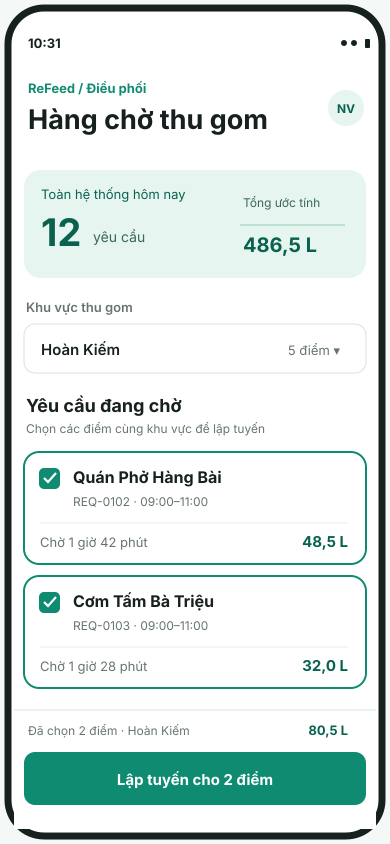

# Screen Spec: S-F02-01 Dispatch queue

| Field | Value |
|---|---|
| Screen ID | S-F02-01 |
| Screen name | Dispatch queue / Hàng chờ thu gom |
| Actor | ReFeed Staff |
| Priority | Must |
| Feature | F-02 Collection Operations & Handover |
| Activity diagram | AD-UC-05 (choose area and request a route plan) |
| Mockup image | [S-F02-01.svg](img/S-F02-01.svg), **390 × 844 mobile** |
| Status | Draft — mobile design baseline; not placed in Figma |

## 1. Purpose

Staff open the queue from the ReFeed Staff menu or S-F06-01 to find pending pickups in one area and select them for route planning. Tapping **Lập tuyến cho N điểm** sends the selection to the planner and opens S-F02-02 only when a feasible draft is returned. Opening this screen does **not** assign a driver, change pickup status or notify anyone.

## 2. Mockup and visual direction

Use the same 390 × 844 phone frame, white header, pale-green surfaces and deep-green actions as the existing ReFeed mobile mockups. A single green summary block gives pending count and estimated volume; below it, the area selector and vertically scrolling pickup cards carry the operational detail. Selected cards are outlined and have a checked control. The fixed bottom bar shows selection count, total volume and **one** primary action. Do not reproduce a desktop table, sidebar, multi-column KPI grid or miniature map on mobile.

## 3. Element inventory

| # | Element | Type | Content / data source | Required | Validation / behavior |
|---|---|---|---|---|---|
| 1 | Status bar | Device chrome | Time and system indicators | Yes | Mockup only; not app data |
| 2 | ReFeed / Điều phối | Header / navigation | Staff context; account/menu entry | Yes | 44 × 44 touch area for menu |
| 3 | Hàng chờ thu gom | Screen title | Static | Yes | Visible on scroll |
| 4 | Pending summary | Summary card | Count of `Requested` pickups; sum of `estimated_volume` | Yes | Integer count; one decimal + L |
| 5 | Khu vực thu gom | Selector | `area.id`, `area.name`, pending-stop count | Yes | One area active; changes reload list and clear incompatible selection |
| 6 | Queue heading and hint | Text | `Yêu cầu đang chờ`; guidance to select same-area requests | Yes | Static |
| 7 | Pickup cards | Scrollable list | `pickup_request` rows for selected area | Yes | Order by waiting time, oldest first |
| 8 | Selection control | Checkbox / card action | `selected_request_ids` | Yes | At least 44 × 44 target; explicit checked state |
| 9 | Supplier and request | Text | `supplier.business_name`, `pickup_request.id` | Yes | Request ID uses the source record; see format open question |
| 10 | Window and waiting time | Text | `pickup.time_window`, current time − `created_at` | Yes | HH:mm–HH:mm; duration rounded to minutes |
| 11 | Estimated volume | Text | `pickup.estimated_volume` | Yes | One decimal + L |
| 12 | Selection summary | Sticky footer | Selected stop count, area and total estimated volume | Yes | Recomputed after every selection |
| 13 | Lập tuyến cho N điểm | Primary button | Selected count | Yes | Disabled when selection empty; invokes planner, not dispatch |
| 14 | Empty state | Card | No pending requests in the chosen area + change-area/retry guidance | Conditional | Do not display blank list |
| 15 | Loading state | Skeleton cards | Summary and list being fetched | Conditional | Selection unavailable while loading |
| 16 | Error banner and retry | Banner/button | Load or planning failure | Conditional | Keep filters; preserve cached list if present |
| 17 | Refresh action | Header/menu action | Reload current area | Yes | Preserve area, revalidate selection |

## 4. States

| State | What the user sees | Trigger |
|---|---|---|
| Default | Hoàn Kiếm selected; summary `12 yêu cầu · 486,5 L` across the queue; two selected pickup cards REQ-0102 (48,5 L) and REQ-0103 (32,0 L); sticky bar `Đã chọn 2 điểm · 80,5 L` and enabled `Lập tuyến cho 2 điểm`. Summary scope and selected area differ: see open question 2. | Queue loaded |
| Empty | `Khu vực này chưa có yêu cầu đang chờ. Chọn khu vực khác hoặc tải lại danh sách.`; selector and refresh remain usable; planning disabled. | No pending pickups in selected area |
| Loading | Summary and two card skeletons with `Đang tải yêu cầu…`; area selector and planning disabled. | Initial load, area switch or refresh |
| Error | Banner `Không tải được hàng chờ. Kiểm tra kết nối rồi thử lại.` with `Tải lại danh sách`; cached cards remain if available and are marked as out of date; planning disabled until revalidated. | Fetch fails |
| Success / draft ready | Brief message `Đã tạo tuyến nháp cho 2 điểm`; navigate to S-F02-02 with the selected request IDs and computed order. No statuses change yet. | Planner returns a feasible draft |

## 5. Interactions and navigation

| Element | User action | System response | Goes to |
|---|---|---|---|
| Staff header/menu | Tap | Open staff navigation/account overlay | Stays |
| Area selector | Choose area | Reload area and clear selections from another area | Stays |
| Pickup card/checkbox | Tap | Toggle request; update total and button label | Stays |
| Lập tuyến cho N điểm | Tap with valid selection | Ask planner to group selected requests and optimize visit order | S-F02-02 when draft ready |
| Refresh/retry | Tap | Refetch and revalidate pending statuses | Stays |

## 6. Screen-level rules

| Rule | Requirement |
|---|---|
| SR-001 | Only pending `Requested` requests may be selected; statuses must be revalidated when planning. FR-02-01; AD-UC-05. |
| SR-002 | Only one area is planned at a time. If demand cannot fit an available vehicle, show `Không đủ sức chứa cho các điểm đã chọn. Bỏ chọn một điểm hoặc đổi xe ở bước tiếp theo.` and do not navigate. FR-02-01. |
| SR-003 | The footer count and volume come only from selected requests, never all pending requests. FR-02-01. |
| SR-004 | Creating a draft does not assign resources, dispatch or mark pickups Driver Assigned. AD-UC-05 confirmation gate. |
| SR-005 | Staff-only controls require authorised access. FR-06-03. |
| SR-006 | Selection state is conveyed by checkmark, border and accessible checked label, not colour alone. UI conventions §5. |

## 7. Linked requirements

| FR | Coverage |
|---|---|
| FR-02-01 | Shows pending requests by area, estimated demand and waiting time; starts route planning. |
| FR-06-03 | Restricts planning to authorised ReFeed Staff. |

## 8. Mobile and accessibility notes

- Design frame **390 × 844**; minimum supported width **360 px**. Cards stack vertically; the list scrolls beneath a fixed action footer.
- All taps, the area selector, cards and buttons have 44 × 44 px minimum targets; primary button at least 52 px high.
- On 360 px, supplier names wrap; volume and request ID remain readable. Add bottom scroll padding so the last card is not covered by the fixed footer.
- Every selected state and error has explicit text/icon; body text contrast target ≥ 4.5:1.

## 9. Open questions

| # | Question | Blocking? | Default |
|---|---|---|---|
| 1 | Which pickup statuses qualify as pending? | Yes for implementation | `Requested` only until W1 status catalogue is settled. |
| 2 | Does the summary count cover all areas or only the active area? | No | All-area total; the area selector/list is Hoàn Kiếm only. Label the scope in Figma. |
| 3 | What request ID format should appear? Existing driver mockups use `PK-` while UI conventions require `REQ-`. | Yes for cross-screen consistency | Use `REQ-` in this draft; do not silently invent an ID mapping. |

## Completion checklist

- [x] Mobile 390 × 844 mockup replaces the desktop layout.
- [x] Five states, input fields, actions and requirement trace are defined.
- [ ] Figma frame, final components and state exports have not been created in the shared Figma file.
