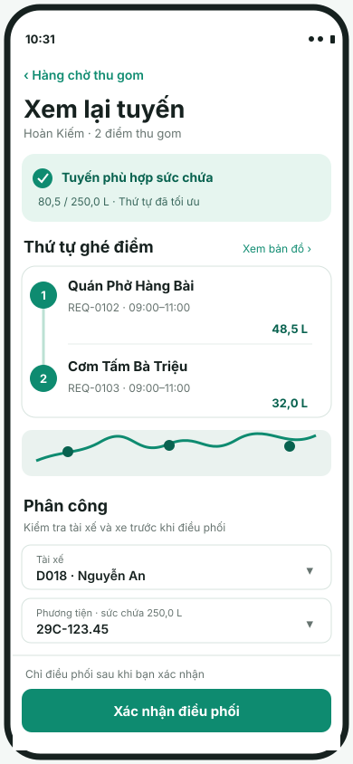

# Screen Spec: S-F02-02 Route review and dispatch

| Field | Value |
|---|---|
| Screen ID | S-F02-02 |
| Screen name | Route review and dispatch / Xem lại tuyến |
| Actor | ReFeed Staff |
| Priority | Must |
| Feature | F-02 Collection Operations & Handover |
| Activity diagram | AD-UC-05 (review proposal, confirm or leave without dispatch) |
| Mockup image | [S-F02-02.svg](img/S-F02-02.svg), **390 × 844 mobile** |
| Modal | `Confirm route and dispatch?` / `Xác nhận điều phối tuyến?` |
| Status | Draft — mobile design baseline; not placed in Figma |

## 1. Purpose

Staff arrive from S-F02-01 after a feasible route proposal is calculated. They review the ordered stops, demand versus vehicle capacity, driver and vehicle. Only after an explicit confirmation does the system assign resources, save and dispatch the route, change included pickups to `Driver Assigned` and notify the driver. Returning to the queue leaves pickups unchanged.

## 2. Mockup and visual direction

Keep the ReFeed 390 × 844 phone frame, white header, quiet mint canvas and green primary action. On mobile, prioritise the **ordered pickup list** over the map: the numbered sequence is the operational truth. A compact route strip represents the itinerary, with `Xem bản đồ` as an optional secondary view. Driver and vehicle selectors stack below the route. The fixed footer states the confirmation consequence; there is no desktop three-column dashboard or sidebar.

## 3. Element inventory

| # | Element | Type | Content / data source | Required | Validation / behavior |
|---|---|---|---|---|---|
| 1 | Status bar | Device chrome | Time and system indicators | Yes | Mockup only |
| 2 | Back | Link/button | `Hàng chờ thu gom` | Yes | Returns to S-F02-01 without dispatch |
| 3 | Title and context | Header | `Xem lại tuyến`; `route.area`; stop count | Yes | Count matches route stops |
| 4 | Capacity banner | Banner | `route.total_estimated_volume`, `vehicle.capacity`, optimized-order status | Yes | Text + check/warning icon; no colour-only meaning |
| 5 | Thứ tự ghé điểm | Ordered list | `route.stops` in optimized `sequence` order | Yes | Every stop represented; list scrolls |
| 6 | Stop card/row | List item | Sequence, supplier name, request ID, time window and estimated volume | Yes | `REQ-` ID, HH:mm–HH:mm, one decimal + L |
| 7 | Map link and route strip | Link/visual | Opens ordered route map; strip is a summary, not a precise street map | No | Text list remains usable without map |
| 8 | Driver selector | Select | Available `driver.id`, `driver.name` | Yes | Required; availability rechecked at confirmation |
| 9 | Vehicle selector | Select | Available `vehicle.plate`, `vehicle.capacity` | Yes | Required; capacity must cover total demand |
| 10 | Dispatch consequence | Footer copy | `Chỉ điều phối sau khi bạn xác nhận` | Yes | Visible before primary action |
| 11 | Xác nhận điều phối | Primary button | Opens confirmation modal | Yes | Disabled until driver, vehicle, capacity and draft are valid |
| 12 | Confirmation modal | Modal | Area, stop count, total volume, driver and vehicle; final effect | On action | Secondary `Quay lại`; primary `Điều phối tuyến` |
| 13 | Loading/saving | Progress | Planner or dispatch in progress | Conditional | No duplicate submission |
| 14 | Error banner | Banner | Planner, capacity, stale assignment or dispatch failure | Conditional | Actionable retry |
| 15 | Success summary | Confirmation | Route ID, driver, vehicle, number of assigned pickups, notification result | Conditional | Includes `Về hàng chờ` |

## 4. States

| State | What the user sees | Trigger |
|---|---|---|
| Default | Hoàn Kiếm, 2 ordered stops (REQ-0102: 48,5 L; REQ-0103: 32,0 L); total 80,5 / 250,0 L. Driver D018 and vehicle 29C-123.45 selected; `Xác nhận điều phối` opens the modal. | Valid draft and available resources loaded |
| Empty | `Chưa có tuyến nháp để xem. Chọn yêu cầu từ hàng chờ trước.` and `Về hàng chờ`; no dispatch button. | Draft missing, expired or opened directly |
| Loading | Stop, capacity and assignment skeletons; `Đang tạo tuyến…`; all dispatch actions disabled. | Planner, route calculation or resource lookup running |
| Error | `Không tạo được tuyến. Các yêu cầu chưa được điều phối.` with `Tính lại tuyến` and `Về hàng chờ`; stale vehicle or capacity error names the resource that changed. | Planner/map service or resource validation fails |
| Success | `Đã điều phối tuyến RT-202611-04`; 2 included requests are `Driver Assigned`, driver D018, vehicle 29C-123.45; `Đã gửi thông báo cho tài xế` or a distinct notification-warning message. | Confirmed dispatch succeeds |

## 5. Confirmation modal

- **Title:** `Xác nhận điều phối tuyến?`
- **Summary:** `Hoàn Kiếm · 2 điểm · 80,5 L`; `Tài xế D018 · Nguyễn An`; `Xe 29C-123.45 · sức chứa 250,0 L`.
- **Consequence:** `Hai yêu cầu sẽ được chuyển sang “Đã phân tài xế” và tài xế sẽ nhận thông báo.`
- **Actions:** `Quay lại` (secondary) and `Điều phối tuyến` (primary). The primary shows a loading state and is single-submit. Closing the modal changes nothing.

## 6. Interactions and navigation

| Element | User action | System response | Goes to |
|---|---|---|---|
| Hàng chờ thu gom | Tap | Return without assignment or status changes | S-F02-01 |
| Stop row | Tap | Expand address, window and quantity detail | Stays |
| Xem bản đồ | Tap | Show route waypoints in a map overlay with list still available | Stays |
| Driver/vehicle selector | Choose | Update assignment and capacity summary | Stays |
| Xác nhận điều phối | Tap | Open confirmation modal | Stays (modal) |
| Quay lại (modal) | Tap | Close modal without changes | Stays |
| Điều phối tuyến (modal) | Tap | Revalidate resources; save and dispatch, update included pickup statuses, notify assigned driver | Success state, then S-F02-01 |
| Tính lại tuyến | Tap on planner error | Re-run planner for same eligible selection | Stays |

## 7. Screen-level rules

| Rule | Requirement |
|---|---|
| SR-001 | Demand must fit selected vehicle capacity before the button can open the modal. FR-02-01. |
| SR-002 | Driver and vehicle must be available at final confirmation; a stale selection is rejected with an explicit retry path. AD-UC-05. |
| SR-003 | Preview, map and resource selection do not modify pickups or notify the driver. AD-UC-05 confirmation gate. |
| SR-004 | Confirmation updates **only included requests** to `Driver Assigned`. FR-02-01-BE. |
| SR-005 | Persisted route and pickup-status updates must succeed before a success message is shown. If notification fails afterward, show a distinct warning rather than claiming it was sent. SD-UC-05 open issue. |
| SR-006 | Route sequence is readable in text/numbered stops without map colour. UI conventions §5. |
| SR-007 | Dispatch is restricted to authorised ReFeed Staff. FR-06-03. |

## 8. Linked requirements

| FR | Coverage |
|---|---|
| FR-02-01 | Reviews grouped route and optimized stop order; checks capacity; assigns driver/vehicle only on confirmed dispatch; notifies driver. |
| FR-06-03 | Restricts dispatch to authorised staff. |

## 9. Mobile and accessibility notes

- Design frame **390 × 844**; minimum supported width **360 px**. Route and assignment sections stack vertically; scroll under a fixed footer with bottom padding.
- Buttons, selectors, stop rows and modal actions have minimum 44 × 44 px touch targets; primary action at least 48 px high.
- Long supplier names wrap while sequence numbers, volumes and the dispatch action stay legible.
- The route strip is illustrative; the ordered list is the accessible source of stop order. Banner states use icon and text, not colour alone. Body text contrast target ≥ 4.5:1.

## 10. Open questions

| # | Question | Blocking? | Default |
|---|---|---|---|
| 1 | What is the lifecycle of a draft if staff leaves without confirmation? | Yes for persistence | No assignment or pickup-status change; draft held only for the current session until agreed otherwise. |
| 2 | Who selects the driver and vehicle and when? | Yes for business rule | Staff selects them here, before final confirmation. |
| 3 | How is failed notification retried after a successful dispatch? | Yes for operations | Show warning and escalation path; do not silently claim success. |
| 4 | Is route order manually editable? | No | Display optimized order without drag-and-drop until business rule exists. |

## Completion checklist

- [x] Mobile 390 × 844 mockup replaces the desktop layout.
- [x] Five states, confirmation modal, capacity and assignment checks are defined.
- [x] Traceability to AD-UC-05 and FR-02-01 is complete.
- [ ] Figma frame, final components and state exports have not been created in the shared Figma file.
