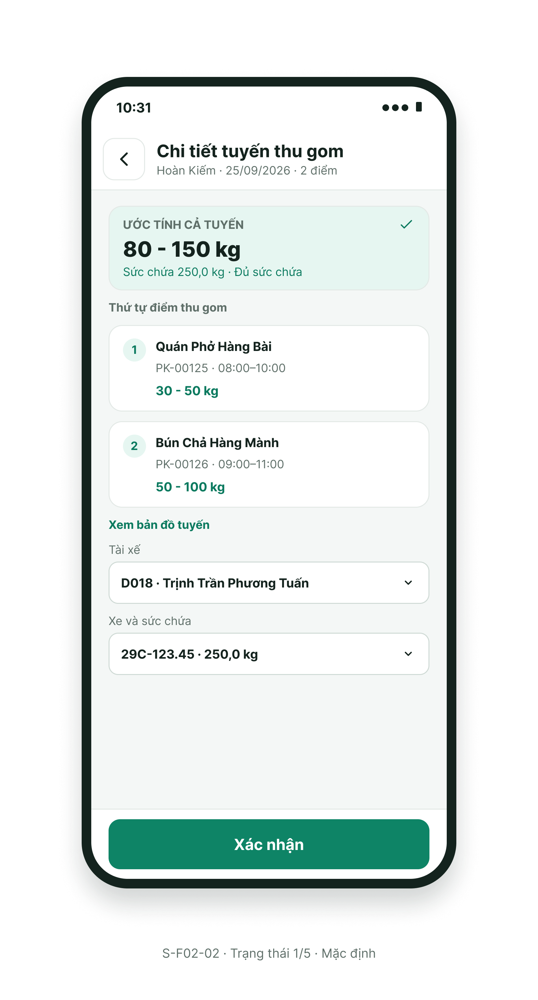
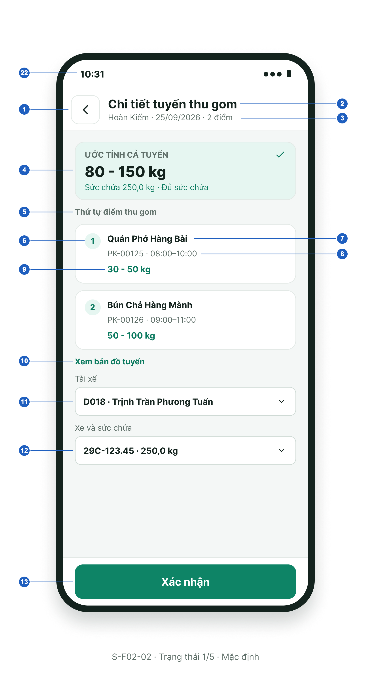
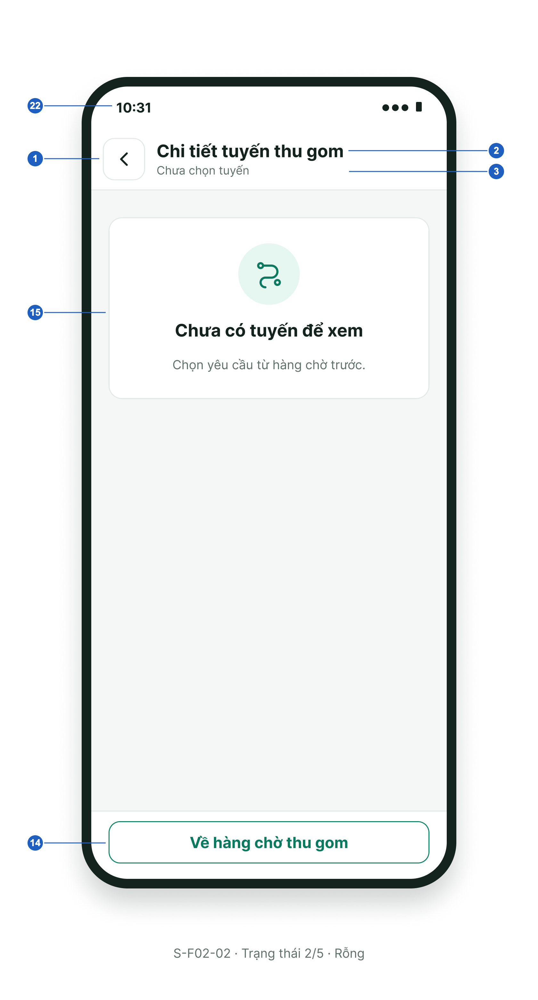
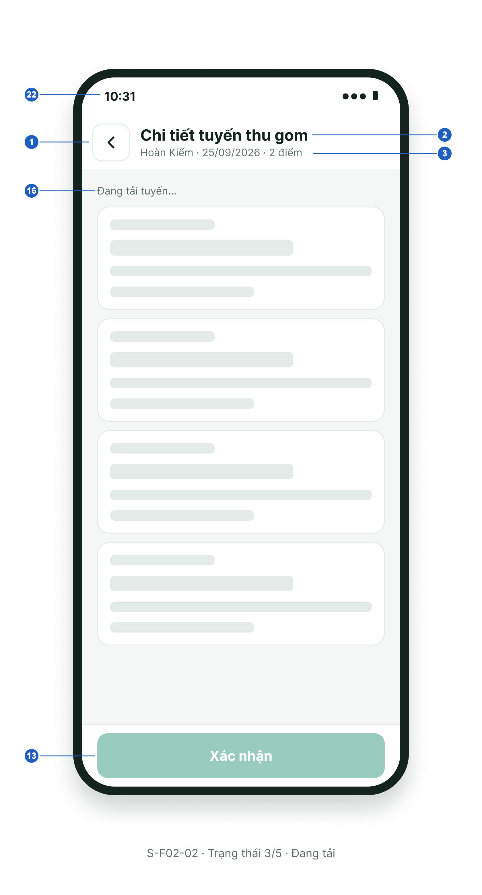
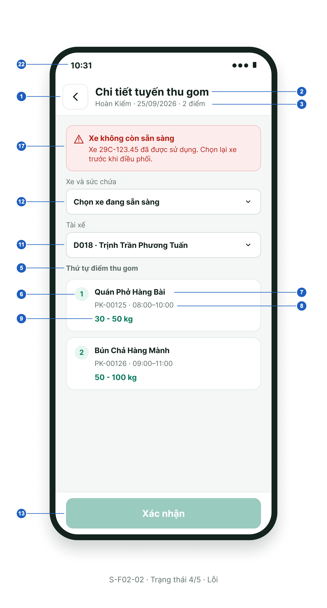
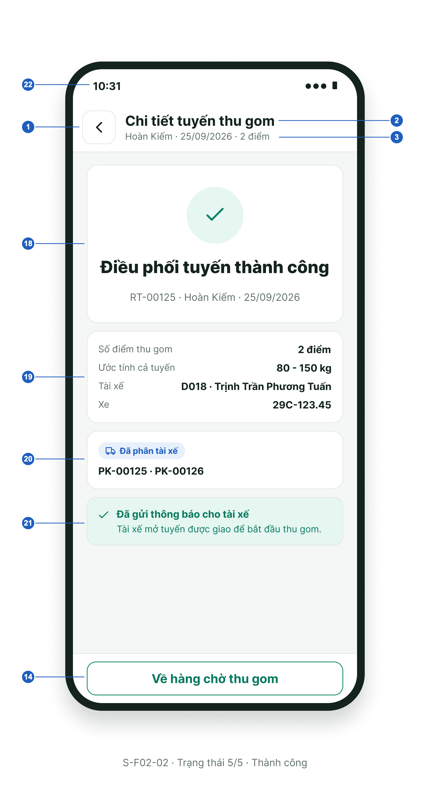

# Screen Spec: S-F02-02 Route review and dispatch

| Field | Value |
|---|---|
| Screen ID | S-F02-02 |
| Screen name | Route review and dispatch |
| Actor | ReFeed Staff |
| Priority | Must |
| Feature | F-02 Collection Operations & Handover |
| Activity diagrams | AD-UC-05 a2, d1 and s4–s7; SD-UC-05 (review, confirm, assign driver/vehicle, save and dispatch, update included pickups, notify driver) |
| Mockup images | `img/S-F02-02-default.png` (default), `img/S-F02-02-default-numbered.png`, four state images and four numbered state images (section 2) |
| Frame width | 370px screen inside a 390 × 844 device frame (team convention). The five supplied exports are 1680 × 3120 pixels, including the surrounding margin and state caption. |
| Figma frame | Supplied exports captioned "S-F02-02 · Trạng thái 1/5" to "S-F02-02 · Trạng thái 5/5"; these five images are the visual reference for this spec. Exact Figma frame/node not supplied. |
| Status | Draft |

## 1. Purpose

**Shown when:** authorised ReFeed staff open a proposed route from S-F02-01 after selecting pickup requests and requesting a route plan. They review the area, collection date, estimated quantity, vehicle capacity and optimized visiting order, then select or review a candidate driver and vehicle before dispatch.

**The user leaves this screen when:** they return to S-F02-01 using Back, or tap "Về hàng chờ thu gom" in Empty or Success. "Xác nhận" opens the dispatch confirmation modal on this screen; only the final modal action assigns the driver/vehicle, saves and dispatches the route, updates included pickup statuses and notifies the driver.

## 2. Mockup

**Numbered:** each number is the # of the element inventory in section 3. Back (1), the header (2–3) and device status bar (22) appear in all five states. Default shows the capacity summary (4), ordered stops (5–9), map action (10), driver/vehicle selectors (11–12) and enabled confirmation button (13). Empty shows the empty message (15) and return button (14); Loading shows placeholders (16) and disabled button (13). Error shows the message (17), vehicle selector (12) before driver (11), the retained ordered stops (5–9) and disabled button (13); the capacity summary and map action are absent. Success replaces the review form with the dispatch confirmation (18), summary (19), assigned-pickups card (20), notification banner (21) and return button (14). Repeated stop elements are numbered on their first occurrence. Modal-only elements (23–25) are specified in section 5 and are not pictured in the five supplied states. Numbers and leaders are documentation annotations on copies of the supplied images; the caption below the phone is not product UI.

| Default, numbered | Empty, numbered | Loading, numbered | Error, numbered | Success, numbered |
|---|---|---|---|---|
|  |  |  |  |  |

| State | Image |
|---|---|
| Default | [`img/S-F02-02-default.png`](img/S-F02-02-default.png) |
| Empty | [`img/S-F02-02-empty.png`](img/S-F02-02-empty.png) |
| Loading | [`img/S-F02-02-loading.png`](img/S-F02-02-loading.png) |
| Error | [`img/S-F02-02-error.png`](img/S-F02-02-error.png) (the selected vehicle is no longer available) |
| Success | [`img/S-F02-02-success.png`](img/S-F02-02-success.png) (route dispatched and driver notification sent) |

Colours, fonts and corners follow the design tokens in
[ui-conventions.md](../ui-conventions.md#6-design-tokens). The supplied images and Vietnamese wording are preserved. The generic label "Xác nhận", the Back-header pattern and the loading layout differ from the shared component guidance; section 9 records these points for review. IDs, dates, quantities and resource names shown below are mockup examples.

## 3. Element inventory

| # | Element | Type | Content / data source | Required | Validation |
|---|---|---|---|---|---|
| 1 | Back | Button | left-chevron icon; accessible name "Về hàng chờ thu gom" | Yes | none; opens S-F02-01 without dispatching an unconfirmed route |
| 2 | Title | Header | static: "Chi tiết tuyến thu gom" | Yes | none |
| 3 | Context line | Text | `draft.area` · `draft.scheduled_date` · `draft.stops.length`; after dispatch: corresponding saved `route` fields; Empty: "Chưa chọn tuyến" | Yes | `dd/MM/yyyy`; stop count matches included pickups; Loading retains only context already known from S-F02-01 |
| 4 | Capacity summary | Card | "ƯỚC TÍNH CẢ TUYẾN"; sum of `pickup.estimated_volume_min/max`; "Sức chứa " + `vehicle.capacity_kg` + " · Đủ sức chứa" with a check icon | No | Default only; example "80 - 150 kg" and "Sức chứa 250,0 kg · Đủ sức chứa"; estimates in whole kg, capacity with 1 decimal; use the upper estimate bound for the draft capacity check (section 9) |
| 5 | Stop-list heading | Text | static: "Thứ tự điểm thu gom" | No | Default and Error; order comes from the optimized proposal |
| 6 | Stop number | Number badge | `draft.stops[].sequence`; examples "1", "2" | No | one number per included stop; sequence starts at 1, is unique and follows the displayed order |
| 7 | Supplier name | Text within stop card | `supplier.business_name`; examples "Quán Phở Hàng Bài", "Bún Chả Hàng Mành" | No | required for every displayed stop; long names wrap |
| 8 | Pickup ID and appointment | Text within stop card | `pickup.id` · `pickup.time_window`; examples "PK-00125 · 08:00–10:00", "PK-00126 · 09:00–11:00" | No | `PK-` + 5 digits; `HH:mm–HH:mm`; collection date is already shown in the context line |
| 9 | Stop estimate | Text within stop card | `pickup.estimated_volume_min/max`; examples "30 - 50 kg", "50 - 100 kg" | No | whole-kg range; minimum must not exceed maximum; both bounds contribute to the route estimate |
| 10 | Xem bản đồ tuyến | Text button | static label; `draft.stops` locations in the same visiting order | No | Default only in supplied images; opens an in-screen map overlay; none of the route assignments or statuses change |
| 11 | Driver selector | Selector | label "Tài xế"; `driver.id` · `driver.name`; example "D018 · Trịnh Trần Phương Tuấn" | No | required before dispatch; `D` + 3 digits; selected driver must still be eligible and available at final confirmation; selection is a candidate, not a committed assignment |
| 12 | Vehicle and capacity selector | Selector | label "Xe và sức chứa"; `vehicle.plate` · `vehicle.capacity_kg`; Default: "29C-123.45 · 250,0 kg"; Error placeholder: "Chọn xe đang sẵn sàng" | No | required before dispatch; registered plate, positive capacity in kg with 1 decimal; recheck capacity and current availability; stale selection is cleared in Error |
| 13 | Xác nhận | Primary button | static label | No | enabled only for a loaded, current proposal with included stops, a valid driver and vehicle, and sufficient capacity; disabled in Loading and Error; opens modal #23 |
| 14 | Về hàng chờ thu gom | Secondary button | static label | No | Empty and Success only; opens S-F02-01 and refreshes queue data after dispatch |
| 15 | Empty message | Card | route icon; "Chưa có tuyến để xem" — "Chọn yêu cầu từ hàng chờ trước." | No | no valid route proposal to review; no stop list, selectors, capacity summary or dispatch button |
| 16 | Loading placeholders | Skeleton cards with text | "Đang tải tuyến..." and four placeholder cards | No | no interactive placeholder controls; no fabricated driver, vehicle or route data; button #13 remains disabled |
| 17 | Vehicle-unavailable message | Error banner | alert icon; "Xe không còn sẵn sàng" — "Xe 29C-123.45 đã được sử dụng. Chọn lại xe trước khi điều phối."; plate from rejected `vehicle.plate` | No | invalidate the unavailable vehicle, retain the proposed stops and still-valid driver selection; no confirmed assignment results from this rejected attempt |
| 18 | Dispatch confirmation | Success card | check icon; "Điều phối tuyến thành công"; `route.id` · `route.area` · `route.scheduled_date`; example "RT-00125 · Hoàn Kiếm · 25/09/2026" | No | show only after route dispatch and included pickup-status updates are confirmed; RT-00125 is an example, not a confirmed shared ID convention |
| 19 | Dispatch summary | Label–value card | "Số điểm thu gom" → `route.stops.length`; "Ước tính cả tuyến" → `route.estimated_volume_min/max`; "Tài xế" → assigned `driver.id/name`; "Xe" → assigned `vehicle.plate` | No | use the saved dispatch result, not unsaved selector values; examples "2 điểm", "80 - 150 kg", "D018 · Trịnh Trần Phương Tuấn", "29C-123.45" |
| 20 | Assigned pickups | Card with status badge | truck icon + "Đã phân tài xế"; included `pickup.id` values, example "PK-00125 · PK-00126" | No | reflects confirmed `pickup.status = Driver Assigned` for included pickups only |
| 21 | Driver notification result | Success banner | check icon; "Đã gửi thông báo cho tài xế" — "Tài xế mở tuyến được giao để bắt đầu thu gom."; `dispatch.notification_status` | No | show the green sent message only after the system confirms sending; it does not mean the driver has read or accepted the route |
| 22 | Status bar | Device chrome | static mockup time "10:31", three dots and the vertical battery indicator | Yes | none; device chrome, not route data |
| 23 | Dispatch confirmation modal | Modal | "Xác nhận tuyến và điều phối?"; reviewed route, quantity/capacity, selected driver and vehicle; consequence described in section 5 | No | opens from #13; no dispatch on opening; summary matches the current proposal; not pictured in supplied states |
| 24 | Về xem lại tuyến | Modal secondary button | draft static label | No | none; closes the modal without dispatching; available before submission begins |
| 25 | Điều phối tuyến | Modal primary button | draft static label | No | revalidate current proposal, pickup eligibility, capacity, driver and vehicle; single submission; disable while the outcome is pending |

## 4. States

| State | What the user sees | Trigger |
|---|---|---|
| Default | Header "Chi tiết tuyến thu gom", "Hoàn Kiếm · 25/09/2026 · 2 điểm"; capacity card "ƯỚC TÍNH CẢ TUYẾN", "80 - 150 kg", "Sức chứa 250,0 kg · Đủ sức chứa" and a check; "Thứ tự điểm thu gom" with stop 1 Quán Phở Hàng Bài, PK-00125 · 08:00–10:00, 30 - 50 kg, then stop 2 Bún Chả Hàng Mành, PK-00126 · 09:00–11:00, 50 - 100 kg; "Xem bản đồ tuyến"; driver D018 · Trịnh Trần Phương Tuấn and vehicle 29C-123.45 · 250,0 kg selected; "Xác nhận" enabled. The mockup shows this state. | A feasible optimized proposal and valid candidate resources have loaded; no route has been dispatched yet |
| Empty (no data) | Same title; context "Chưa chọn tuyến"; route-icon card "Chưa có tuyến để xem" — "Chọn yêu cầu từ hàng chờ trước."; footer "Về hàng chờ thu gom"; no capacity card, stops, map link, resource selectors or confirmation button | Screen opened without a valid proposal or the selected proposal is no longer available |
| Loading | Same title and known context "Hoàn Kiếm · 25/09/2026 · 2 điểm"; "Đang tải tuyến..."; four cards of grey placeholders; "Xác nhận" disabled | Route details or candidate resources are being fetched; this supplied image depicts initial loading, not a dispatch result |
| Error | Same title/context; red banner "Xe không còn sẵn sàng" — "Xe 29C-123.45 đã được sử dụng. Chọn lại xe trước khi điều phối."; "Xe và sức chứa" selector reset to "Chọn xe đang sẵn sàng", followed by the retained driver D018 · Trịnh Trần Phương Tuấn; same two ordered stops and estimates; "Xác nhận" disabled. Capacity summary and map link are not shown. | Availability validation rejects the previously selected vehicle before dispatch is committed |
| Success / confirmation | Same title/context; check mark, "Điều phối tuyến thành công" — "RT-00125 · Hoàn Kiếm · 25/09/2026"; summary: Số điểm thu gom 2 điểm, Ước tính cả tuyến 80 - 150 kg, Tài xế D018 · Trịnh Trần Phương Tuấn, Xe 29C-123.45; truck badge "Đã phân tài xế" with PK-00125 · PK-00126; green banner "Đã gửi thông báo cho tài xế" — "Tài xế mở tuyến được giao để bắt đầu thu gom."; footer "Về hàng chờ thu gom"; no editable selectors or confirmation button | The route and assignments are saved and dispatched, included pickups are updated to Driver Assigned, and sending the notification is confirmed (FR-02-01) |

## 5. Interactions and navigation

**Dispatch modal:** the Screen List and UI conventions require "Xác nhận tuyến và điều phối?" as an overlay on this screen. The five supplied images do not show it. Draft summary: "Hoàn Kiếm · 25/09/2026 · 2 điểm", "Ước tính 80 - 150 kg · Sức chứa 250,0 kg", "D018 · Trịnh Trần Phương Tuấn", "Xe 29C-123.45". Draft consequence: "Hai yêu cầu sẽ chuyển sang Đã phân tài xế. Hệ thống sẽ gửi thông báo cho tài xế." Secondary "Về xem lại tuyến"; primary "Điều phối tuyến". Values and pickup count come from the current proposal. Modal copy/layout remain open question 2.

| # | Element | User action | System response | Goes to screen |
|---|---|---|---|---|
| 1 | Ordered stop list | view / scroll | Shows the optimized order, supplier names, pickup IDs, appointments and quantity ranges; no manual reorder control is supplied | stays |
| 2 | Xem bản đồ tuyến | tap | Opens a map overlay for the same ordered stops; closing returns to the review; a map failure leaves the text list usable | stays (overlay) |
| 3 | Driver selector | choose | Updates the candidate driver; does not assign or notify the driver yet | stays |
| 4 | Vehicle and capacity selector | choose | Updates the candidate vehicle and capacity check; in Error, replaces the rejected vehicle. After successful revalidation, restores the review and enables confirmation if all conditions are satisfied | stays (Default or Error) |
| 5 | Xác nhận | tap | Opens "Xác nhận tuyến và điều phối?" with the current summary and consequences | stays (modal) |
| 6 | Về xem lại tuyến / modal close / Escape | dismiss before submission | Closes the modal; candidate selections remain available for review; no assignment, dispatch, pickup-status update or notification occurs | stays |
| 7 | Điều phối tuyến (modal) | tap | Revalidates the proposal, included pickups and resources; assigns driver/vehicle, saves and dispatches the route, updates included pickups to Driver Assigned and sends the driver notification (FR-02-01). Keeps reviewed context with a busy action while submitting, then shows Success or the relevant error | stays (submitting, then Success or Error) |
| 8 | Về hàng chờ thu gom | tap (Empty or Success) | Opens the queue; after Success, refreshes pickup statuses and resource availability without repeating dispatch | S-F02-01 |
| 9 | Back | tap when no modal/submission blocks the parent screen | Returns to the queue. Before final confirmation, performs no dispatch; after Success, does not undo or repeat dispatch. During initial fetching, ignores late results for the screen being left | S-F02-01 |

The driver's next use case begins when they open the dispatch notification and see S-F02-03. That is a handoff to another actor, not staff navigation from this screen.

## 6. Screen-level rules

| Rule ID | Rule | Source |
|---|---|---|
| SR-001 | Only authenticated ReFeed staff with route-planning/dispatch permission may access this screen or confirm a dispatch. Denied protected actions are recorded. | FR-06-03 |
| SR-002 | Reviewing stops, opening the map, selecting candidates, opening/dismissing the modal and returning before final confirmation do not assign resources, dispatch, update pickup statuses or notify a driver. | FR-02-01; AD-UC-05 d1 [no]; SD-UC-05 |
| SR-003 | Route estimates sum the included pickup ranges: 30 + 50 = 80 kg minimum and 50 + 100 = 150 kg maximum in the supplied example. Demand must fit the selected vehicle's capacity. The draft check compares the upper bound, 150 kg, with 250,0 kg; the estimator policy remains open. | FR-02-01; AD-UC-05 s1; supplied Default; section 9 |
| SR-004 | "Xác nhận" requires a loaded, valid proposal, at least one included stop, an eligible driver, an available vehicle and sufficient capacity. Resource availability and pickup eligibility are checked again on final submission; an unavailable vehicle is cleared and confirmation stays disabled until corrected. | FR-02-01; supplied Error; draft validation/recovery rule, AD-UC-05 §6 |
| SR-005 | Dispatch always goes through the confirmation modal. Only its final action commits assignment, route dispatch, included pickup-status updates and driver notification. While submission is pending, prevent repeated submission and keep the background controls inert. | Screen List (modals); ui-conventions §3; AD-UC-05 d1 [yes], s4–s7 |
| SR-006 | Use the optimized stop order returned for the proposal. Update only the pickups included in the confirmed route to Driver Assigned ("Đã phân tài xế"); do not change unrelated pickups. No manual reordering is specified by the supplied UI. | FR-02-01; AD-UC-05 s2, s6; SD-UC-05 |
| SR-007 | Show route-dispatch success only after the route, assignments and included pickup-status updates are confirmed. If the commit outcome is unknown, check the existing result before retrying; do not create another route to resolve an unknown result. Transaction and request-identity details remain open. | SD-UC-05; draft recovery rule, section 9 |
| SR-008 | "Đã gửi thông báo cho tài xế" requires a confirmed send result. If sending fails after dispatch, retain the dispatched route and distinguish notification failure from dispatch failure; recovery must not dispatch the route again. | FR-02-01; AD-UC-05 s7 and §6 question 3; draft recovery rule |
| SR-009 | Back and "Về hàng chờ thu gom" open S-F02-01. Closing an overlay stays on S-F02-02. Returning after Success refreshes the queue and does not undo dispatch; unconfirmed-draft retention is not promised. | Screen Transition §4; AD-UC-05 d1 [no] and §6 question 1 |
| SR-010 | Availability, assignment and notification results use text and icons as well as colour. Loading placeholders are non-interactive. The footer is fixed above the safe area and content scrolls above it. | ui-conventions §§3, 5; supplied five states |

## 7. Linked requirements

| FR ID | What this screen does for it |
|---|---|
| FR-02-01 | Shows the proposed route, summed pickup estimates, capacity, optimized visiting order and candidate resources; captures staff confirmation; assigns driver/vehicle, saves and dispatches the route, updates included pickups to Driver Assigned and notifies the assigned driver |
| FR-06-03 | Restricts route review and dispatch to authorised ReFeed staff and enforces permission checks for protected actions |

## 8. Responsive and accessibility notes

- Smallest supported width: 360px; long supplier/driver names and error text wrap without hiding pickup IDs, appointment windows or actions. Stop numbers stay in a separate column; name, ID/window and estimate share one text-column edge.
- Designed on a 370 × 824 screen inside a 390 × 844 device frame; the supplied full-article exports are 1680 × 3120 pixels, including margins and captions. Content scrolls above the fixed footer. Success summary values stay right-aligned and wrap when necessary; do not shrink long driver names to fit one line.
- Touch targets at least 44 × 44px: Back has a 44 × 44px target, selectors and map action have at least 44px tap height, the primary is 52px high, and the secondary return button is at least 44px high. Give Back the accessible name "Về hàng chờ thu gom"; associate "Tài xế" and "Xe và sức chứa" with their selectors.
- Present stops as an ordered list. Announce loading, vehicle-unavailable errors and dispatch results; keep skeletons decorative. Move focus to the error summary when dispatch is rejected, with the vehicle field next in recovery order. Expose disabled controls programmatically; do not communicate disabled state by faded colour alone.
- The confirmation modal traps focus, makes the parent screen inert and restores focus to its opener when dismissed. Selector options support keyboard selection and visible focus. A map is supplementary; the ordered text list remains usable without it.
- Body text contrast at least 4.5:1; statuses and banners use text plus icons. The screenshots have no bottom navigation; retain the Back header and state-dependent footer shown in the supplied images.

## 9. Open questions

| # | Question | Blocking? | Status |
|---|---|---|---|
| 1 | [NEEDS CLARIFICATION: the supplied primary label is "Xác nhận", while ui-conventions §1 requires a specific verb + object. Should it become "Xem xác nhận điều phối"?] | No for this draft; yes for final action wording | Open. Preserve "Xác nhận" in these supplied mockups; it opens the confirmation modal and does not dispatch immediately. |
| 2 | [NEEDS CLARIFICATION: the five supplied images do not show the dispatch confirmation modal. Are its summary, consequence, action labels and layout approved?] | No for this draft; yes for final modal design | Open. The modal is required by the Screen List and ui-conventions; section 5 supplies draft copy, not a supplied modal mockup. |
| 3 | [NEEDS CLARIFICATION: how long is an unconfirmed proposal retained, and can staff return to it after leaving?] | Yes for draft persistence | Open. Leaving before confirmation performs no dispatch; saved-draft retention or restoration is not promised. |
| 4 | [NEEDS CLARIFICATION: which pickup statuses are eligible, how are driver/vehicle candidates chosen, and which availability constraints apply?] | Yes for detailed selection rules | Open. Pending pickups and candidate resources are inputs; staff reviews/selects here and the server revalidates eligibility/availability before dispatch. |
| 5 | [NEEDS CLARIFICATION: should capacity planning always use the sum of estimated upper bounds in kg?] | Yes for planner implementation | Open. Draft uses 150 kg against 250,0 kg in this example; use the same unit and do not infer litre-to-kg conversion. |
| 6 | [NEEDS CLARIFICATION: what are the transaction boundary, duplicate-request contract and recovery policy for partial persistence, unknown timeout or a failed driver notification?] | Yes for API and operational recovery | Open. Confirm saved dispatch/status results before reporting success; check unknown outcomes before retry; a notification-only failure must not create another route. |
| 7 | [NEEDS CLARIFICATION: is visiting order manually editable, and what is the shared route-ID format?] | No for this visual draft | Open. Order is read-only here; RT-00125 is the supplied example and does not establish a shared ID format. |
| 8 | [NEEDS CLARIFICATION: should ui-conventions §3 document the Back-header pattern used in these images?] | No for this draft | Open. Keep Back beside "Chi tiết tuyến thu gom"; reconcile the shared text-only-header guidance separately. |
| 9 | [NEEDS CLARIFICATION: should Loading follow the loaded capacity/stop/selector layout as ui-conventions specifies, instead of four uniform placeholder cards?] | No for this draft | Open. Preserve the four cards and "Đang tải tuyến..." exactly as supplied; confirmation stays disabled. |

---

## Completion checklist

- [x] The mockup is a separate image file, named with the Screen ID; its supplied dimensions are recorded above.
- [x] The numbered images exist, and their numbers match the # column of the element inventory (modal-only elements are identified separately).
- [x] Every visible element in the mockups appears in the element inventory.
- [ ] Every colour in the mockups is a design token from ui-conventions.md.
- [x] Every input element has a validation rule or an explicit "none".
- [x] All five states are filled in.
- [x] Every navigation target is a Screen ID that exists in the Screen List.
- [x] Every element that displays data names the field it displays.
- [x] Every linked FR exists in the Function List, and the review / confirmation / assignment / dispatch / included-pickup update / notification actions of AD-UC-05 and SD-UC-05 are covered by interaction rows.
