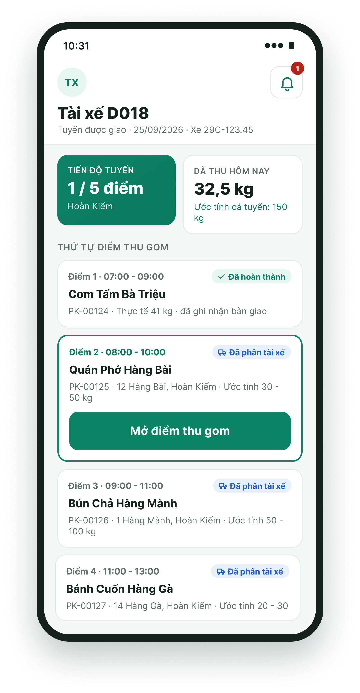
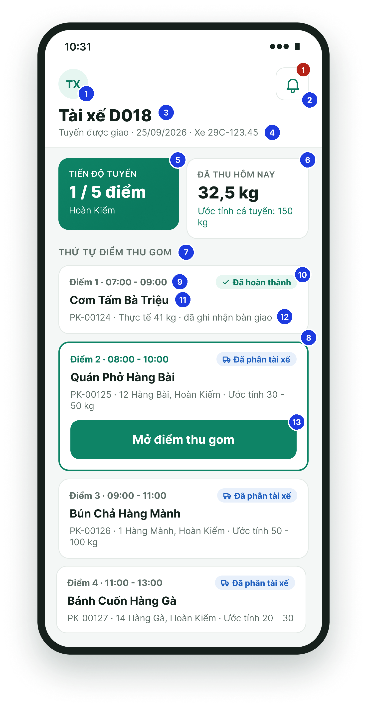
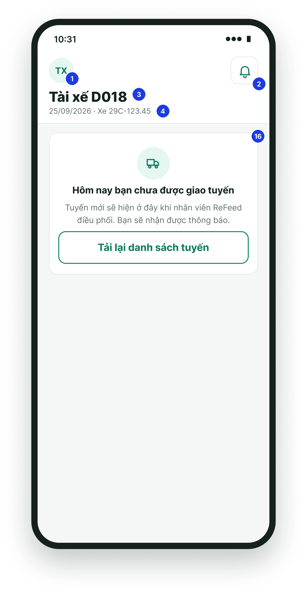
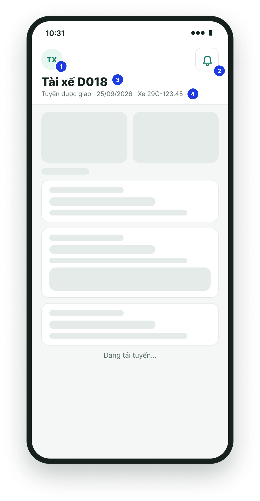
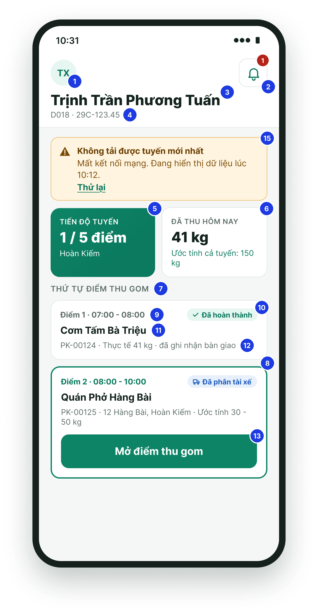
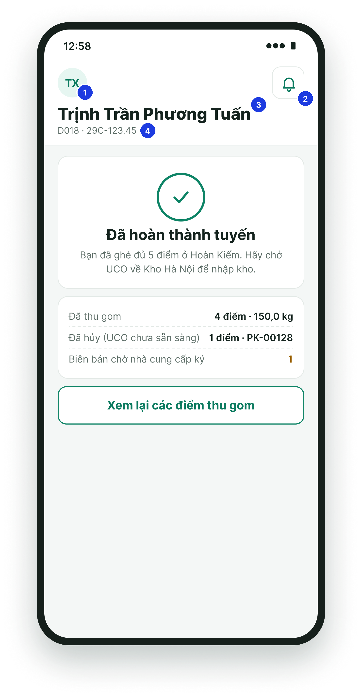

# Screen Spec: S-F02-03 Assigned route

| Field | Value |
|---|---|
| Screen ID | S-F02-03 |
| Screen name | Assigned route |
| Actor | Driver / Collector |
| Priority | Must |
| Feature | F-02 Collection Operations & Handover |
| Activity diagrams | AD-UC-06 (actions "Open assigned collection route", "Select supplier point and confirm arrival" — the select part; the loop through `d2` "More assigned pickup points remain?") |
| Mockup images | `img/S-F02-03-default.png` (default), `img/S-F02-03-default-numbered.png`, four state images and four numbered state images (section 2) |
| Frame width | width	370px screen inside a 390 × 844 device frame (exported at 3x with a 50px shadow margin, 1470 × 2832 pixels) |
| Figma frame | Frames "S-F02-03 / 1" to "S-F02-03 / 5", page "4 màn × 5 trạng thái" in the ReFeed Figma file |
| Status | Draft |

## 1. Purpose

**Shown when:** the driver / collector signs in (this is the driver home, S-F00-01 → S-F02-03), opens the dispatch notification sent when ReFeed staff dispatch a route (FR-02-01), or comes back from S-F02-04 after a pickup is saved or cancelled.

**The user leaves this screen when:** they open a pickup point ("Mở điểm thu gom" or tap a stop card → S-F02-04), or they sign out (→ S-F00-01).

## 2. Mockup

**Numbered:** each number is the # of the element inventory in section 3. Element 15 (Message
area) appears only in the error state and element 16 (Empty message) only in the empty state, so
each is numbered on that state's image. Elements 5–13 appear only when a route is loaded (default
and error states); the loading and success images number the header elements 1–4, and the success
summary is described in section 4. Element 14 (End of list) sits below the visible part of the list
(the list scrolls), so it is not numbered.

| Default, numbered | Empty, numbered | Loading, numbered | Error, numbered | Success, numbered |
|---|---|---|---|---|
|  |  |  |  |  |

| State | Image |
|---|---|
| Default | [`img/S-F02-03-default.png`](img/S-F02-03-default.png) |
| Empty | [`img/S-F02-03-empty.png`](img/S-F02-03-empty.png) |
| Loading | [`img/S-F02-03-loading.png`](img/S-F02-03-loading.png) |
| Error | [`img/S-F02-03-error.png`](img/S-F02-03-error.png) (route could not be refreshed; cached copy shown) |
| Success | [`img/S-F02-03-success.png`](img/S-F02-03-success.png) |

All colours, fonts and corners come from the design tokens in
[ui-conventions.md](../ui-conventions.md#6-design-tokens).

## 3. Element inventory

| # | Element | Type | Content / data source | Required | Validation |
|---|---|---|---|---|---|
| 1 | Avatar | Avatar (initials) | static role initials "TX" | Yes | none |
| 2 | Notification button | Icon button with count | `notification.unread_count` for the driver; count hidden when 0 | Yes | count shown only when > 0 |
| 3 | Title | Header | "Tài xế " + `driver.id` (e.g. "Tài xế D018") | Yes | |
| 4 | Context line | Text | "Tuyến được giao · " + `route.date` + " · Xe " + `vehicle.plate`; without a route: `route.date` + " · Xe " + `vehicle.plate` | Yes | date `dd/MM/yyyy`, plate as registered (ui-conventions §2) |
| 5 | Route progress | Stat card (highlight) | `route.done_count` " / " `route.stop_count` " điểm"; `route.area` (FR-02-01) | Yes | done = stops whose `pickup.status` is not Driver Assigned |
| 6 | Collected today | Stat card | sum of `collection.actual_quantity` of the route; "Ước tính cả tuyến: " `route.estimated_volume` (FR-02-01 grouped volume) | Yes | 1 decimal + " kg" |
| 7 | Section label | Text | static: "Thứ tự điểm thu gom" | Yes | |
| 8 | Stop list | Scrollable list of stop cards | `route.stops` ordered by `stop.sequence` (optimized order from FR-02-01) | Yes | one card per pickup of the route; list scrolls, header stays fixed |
| 9 | Stop header | Text | "Điểm " + `stop.sequence` + " · " + `pickup.time_window` | Yes | `HH:mm - HH:mm` |
| 10 | Status badge | Status badge | `pickup.status`: Đã phân tài xế · Đã đến · Hoàn tất · Đã hủy; a collected stop shows "Đã hoàn thành" with a check icon (open question 1) | Yes | text + icon + colour (ui-conventions §3, §5) |
| 11 | Supplier name | Text | `supplier.business_name` | Yes | |
| 12 | Stop detail | Text | `pickup.id` · `supplier.address` · "Ước tính " `pickup.estimated_volume`; after collection: "Thực tế " `collection.actual_quantity` · "đã ghi nhận bàn giao" | Yes | volume range in kg; actual in kg |
| 13 | Mở điểm thu gom | Primary button | static label | Yes | only on the current stop (SR-003) |
| 14 | End of list | Text | static: "Hết tuyến · đã hiển thị đủ " + `route.stop_count` + " điểm" | Yes | |
| 15 | Message area | Banner | warning / info messages (load failure, cached data time) | No | |
| 16 | Empty message | Card with secondary button | static: "Hôm nay bạn chưa được giao tuyến" — "Tuyến mới sẽ hiện ở đây khi nhân viên ReFeed điều phối. Bạn sẽ nhận được thông báo."; button "Tải lại danh sách tuyến" | No | shown only when no route is dispatched to the driver for today |

## 4. States

| State | What the user sees | Trigger |
|---|---|---|
| Default | Header "Tài xế D018", "Tuyến được giao · 25/09/2026 · Xe 29C-123.45", unread count "1" on the bell; progress "1 / 5 điểm" (Hoàn Kiếm), "Đã thu hôm nay 32,5 kg · Ước tính cả tuyến: 150 kg"; stop list in visiting order: Điểm 1 · 07:00 - 09:00 Cơm Tấm Bà Triệu (badge "Đã hoàn thành", PK-00124, thực tế 41 kg, đã ghi nhận bàn giao), Điểm 2 · 08:00 - 10:00 Quán Phở Hàng Bài (current stop, green border, PK-00125 · 12 Hàng Bài, Hoàn Kiếm · Ước tính 30 - 50 kg, "Mở điểm thu gom"), Điểm 3 · 09:00 - 11:00 Bún Chả Hàng Mành (PK-00126, Ước tính 50 - 100 kg), Điểm 4 · 11:00 - 13:00 Bánh Cuốn Hàng Gà (PK-00127); the list scrolls. The mockup shows this state. | Screen opened, route loaded |
| Empty (no data) | Context line "25/09/2026 · Xe 29C-123.45"; no unread count; card with truck icon "Hôm nay bạn chưa được giao tuyến" — "Tuyến mới sẽ hiện ở đây khi nhân viên ReFeed điều phối. Bạn sẽ nhận được thông báo." and button "Tải lại danh sách tuyến"; no stat cards, no list | No route dispatched to this driver for today |
| Loading | Header without unread count; grey placeholders for the two stat cards, the section label and three stop cards (the middle one with a button block); text "Đang tải tuyến…" | Route is being fetched |
| Error | Orange banner "Không tải được tuyến mới nhất — Mất kết nối mạng. Đang hiển thị dữ liệu lúc 10:12." with link "Thử lại"; below it the last loaded route: stat cards and stop list (Điểm 1 · 07:00 - 08:00 Cơm Tấm Bà Triệu "Đã hoàn thành", Điểm 2 Quán Phở Hàng Bài with "Mở điểm thu gom") | The route request failed; a cached copy exists |
| Success / confirmation | Time 12:58; no unread count; check mark, "Đã hoàn thành tuyến" — "Bạn đã ghé đủ 5 điểm ở Hoàn Kiếm. Hãy chở UCO về Kho Hà Nội để nhập kho."; summary card: "Đã thu gom 4 điểm · 150,0 kg", "Đã hủy (UCO chưa sẵn sàng) 1 điểm · PK-00128", "Biên bản chờ nhà cung cấp ký 1"; button "Xem lại các điểm thu gom" | No stop of the route is left in status Driver Assigned (AD-UC-06 `d2` [No]) |

## 5. Interactions and navigation

| # | Element | User action | System response | Goes to screen |
|---|---|---|---|---|
| 1 | Mở điểm thu gom | tap | Opens the current pickup point | S-F02-04 |
| 2 | Stop card (any stop) | tap | Opens that pickup point; a Hoàn tất or Đã hủy stop opens read-only | S-F02-04 |
| 3 | Stop list | scroll | List moves; header and status bar stay fixed | stays |
| 4 | Notification button | tap | Shows the driver's notifications (dispatch messages) and clears the count | stays |
| 5 | Avatar | tap | Shows the account menu with "Đăng xuất"; signing out ends the session | S-F00-01 |
| 6 | Tải lại danh sách tuyến | tap (empty state) | Fetches today's route again; shows Loading, then Default or Empty | stays |
| 7 | Thử lại | tap (error state) | Fetches the route again; the banner disappears on success | stays |
| 8 | Xem lại các điểm thu gom | tap (success state) | Shows the full stop list with the final status of each stop | stays |

## 6. Screen-level rules

| Rule ID | Rule | Source |
|---|---|---|
| SR-001 | The driver sees only the route assigned to their own `driver.id`. | FR-06-03 |
| SR-002 | Stops are listed in the optimized visiting order set at dispatch; the driver may still open any remaining stop. | FR-02-01; AD-UC-06 open question 7 (default) |
| SR-003 | "Mở điểm thu gom" appears on one card only: the first stop in order whose `pickup.status` is Driver Assigned (the current stop, green border). | FR-02-02 |
| SR-004 | Statuses are shown with text and icon, never by colour alone. | ui-conventions §5 |
| SR-005 | When no stop is left in Driver Assigned, the screen shows the success state instead of the list. | AD-UC-06 `d2` [No] |
| SR-006 | When the route cannot be refreshed, the last loaded copy is shown with its time ("dữ liệu lúc 10:12"); saving at a pickup point still needs a connection. | AD-UC-06 open question 3 (default) |

## 7. Linked requirements

| FR ID | What this screen does for it |
|---|---|
| FR-02-02 | Displays the assigned route and its pickups in visiting order and opens the pickup point for arrival and collection |
| FR-02-01 | Shows the route, order, area and estimated volume created at dispatch; the dispatch notification opens this screen |
| FR-06-03 | Restricts the route shown to the signed-in driver |

## 8. Responsive and accessibility notes

- Smallest supported width: 360px; the two stat cards stay side by side (each at least 150px); long supplier names and addresses wrap to two lines.
- Designed at 390 × 844; only the stop list scrolls, the header stays fixed.
- Touch targets at least 44 × 44: the whole stop card is tappable, "Mở điểm thu gom" is 52px high, the notification button is 44 × 44, and the 40px avatar gets a 44px tap area.
- Status badges use text plus icon (Đã phân tài xế: truck, Đã đến: pin, Hoàn tất: check, Đã hủy: cross).
- Body text contrast at least 4.5:1.

## 9. Open questions

| # | Question | Blocking? | Status |
|---|---|---|---|
| 1 | [NEEDS CLARIFICATION: the mockup shows "Đã hoàn thành" on Điểm 1 (collected, waiting for the supplier's signature). This label is not one of the pickup statuses in ui-conventions §3: by FR-02-02 a visited pickup is Arrived ("Đã đến"), and it becomes Completed ("Hoàn tất") only after the supplier signs (FR-03-01). Add a status such as Collected ("Đã hoàn thành") to W1 and ui-conventions, or show "Đã đến"?] | No | Open. Default: "Đã hoàn thành" is shown as in the mockup and is proposed as a new status Collected; it does not count as Completed. |
| 2 | [NEEDS CLARIFICATION: the notification list and the account menu are not screens in the Screen List. Are they overlays of this screen?] | No | Open. Default: both are overlays on S-F02-03. |
| 3 | [NEEDS CLARIFICATION: should the route refresh by itself when ReFeed staff change it after dispatch?] | No | Open. Default: refresh on open, on "Thử lại" and on return from S-F02-04. |

---

## Completion checklist

- [x] The mockup is a separate cropped image file, named with the Screen ID, at the frame width.
- [x] The numbered image exists, and its numbers match the # column of the element inventory.
- [x] Every visible element in the mockup appears in the element inventory.
- [ ] Every colour in the mockup is a design token from ui-conventions.md.
- [x] Every input element has a validation rule or an explicit "none".
- [x] All five states are filled in.
- [x] Every navigation target is a Screen ID that exists in the Screen List.
- [x] Every element that displays data names the field it displays.
- [x] Every linked FR exists in the Function List, and every action of this screen in AD-UC-06 is
      covered by an interaction row.
