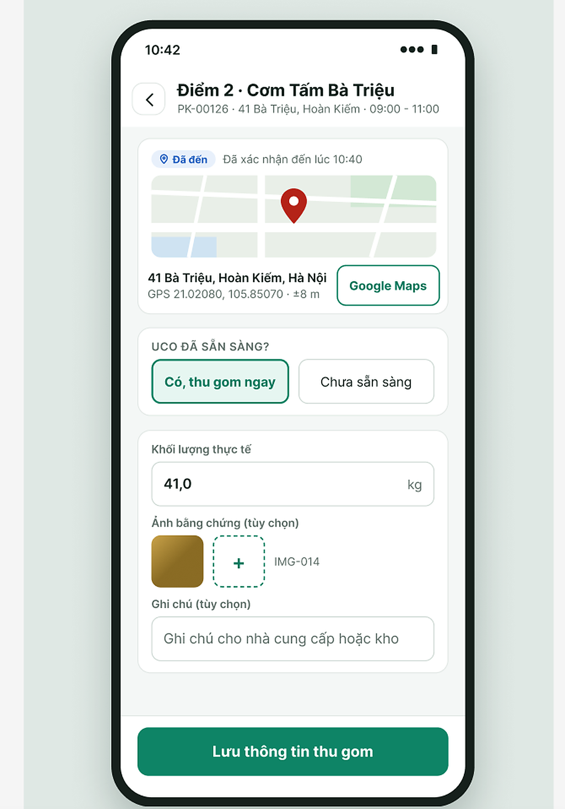

# Screen Spec: S-F02-04 Pickup point collection

| Field | Value |
|---|---|
| Screen ID | S-F02-04 |
| Screen name | Pickup point collection |
| Actor | Driver / Collector |
| Priority | Must |
| Feature | F-02 Collection Operations & Handover |
| Activity diagrams | AD-UC-06 (actions "Select supplier point and confirm arrival" — the confirm part, decision `d0` "UCO ready?", "Enter or correct actual UCO quantity and optional evidence", "Submit collection details", and the outcomes of `d1` "Required collection data valid?") |
| Mockup image | `img/S-F02-04.png` |
| Status | Draft |

## 1. Purpose

**Shown when:** the driver / collector opens one pickup point from the assigned route on S-F02-03 ("Mở điểm thu gom" or a tap on the stop card).

**The user leaves this screen when:** the collection details are saved (success state, then "Ghi nhận bàn giao" or "Về tuyến được giao"), the pickup is cancelled because UCO is not ready, or the driver goes back to the route.

## 2. Mockup

## 3. Element inventory

| # | Element | Type | Content / data source | Required | Validation |
|---|---|---|---|---|---|
| 1 | Back | Button | static | Yes | none |
| 2 | Title | Header | "Điểm " + `stop.sequence` + " · " + `supplier.business_name` | Yes | |
| 3 | Context line | Text | `pickup.id` · `supplier.address` (short) · `pickup.time_window` | Yes | formats from ui-conventions §2 |
| 4 | Arrival status | Status badge + text | `pickup.status` ("Đã đến") + "Đã xác nhận đến lúc " + `pickup.arrived_at` (FR-02-02) | Yes | badge text + icon (ui-conventions §3) |
| 5 | Location map | Map preview | supplier point location `supplier.gps` (Point-of-Origin profile) | Yes | illustrative map, pin on the supplier point |
| 6 | Address | Text | `supplier.address` (full) | Yes | |
| 7 | GPS line | Text | "GPS " + `pickup.arrival_gps` (lat, lng, 5 decimals) + " · ±" + GPS accuracy in m | Yes | captured by the device, not typed |
| 8 | Google Maps | Link button | opens Google Maps at `supplier.gps` | Yes | none |
| 9 | UCO status label | Text | static: "Tình trạng UCO tại điểm" | Yes | |
| 10 | Readiness options | Toggle pair | "Thu gom ngay" / "Chưa có hàng" (AD-UC-06 `d0`) | Yes | exactly one selected; "Thu gom ngay" selected by default |
| 11 | Actual quantity | Number input with unit "kg" | `collection.actual_quantity` (FR-02-02) | Yes | greater than 0 kg; 1 decimal with decimal comma (ui-conventions §2, §4) |
| 12 | Evidence photos | Thumbnail list | `collection.photos` (e.g. "IMG-014") (FR-02-02, optional evidence) | No | none; ID format `IMG-` + 3 digits |
| 13 | Add photo | Tile button | static "+" | No | none |
| 14 | Notes | Text input | `collection.notes`; placeholder "Ghi chú cho nhà cung cấp hoặc kho" (FR-02-02, optional evidence) | No | none |
| 15 | Lưu thông tin thu gom | Primary button | static label | Yes | disabled while saving |
| 16 | Message area | Banner | error messages (validation, GPS, network) (AD-UC-06 `s4`) | No | |

## 4. States

| State | What the user sees | Trigger |
|---|---|---|
| Default | Header "Điểm 2 · Cơm Tấm Bà Triệu" with back button; GPS card with badge "Đã đến", "Đã xác nhận đến lúc 10:40", map, "41 Bà Triệu, Hoàn Kiếm, Hà Nội", "GPS 21.02080, 105.85070 · ±8 m" and "Google Maps"; "Tình trạng UCO tại điểm" with "Thu gom ngay" selected; actual quantity "41,0 kg", photo IMG-014, empty notes; footer "Lưu thông tin thu gom". The mockup shows this state. | Pickup PK-00126 opened with status Arrived |
| Empty (no data) | Info card (Trạng thái "Đã phân tài xế", Khung giờ 09:00–11:00, Ước tính 30 - 50 kg); card "Vị trí điểm thu gom" with map, address, coordinates and "Chỉ đường"; message "Bạn chưa xác nhận đến điểm này" — "Khi tới nơi, hãy xác nhận để hệ thống ghi lại vị trí GPS và thời gian đến."; no readiness or quantity fields; footer "Xác nhận đã đến" | Pickup opened while its status is still Driver Assigned (arrival not yet confirmed) |
| Loading | GPS card and quantity "41,0 kg" read-only; progress bar "Đang tải ảnh IMG-014 lên… 60%"; text "Đang lưu thông tin thu gom… Đừng đóng ứng dụng."; footer button "Đang lưu…" disabled | Collection details are being saved and the photo uploaded |
| Error | Red banner "Chưa lưu được thông tin thu gom — Có 2 thông tin cần sửa bên dưới."; quantity "0" with red border and "Khối lượng thực tế phải lớn hơn 0 kg."; card "Vị trí GPS" with "Chưa lấy được vị trí GPS. Bật định vị rồi lưu lại."; photo and notes kept; footer "Lưu thông tin thu gom". Network failure: "Không lưu được thay đổi. Kiểm tra kết nối mạng và thử lại.", entered values kept | Save rejected by validation (AD-UC-06 `d1` [No] → `s4`), or the request failed |
| Success / confirmation | Check mark, "Đã lưu thông tin thu gom" — "PK-00126 · Cơm Tấm Bà Triệu. Bước tiếp theo: ghi nhận bàn giao để tạo biên bản cho nhà cung cấp ký."; summary card (Khối lượng thực tế 41,0 kg, Thời gian 10:44 · 25/09/2026, Ảnh bằng chứng IMG-014); card "Vị trí GPS đã ghi nhận" with map, "GPS 21.02080, 105.85070 · 10:44" and "Google Maps"; buttons "Ghi nhận bàn giao" and "Về tuyến được giao" | Collection details saved (AD-UC-06 `d1` [Yes] → `s5`, FR-02-02) |

## 5. Interactions and navigation

| # | Element | User action | System response | Goes to screen |
|---|---|---|---|---|
| 1 | Xác nhận đã đến | tap (empty state) | Records arrival time and GPS and updates the pickup status to Arrived (FR-02-02) | stays (default state) |
| 2 | Google Maps / Chỉ đường | tap | Opens Google Maps outside the app at the supplier point (Chỉ đường: with directions) | stays |
| 3 | "Thu gom ngay" | tap | Selects the option; quantity, photo and notes fields are available | stays |
| 4 | "Chưa có hàng" | tap | Opens the modal "UCO chưa sẵn sàng: hủy lần thu gom này?" — "Lần thu gom PK-00126 sẽ chuyển sang Đã hủy và không ghi nhận khối lượng." | stays (modal) |
| 5 | Hủy lần thu gom (modal) | tap | Cancels the pickup and updates its status to Cancelled; no collection details are saved (AD-UC-06 `s6`) | S-F02-03 |
| 6 | Quay lại (modal) | tap | Closes the modal; "Thu gom ngay" stays selected | stays |
| 7 | Actual quantity | type | Numeric keypad with decimal comma; the field error clears once the value is valid | stays |
| 8 | Add photo | tap | Opens the camera or photo library and adds the photo as a thumbnail | stays |
| 9 | Lưu thông tin thu gom | tap | Validates and saves actual quantity, GPS, timestamp and any photo and notes (FR-02-02) or shows the error state | stays (loading, then success or error state) |
| 10 | Ghi nhận bàn giao | tap (success state) | Opens the handover record for this pickup | S-F02-05 |
| 11 | Về tuyến được giao | tap (success state) | Returns to the route; the next pickup becomes the current stop | S-F02-03 |
| 12 | Back | tap | Returns without saving | S-F02-03 |

## 6. Screen-level rules

| Rule ID | Rule | Source |
|---|---|---|
| SR-001 | Collection details can only be entered after arrival is confirmed and the pickup status is Arrived. | FR-02-02; AD-UC-06 `s2` → `o1` |
| SR-002 | Actual quantity, GPS and timestamp are required; photo and notes are optional. | FR-02-02 |
| SR-003 | Actual quantity must be greater than 0 kg and is shown with 1 decimal. | ui-conventions §2, §4; AD-UC-06 open question 3 (default) |
| SR-004 | GPS and timestamp are taken from the device when the driver saves; the driver cannot type them. | FR-02-02; AD-UC-06 open question 3 (default) |
| SR-005 | "Chưa có hàng" cancels the pickup only after confirmation in the modal; a cancelled pickup records no quantity. | AD-UC-06 `d0` [No] → `s6`; ui-conventions §3 (Modal, Destructive button) |
| SR-006 | Invalid data are not saved; the entered values stay on the screen so the driver can correct and resubmit. | AD-UC-06 `d1` [No] → `s4` → `m1` |
| SR-007 | After saving, the pickup stays Arrived; it becomes Completed only after the supplier signs. | AD-UC-06 §4; FR-03-01 |
| SR-008 | Only the driver assigned to the route can open and save this pickup. | FR-06-03 |
| SR-009 | Statuses and errors are shown with text and icon, never by colour alone. | ui-conventions §5 |

## 7. Linked requirements

| FR ID | What this screen does for it |
|---|---|
| FR-02-02 | Confirms arrival (status Arrived) and validates and records the actual UCO quantity, GPS, timestamp and optional photo and notes against the pickup |
| FR-06-03 | Allows the arrival and collection actions only to the driver assigned to the route |

## 8. Responsive and accessibility notes

- Smallest supported width: 360px; the map keeps its height and scales in width; the address wraps to two lines and the Google Maps button keeps its 44px height.
- Designed at 390 × 844; the content scrolls and the footer button stays fixed above the keyboard.
- Touch targets at least 44 × 44: back button 44 × 44, readiness options and inputs 48px high, photo tiles 56 × 56, footer buttons 52px high.
- The quantity field opens a numeric keypad with decimal comma.
- Field errors use a red border plus an error text below the field; the arrival status uses badge text plus icon.
- Body text contrast at least 4.5:1.

## 9. Open questions

| # | Question | Blocking? | Status |
|---|---|---|---|
| 1 | [NEEDS CLARIFICATION: no W1 row covers cancelling a pickup when UCO is not ready (AD-UC-06 `s6`). Add FR-02-04 or merge into FR-02-02? Should the reason (supplier absent / no UCO) be recorded and the supplier notified?] | No | Open. Default: modal, pickup Cancelled, no reason recorded; link FR-02-04 here once it is added to W1 (Screen List note 3). |
| 2 | [NEEDS CLARIFICATION: what happens when GPS is unavailable or the device is offline?] | No | Open. Default: saving is blocked with "Chưa lấy được vị trí GPS. Bật định vị rồi lưu lại."; no offline save (AD-UC-06 open question 3). |
| 3 | [NEEDS CLARIFICATION: UC-06 (S-F02-04) and UC-07 (S-F02-05) both capture actual quantity and evidence. Should S-F02-05 only add handover time, amount and draft agreement?] | No | Open. Default: S-F02-04 captures quantity and evidence; S-F02-05 adds handover time and shows the amount and draft agreement (Screen List open question 2). |

---

## Completion checklist

- [ ] The mockup is a separate cropped image file, named with the Screen ID.
- [x] Every visible element in the mockup appears in the element inventory.
- [x] Every input element has a validation rule or an explicit "none".
- [x] All five states are filled in.
- [x] Every navigation target is a Screen ID that exists in the Screen List.
- [x] Every element that displays data names the field it displays.
- [x] Every linked FR exists in the Function List, and every action of this screen in AD-UC-06 is
      covered by an interaction row.
