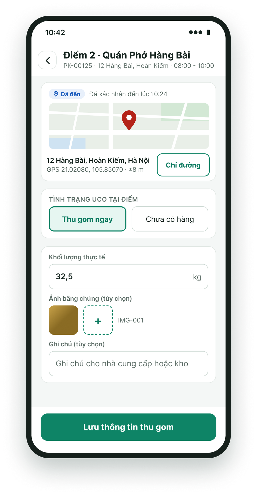
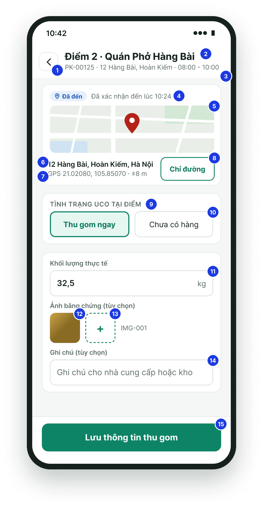
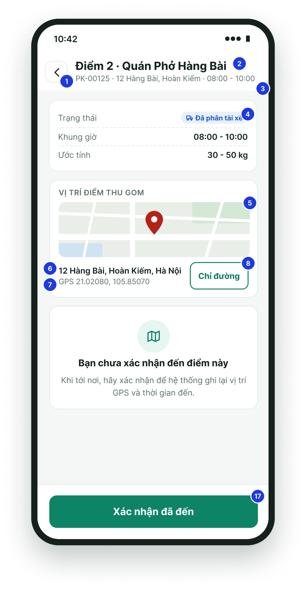
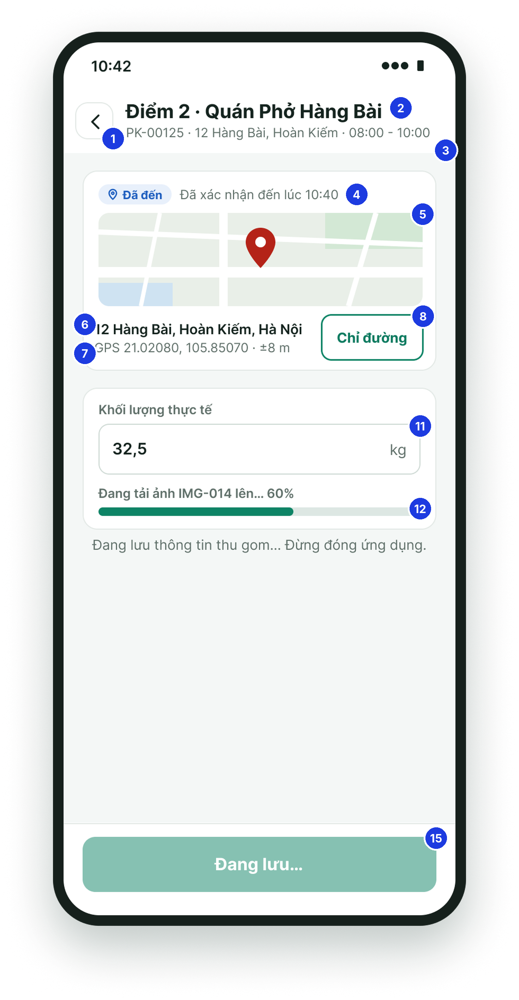
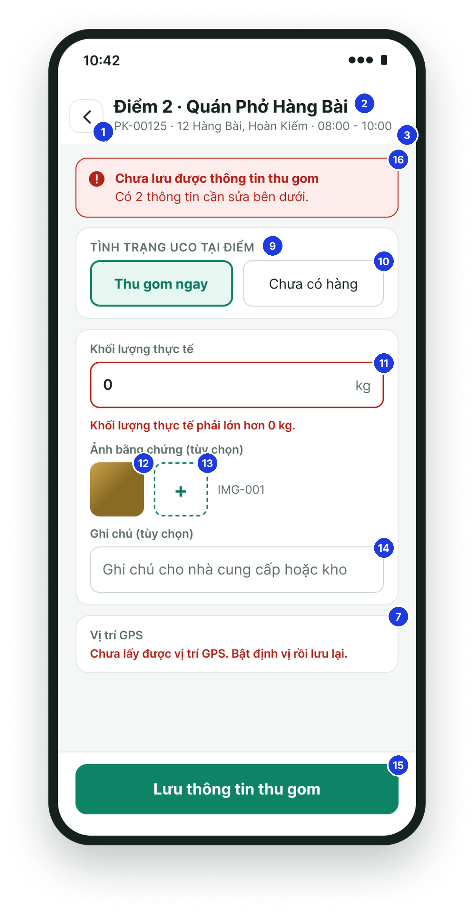
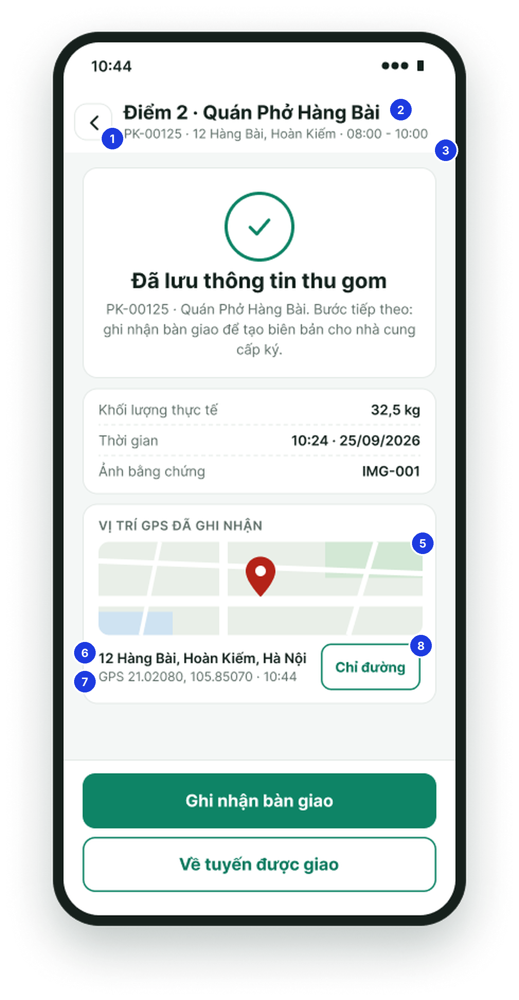

# Screen Spec: S-F02-04 Pickup point collection

| Field | Value |
|---|---|
| Screen ID | S-F02-04 |
| Screen name | Pickup point collection |
| Actor | Driver / Collector |
| Priority | Must |
| Feature | F-02 Collection Operations & Handover |
| Activity diagrams | AD-UC-06 (actions "Select supplier point and confirm arrival" — the confirm part, with "Update selected pickup status to Arrived"; decision "UCO ready?" and "Cancel current pickup and update status to Cancelled"; "Enter or correct actual UCO quantity and optional evidence", "Submit collection details", and the outcomes of "Required collection data valid?"); sequence SD-UC-06 |
| Mockup images | `img/S-F02-04-default.png` (default), `img/S-F02-04-default-numbered.png`, four state images and four numbered state images (section 2) |
| Frame width | 370px screen inside a 390 × 844 device frame (exported at 3x with a 50px shadow margin, 1470 × 2832 pixels) |
| Figma frame | Frames "S-F02-04 / 1" to "S-F02-04 / 5", page "4 màn × 5 trạng thái" in the ReFeed Figma file |
| Status | Draft |

## 1. Purpose

**Shown when:** the driver / collector opens one pickup point from the assigned route on S-F02-03 ("Mở điểm thu gom" or a tap on the stop card).

**The user leaves this screen when:** the collection details are saved (success state, then "Ghi nhận bàn giao" or "Về tuyến được giao"), the pickup is cancelled because UCO is not ready, or the driver goes back to the route.

## 2. Mockup

**Numbered:** each number is the # of the element inventory in section 3. Element 16 (Message
area) appears only in the error state and element 17 (Xác nhận đã đến) only in the empty state, so
each is numbered on that state's image. In the error state the location card is replaced by the GPS
error card, numbered 7 (GPS line). The success image numbers the header (1–3) and the recorded
location card (5–8); its summary card and buttons are described in section 4.

| Default, numbered | Empty, numbered | Loading, numbered | Error, numbered | Success, numbered |
|---|---|---|---|---|
|  |  |  |  |  |

| State | Image |
|---|---|
| Default | [`img/S-F02-04-default.png`](img/S-F02-04-default.png) |
| Empty | [`img/S-F02-04-empty.png`](img/S-F02-04-empty.png) |
| Loading | [`img/S-F02-04-loading.png`](img/S-F02-04-loading.png) |
| Error | [`img/S-F02-04-error.png`](img/S-F02-04-error.png) (invalid quantity and missing GPS, AD-UC-06 `d1` [No]; the network error is described in section 4 only) |
| Success | [`img/S-F02-04-success.png`](img/S-F02-04-success.png) |

All colours, fonts and corners come from the design tokens in
[ui-conventions.md](../ui-conventions.md#6-design-tokens).

## 3. Element inventory

| # | Element | Type | Content / data source | Required | Validation |
|---|---|---|---|---|---|
| 1 | Back | Button | static | Yes | none |
| 2 | Title | Header | "Điểm " + `stop.sequence` + " · " + `supplier.business_name` | Yes | |
| 3 | Context line | Text | `pickup.id` · `supplier.address` (short) · `pickup.time_window` | Yes | formats from ui-conventions §2 |
| 4 | Pickup status | Status badge + text | `pickup.status` ("Đã đến") + "Đã xác nhận đến lúc " + `pickup.arrived_at` (FR-02-09); before arrival: row "Trạng thái" with "Đã phân tài xế" | Yes | badge text + icon (ui-conventions §3) |
| 5 | Location map | Map preview | supplier point location `supplier.gps` (Point-of-Origin profile) | Yes | illustrative map, pin on the supplier point |
| 6 | Address | Text | `supplier.address` (full) | Yes | |
| 7 | GPS line | Text | "GPS " + `pickup.arrival_gps` (lat, lng, 5 decimals) + " · ±" + accuracy in m; when GPS is missing: "Chưa lấy được vị trí GPS. Bật định vị rồi lưu lại." | Yes | captured by the device, not typed |
| 8 | Chỉ đường | Link button | opens Google Maps directions to `supplier.gps` | Yes | none |
| 9 | UCO status label | Text | static: "Tình trạng UCO tại điểm" | Yes | |
| 10 | UCO status options | Toggle pair | "Thu gom ngay" / "Chưa có hàng" (AD-UC-06 `d0`; FR-02-10, FR-02-13) | Yes | exactly one selected; "Thu gom ngay" selected by default |
| 11 | Actual quantity | Number input with unit "kg" | `collection.actual_quantity` (FR-02-10, FR-02-12) | Yes | greater than 0 kg; 1 decimal with decimal comma (ui-conventions §2, §4) |
| 12 | Evidence photos | Thumbnail list | `collection.photos` (e.g. "IMG-001") (FR-02-10, FR-02-12, optional evidence); upload progress while saving | No | none; ID format `IMG-` + 3 digits |
| 13 | Add photo | Tile button | static "+" | No | none |
| 14 | Notes | Text input | `collection.notes`; placeholder "Ghi chú cho nhà cung cấp hoặc kho" (FR-02-10, FR-02-12, optional evidence) | No | none |
| 15 | Lưu thông tin thu gom | Primary button | static label; "Đang lưu…" while saving | Yes | disabled while saving |
| 16 | Message area | Banner | error messages (validation, network) (AD-UC-06 `s4`, FR-02-11) | No | |
| 17 | Xác nhận đã đến | Primary button | static label (empty state only) | Yes | shown only while `pickup.status` is Driver Assigned |

## 4. States

| State | What the user sees | Trigger |
|---|---|---|
| Default | Header "Điểm 2 · Quán Phở Hàng Bài", "PK-00125 · 12 Hàng Bài, Hoàn Kiếm · 08:00 - 10:00" with back button; location card with badge "Đã đến", "Đã xác nhận đến lúc 10:24", map, "12 Hàng Bài, Hoàn Kiếm, Hà Nội", "GPS 21.02080, 105.85070 · ±8 m" and "Chỉ đường"; "Tình trạng UCO tại điểm" with "Thu gom ngay" selected; actual quantity "32,5 kg", photo IMG-001, empty notes; footer "Lưu thông tin thu gom". The mockup shows this state. | Pickup PK-00125 opened with status Arrived |
| Empty (no data) | Info card (Trạng thái "Đã phân tài xế", Khung giờ 08:00 - 10:00, Ước tính 30 - 50 kg); card "Vị trí điểm thu gom" with map, address, "GPS 21.02080, 105.85070" and "Chỉ đường"; message with map icon "Bạn chưa xác nhận đến điểm này" — "Khi tới nơi, hãy xác nhận để hệ thống ghi lại vị trí GPS và thời gian đến."; no UCO status or quantity fields; footer "Xác nhận đã đến" | Pickup opened while its status is still Driver Assigned (arrival not yet confirmed) |
| Loading | Location card; quantity "32,5 kg" read-only; progress bar "Đang tải ảnh … lên… 60%"; text "Đang lưu thông tin thu gom… Đừng đóng ứng dụng."; footer button "Đang lưu…" disabled | Collection details are being saved and the photo uploaded |
| Error | Red banner "Chưa lưu được thông tin thu gom — Có 2 thông tin cần sửa bên dưới."; UCO status kept; quantity "0" with red border and "Khối lượng thực tế phải lớn hơn 0 kg."; photo IMG-001 and notes kept; card "Vị trí GPS" with "Chưa lấy được vị trí GPS. Bật định vị rồi lưu lại."; footer "Lưu thông tin thu gom". Network failure: "Không lưu được thay đổi. Kiểm tra kết nối mạng và thử lại.", entered values kept | Save rejected by validation (AD-UC-06 `d1` [No] → `s4`, FR-02-11), or the request failed |
| Success / confirmation | Time 10:44; check mark, "Đã lưu thông tin thu gom" — "PK-00125 · Quán Phở Hàng Bài. Bước tiếp theo: ghi nhận bàn giao để tạo biên bản cho nhà cung cấp ký."; summary card (Khối lượng thực tế 32,5 kg, Thời gian 10:24 · 25/09/2026, Ảnh bằng chứng IMG-001); card "Vị trí GPS đã ghi nhận" with map, address, "GPS 21.02080, 105.85070 · 10:44" and "Chỉ đường"; buttons "Ghi nhận bàn giao" and "Về tuyến được giao" | Collection details saved (AD-UC-06 `d1` [Yes] → `s5`, FR-02-12) |

## 5. Interactions and navigation

| # | Element | User action | System response | Goes to screen |
|---|---|---|---|---|
| 1 | Xác nhận đã đến | tap (empty state) | Records arrival time and GPS and updates the pickup status to Arrived (FR-02-09) | stays (default state) |
| 2 | Chỉ đường | tap | Opens Google Maps outside the app with directions to the supplier point | stays |
| 3 | "Thu gom ngay" | tap | Selects the option; quantity, photo and notes fields are available | stays |
| 4 | "Chưa có hàng" | tap | Opens the modal "UCO chưa sẵn sàng: hủy lần thu gom này?" — "Lần thu gom PK-00125 sẽ chuyển sang Đã hủy và không ghi nhận khối lượng." | stays (modal) |
| 5 | Hủy lần thu gom (modal) | tap | Cancels the pickup and updates its status to Cancelled; no collection details are saved (AD-UC-06 `s6`, FR-02-13) | S-F02-03 |
| 6 | Quay lại (modal) | tap | Closes the modal; "Thu gom ngay" stays selected | stays |
| 7 | Actual quantity | type | Numeric keypad with decimal comma; the field error clears once the value is valid | stays |
| 8 | Add photo | tap | Opens the camera or photo library and adds the photo as a thumbnail | stays |
| 9 | Lưu thông tin thu gom | tap | Validates and saves actual quantity, GPS, timestamp and any photo and notes (FR-02-10, FR-02-12) or shows the error state (FR-02-11) | stays (loading, then success or error state) |
| 10 | Ghi nhận bàn giao | tap (success state) | Opens the handover record for this pickup | S-F02-05 |
| 11 | Về tuyến được giao | tap (success state) | Returns to the route; the next pickup becomes the current stop | S-F02-03 |
| 12 | Back | tap | Returns without saving | S-F02-03 |

## 6. Screen-level rules

| Rule ID | Rule | Source |
|---|---|---|
| SR-001 | Collection details can only be entered after arrival is confirmed and the pickup status is Arrived. | FR-02-09; AD-UC-06 `s2` → `o1` |
| SR-002 | Actual quantity, GPS and timestamp are required; photo and notes are optional. | FR-02-10 |
| SR-003 | Actual quantity must be greater than 0 kg and is shown with 1 decimal. | ui-conventions §2, §4; AD-UC-06 open question 3 (default) |
| SR-004 | GPS and timestamp are taken from the device when the driver confirms arrival and saves; the driver cannot type them. | FR-02-09, FR-02-10; AD-UC-06 open question 3 (default) |
| SR-005 | "Chưa có hàng" cancels the pickup only after confirmation in the modal; a cancelled pickup records no quantity. | FR-02-13; AD-UC-06 `d0` [No] → `s6`; ui-conventions §3 (Modal, Destructive button) |
| SR-006 | Invalid data are not saved; the entered values stay on the screen so the driver can correct and resubmit. | FR-02-11; AD-UC-06 `d1` [No] → `s4` → `m1` |
| SR-007 | After saving, the pickup is not Completed; it becomes Completed only after the supplier signs. | AD-UC-06 §4; FR-03-08 |
| SR-008 | Only the driver assigned to the route can open and save this pickup. | FR-06-04 |
| SR-009 | Statuses and errors are shown with text and icon, never by colour alone. | ui-conventions §5 |

## 7. Linked requirements

| FR ID | What this screen does for it |
|---|---|
| FR-02-09 | Confirms arrival and updates the pickup status to Arrived |
| FR-02-10 | Validates the actual quantity, GPS, timestamp and optional photo and notes when UCO is ready |
| FR-02-11 | Shows the validation feedback, saves nothing and keeps the pickup Arrived |
| FR-02-12 | Saves the actual quantity, GPS, timestamp and evidence against the pickup |
| FR-02-13 | Cancels the pickup (status Cancelled) when UCO is not ready, without a collection record |
| FR-06-04 | Allows the arrival and collection actions only to the driver assigned to the route (role permission) |

## 8. Responsive and accessibility notes

- Smallest supported width: 360px; the map keeps its height and scales in width; the address wraps to two lines and the "Chỉ đường" button keeps its 44px height.
- Designed on a 370 × 824 screen inside a 390 × 844 device frame; the content scrolls and the footer button stays fixed above the keyboard.
- Touch targets at least 44 × 44: back button 44 × 44, UCO status options and inputs 48px high, photo tiles 56 × 56, footer buttons 52px high.
- The quantity field opens a numeric keypad with decimal comma.
- Field errors use a red border plus an error text below the field; the pickup status uses badge text plus icon.
- Body text contrast at least 4.5:1.

## 9. Open questions

| # | Question | Blocking? | Status |
|---|---|---|---|
| 1 | [NEEDS CLARIFICATION: when a pickup is cancelled because UCO is not ready (FR-02-13), should the driver pick a reason (supplier absent / no UCO yet) so ReFeed staff can plan the next visit?] | No | Open. Default: modal only, pickup Cancelled, no reason recorded; the supplier sees the status on S-F01-05 and can request a new pickup (AD-UC-06 open question 5). |
| 2 | [NEEDS CLARIFICATION: what happens when GPS is unavailable or the device is offline?] | No | Open. Default: saving is blocked with "Chưa lấy được vị trí GPS. Bật định vị rồi lưu lại."; no offline save (AD-UC-06 open question 3). |
| 3 | [NEEDS CLARIFICATION: W1 keeps UC-06 and UC-07 as separate use cases, and both validate the actual quantity (FR-02-10, FR-02-14). Does S-F02-05 only reuse the quantity saved here?] | No | Open. Default: S-F02-04 captures quantity and evidence (FR-02-09 to FR-02-13); S-F02-05 reuses them and adds handover time, amount and draft agreement (FR-02-14 to FR-02-18). |

---

## Completion checklist

- [x] The mockup is a separate cropped image file, named with the Screen ID, at the frame width.
- [x] The numbered image exists, and its numbers match the # column of the element inventory.
- [x] Every visible element in the mockup appears in the element inventory.
- [x] Every colour in the mockup is a design token from ui-conventions.md.
- [x] Every input element has a validation rule or an explicit "none".
- [x] All five states are filled in.
- [x] Every navigation target is a Screen ID that exists in the Screen List.
- [x] Every element that displays data names the field it displays.
- [x] Every linked FR exists in the Function List, and every action of this screen in AD-UC-06 is
      covered by an interaction row.
