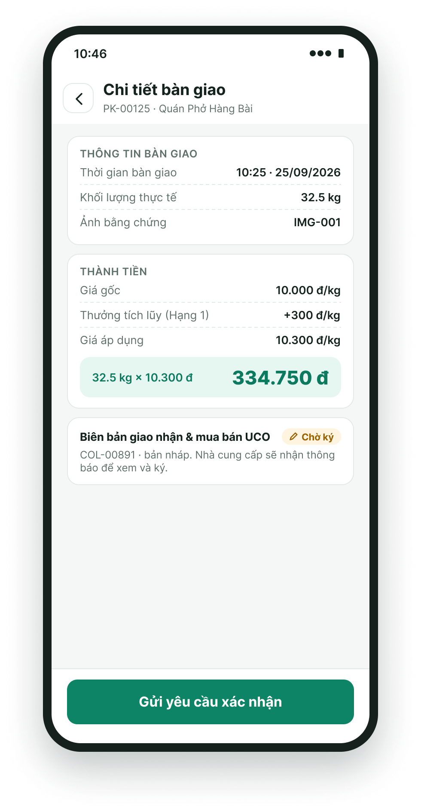
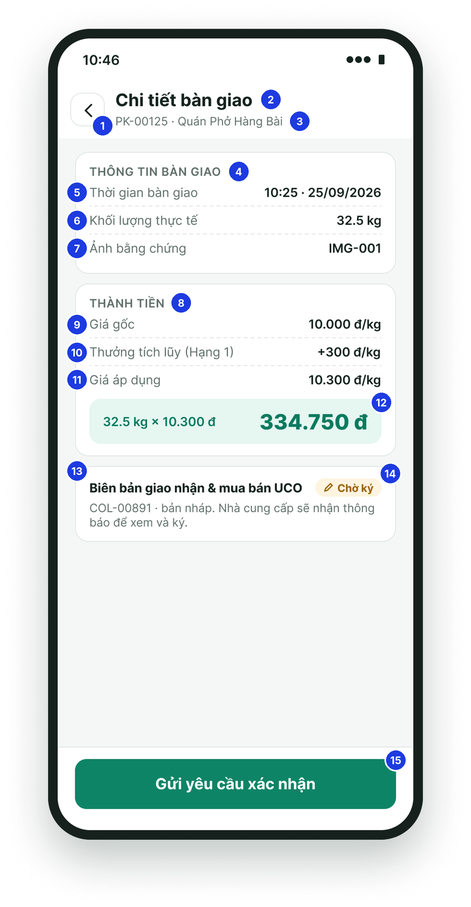
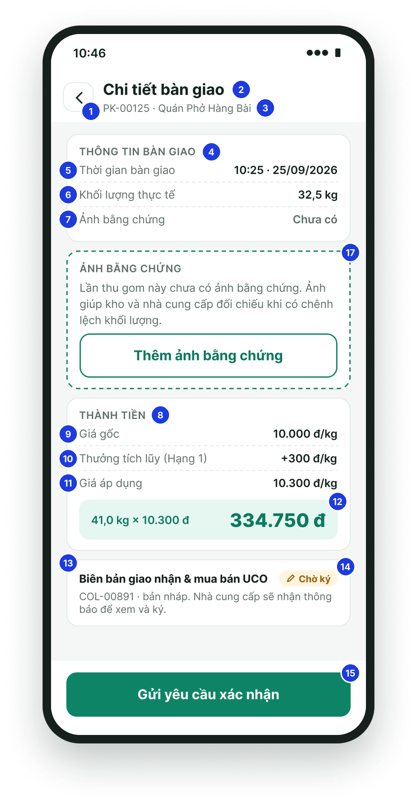
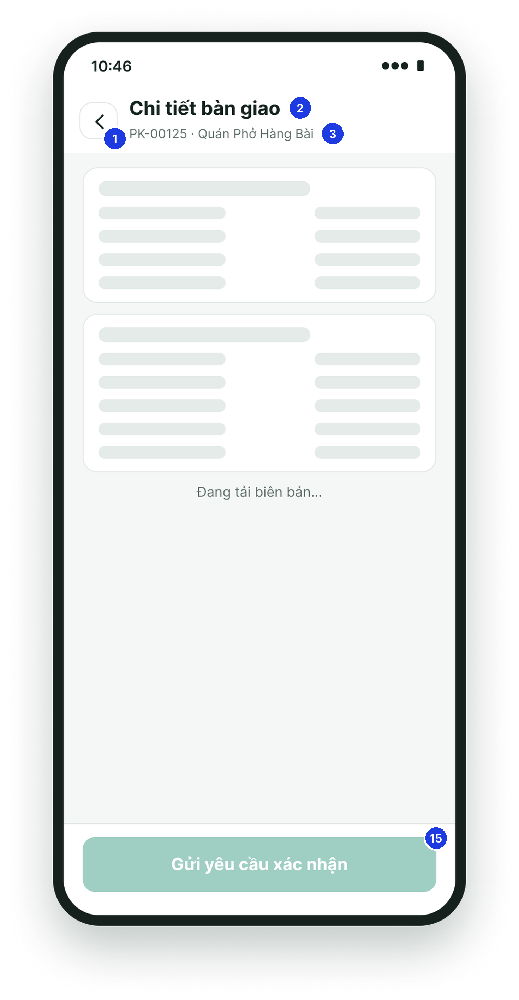
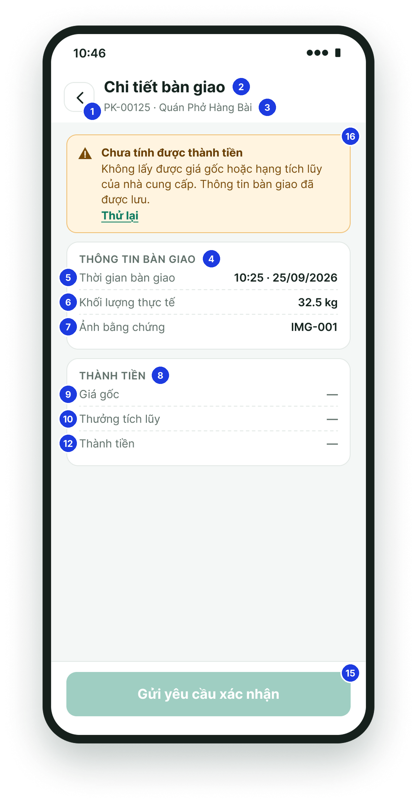
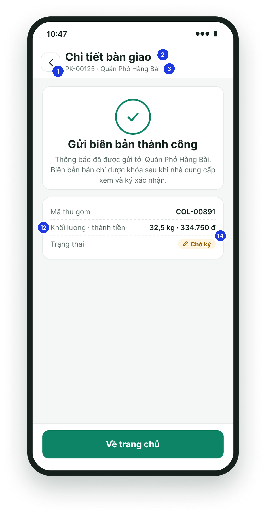

# Screen Spec: S-F02-05 Handover record and draft agreement

| Field | Value |
|---|---|
| Screen ID | S-F02-05 |
| Screen name | Handover record and draft agreement |
| Actor | Driver / Collector |
| Priority | Must |
| Feature | F-02 Collection Operations & Handover |
| Activity diagrams | AD-UC-07 (listed in the usage flow for UC-07 "Input handover information"; not drawn yet, see open question 1) |
| Mockup images | `img/S-F02-05-default.png` (default), `img/S-F02-05-default-numbered.png`, four state images and four numbered state images (section 2) |
| Frame width | 370px screen inside a 390 × 844 device frame (exported at 3x with a 50px shadow margin, 1470 × 2832 pixels) |
| Figma frame | Frames "S-F02-05 / 1" to "S-F02-05 / 5", page "4 màn × 5 trạng thái" in the ReFeed Figma file |
| Status | Draft |

## 1. Purpose

**Shown when:** the driver / collector has saved the collection details of a pickup on S-F02-04 and taps "Ghi nhận bàn giao" (screen transition: S-F02-04 → S-F02-05 "[collection saved] Record handover").

**The user leaves this screen when:** the handover is sent to the supplier (success state, then "Về trang chủ" back to the route), or the driver goes back to the pickup point.

## 2. Mockup

**Numbered:** each number is the # of the element inventory in section 3. Element 16 (Message
area) appears only in the error state and element 17 (Missing evidence card) only in the empty
state, so each is numbered on that state's image. In the error state the applied price (11) and the
draft agreement (13, 14) are not shown and the amount row (12) shows "—". The loading image numbers
the header (1–3) and the button (15); the success image numbers the header, the amount (12) and the
agreement status (14) in its summary card.

| Default, numbered | Empty, numbered | Loading, numbered | Error, numbered | Success, numbered |
|---|---|---|---|---|
|  |  |  |  |  |

| State | Image |
|---|---|
| Default | [`img/S-F02-05-default.png`](img/S-F02-05-default.png) |
| Empty | [`img/S-F02-05-empty.png`](img/S-F02-05-empty.png) |
| Loading | [`img/S-F02-05-loading.png`](img/S-F02-05-loading.png) |
| Error | [`img/S-F02-05-error.png`](img/S-F02-05-error.png) (amount not calculated; the network error on send is described in section 4 only) |
| Success | [`img/S-F02-05-success.png`](img/S-F02-05-success.png) |

All colours, fonts and corners come from the design tokens in
[ui-conventions.md](../ui-conventions.md#6-design-tokens).

## 3. Element inventory

| # | Element | Type | Content / data source | Required | Validation |
|---|---|---|---|---|---|
| 1 | Back | Button | static | Yes | none |
| 2 | Title | Header | static: "Chi tiết bàn giao" | Yes | |
| 3 | Context line | Text | `pickup.id` · `supplier.business_name` | Yes | |
| 4 | Section label | Text | static: "Thông tin bàn giao" | Yes | |
| 5 | Handover time | Text | `handover.time` (FR-02-03) | Yes | `HH:mm · dd/MM/yyyy` (ui-conventions §2) |
| 6 | Actual quantity | Text | `collection.actual_quantity` saved on S-F02-04 (FR-02-02, FR-02-03) | Yes | 1 decimal with decimal comma + " kg" |
| 7 | Evidence photo | Text | `collection.photos` (e.g. "IMG-001"); "Chưa có" when no photo | No | ID format `IMG-` + 3 digits |
| 8 | Section label | Text | static: "Thành tiền" | Yes | |
| 9 | Base price | Text | `price.base_price` (FR-02-03) | Yes | integer + " đ/kg" |
| 10 | Loyalty bonus | Text | "Thưởng tích lũy (Hạng " + `supplier.loyalty_tier` + ")" · `supplier.loyalty_bonus_rate` (FR-02-03, FR-05-01) | Yes | "+" + integer + " đ/kg" |
| 11 | Applied price | Text | base price + loyalty bonus | Yes | integer + " đ/kg" |
| 12 | Amount | Total row | `collection.actual_quantity` + " × " + applied price; `transaction.amount` (FR-02-03) | Yes | integer + " đ" (e.g. "334.750 đ") |
| 13 | Draft agreement | Card | static title "Biên bản giao nhận & mua bán UCO"; `collection.id` + " · bản nháp. Nhà cung cấp sẽ nhận thông báo để xem và ký." (FR-02-03) | Yes | ID format `COL-` + 5 digits |
| 14 | Agreement status | Status badge | `transaction.status`: "Chờ ký" | Yes | text + icon (ui-conventions §3, §5) |
| 15 | Gửi yêu cầu xác nhận | Primary button | static label | Yes | disabled until the amount is calculated and the draft agreement is generated |
| 16 | Message area | Banner | warning or error messages (amount not calculated, network) | No | |
| 17 | Missing evidence card | Card with secondary button | static: "Ảnh bằng chứng" — "Lần thu gom này chưa có ảnh bằng chứng. Ảnh giúp kho và nhà cung cấp đối chiếu khi có chênh lệch khối lượng."; button "Thêm ảnh bằng chứng" | No | shown only when `collection.photos` is empty |

## 4. States

| State | What the user sees | Trigger |
|---|---|---|
| Default | Header "Chi tiết bàn giao", "PK-00125 · Quán Phở Hàng Bài"; "Thông tin bàn giao" (Thời gian bàn giao 10:25 · 25/09/2026, Khối lượng thực tế 32,5 kg, Ảnh bằng chứng IMG-001); "Thành tiền" (Giá gốc 10.000 đ/kg, Thưởng tích lũy (Hạng 1) +300 đ/kg, Giá áp dụng 10.300 đ/kg, "32,5 kg × 10.300 đ" = 334.750 đ); draft card "Biên bản giao nhận & mua bán UCO" with badge "Chờ ký" and COL-00891; footer "Gửi yêu cầu xác nhận". The mockup shows this state. | Screen opened, handover data loaded, amount calculated and draft generated |
| Empty (no data) | "Ảnh bằng chứng: Chưa có"; dashed card "Ảnh bằng chứng" with the explanation and button "Thêm ảnh bằng chứng"; amount and draft agreement shown as in Default; "Gửi yêu cầu xác nhận" stays available | Collection saved on S-F02-04 without a photo (photo is optional, FR-02-02) |
| Loading | Two cards of grey placeholders and the text "Đang tải biên bản…"; "Gửi yêu cầu xác nhận" disabled | Handover data, amount and draft agreement are being fetched |
| Error | Orange banner "Chưa tính được thành tiền — Không lấy được giá gốc hoặc hạng tích lũy của nhà cung cấp. Thông tin bàn giao đã được lưu." with link "Thử lại"; handover card shown; "Thành tiền" rows Giá gốc, Thưởng tích lũy, Thành tiền show "—"; no draft card; "Gửi yêu cầu xác nhận" disabled. Network failure on send: "Không lưu được thay đổi. Kiểm tra kết nối mạng và thử lại." | Base price or loyalty tier could not be read, or the send request failed |
| Success / confirmation | Time 10:47; check mark, "Gửi biên bản thành công" — "Thông báo đã được gửi tới Quán Phở Hàng Bài. Biên bản chỉ được khóa sau khi nhà cung cấp xem và ký xác nhận."; summary card (Mã thu gom COL-00891, Khối lượng · thành tiền 32,5 kg · 334.750 đ, Trạng thái "Chờ ký"); button "Về trang chủ" | Handover record stored and the draft agreement sent to the supplier (FR-02-03) |

## 5. Interactions and navigation

| # | Element | User action | System response | Goes to screen |
|---|---|---|---|---|
| 1 | Thêm ảnh bằng chứng | tap (empty state) | Opens the camera or photo library; the photo ID replaces "Chưa có" and the missing evidence card disappears | stays (default state) |
| 2 | Thử lại / warning banner | tap (error state) | Reads the base price and loyalty tier again, recalculates the amount and generates the draft | stays |
| 3 | Gửi yêu cầu xác nhận | tap | Stores the handover record and sends the draft agreement to the supplier (FR-02-03) or shows the error state | stays (loading, then success or error state) |
| 4 | Về trang chủ | tap (success state) | Returns to the route; the next pickup becomes the current stop | S-F02-03 |
| 5 | Back | tap | Returns without sending; saved collection details are kept | S-F02-04 |

## 6. Screen-level rules

| Rule ID | Rule | Source |
|---|---|---|
| SR-001 | Actual quantity and evidence come from S-F02-04 and are not typed again here; only a missing photo can be added. | FR-02-02, FR-02-03; open question 4 (default) |
| SR-002 | Applied price = base price + the supplier's current loyalty bonus rate; amount = actual quantity × applied price, shown as whole đồng. | FR-02-03; ui-conventions §2 |
| SR-003 | The loyalty bonus uses the supplier's tier at the time of handover. | FR-02-03; FR-05-01 |
| SR-004 | "Gửi yêu cầu xác nhận" is disabled until the amount is calculated and the draft agreement is generated. | FR-02-03 |
| SR-005 | If the amount cannot be calculated, the handover information stays saved and no draft agreement is shown. | FR-02-03 (error state) |
| SR-006 | The agreement stays a draft with status "Chờ ký"; it is locked with the amount only after the supplier signs. | FR-03-01 |
| SR-007 | After sending, the supplier receives the notification "draft agreement ready", which opens S-F03-01. | screen-transition (Driver to Supplier, UC-07 to UC-08) |
| SR-008 | Only the driver assigned to the route can open and send this handover. | FR-06-03 |
| SR-009 | Statuses are shown with text and icon, never by colour alone. | ui-conventions §5 |

## 7. Linked requirements

| FR ID | What this screen does for it |
|---|---|
| FR-02-03 | Shows and stores the actual quantity, handover time and evidence, displays the transaction amount from base price and loyalty bonus, and generates and sends the draft handover agreement |
| FR-06-03 | Allows the handover actions only to the driver assigned to the route |

## 8. Responsive and accessibility notes

- Smallest supported width: 360px; label–value rows keep the value right-aligned and long labels wrap to two lines; the amount "334.750 đ" never wraps.
- Designed on a 370 × 824 screen inside a 390 × 844 device frame; the content scrolls and the footer button stays fixed.
- Touch targets at least 44 × 44: back button 44 × 44, "Thêm ảnh bằng chứng" and footer buttons 52px high; the whole warning banner is the tap target for "Thử lại" (ui-conventions §5).
- The "Chờ ký" badge uses text plus a pen icon; a disabled button is shown faded and does not react.
- Body text contrast at least 4.5:1.

## 9. Open questions

| # | Question | Blocking? | Status |
|---|---|---|---|
| 1 | [NEEDS CLARIFICATION: the usage flow lists `AD-UC-07.md` for UC-07, but the diagram has not been drawn. Which actions and decisions does it contain?] | No | Open. Default: states and rules follow FR-02-03 and the screen-transition diagram. |
| 2 | [NEEDS CLARIFICATION: is the handover time set by the system or entered by the driver?] | No | Open. Default: set by the system when the handover record is created; not editable. |
| 3 | [NEEDS CLARIFICATION: FR-02-03 generates the draft agreement when the driver submits. Is it shown as a preview before sending?] | No | Open. Default: preview shown when the screen opens; stored and sent on "Gửi yêu cầu xác nhận". |
| 4 | [NEEDS CLARIFICATION: UC-06 (S-F02-04) and UC-07 (S-F02-05) both capture actual quantity and evidence. Keep two screens or merge?] | No | Open. Default: S-F02-04 captures quantity and evidence; S-F02-05 adds handover time, amount and draft agreement (W1: FR-02-02 for S-F02-04, FR-02-03 for S-F02-05). |

---

## Completion checklist

- [x] The mockup is a separate cropped image file, named with the Screen ID, at the frame width.
- [x] The numbered image exists, and its numbers match the # column of the element inventory.
- [x] Every visible element in the mockup appears in the element inventory.
- [ ] Every colour in the mockup is a design token from ui-conventions.md.
- [x] Every input element has a validation rule or an explicit "none".
- [x] All five states are filled in.
- [x] Every navigation target is a Screen ID that exists in the Screen List.
- [x] Every element that displays data names the field it displays.
- [ ] Every linked FR exists in the Function List, and every action of this screen in AD-UC-07 is
      covered by an interaction row.
