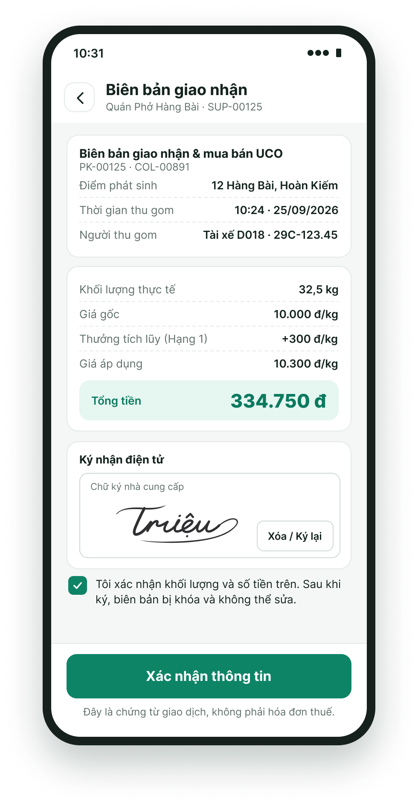
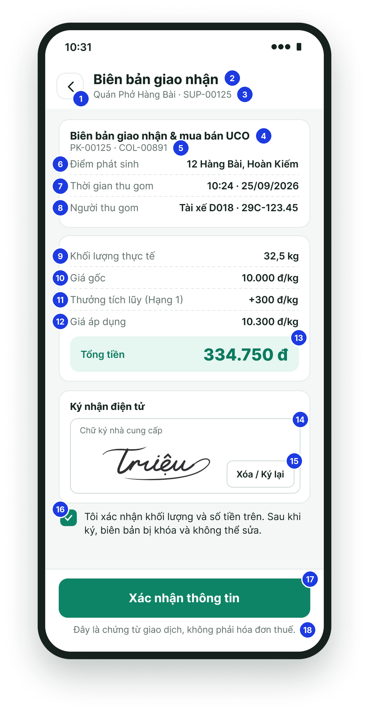
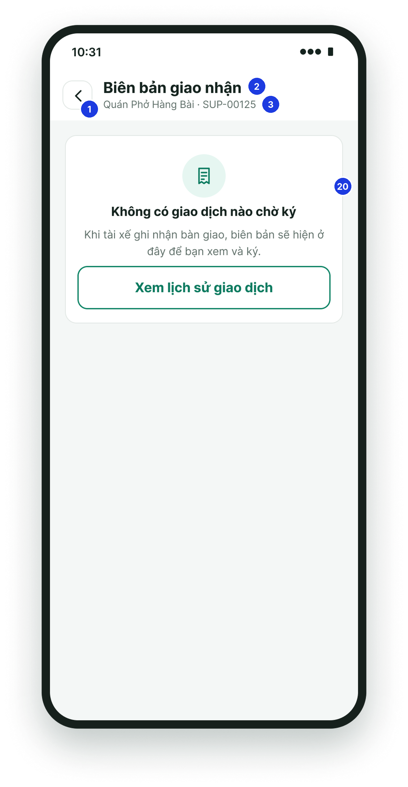
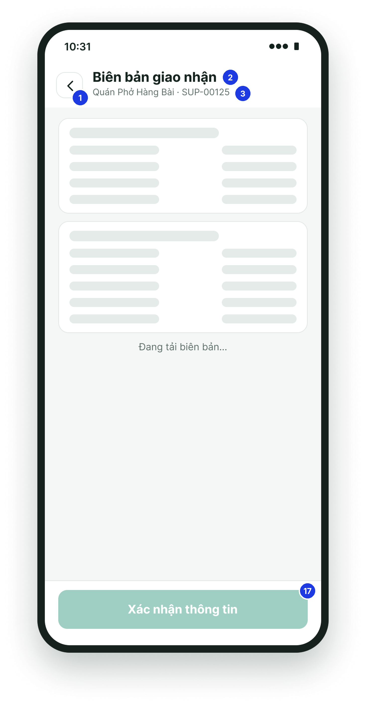
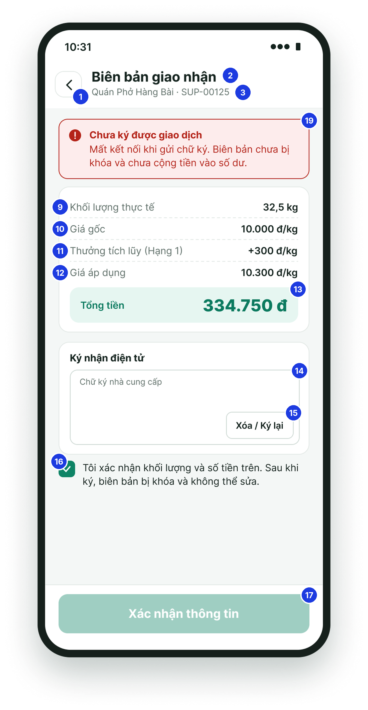
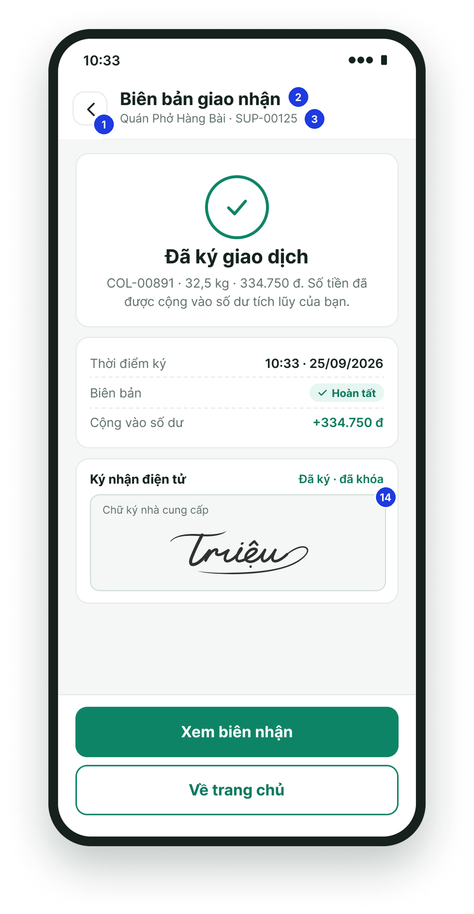

# Screen Spec: S-F03-01 Transaction review and e-signature

| Field | Value |
|---|---|
| Screen ID | S-F03-01 |
| Screen name | Transaction review and e-signature (Biên bản giao nhận) |
| Actor | Supplier |
| Priority | Must |
| Feature | F-03 UCO Transaction |
| Activity diagrams | None: the usage flow marks UC-08 "not needed"; W1 traces FR-03-01 to sequence S-02 |
| Mockup images | `img/S-F03-01-default.png` (default), `img/S-F03-01-default-numbered.png`, four state images and four numbered state images (section 2) |
| Frame width | 370px screen inside a 390 × 844 device frame (exported at 3x with a 50px shadow margin, 1470 × 2832 pixels) |
| Figma frame | Frames "S-F03-01 / 1" to "S-F03-01 / 5", page "4 màn × 5 trạng thái" in the ReFeed Figma file |
| Status | Draft |

## 1. Purpose

**Shown when:** the supplier opens the notification "draft agreement ready" after the driver sends the handover from S-F02-05, taps the awaiting-signature banner on S-F00-02, or taps "Transaction awaiting signature" on S-F05-01.

**The user leaves this screen when:** the transaction is signed (success state, then "Xem biên nhận" or "Về trang chủ"), or the supplier goes back to the supplier home (S-F00-02) without signing.

## 2. Mockup

**Numbered:** each number is the # of the element inventory in section 3. Element 19 (Message
area) appears only in the error state and element 20 (Empty message) only in the empty state, so
each is numbered on that state's image. In the error state the agreement card (4–8) and the amount
card (9–13) stay on screen, the signature pad (14) is empty, and the confirmation checkbox (16) and the
document note (18) sit below the visible part of the screen (the content scrolls), so they are not
numbered on the error image. The empty and loading images number the
header (1–3), the loading image also the disabled button (17); the success image numbers the header
and the locked signature pad (14), and its summary card is described in section 4.

| Default, numbered | Empty, numbered | Loading, numbered | Error, numbered | Success, numbered |
|---|---|---|---|---|
|  |  |  |  |  |

| State | Image |
|---|---|
| Default | [`img/S-F03-01-default.png`](img/S-F03-01-default.png) |
| Empty | [`img/S-F03-01-empty.png`](img/S-F03-01-empty.png) |
| Loading | [`img/S-F03-01-loading.png`](img/S-F03-01-loading.png) |
| Error | [`img/S-F03-01-error.png`](img/S-F03-01-error.png) (signing failed because the connection was lost) |
| Success | [`img/S-F03-01-success.png`](img/S-F03-01-success.png) |

All colours, fonts and corners come from the design tokens in
[ui-conventions.md](../ui-conventions.md#6-design-tokens).

## 3. Element inventory

| # | Element | Type | Content / data source | Required | Validation |
|---|---|---|---|---|---|
| 1 | Back | Button | static | Yes | none |
| 2 | Title | Header | static: "Biên bản giao nhận" | Yes | |
| 3 | Context line | Text | `supplier.business_name` · `supplier.id` | Yes | `SUP-` + 5 digits |
| 4 | Agreement title | Text | static: "Biên bản giao nhận & mua bán UCO" | Yes | |
| 5 | Record IDs | Text | `pickup.id` · `collection.id` | Yes | `PK-` / `COL-` + 5 digits |
| 6 | Point of origin | Text | "Điểm phát sinh" · `supplier.address` (Point-of-Origin) | Yes | |
| 7 | Collection time | Text | "Thời gian thu gom" · `collection.collected_at` (FR-02-02) | Yes | `HH:mm · dd/MM/yyyy` |
| 8 | Collector | Text | "Người thu gom" · "Tài xế " + `driver.id` · `vehicle.plate` | Yes | |
| 9 | Actual quantity | Text | `collection.actual_quantity` (FR-02-03) | Yes | 1 decimal + " kg" |
| 10 | Base price | Text | `transaction.base_price` | Yes | integer + " đ/kg" |
| 11 | Loyalty bonus | Text | "Thưởng tích lũy (Hạng " + `transaction.loyalty_tier` + ")" · `transaction.loyalty_bonus_rate` | Yes | "+" + integer + " đ/kg" |
| 12 | Applied price | Text | base price + loyalty bonus | Yes | integer + " đ/kg" |
| 13 | Total amount | Total row | "Tổng tiền" · `transaction.amount` (FR-02-03) | Yes | integer + " đ" |
| 14 | Signature pad | Drawing input | "Ký nhận điện tử"; caption "Chữ ký nhà cung cấp"; `transaction.signature` (FR-03-01); after signing: "Đã ký · đã khóa" | Yes | must not be empty |
| 15 | Xóa / Ký lại | Button | static | No | none; hidden after signing |
| 16 | Confirmation checkbox | Checkbox | static: "Tôi xác nhận khối lượng và số tiền trên. Sau khi ký, biên bản bị khóa và không thể sửa." | Yes | must be ticked |
| 17 | Xác nhận thông tin | Primary button | static label | Yes | disabled until the signature is drawn and the checkbox is ticked |
| 18 | Document note | Text | static: "Đây là chứng từ giao dịch, không phải hóa đơn thuế." | Yes | |
| 19 | Message area | Banner | error messages (signing failed, network) | No | |
| 20 | Empty message | Card with secondary button | static: "Không có giao dịch nào chờ ký" — "Khi tài xế ghi nhận bàn giao, biên bản sẽ hiện ở đây để bạn xem và ký."; button "Xem lịch sử giao dịch" | No | shown only when no transaction is awaiting signature |

## 4. States

| State | What the user sees | Trigger |
|---|---|---|
| Default | Header "Biên bản giao nhận", "Quán Phở Hàng Bài · SUP-00125"; agreement "Biên bản giao nhận & mua bán UCO" PK-00125 · COL-00891 (Điểm phát sinh 12 Hàng Bài, Hoàn Kiếm; Thời gian thu gom 10:24 · 25/09/2026; Người thu gom Tài xế D018 · 29C-123.45); 32,5 kg, Giá gốc 10.000 đ/kg, Thưởng tích lũy (Hạng 1) +300 đ/kg, Giá áp dụng 10.300 đ/kg, Tổng tiền 334.750 đ; signature pad with the supplier's signature and "Xóa / Ký lại"; checkbox ticked; "Xác nhận thông tin" enabled; document note below. The mockup shows this state. | Screen opened with one transaction awaiting signature |
| Empty (no data) | Card with receipt icon "Không có giao dịch nào chờ ký" — "Khi tài xế ghi nhận bàn giao, biên bản sẽ hiện ở đây để bạn xem và ký." with button "Xem lịch sử giao dịch"; no agreement, no signature pad, no footer button | No transaction of this supplier is awaiting signature (e.g. already signed) |
| Loading | Two cards of grey placeholders and the text "Đang tải biên bản…"; "Xác nhận thông tin" disabled | The agreement is being fetched |
| Error | Red banner "Chưa ký được giao dịch — Mất kết nối khi gửi chữ ký. Biên bản chưa bị khóa và chưa cộng tiền vào số dư."; agreement card (PK-00125 · COL-00891, 12 Hàng Bài, Hoàn Kiếm, 10:24 · 25/09/2026, Tài xế D018 · 29C-123.45) and amount card (32,5 kg … Tổng tiền 334.750 đ) kept; signature pad empty with "Xóa / Ký lại"; the confirmation checkbox stays ticked below the signature pad (reached by scrolling); "Xác nhận thông tin" disabled until the supplier signs again | The signing request failed |
| Success / confirmation | Time 10:33; check mark, "Đã ký giao dịch" — "COL-00891 · 32,5 kg · 334.750 đ. Số tiền đã được cộng vào số dư tích lũy của bạn."; card (Thời điểm ký 10:33 · 25/09/2026, Biên bản "Hoàn tất", Cộng vào số dư +334.750 đ); signature shown "Đã ký · đã khóa"; buttons "Xem biên nhận" and "Về trang chủ" | Agreement locked, signature stored and pickup Completed (FR-03-01); amount added to the balance (FR-05-01) |

## 5. Interactions and navigation

| # | Element | User action | System response | Goes to screen |
|---|---|---|---|---|
| 1 | Signature pad | draw | Captures the signature; the button is enabled once the checkbox is also ticked | stays |
| 2 | Xóa / Ký lại | tap | Clears the signature; the button is disabled | stays |
| 3 | Confirmation checkbox | tap | Ticks or unticks the confirmation | stays |
| 4 | Xác nhận thông tin | tap | Opens the modal "Xác nhận & ký điện tử" with the amount 334.750 đ | stays (modal) |
| 5 | Ký và khóa biên bản (modal) | tap | Locks the agreement (document hash) with the amount, stores the signature, marks the pickup Completed (FR-03-01) and adds the amount to the balance (FR-05-01), or shows the error state | stays (loading, then success or error state) |
| 6 | Quay lại (modal) | tap | Closes the modal; nothing is signed | stays |
| 7 | Xem biên nhận | tap (success state) | Opens the receipt of this transaction | S-F03-02 |
| 8 | Về trang chủ | tap (success state) | Returns to the supplier home | S-F00-02 |
| 9 | Xem lịch sử giao dịch | tap (empty state) | Opens the transaction history | S-F05-01 |
| 10 | Back | tap | Returns without signing; the transaction stays awaiting signature | S-F00-02 |

## 6. Screen-level rules

| Rule ID | Rule | Source |
|---|---|---|
| SR-001 | The supplier sees only transactions of their own `supplier.id`. | FR-06-03 |
| SR-002 | Quantity, prices and amount are read-only; they come from the handover recorded by the driver. | FR-02-03 |
| SR-003 | "Xác nhận thông tin" is enabled only when the signature is drawn and the checkbox is ticked. | FR-03-01 |
| SR-004 | Signing always goes through the confirmation modal "Xác nhận & ký điện tử". | Screen List (modals); ui-conventions §3 |
| SR-005 | On signing, the agreement is locked (document hash) with the amount, the signature is stored and the pickup becomes Completed. | FR-03-01 |
| SR-006 | After signing, the base payment and loyalty bonus are added to the payout balance and the quantity to the verified UCO volume. | FR-05-01 |
| SR-007 | If signing fails, the agreement stays unlocked and the balance is unchanged; the supplier signs again. | FR-03-01 (error state) |
| SR-008 | A signed agreement and its signature cannot be edited or cleared. | FR-03-01 |
| SR-009 | Statuses are shown with text and icon, never by colour alone. | ui-conventions §5 |

## 7. Linked requirements

| FR ID | What this screen does for it |
|---|---|
| FR-03-01 | Shows the recorded handover and amount, captures the electronic signature, locks the agreement and marks the pickup Completed |
| FR-05-01 | Shows that the signed amount was added to the accumulated payout balance (success state) |
| FR-06-03 | Restricts the transaction shown to the signed-in supplier |

## 8. Responsive and accessibility notes

- Smallest supported width: 360px; label–value rows keep the value right-aligned and long values wrap; the total "334.750 đ" never wraps.
- Designed on a 370 × 824 screen inside a 390 × 844 device frame; the content scrolls and the footer button stays fixed; the signature pad keeps at least 300 × 100px.
- Touch targets at least 44 × 44: back button 44 × 44, checkbox row 44px high, footer buttons 52px high, "Xóa / Ký lại" 44px high.
- The signature pad has a visible caption; the locked state is shown by the text "Đã ký · đã khóa" and a grey pad, not by colour alone; status badges use text plus icon.
- Body text contrast at least 4.5:1.

## 9. Open questions

| # | Question | Blocking? | Status |
|---|---|---|---|
| 1 | [NEEDS CLARIFICATION: the supplier home ("Supplier main menu" in the screen-transition diagram) has no Screen ID in the Screen List. Add one?] | No | Closed: added to the Screen List as S-F00-02 Supplier home; the screen-transition node is renamed to match. |
| 2 | [NEEDS CLARIFICATION: does the supplier sign on their own device or on the driver's phone at the handover?] | No | Open. Default: on the supplier's own device after the notification; SR-007 of S-F02-05. |
| 3 | [NEEDS CLARIFICATION: W1 has no path for a supplier who disagrees with the quantity or amount. Should the screen offer "reject" or "report a problem"?] | No | Open. Default: no reject action; the supplier contacts ReFeed by phone and does not sign. |
| 4 | [NEEDS CLARIFICATION: the note "Đây là chứng từ giao dịch, không phải hóa đơn thuế." is not traced to W0/W1. Confirm the wording with ReFeed.] | No | Open. Default: the note is shown. |

---

## Completion checklist

- [x] The mockup is a separate cropped image file, named with the Screen ID, at the frame width.
- [x] The numbered image exists, and its numbers match the # column of the element inventory.
- [x] Every visible element in the mockup appears in the element inventory.
- [ ] Every colour in the mockup is a design token from ui-conventions.md.
- [x] Every input element has a validation rule or an explicit "none".
- [x] All five states are filled in.
- [x] Every navigation target is a Screen ID that exists in the Screen List.
- [x] Every element that displays data names the field it displays.
- [x] Every linked FR exists in the Function List, and every action of this screen in its activity diagram is
      covered by an interaction row (UC-08: no activity diagram, "not needed" in the usage flow).
