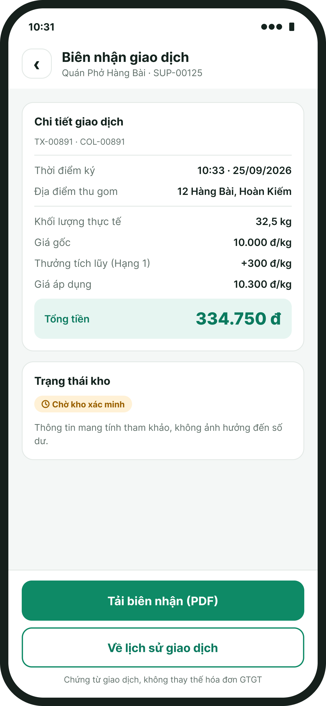
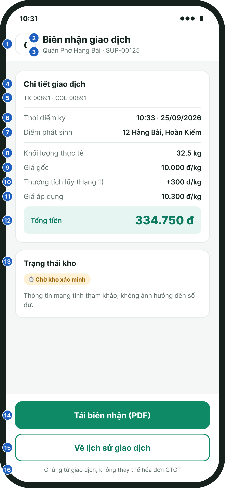

# Screen Spec: S-F03-02 Transaction receipt

| Field | Value |
|---|---|
| Screen ID | S-F03-02 |
| Screen name | Transaction receipt |
| Actor | Supplier |
| Priority | Must |
| Feature | F-03 UCO Transaction |
| Activity diagrams | UC-09 remains a read/download interaction; its signing predecessor is [AD-UC-08](../../activity/AD-UC-08.md) / [SD-UC-08](../../use-case/SD-UC-08.md). Current receipt functions are FR-03-11–FR-03-14. |
| Mockup images | `img/S-F03-02-default.png` (default), `img/S-F03-02-default-numbered.png`, four state images and four numbered state images (section 2) |
| Frame width | 390px phone frame (exported at 3x, 1470 × 2832 pixels including the device frame) |
| Figma frame | Frames "S-F03-02 / 1" to "S-F03-02 / 5", page "4 màn × 5 trạng thái" in the ReFeed Figma file |
| Status | Draft |

## 1. Purpose

**Shown when:** the supplier taps "Xem biên nhận" after signing on S-F03-01, or opens a completed transaction from the history list on S-F05-01.

**The user leaves this screen when:** the PDF receipt is downloaded (success state, then "Mở tệp PDF" or "Về số dư tích lũy"), or the supplier taps Back / "Về lịch sử giao dịch" to go to S-F05-01.

## 2. Mockup

**Numbered:** each number is the # of the element inventory in section 3. Elements 17–25 appear only in their respective states (17 in empty, 18 in loading, 19 in error, 20–25 in success), so each is numbered on that state's image. In the empty and loading states the receipt card (4–12), warehouse status card (13), secondary button (15), and document note (16) are not shown and the download button (14) is disabled. In the success state the receipt and warehouse cards are replaced by the confirmation card (20) and file metadata card (21–23).

| Default, numbered | Empty, numbered | Loading, numbered | Error, numbered | Success, numbered |
|---|---|---|---|---|
|  |  |  |  |  |

| State | Image |
|---|---|
| Default | [`img/S-F03-02-default.png`](img/S-F03-02-default.png) |
| Empty | [`img/S-F03-02-empty.png`](img/S-F03-02-empty.png) |
| Loading | [`img/S-F03-02-loading.png`](img/S-F03-02-loading.png) |
| Error | [`img/S-F03-02-error.png`](img/S-F03-02-error.png) (PDF generation/download failed because the connection was lost) |
| Success | [`img/S-F03-02-success.png`](img/S-F03-02-success.png) |

All colours, fonts and corners come from the design tokens in
[ui-conventions.md](../ui-conventions.md#6-design-tokens).

## 3. Element inventory

| # | Element | Type | Content / data source | Required | Validation |
|---|---|---|---|---|---|
| 1 | Back | Button | static | Yes | none |
| 2 | Title | Header | static: "Biên nhận giao dịch" | Yes | |
| 3 | Context line | Text | `supplier.business_name` · `supplier.id` | Yes | `SUP-` + 5 digits |
| 4 | Receipt title | Text | static: "Chi tiết giao dịch" (Default) / "Biên nhận giao dịch UCO" (Error) | Yes | |
| 5 | Record IDs | Text | `transaction.id` · `collection.id` | Yes | `TX-` / `COL-` + 5 digits |
| 6 | Signed timestamp | Text | "Thời điểm ký" (Default) / "Thời gian giao dịch:" (Error) · `transaction.signed_at` (FR-03-07) | Yes | `HH:mm · dd/MM/yyyy` |
| 7 | Point of origin | Text | "Địa điểm thu gom" (Default) / "Địa điểm thu gom:" (Error) · `supplier.address` (Point-of-Origin) | Yes | |
| 8 | Actual quantity | Text | "Khối lượng thực tế" · `collection.actual_quantity` (FR-02-03) | Yes | 1 decimal + " kg" |
| 9 | Base price | Text | "Giá gốc" · `transaction.base_price` | Yes | integer + " đ/kg" |
| 10 | Loyalty bonus | Text | "Thưởng tích lũy (Hạng " + `transaction.loyalty_tier` + ")" · `transaction.loyalty_bonus_rate` | Yes | "+" + integer + " đ/kg" |
| 11 | Applied price | Text | "Giá áp dụng" · base price + loyalty bonus | Yes | integer + " đ/kg" |
| 12 | Total amount | Total row | "Tổng tiền" · `transaction.amount` (FR-02-16) | Yes | integer + " đ" |
| 13 | Warehouse status card | Info card | header "Trạng thái kho"; badge `warehouse.verification_status` ("Chờ kho xác minh"); note "Thông tin mang tính tham khảo, không ảnh hưởng đến số dư." | Yes | read-only status badge |
| 14 | Tải biên nhận (PDF) | Primary button | static: "Tải biên nhận (PDF)" (Default/Empty/Loading) / "Thử lại tải PDF" (Error) | Yes | disabled in Empty and Loading states |
| 15 | Secondary navigation button | Secondary button | static: "Về lịch sử giao dịch" (Default/Error) / "Xem lịch sử giao dịch" (Empty) | Yes | none |
| 16 | Document note | Text | static: "Chứng từ giao dịch, không thay thế hóa đơn GTGT" | No | shown in Default state |
| 17 | Empty message | Card with secondary button | static: "Chưa có biên nhận" - "Biên nhận được tạo sau khi bạn ký giao dịch. Giao dịch đã ký sẽ hiển thị ở đây."; button `#15` ("Xem lịch sử giao dịch") | No | shown only when no signed receipt exists |
| 18 | Loading placeholder | Skeleton cards & text | two cards of grey placeholders and the text "Đang tải biên nhận..." | No | shown only while fetching receipt data |
| 19 | Message area | Banner | static: "Không tải được biên nhận - Mất kết nối khi tạo tệp PDF. Kiểm tra kết nối mạng và thử lại." | No | shown only when PDF generation/download fails |
| 20 | Success card | Summary card | check mark, "Tải biên nhận thành công" - `collection.id` · `collection.actual_quantity` · `transaction.amount` | No | shown only after PDF download succeeds |
| 21 | File name | Text | "Tên tệp" · `collection.id` + "_bien-nhan.pdf" | No | shown only in Success state |
| 22 | File size | Text | "Dung lượng" · `receipt_pdf.file_size` | No | integer + " KB"; shown only in Success state |
| 23 | Download timestamp | Text | "Thời gian tải" · `receipt_pdf.downloaded_at` | No | `HH:mm · dd/MM/yyyy`; shown only in Success state |
| 24 | Mở tệp PDF | Primary button | static label | No | shown only in Success state |
| 25 | Về số dư tích lũy | Secondary button | static label | No | shown only in Success state |

## 4. States

| State | What the user sees | Trigger |
|---|---|---|
| Default | Header "Biên nhận giao dịch", "Quán Phở Hàng Bài · SUP-00125"; card "Chi tiết giao dịch" TX-00891 · COL-00891 (Thời điểm ký 10:33 · 25/09/2026; Địa điểm thu gom 12 Hàng Bài, Hoàn Kiếm; Khối lượng thực tế 32,5 kg; Giá gốc 10.000 đ/kg; Thưởng tích lũy (Hạng 1) +300 đ/kg; Giá áp dụng 10.300 đ/kg; Tổng tiền 334.750 đ); card "Trạng thái kho" with badge "Chờ kho xác minh" and reference note; "Tải biên nhận (PDF)" enabled; "Về lịch sử giao dịch" below; document note at the bottom. The mockup shows this state. | Screen opened for an authorized signed transaction (`FR-03-11`, `FR-03-12`) |
| Empty (no data) | Card with receipt icon "Chưa có biên nhận" - "Biên nhận được tạo sau khi bạn ký giao dịch. Giao dịch đã ký sẽ hiển thị ở đây." with button "Xem lịch sử giao dịch"; no receipt card, no warehouse card; "Tải biên nhận (PDF)" disabled in footer | No signed transaction receipt exists for this supplier |
| Loading | Two cards of grey placeholders and the text "Đang tải biên nhận..."; "Tải biên nhận (PDF)" disabled in footer | The receipt data is being fetched |
| Error | Red banner "Không tải được biên nhận - Mất kết nối khi tạo tệp PDF. Kiểm tra kết nối mạng và thử lại."; receipt card and warehouse status card kept; primary button relabeled "Thử lại tải PDF"; secondary button "Về lịch sử giao dịch" kept | PDF generation or download request failed |
| Success / confirmation | Time 10:31; check mark, "Tải biên nhận thành công" - "COL-00891 · 32,5 kg · 334.750 đ"; file

## 5. Interactions and navigation

| # | Element | User action | System response | Goes to screen |
|---|---|---|---|---|
| 1 | Tải biên nhận (PDF) | tap (default state) | Generates and downloads the PDF receipt (`FR-03-13`), or shows the error state | stays (loading, then success or error state) |
| 2 | Thử lại tải PDF | tap (error state) | Retries generating and downloading the PDF receipt | stays (loading, then success or error state) |
| 3 | Về lịch sử giao dịch | tap (default or error state) | Opens the transaction history list | S-F05-01 |
| 4 | Xem lịch sử giao dịch | tap (empty state) | Opens the transaction history list | S-F05-01 |
| 5 | Mở tệp PDF | tap (success state) | Opens `COL-00891_bien-nhan.pdf` in the device's default PDF viewer | Device PDF viewer |
| 6 | Về số dư tích lũy | tap (success state) | Opens the accumulated payout balance screen | S-F05-01 |
| 7 | Back | tap | Returns to the previous screen without altering the receipt | S-F05-01 (or S-F03-01 if opened right after signing) |

## 6. Screen-level rules

| Rule ID | Rule | Source |
|---|---|---|
| SR-001 | The supplier sees only receipts of their own `supplier.id`. | FR-06-04 |
| SR-002 | All transaction, weight, price, and amount values on the receipt are read-only and locked upon signing on S-F03-01. | FR-03-06; FR-03-12, FR-03-13 |
| SR-003 | Warehouse verification status (`#13`) is strictly informational and does not affect the supplier's balance or block PDF receipt export. | FR-03-14 |
| SR-004 | "Tải biên nhận (PDF)" is disabled in the Empty and Loading states. | ui-conventions §4 |
| SR-005 | If PDF download fails, the loaded receipt and warehouse cards stay visible so the supplier can still read the details and tap "Thử lại tải PDF". | FR-03-13 (error state) |
| SR-006 | Statuses are shown with text and icon, never by colour alone. | ui-conventions §5 |

## 7. Linked requirements

| FR ID | What this screen does for it |
|---|---|
| FR-03-11 | Checks supplier ownership and signed status before showing the receipt |
| FR-03-12 | Retrieves the itemized signed-transaction receipt data |
| FR-03-13 | Renders/provides the PDF receipt for viewing or downloading |
| FR-03-14 | Shows read-only warehouse verification status for information only |
| FR-06-04 | Restricts receipt access to the signed-in supplier |

## 8. Responsive and accessibility notes

- Smallest supported width: 360px; label–value rows keep the value right-aligned and long values wrap; the total "334.750 đ" never wraps.
- Designed at 390 × 844; the content scrolls and the footer action buttons stay fixed at the bottom.
- Touch targets at least 44 × 44: back button 44 × 44, footer primary and secondary buttons 52px high, empty-state secondary button 48px high.
- Status badge ("Chờ kho xác minh"), error banner, and success confirmation use icon plus text rather than colour alone.
- Body text contrast at least 4.5:1.

## 9. Open questions

| # | Question | Blocking? | Status |
|---|---|---|---|
| 1 | [NEEDS CLARIFICATION: in the mockups, labels `#4`, `#6`, and `#7` differ slightly between Default ("Chi tiết giao dịch", "Thời điểm ký", "Điểm phát sinh") and Error ("Biên nhận giao dịch UCO", "Thời gian giao dịch:", "Địa điểm thu gom:"). Unify them?] | No | Open. Default: use the Default state labels across both states. |
| 2 | [NEEDS CLARIFICATION: "Về số dư tích lũy" in the success state goes to S-F05-01 (which combines transaction history and accumulated balance) or a dedicated payout balance screen?] | No | Open. Default: goes to S-F05-01. |
| 3 | [NEEDS CLARIFICATION: the note "Chứng từ giao dịch, không thay thế hóa đơn GTGT" uses slightly different phrasing from S-F03-01 ("Đây là chứng từ giao dịch, không phải hóa đơn thuế."). Confirm standard legal wording with ReFeed.] | No | Open. Default: keep the wording shown on S-F03-02. |

---

## Completion checklist

- [x] The mockup is a separate cropped image file, named with the Screen ID, at the frame width.
- [x] The numbered images exist, and their numbers match the # column of the element inventory.
- [x] Every visible element in the mockup appears in the element inventory.
- [ ] Every colour in the mockup is a design token from ui-conventions.md.
- [x] Every input element has a validation rule or an explicit "none".
- [x] All five states are filled in.
- [ ] Every navigation target is a Screen ID that exists in the Screen List.
- [x] Every element that displays data names the field it displays.
- [x] Every linked FR exists in the Function List, and every action of this screen in its activity diagram is
      covered by an interaction row. UC-09 remains read/download; its signing predecessor is documented in AD-UC-08.
