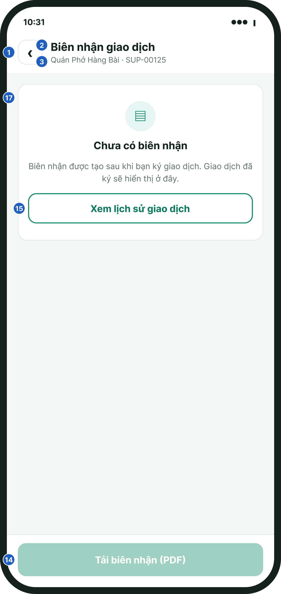
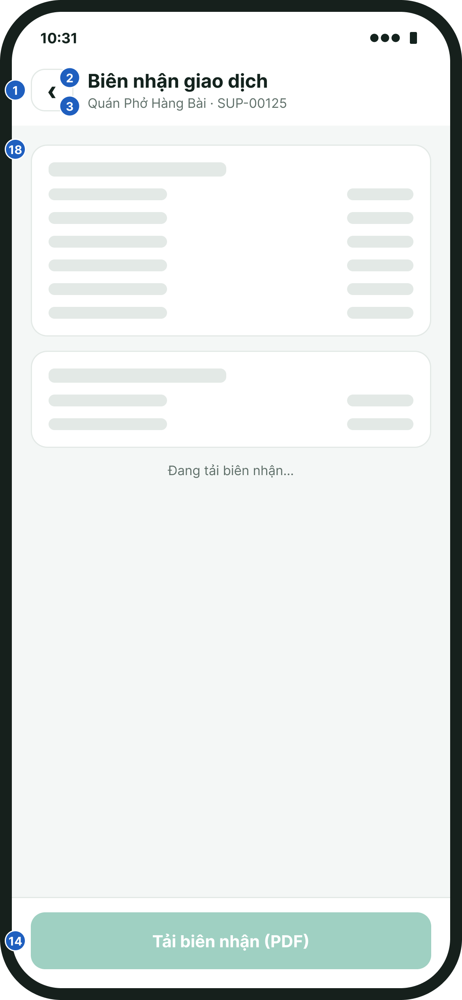
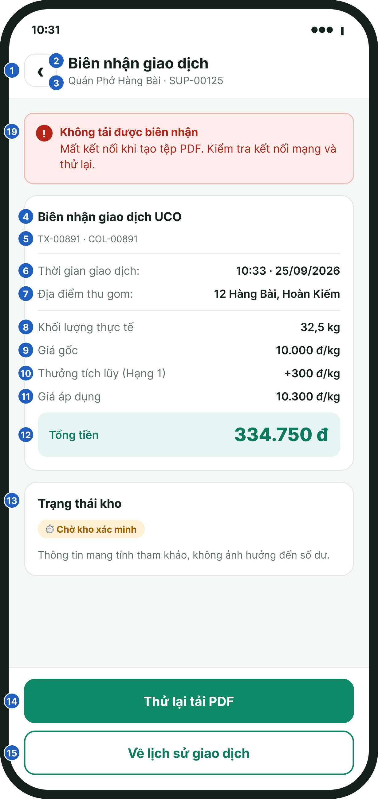
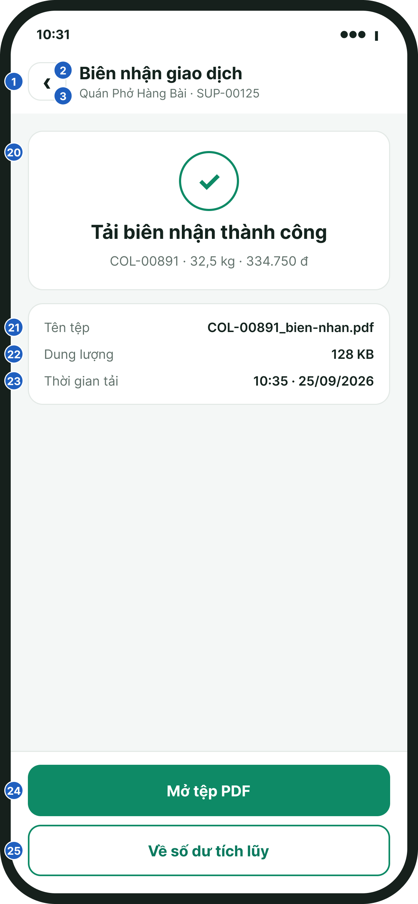

# Screen Spec: S-F03-02 Transaction Receipt

| Field | Value |
|---|---|
| Screen ID | S-F03-02 |
| Screen name | Transaction Receipt |
| Actor | Supplier (Food Business / Restaurant) |
| Priority | Must |
| Feature | F-03 Transaction History & Receipt |
| Activity diagrams | AD-UC-03 (actions "View transaction receipt", "Download PDF receipt") |
| Mockup images | `img/S-F03-02.png` (default), `img/S-F03-02-numbered.png` (default, numbered), and four numbered state images (section 2) |
| Frame width | 360px (exported at 3x, 1080 pixels) |
| Figma frame | `S-F03-02` (5 state frames) |
| Status | Draft |

## 1. Purpose

**Shown when:** the supplier selects a signed transaction from the transaction history list (`S-F03-01`) or navigates directly after signing a UCO collection handover to view and export the official digital receipt.

**The user leaves this screen when:** the supplier taps Back or "Về lịch sử giao dịch" to return to the transaction list (`S-F03-01`), taps "Về số dư tích lũy" in the success state (`S-F02-01`), or opens the downloaded PDF file externally.

## 2. Mockup

**Numbered:** each number corresponds to the `#` column of the element inventory in section 3. Because elements 14–25 appear across different states (empty, loading, error, and success), all five state mockups are shown with numbered annotations below.

| Default, numbered (Stage 1/5) | Empty, numbered (Stage 2/5) |
|---|---|
|  |  |

| Loading, numbered (Stage 3/5) | Error, numbered (Stage 4/5) |
|---|---|
|  |  |

| Success, numbered (Stage 5/5) |
|---|
|  |

| State | Unnumbered image | Numbered image |
|---|---|---|
| Default | `img/S-F03-02.png` | `img/S-F03-02-numbered.png` |
| Empty | — | `img/S-F03-02-empty-numbered.png` |
| Loading | — | `img/S-F03-02-loading-numbered.png` |
| Error | — | `img/S-F03-02-error-numbered.png` |
| Success | — | `img/S-F03-02-success-numbered.png` |

All colours, fonts and corners come from the design tokens in
[ui-conventions.md](../ui-conventions.md#6-design-tokens).

## 3. Element inventory

| # | Element | Type | Content / data source | Required | Validation |
|---|---|---|---|---|---|
| 1 | Back | Icon button | static (`<`) | Yes | none |
| 2 | Screen title | Header | static: "Biên nhận giao dịch" | Yes | none |
| 3 | Supplier subtitle | Text | `supplier.name` + `supplier.code` (e.g., "Quán Phở Hàng Bài · SUP-00125") | Yes | none |
| 4 | Receipt card title | Subheader | static: "Chi tiết giao dịch" (Default) / "Biên nhận giao dịch UCO" (Error) | Yes | none |
| 5 | Transaction & collection ID | Text | `transaction.code` + `collection.code` (e.g., "TX-00891 · COL-00891") | Yes | none |
| 6 | Signed timestamp | Key-value row | label "Thời điểm ký" / "Thời gian giao dịch:"; value `transaction.signed_at` (`HH:mm · DD/MM/YYYY`) | Yes | formats from ui-conventions |
| 7 | Collection location | Key-value row | label "Điểm phát sinh" / "Địa điểm thu gom:"; value `collection.address` | Yes | none |
| 8 | Actual weight | Key-value row | label "Khối lượng thực tế"; value `collection.actual_weight_kg` + " kg" | Yes | `> 0`, 1 decimal place |
| 9 | Base unit price | Key-value row | label "Giá gốc"; value `pricing.base_rate` + " đ/kg" | Yes | `> 0`, thousand-separated |
| 10 | Tier bonus | Key-value row | label "Thưởng tích lũy (`supplier.tier_name`)"; value "+" + `pricing.tier_bonus` + " đ/kg" | Yes | `>= 0` |
| 11 | Applied unit price | Key-value row | label "Giá áp dụng"; value `pricing.applied_rate` + " đ/kg" | Yes | `base_rate + tier_bonus` |
| 12 | Total amount | Highlight box | label "Tổng tiền"; value `transaction.total_amount` + " đ" | Yes | `actual_weight_kg * applied_rate` |
| 13 | Warehouse status card | Info card | header "Trạng thái kho"; badge `warehouse.verification_status` ("Chờ kho xác minh"); helper note "Thông tin mang tính tham khảo, không ảnh hưởng đến số dư." | Yes | read-only status badge |
| 14 | Download PDF | Primary button | label "Tải biên nhận (PDF)" (Default/Empty/Loading) / "Thử lại tải PDF" (Error) | Yes | disabled in Empty and Loading states |
| 15 | Secondary navigation button | Secondary button | label "Về lịch sử giao dịch" (Default/Error) / "Xem lịch sử giao dịch" (Empty) | Yes | none |
| 16 | Legal disclaimer | Caption text | static: "Chứng từ giao dịch, không thay thế hóa đơn GTGT" | No | shown in Default state |
| 17 | Empty state card | Empty container | document icon, title "Chưa có biên nhận", body "Biên nhận được tạo sau khi bạn ký giao dịch. Giao dịch đã ký sẽ hiển thị ở đây.", button `#15` | No | shown only in Empty state |
| 18 | Loading skeleton | Placeholder & text | skeleton cards matching receipt & warehouse layout; caption "Đang tải biên nhận..." | No | shown only in Loading state |
| 19 | Error alert banner | Alert banner | error icon, title "Không tải được biên nhận", body "Mất kết nối khi tạo tệp PDF. Kiểm tra kết nối mạng và thử lại." | No | shown only in Error state |
| 20 | Success confirmation card | Status card | green check icon, title "Tải biên nhận thành công", summary `collection.code` · `actual_weight_kg` · `total_amount` | No | shown only in Success state |
| 21 | Generated file name | Key-value row | label "Tên tệp"; value `<collection.code>_bien-nhan.pdf` (e.g., `COL-00891_bien-nhan.pdf`) | No | shown only in Success state |
| 22 | File size | Key-value row | label "Dung lượng"; value `pdf_file.size_kb` + " KB" | No | shown only in Success state |
| 23 | Download timestamp | Key-value row | label "Thời gian tải"; value `pdf_file.downloaded_at` (`HH:mm · DD/MM/YYYY`) | No | shown only in Success state |
| 24 | Open PDF file | Primary button | label "Mở tệp PDF" | No | shown only in Success state |
| 25 | Go to accumulated balance | Secondary button | label "Về số dư tích lũy" | No | shown only in Success state |

## 4. States

| State | What the user sees | Trigger |
|---|---|---|
| Default | Header with supplier info, transaction detail card (`#4`–`#12`), warehouse status card (`#13`), active primary button "Tải biên nhận (PDF)" (`#14`), secondary button "Về lịch sử giao dịch" (`#15`), and legal disclaimer (`#16`). | Screen opened with a valid signed transaction (`FR-03-02`) |
| Empty (no data) | Header (`#1`–`#3`), empty state card (`#17`) explaining that receipts are generated after signing a transaction with "Xem lịch sử giao dịch" button (`#15`), and disabled "Tải biên nhận (PDF)" button (`#14`). | Screen accessed when no signed transaction receipt exists yet |
| Loading | Header (`#1`–`#3`), grey skeleton placeholders for the two cards with caption "Đang tải biên nhận..." (`#18`), and disabled "Tải biên nhận (PDF)" button (`#14`). | Receipt data is being fetched from the server |
| Error | Header (`#1`–`#3`), red error banner "Không tải được biên nhận" (`#19`), full transaction & warehouse cards preserved (`#4`–`#13`), primary button relabeled "Thử lại tải PDF" (`#14`), and secondary button "Về lịch sử giao dịch" (`#15`). | PDF generation or download fails due to network disconnection |
| Success / confirmation | Header (`#1`–`#3`), success card with check mark and transaction summary (`#20`), file metadata card showing file name, size, and download time (`#21`–`#23`), primary button "Mở tệp PDF" (`#24`), and secondary button "Về số dư tích lũy" (`#25`). | PDF receipt generated and saved to device successfully (`FR-03-03`) |

## 5. Interactions and navigation

| # | Element | User action | System response | Goes to screen |
|---|---|---|---|---|
| 1 | Back (`#1`) | tap | Returns to the previous screen without altering state | S-F03-01 |
| 2 | Tải biên nhận (PDF) (`#14`, Default) | tap | Requests PDF generation and transitions to Success or Error state | stays (Success or Error state) |
| 3 | Thử lại tải PDF (`#14`, Error) | tap | Retries PDF generation and download | stays (Success or Error state) |
| 4 | Về / Xem lịch sử giao dịch (`#15`) | tap | Navigates to the transaction history list | S-F03-01 |
| 5 | Mở tệp PDF (`#24`, Success) | tap | Opens the downloaded PDF receipt in the device's default PDF viewer | external PDF viewer |
| 6 | Về số dư tích lũy (`#25`, Success) | tap | Navigates to the supplier's accumulated balance and wallet overview | S-F02-01 |

## 6. Screen-level rules

| Rule ID | Rule | Source |
|---|---|---|
| SR-001 | Receipts are immutable once generated upon transaction signing; all monetary and weight fields on this screen are strictly read-only. | BR-03-01 |
| SR-002 | Warehouse verification status (`#13`) is informational only and does not block receipt viewing, PDF export, or supplier balance calculation. | BR-03-02 |
| SR-003 | The primary PDF download button (`#14`) must remain disabled in Empty and Loading states to prevent null file generation. | ui-conventions §4 |
| SR-004 | On PDF download failure (Error state), all loaded transaction details remain visible on screen so the user can still verify data and retry without reloading. | FR-03-03 |
| SR-005 | Every digital receipt must display the legal disclaimer stating that it serves as a transaction voucher and does not replace a VAT invoice. | BR-03-03 |

## 7. Linked requirements

| FR ID | What this screen does for it |
|---|---|
| FR-03-02 | Displays full itemized transaction receipt details including weight, base price, tier bonus, applied rate, total payout, and warehouse verification status |
| FR-03-03 | Exports the transaction receipt as a downloadable PDF file (`<collection_code>_bien-nhan.pdf`) and confirms file metadata upon completion |

## 8. Responsive and accessibility notes

- Smallest supported width: `360px`; cards stack vertically with `16px` horizontal padding and full-width bottom action buttons (`48px` minimum touch target height).
- Key-value rows align labels on the left and values right-aligned with `tabular-nums` so currency and weight digits align cleanly.
- Status badges (`Chờ kho xác minh`), error banners (`#19`), and success cards (`#20`) pair semantic icons with text labels rather than relying on colour alone.
- Body and label text maintain a minimum contrast ratio of `4.5:1` against card and background surfaces.

## 9. Open questions

| # | Question | Blocking? | Status |
|---|---|---|---|
| 1 | [NEEDS CLARIFICATION: Should labels in cards `#4`, `#6`, and `#7` be unified between Default ("Chi tiết giao dịch", "Thời điểm ký", "Điểm phát sinh") and Error ("Biên nhận giao dịch UCO", "Thời gian giao dịch:", "Địa điểm thu gom:")?] | No | Open. Default: use the Default state labels across all states. |
| 2 | [NEEDS CLARIFICATION: Should the legal disclaimer (`#16`) also remain visible at the bottom of the Error state?] | No | Open. Default: display `#16` consistently whenever receipt details are shown. |

---

## Completion checklist

- [x] The mockup is a separate cropped image file, named with the Screen ID, at the frame width.
- [x] The numbered images exist, and their numbers match the `#` column of the element inventory.
- [x] Every visible element in the mockup appears in the element inventory.
- [x] Every colour in the mockup is a design token from `ui-conventions.md`.
- [x] Every input element has a validation rule or an explicit "none".
- [x] All five states are filled in.
- [x] Every navigation target is a Screen ID that exists in the Screen List.
- [x] Every element that displays data names the field it displays.
- [x] Every linked FR exists in the Function List, and every action of this screen in AD-UC-03 is covered by an interaction row.
