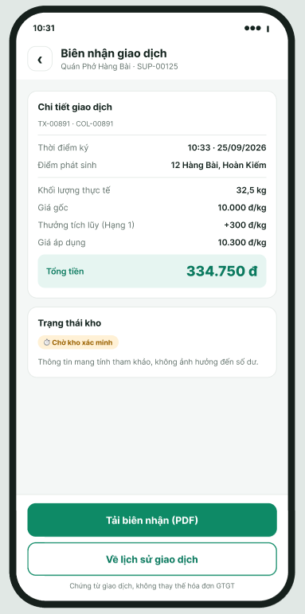

# Screen Spec: S-F03-02 Transaction receipt

| Field | Value |
|---|---|
| Screen ID | S-F03-02 |
| Screen name | Transaction receipt |
| Actor | Supplier |
| Priority | Must |
| Feature | F-03 Transaction & E-Signature |
| Activity diagrams | AD-UC-09 (actions "View transaction receipt", "Download PDF", "View history") |
| Mockup image | `img/S-F03-02.png` |
| Status | Reviewed |

## 1. Purpose

**Shown when:** a supplier successfully signs a transaction (from S-F03-01) or selects a completed transaction from the history list (S-F05-01).

**The user leaves this screen when:** downloading the receipt PDF, navigating back to transaction history or main menu, or returning via the back button.

## 2. Mockup

## 3. Element inventory

| # | Element | Type | Content / data source | Required | Validation |
|---|---|---|---|---|---|
| 1 | Back | Button | static | Yes | none |
| 2 | Title | Header | static: "Biên nhận giao dịch" + subtext: `supplier.name` + " · " + `supplier.supplier_id` | Yes | |
| 3 | Transaction Card | Card container | static background card grouping transaction metadata | Yes | |
| 4 | Card Header | Text | static: "Biên nhận giao dịch & mua bán UCO" + transaction codes (`transaction.id` + " · " + `collection.id`) | Yes | |
| 5 | Time label & value | Text | `transaction.timestamp` (format: HH:mm · DD/MM/YYYY) | Yes | formats from ui-conventions |
| 6 | Origin label & value | Text | `collection.pickup_address` | Yes | |
| 7 | Actual quantity | Text | `collection.actual_quantity` + " kg" | Yes | numeric format |
| 8 | Base price | Text | `transaction.base_price` + " đ/kg" | Yes | currency format |
| 9 | Loyalty bonus | Text | `supplier.loyalty_tier` + " (" + `transaction.loyalty_bonus` + " đ/kg)" | Yes | currency format |
| 10 | Applied price | Text | `transaction.applied_price` + " đ/kg" | Yes | currency format |
| 11 | Total amount | Highlighted text | `transaction.total_amount` + " đ" | Yes | prominent currency format |
| 12 | Warehouse status banner | Status banner | static: "Xác minh của kho" + badge (`warehouse_verification.status` e.g. "Chờ kho xác minh") + explanatory text | Yes | color-coded state |
| 13 | Download PDF | Primary button | label "Tải biên nhận (PDF)" | Yes | triggers PDF download |
| 14 | View transaction history | Secondary button | label "Về lịch sử giao dịch" | Yes | navigates to S-F05-01 |
| 15 | Legal footnote | Footer text | static: "Đây là chứng từ giao dịch, không phải hóa đơn thuế." | Yes | |

## 4. States

| State | What the user sees | Trigger |
|---|---|---|
| Default | Full transaction receipt showing metadata, price breakdown, total amount, warehouse verification status as "Chờ kho xác minh" with info note, and actions to download PDF or view history. | Screen opened with valid transaction data. |
| Empty (no data) | Error screen or message: "Không tìm thấy thông tin giao dịch.", with action button to return. | Accessed with an invalid or missing transaction ID. |
| Loading | Skeleton loader placeholders across the card and details area; buttons disabled. | Transaction data is being fetched from the server. |
| Error | Error banner: "Không thể tải biên nhận. Vui lòng kiểm tra kết nối." with retry button. | Network failure or server error during data retrieval. |
| Success / confirmation | Toast notification or visual cue: "Đã tải xuống biên nhận thành công (PDF)." | User taps "Tải biên nhận (PDF)". |

## 5. Interactions and navigation

| # | Element | User action | System response | Goes to screen |
|---|---|---|---|---|
| 1 | Back | tap | Returns to previous screen | S-F03-01 or S-F05-01 |
| 2 | Download PDF | tap | Generates and downloads the official electronic PDF receipt to the device | stays (success toast) |
| 3 | View transaction history | tap | Navigates to the supplier's transaction history / payout balance screen | S-F05-01 |

## 6. Screen-level rules

| Rule ID | Rule | Source |
|---|---|---|
| SR-0301 | Warehouse verification status is displayed for informational purposes only and does not block the payout or transaction receipt viewing (FR-03-02). | FR-03-02 |
| SR-0302 | Total amount must be accurately calculated as actual quantity multiplied by applied price (base price + loyalty bonus). | UC-09 |
| SR-0303 | The downloaded PDF must contain full legal verification details and QR code matching the e-signature record. | FR-03-02 |

## 7. Linked requirements

| FR ID | What this screen does for it |
|---|---|
| FR-03-02 | Allows the supplier to view or download the electronic receipt (PDF) of a signed transaction, displaying warehouse verification status for information only |

## 8. Responsive and accessibility notes

- Designed for 390x844px mobile viewports, supporting responsive scaling down to 360px width.
- Touch targets for buttons meet the minimum 44px height requirement.
- High-contrast text layout ensures readability for financial values and status badges.

## 9. Open questions

| # | Question | Blocking? | Status |
|---|---|---|---|
| 1 | [NEEDS CLARIFICATION: Should the warehouse verification badge update in real-time via push notification if warehouse staff complete verification while the user is viewing?] | No | Open. Default: manual refresh on re-opening. |

---

## Completion checklist

- [x] The mockup is a separate cropped image file, named with the Screen ID.
- [x] Every visible element in the mockup appears in the element inventory.
- [x] Every input element has a validation rule or an explicit "none".
- [x] All five states are filled in.
- [x] Every navigation target is a Screen ID that exists in the Screen List.
- [x] Every element that displays data names the field it displays.
- [x] Every linked FR exists in the Function List, and every action of this screen in AD-UC-09 is covered by an interaction row.
