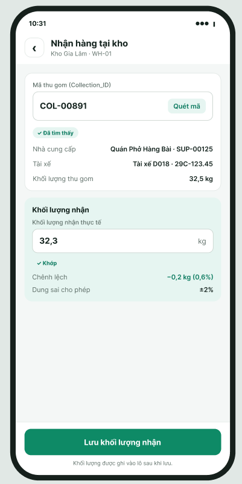

# Screen Spec: S-F04-01 Warehouse receiving

| Field | Value |
|---|---|
| Screen ID | S-F04-01 |
| Screen name | Warehouse receiving |
| Actor | Warehouse Staff |
| Priority | Must |
| Feature | F-04 Warehouse Batch & Mass-Balance Management |
| Activity diagrams | AD-UC-04 (actions "Scan collection QR", "Weigh received UCO", "Confirm warehouse intake", "Flag weight discrepancy") |
| Mockup image | `img/S-F04-01.png` |
| Status | Draft |

## 1. Purpose

**Shown when:** warehouse staff opens the receiving screen for a specific warehouse (e.g., Kho Gia Lâm · WH-01) from the warehouse home dashboard or after completing a batch update (S-F04-02) to weigh and log an incoming UCO collection handover.

**The user leaves this screen when:** the staff taps Back, navigates to Batch Management ("Quản lý lô hàng") or Home ("Về trang chủ") after saving, or opens the QR scanner.

## 2. Mockup

## 3. Element inventory

| # | Element | Type | Content / data source | Required | Validation |
|---|---|---|---|---|---|
| 1 | Back | Button | static | Yes | none |
| 2 | Screen Title | Header | static: "Nhận hàng tại kho" | Yes | |
| 3 | Warehouse Subtitle | Text | `warehouse.name` · `warehouse.code` (e.g., "Kho Gia Lâm · WH-01") | Yes | |
| 4 | Discrepancy Banner | Banner | static: "Chênh lệch vượt mức cho phép" + dynamic message: `"Nhận " + actual_weight + ", thấp hơn " + collected_weight + " đã thu. Kiểm tra lại cân hoặc ghi chú nguyên nhân."` (Warning/Error state 4/5 only) | No | |
| 5 | Collection ID Input | Text input + Button | `collection.code` (e.g., `COL-00891`); inline action button: "Quét mã" | Yes | Must match an existing `Pending Intake` collection ID |
| 6 | Lookup Status Badge | Badge | static: "✓ Đã tìm thấy" when `collection.code` is resolved (States 1/5 & 4/5) | No | |
| 7 | Collection Metadata | Key-value rows | `supplier.name` · `supplier.code` ("Nhà cung cấp"), `driver.name` · `driver.plate` ("Tài xế"), `collection.collected_weight` ("Khối lượng thu gom", e.g., `32,5 kg`) | Yes | |
| 8 | Actual Weight Input | Numeric input | `intake.actual_weight` in `kg` (e.g., `32,3` or `28,0`); label: "Khối lượng nhận thực tế" | Yes | Numeric `> 0`, up to 1 decimal place |
| 9 | Variance Indicator | Status text + rows | Badge: "✓ Khớp" (within $\pm 2\%$) or "! Vượt mức chênh lệch cho phép" (outside $\pm 2\%$); Rows: `intake.variance` ("Chênh lệch", e.g., `-0,2 kg (0,6%)` or `-4,5 kg (13,8%)`), `system.tolerance` ("Dung sai cho phép": `±2%`) | Yes | Auto-calculated on weight input |
| 10 | Confirm Intake | Primary button | Label: "Xác nhận nhập kho" (States 1/5, 2/5, 3/5) or "Lưu & gửi cảnh báo" (State 4/5) | Yes | Disabled in Empty (2/5) and Loading (3/5) states |
| 11 | Intake Note | Helper text | static: "Khối lượng được ghi vào lô sau khi lưu." (State 1/5) | No | |
| 12 | Secondary Action (Error) | Secondary button | Label: "Kiểm tra lại" (State 4/5 only) | No | |
| 13 | Empty State Card | Card | QR icon + "Chưa chọn mã thu gom" + "Quét mã QR hoặc nhập Collection_ID để bắt đầu nhận hàng." + buttons "Quét mã QR" & "Nhập mã" (State 2/5 only) | No | |
| 14 | Success Card | Card | Check icon + "Đã lưu khối lượng nhận" + summary `collection.code` · `"nhận " + actual_weight + ", khớp với khối lượng thu gom."` (State 5/5 only) | No | |
| 15 | Success Summary Card | Card | `collection.collected_weight` ("Khối lượng thu gom"), `intake.actual_weight` ("Khối lượng nhận"), `intake.variance` ("Chênh lệch"), `intake.received_at` ("Thời điểm nhận": `HH:mm · DD/MM/YYYY`) (State 5/5 only) | No | |
| 16 | Post-Save Navigation | Buttons | Primary: "Quản lý lô hàng"; Secondary: "Về trang chủ" (State 5/5 only) | No | |

## 4. States

| State | What the user sees | Trigger |
|---|---|---|
| Default (1/5) | Resolved collection info (`COL-00891`), green-tinted weighing card with `32,3 kg` entered (`✓ Khớp`, `-0,2 kg (0,6%)` within `±2%` tolerance), enabled "Xác nhận nhập kho" button, and helper note below. | Valid collection ID scanned/entered and actual weight is within allowed tolerance. |
| Empty (2/5) | Empty state card showing "Chưa chọn mã thu gom" with prompt text and action buttons "Quét mã QR" and "Nhập mã"; bottom "Xác nhận nhập kho" button is disabled. | Screen opened without a pre-selected collection ID. |
| Loading (3/5) | Collection ID field populated (`COL-00891`), grey skeleton placeholders for metadata and weighing cards, centered text "Đang tra cứu mã thu gom...", and disabled bottom button. | Collection ID scanned/submitted and details are being fetched from the server. |
| Warning / Discrepancy (4/5) | Red alert banner ("Chênh lệch vượt mức cho phép"), red-highlighted weighing card (`28,0 kg`, `-4,5 kg (13,8%)`, "! Vượt mức chênh lệch cho phép"), red primary button "Lưu & gửi cảnh báo", and secondary button "Kiểm tra lại". | Entered `actual_weight` deviates from `collected_weight` by more than $\pm 2\%$. |
| Success / confirmation (5/5) | Confirmation card with green checkmark ("Đã lưu khối lượng nhận"), summary card comparing collected vs. received weight and timestamp, and navigation buttons "Quản lý lô hàng" and "Về trang chủ". | Warehouse intake weight is successfully saved and credited to the active warehouse batch. |

## 5. Interactions and navigation

| # | Element | User action | System response | Goes to screen |
|---|---|---|---|---|
| 1 | Back | tap | Returns to the previous screen without saving | S-F04-00 (or caller) |
| 2 | Quét mã / Quét mã QR | tap | Opens device camera QR scanner to capture `collection.code`, then triggers Loading (3/5) lookup | stays |
| 3 | Nhập mã / Collection ID Input | tap / input | Focuses manual text input for `collection.code` and triggers lookup on submit | stays |
| 4 | Actual Weight Input | input | Dynamically computes `variance = actual_weight - collected_weight` and toggles Default (1/5) or Warning (4/5) styling | stays |
| 5 | Xác nhận nhập kho | tap (State 1/5) | Saves intake record, adds weight to active warehouse batch, and transitions to Success (5/5) | stays |
| 6 | Lưu & gửi cảnh báo | tap (State 4/5) | Saves intake record with an anomaly/discrepancy flag for supervisor audit and transitions to Success (5/5) | stays |
| 7 | Kiểm tra lại | tap (State 4/5) | Clears/focuses the `Actual Weight Input` field so staff can re-weigh the drums | stays |
| 8 | Quản lý lô hàng | tap (State 5/5) | Navigates directly to the active batch & mass-balance screen | S-F04-02 |
| 9 | Về trang chủ | tap (State 5/5) | Navigates back to the warehouse staff home dashboard | S-F04-00 |

## 6. Screen-level rules

| Rule ID | Rule | Source |
|---|---|---|
| SR-001 | Allowed weight tolerance is strictly $\pm 2\%$ (`|actual_weight - collected_weight| / collected_weight <= 0.02`). Any deviation beyond $\pm 2\%$ triggers the Warning/Discrepancy state (4/5). | BR-07 |
| SR-002 | Saving a collection with a discrepancy beyond $\pm 2\%$ ("Lưu & gửi cảnh báo") must generate an audit alert linked to `collection.code` and `warehouse.code`. | FR-04-01 |
| SR-003 | Each `collection.code` can only be received into a warehouse once; scanning an already-received code displays an error state and blocks duplicate intake. | BR-10 |
| SR-004 | Upon successful intake (State 5/5), `actual_weight` (not `collected_weight`) is immediately added to the warehouse's active batch (`S-F04-02`). | BR-08 |

## 7. Linked requirements

| FR ID | What this screen does for it |
|---|---|
| FR-04-01 | Enables warehouse staff to look up incoming UCO collections via QR scan or manual ID entry and log actual received weights. |
| FR-04-02 | Automatically validates weight variance against the $\pm 2\%$ tolerance rule and flags excess discrepancies for review. |
| FR-04-03 | Credits verified received weight directly into the warehouse's active batch inventory. |

## 8. Responsive and accessibility notes

* Smallest supported width: 360px; the inline "Quét mã" button sits cleanly inside the right edge of the Collection ID field without truncating `COL-00891`.
* Discrepancy state (4/5) communicates alert status via icon (`!`), bold text ("! Vượt mức chênh lệch cho phép"), border stroke, and tinted fill—never by red color alone.
* Numeric input (`Actual Weight Input`) triggers the OS decimal keypad (`inputmode="decimal"`) for fast one-handed entry at the scale.
* Body text contrast ratio meets at least 4.5:1 against white, green-tinted, and red-tinted card surfaces.

## 9. Open questions

| # | Question | Blocking? | Status |
|---|---|---|---|
| 1 | [NEEDS CLARIFICATION: Should tapping "Lưu & gửi cảnh báo" in State 4/5 open a mandatory reason/note modal before submitting, or submit immediately with an optional note?] | No | Open. Default: submits immediately and flags for review. |
| 2 | [NEEDS CLARIFICATION: Confirm exact Screen ID for Warehouse Home ("Về trang chủ", assumed S-F04-00).] | No | Open. |

---

## Completion checklist

- [x] The mockup is a separate cropped image file, named with the Screen ID (`img/S-F04-01.png`).
- [x] Every visible element across all 5 states in the mockup appears in the element inventory.
- [x] Every input/action element has a validation rule or an explicit state behavior.
- [x] All five states (Default, Empty, Loading, Warning/Discrepancy, Success) are filled in.
- [x] Every navigation target is mapped to a Screen ID or external system action.
- [x] Every element that displays data names the field it displays.
- [x] Every linked FR and user action is covered by an interaction row.
