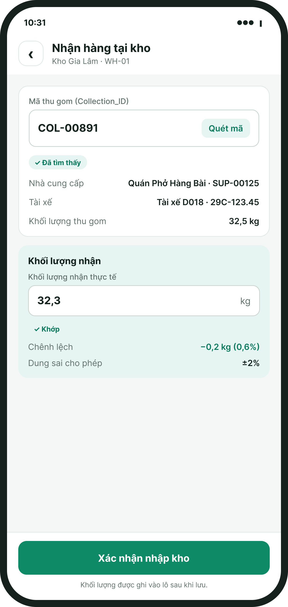
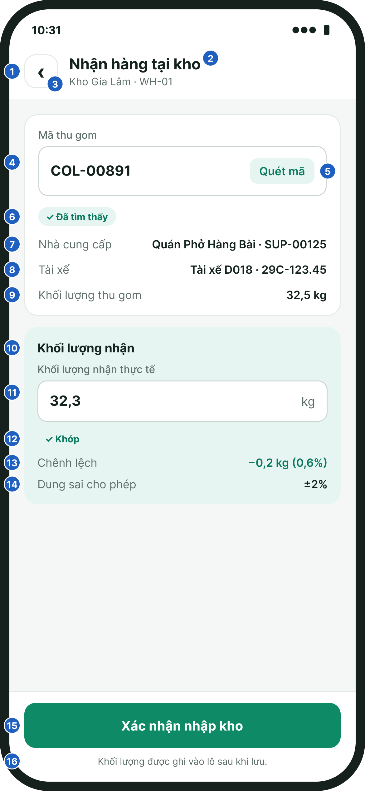
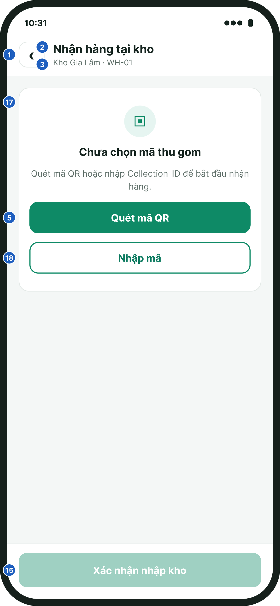
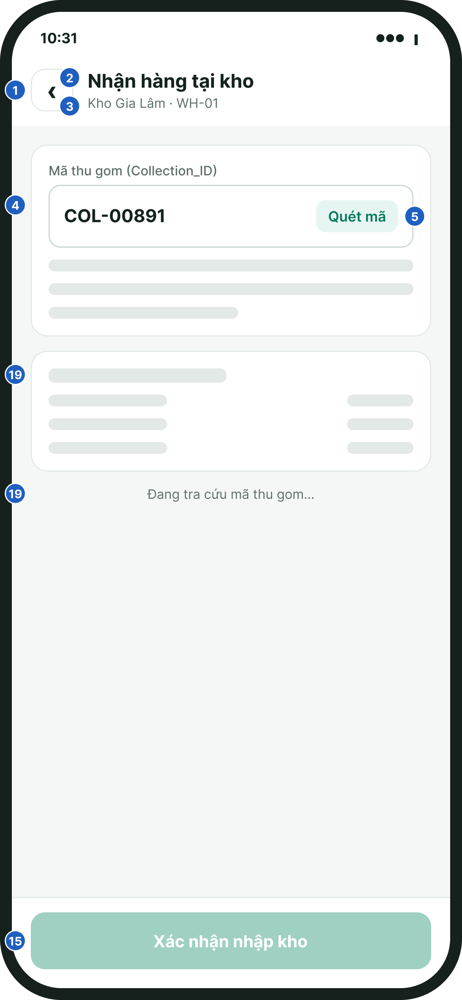
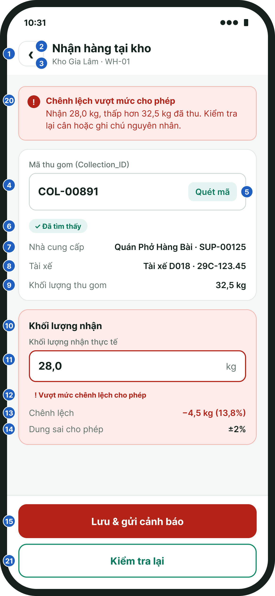
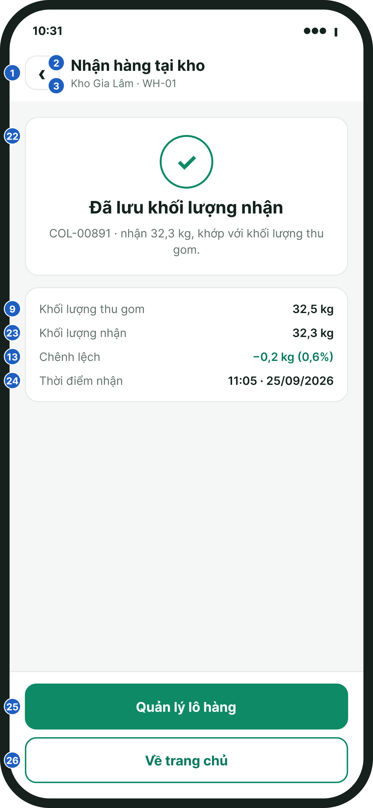

# Screen Spec: S-F04-01 Warehouse receiving

| Field | Value |
|---|---|
| Screen ID | S-F04-01 |
| Screen name | Warehouse receiving |
| Actor | Warehouse Staff |
| Priority | Must |
| Feature | F-04 Warehouse Receiving & Mass Balance |
| Activity diagrams | AD-UC-04 (actions "Scan/enter collection ID", "Record actual received weight", "Confirm warehouse receiving") |
| Mockup images | `img/S-F04-01-default.png` (default), `img/S-F04-01-default-numbered.png`, four state images and four numbered state images (section 2) |
| Frame width | 390px phone frame (exported at 3x, 1470 × 2832 pixels including the device frame) |
| Figma frame | Frames "S-F04-01 / 1" to "S-F04-01 / 5", page "4 màn × 5 trạng thái" in the ReFeed Figma file |
| Status | Draft |

## 1. Purpose

**Shown when:** the warehouse staff opens the receiving function from the warehouse home screen to weigh and check in an incoming UCO collection delivered by a driver.

**The user leaves this screen when:** the received weight is saved (success state, then "Quản lý lô hàng" to go to `S-F04-02` or "Về trang chủ"), or the staff taps Back to return to the warehouse home screen without saving.

## 2. Mockup

**Numbered:** each number is the # of the element inventory in section 3. Elements 17–26 appear only in their respective states (17–18 in empty, 19 in loading, 20–21 in error/warning, 22–26 in success), so each is numbered on that state's image. In the empty state the collection lookup card (4, 6–9), weight input card (10–14), and footer note (16) are replaced by the empty prompt card (17) while the footer button (15) is disabled. In the loading state the lookup result (6–9) and weight input card (10–14) are replaced by skeleton placeholders (19). In the success state the input cards are replaced by the confirmation card (22) and summary card (9, 23, 13, 24).

| Default, numbered | Empty, numbered | Loading, numbered | Error, numbered | Success, numbered |
|---|---|---|---|---|
|  |  |  |  |  |

| State | Image |
|---|---|
| Default | [`img/S-F04-01-default.png`](img/S-F04-01-default.png) |
| Empty | [`img/S-F04-01-empty.png`](img/S-F04-01-empty.png) |
| Loading | [`img/S-F04-01-loading.png`](img/S-F04-01-loading.png) |
| Error | [`img/S-F04-01-error.png`](img/S-F04-01-error.png) (discrepancy warning: received weight exceeds ±2% tolerance) |
| Success | [`img/S-F04-01-success.png`](img/S-F04-01-success.png) |

All colours, fonts and corners come from the design tokens in
[ui-conventions.md](../ui-conventions.md#6-design-tokens).

## 3. Element inventory

| # | Element | Type | Content / data source | Required | Validation |
|---|---|---|---|---|---|
| 1 | Back | Button | static | Yes | none |
| 2 | Title | Header | static: "Nhận hàng tại kho" | Yes | |
| 3 | Context line | Text | `warehouse.name` · `warehouse.id` | Yes | `WH-` + 2 digits |
| 4 | Collection ID input | Text input | label "Mã thu gom (Collection_ID)"; value `collection.id` | Yes | `COL-` + 5 digits |
| 5 | Quét mã / Quét mã QR | Button | static: "Quét mã" (inline in `#4` in Default/Loading/Error) / "Quét mã QR" (primary button in Empty) | Yes | opens QR scanner |
| 6 | Lookup status badge | Badge | static: "✓ Đã tìm thấy" (`collection.status` = valid for receiving) | Yes | shown once `collection.id` is resolved |
| 7 | Supplier row | Text | "Nhà cung cấp" · `supplier.business_name` · `supplier.id` | Yes | `SUP-` + 5 digits |
| 8 | Driver row | Text | "Tài xế" · "Tài xế " + `driver.id` · `vehicle.plate` | Yes | |
| 9 | Collected quantity | Text | "Khối lượng thu gom" · `collection.actual_quantity` (FR-02-03) | Yes | 1 decimal + " kg" |
| 10 | Receiving card title | Subheader | static: "Khối lượng nhận" | Yes | |
| 11 | Actual received weight input | Numeric input | label "Khối lượng nhận thực tế"; `receiving.actual_weight`; unit suffix "kg" | Yes | `> 0`, 1 decimal place |
| 12 | Tolerance status badge | Status indicator | "✓ Khớp" (within ±2%, Default) / "! Vượt mức chênh lệch cho phép" (exceeds ±2%, Error) | Yes | computed from `#13` vs `#14` |
| 13 | Discrepancy row | Text | "Chênh lệch" · `receiving.discrepancy_kg` + " kg (" + `receiving.discrepancy_pct` + "%)" | Yes | `actual_weight - collected_quantity` |
| 14 | Allowed tolerance row | Text | "Dung sai cho phép" · `config.receiving_tolerance_pct` (static "±2%") | Yes | read-only system rule |
| 15 | Primary submit button | Primary button | static: "Xác nhận nhập kho" (Default/Empty/Loading) / "Lưu & gửi cảnh báo" (Error/Warning, red fill) | Yes | disabled in Empty and Loading, or when `#11` is empty/invalid |
| 16 | Footer note | Text | static: "Khối lượng được ghi vào lô sau khi lưu." | No | shown in Default state |
| 17 | Empty message | Card | QR scan icon, title "Chưa chọn mã thu gom", body "Quét mã QR hoặc nhập Collection_ID để bắt đầu nhận hàng." | No | shown only in Empty state |
| 18 | Nhập mã | Secondary button | static label | No | shown only in Empty state; focuses `#4` |
| 19 | Loading placeholder | Skeleton & text | grey skeleton rows inside lookup card, grey skeleton card below, and caption "Đang tra cứu mã thu gom..." | No | shown only while fetching collection record |
| 20 | Warning banner | Alert banner | red banner: "Chênh lệch vượt mức cho phép — Nhận 28,0 kg, thấp hơn 32,5 kg đã thu. Kiểm tra lại cân hoặc ghi chú nguyên nhân." | No | shown when `abs(discrepancy_pct) > 2%` |
| 21 | Kiểm tra lại | Secondary button | static label | No | shown only in Error/Warning state; focuses `#11` |
| 22 | Success card | Summary card | green check mark, title "Đã lưu khối lượng nhận", subtitle `collection.id` + " - nhận " + `receiving.actual_weight` + ", khớp với khối lượng thu gom." | No | shown only after receiving record is saved |
| 23 | Confirmed received weight | Text | "Khối lượng nhận" · `receiving.actual_weight` | No | 1 decimal + " kg"; shown in Success state |
| 24 | Received timestamp | Text | "Thời điểm nhận" · `receiving.received_at` | No | `HH:mm · dd/MM/yyyy`; shown in Success state |
| 25 | Quản lý lô hàng | Primary button | static label | No | shown only in Success state |
| 26 | Về trang chủ | Secondary button | static label | No | shown only in Success state |

## 4. States

| State | What the user sees | Trigger |
|---|---|---|
| Default | Header "Nhận hàng tại kho", "Kho Gia Lâm · WH-01"; lookup card with `COL-00891` and "Quét mã", green badge "✓ Đã tìm thấy", Nhà cung cấp `Quán Phở Hàng Bài · SUP-00125`, Tài xế `Tài xế D018 · 29C-123.45`, Khối lượng thu gom `32,5 kg`; green-tinted "Khối lượng nhận" card with input `32,3 kg`, status "✓ Khớp", Chênh lệch `-0,2 kg (0,6%)`, Dung sai cho phép `±2%`; enabled primary button "Xác nhận nhập kho" and note "Khối lượng được ghi vào lô sau khi lưu.". The mockup shows this state. | Collection ID found and entered received weight is within the ±2% tolerance (`FR-04-01`) |
| Empty (no data) | Header (`#1`–`#3`); card with QR icon "Chưa chọn mã thu gom" — "Quét mã QR hoặc nhập Collection_ID để bắt đầu nhận hàng." with primary button "Quét mã QR" and secondary button "Nhập mã"; disabled footer button "Xác nhận nhập kho" | Screen opened before scanning a QR code or entering a `Collection_ID` |
| Loading | Header (`#1`–`#3`); lookup card showing `COL-00891` with grey skeleton lines below, second card with grey skeleton rows, caption "Đang tra cứu mã thu gom...", and disabled footer button "Xác nhận nhập kho" | Collection details are being queried from the server after scanning or entering `Collection_ID` |
| Error / Warning | Red banner "Chênh lệch vượt mức cho phép — Nhận 28,0 kg, thấp hơn 32,5 kg đã thu. Kiểm tra lại cân hoặc ghi chú nguyên nhân."; lookup card kept; red-tinted "Khối lượng nhận" card with input `28,0 kg`, status "! Vượt mức chênh lệch cho phép", Chênh lệch `-4,5 kg (13,8%)`, Dung sai cho phép `±2%`; red primary button "Lưu & gửi cảnh báo" and secondary button "Kiểm tra lại" | Entered received weight deviates from collected weight by more than ±2% (`FR-04-02`) |
| Success / confirmation | Time 10:31; check mark, "Đã lưu khối lượng nhận" — "COL-00891 - nhận 32,3 kg, khớp với khối lượng thu gom."; detail card (Khối lượng thu gom `32,5 kg`, Khối lượng nhận `32,3 kg`, Chênh lệch `-0,2 kg (0,6%)`, Thời điểm nhận `11:05 · 25/09/2026`); buttons "Quản lý lô hàng" and "Về trang chủ" | Receiving weight saved and added to the warehouse UCO inventory (`FR-04-01`) |

## 5. Interactions and navigation

| # | Element | User action | System response | Goes to screen |
|---|---|---|---|---|
| 1 | Quét mã / Quét mã QR (`#5`) | tap | Opens camera QR scanner to read the collection QR code, then queries `collection.id` | stays (camera overlay, then loading → default) |
| 2 | Nhập mã (`#18`, empty state) | tap | Switches from empty card to the `Collection_ID` text input (`#4`) and focuses keyboard | stays |
| 3 | Collection ID input (`#4`) | input & submit | Queries collection record by `COL-xxxxx` | stays (loading, then default or lookup error) |
| 4 | Actual received weight input (`#11`) | input number | Recalculates discrepancy (`#13`) and tolerance status (`#12`) in real time; switches between Default (within ±2%) and Warning (exceeds ±2%) | stays (default or error/warning state) |
| 5 | Xác nhận nhập kho (`#15`, default) | tap | Saves received weight (`FR-04-01`), updates warehouse inventory for batching, and transitions to Success state | stays (success state) |
| 6 | Lưu & gửi cảnh báo (`#15`, error/warning) | tap | Saves received weight with a discrepancy flag (`FR-04-02`), sends alert notification to Operations/Admin, and transitions to Success state | stays (success state) |
| 7 | Kiểm tra lại (`#21`, error/warning) | tap | Focuses and selects `#11` so staff can re-weigh and re-enter the actual weight | stays |
| 8 | Quản lý lô hàng (`#25`, success) | tap | Opens batch creation & mass-balance management with the newly received UCO available | S-F04-02 |
| 9 | Về trang chủ (`#26`, success) | tap | Returns to the warehouse staff home screen | Warehouse main menu |
| 10 | Back (`#1`) | tap | Returns without saving the receiving record | Warehouse main menu |

## 6. Screen-level rules

| Rule ID | Rule | Source |
|---|---|---|
| SR-001 | Warehouse staff can receive collections assigned to their own `warehouse.id` (`WH-xx`). | FR-06-03 |
| SR-002 | `collection.actual_quantity` (`#9`) is read-only from the signed handover (`FR-03-01`) and cannot be modified at the warehouse. | FR-04-01 |
| SR-003 | Discrepancy (`#13`) is calculated automatically as `actual_weight - collected_quantity` and expressed in both `kg` (1 decimal) and `%` (1 decimal). | FR-04-01 |
| SR-004 | If `abs(discrepancy_pct) <= 2.0%`, the receiving card displays green status "✓ Khớp" and primary button "Xác nhận nhập kho". | BR-04-01 |
| SR-005 | If `abs(discrepancy_pct) > 2.0%`, the screen triggers the out-of-tolerance warning (`#20`), changes primary action to "Lưu & gửi cảnh báo" (`#15`), and requires either re-checking or logging an alert upon save. | FR-04-02; BR-04-01 |
| SR-006 | Saved received weight is immediately recorded into the warehouse's unbatched UCO pool for batch creation (`S-F04-02`), without retroactively altering the supplier's signed payout (`S-F03-01` / `S-F03-02`). | BR-04-02 |
| SR-007 | Statuses and warnings are shown with text and icon ("✓ Khớp", "! Vượt mức chênh lệch cho phép"), never by colour alone. | ui-conventions §5 |

## 7. Linked requirements

| FR ID | What this screen does for it |
|---|---|
| FR-04-01 | Looks up a collection via QR scan or `Collection_ID`, records the actual received weight at the warehouse, calculates discrepancy, and saves the receiving record |
| FR-04-02 | Detects weight discrepancies exceeding the ±2% tolerance threshold, warns the warehouse staff, and flags/notifies Operations when saved with discrepancy |
| FR-06-03 | Restricts warehouse receiving operations to the signed-in warehouse staff's assigned warehouse (`WH-01`) |

## 8. Responsive and accessibility notes

- Smallest supported width: 360px; label–value rows keep values right-aligned with `tabular-nums`; the numeric weight input (`#11`) uses a large `18px` bold font with a clear `kg` unit suffix.
- Designed at 390 × 844; the content scrolls and the footer action buttons stay fixed at the bottom.
- Touch targets at least 44 × 44: back button 44 × 44, inline "Quét mã" button 36px high (44px tap area), weight input 52px high, footer primary and secondary buttons 52px high.
- Default (within tolerance) and Warning (exceeds tolerance) states differ by border colour, background tint, icon (`✓` vs `!`), badge label, and primary button text ("Xác nhận nhập kho" vs "Lưu & gửi cảnh báo"), never by colour alone.
- Body text contrast at least 4.5:1.

## 9. Open questions

| # | Question | Blocking? | Status |
|---|---|---|---|
| 1 | [NEEDS CLARIFICATION: the warning banner `#20` says "Kiểm tra lại cân hoặc ghi chú nguyên nhân", yet there is no reason/note text field on the warning screen. Should an optional/required note input appear in State 4, or is the note entered in a confirmation modal after tapping "Lưu & gửi cảnh báo"?] | No | Open. Default: tapping "Lưu & gửi cảnh báo" opens a quick reason note prompt/modal before saving. |
| 2 | [NEEDS CLARIFICATION: what happens if the warehouse staff enters a `Collection_ID` that does not exist, belongs to another warehouse, or has already been received?] | No | Open. Default: show an inline error message below `#4` ("Không tìm thấy mã thu gom hoặc đơn đã được nhập kho.") and keep `#15` disabled. |
| 3 | [NEEDS CLARIFICATION: the warehouse home ("Warehouse main menu") has no Screen ID in the Screen List. Add one?] | No | Open. Default: "Về trang chủ" and Back go to the Warehouse main menu node. |

---

## Completion checklist

- [x] The mockup is a separate cropped image file, named with the Screen ID, at the frame width.
- [x] The numbered images exist, and their numbers match the `#` column of the element inventory.
- [x] Every visible element in the mockup appears in the element inventory.
- [ ] Every colour in the mockup is a design token from ui-conventions.md.
- [x] Every input element has a validation rule or an explicit "none".
- [x] All five states are filled in.
- [ ] Every navigation target is a Screen ID that exists in the Screen List.
- [x] Every element that displays data names the field it displays.
- [x] Every linked FR exists in the Function List, and every action of this screen in its activity diagram is
      covered by an interaction row.
