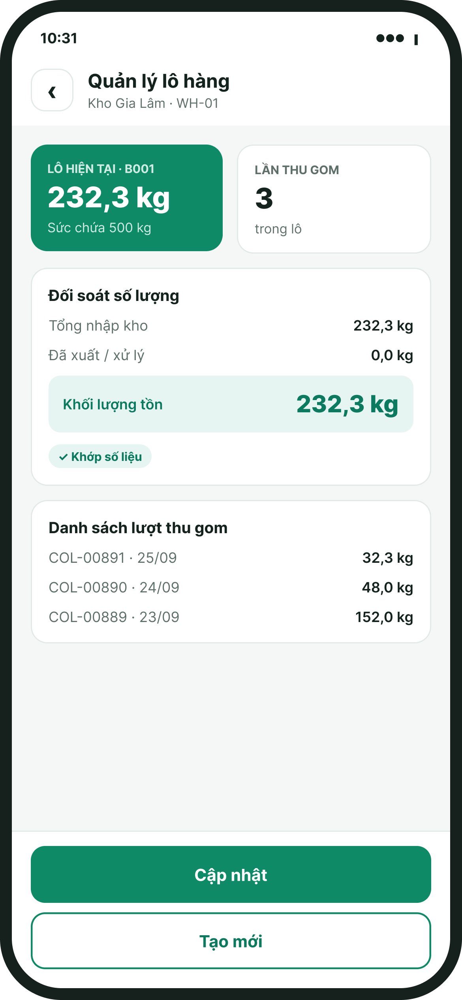
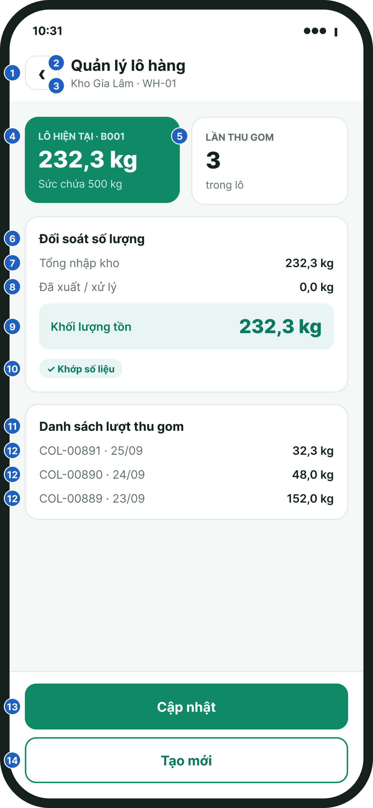
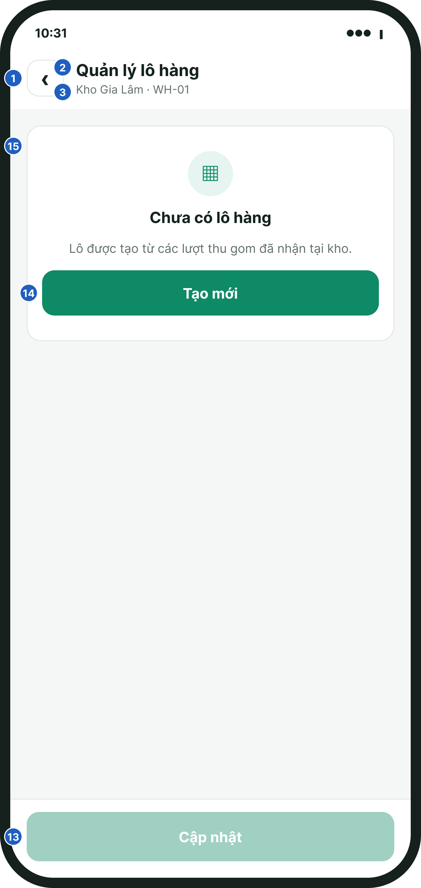
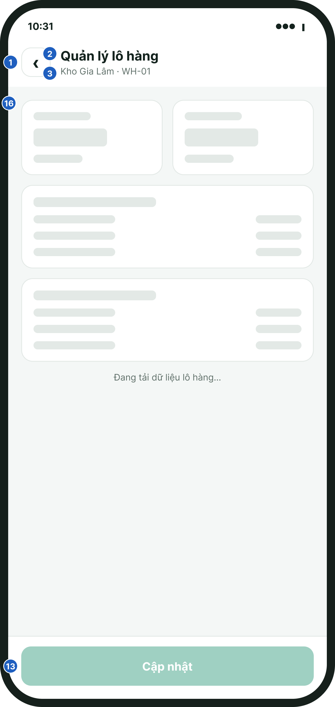
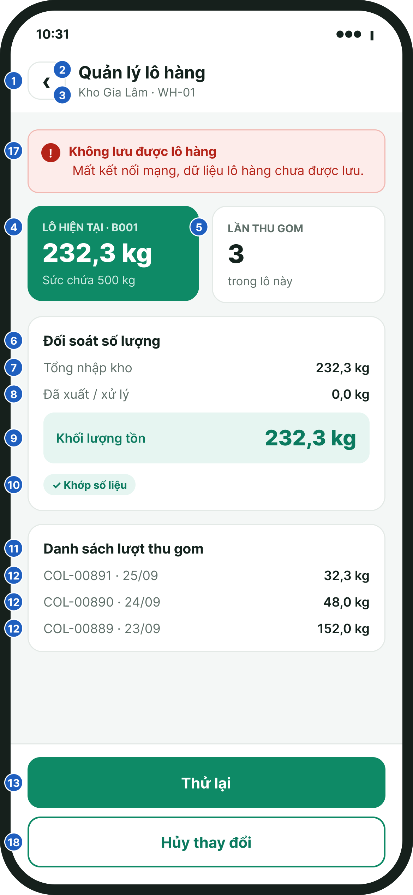
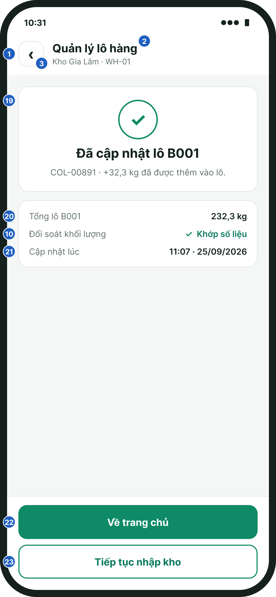

# Screen Spec: S-F04-02 Batch and mass-balance management

| Field | Value |
|---|---|
| Screen ID | S-F04-02 |
| Screen name | Batch and mass-balance management |
| Actor | Warehouse Staff |
| Priority | Must |
| Feature | F-04 Warehouse Receiving & Mass Balance |
| Activity diagrams | AD-UC-04 / AD-UC-05 (actions "Manage active UCO batch", "Verify mass balance", "Update or create batch") |
| Mockup images | `img/S-F04-02-default.png` (default), `img/S-F04-02-default-numbered.png`, four state images and four numbered state images (section 2) |
| Frame width | 390px phone frame (exported at 3x, 1470 × 2832 pixels including the device frame) |
| Figma frame | Frames "S-F04-02 / 1" to "S-F04-02 / 5", page "4 màn × 5 trạng thái" in the ReFeed Figma file |
| Status | Draft |

## 1. Purpose

**Shown when:** the warehouse staff opens batch management from `S-F00-03` (Warehouse home) or taps "Quản lý lô hàng" after saving a received collection on `S-F04-01` (Warehouse receiving).

**The user leaves this screen when:** the batch update or creation succeeds (success state, then "Về trang chủ" to go to `S-F00-03` or "Tiếp tục nhập kho" to go to `S-F04-01`), or the staff taps Back to return to `S-F00-03` (Warehouse home).

## 2. Mockup

**Numbered:** each number is the # of the element inventory in section 3. Elements 15–23 appear only in their respective states (15 in empty, 16 in loading, 17–18 in error, 19–23 in success), so each is numbered on that state's image. In the empty state the batch metric cards (4–5), mass-balance card (6–12), and secondary "Tạo mới" footer button (14) are replaced by the empty card (15) with its "Tạo mới" button (14) while the primary button (13) is disabled. In the loading state the batch summary, mass-balance, and collection list cards are replaced by skeleton placeholders (16) and the primary button (13) is disabled. In the success state the active batch and mass-balance sections are replaced by the confirmation card (19) and updated batch summary card (20, 10, 21).

| Default, numbered | Empty, numbered | Loading, numbered | Error, numbered | Success, numbered |
|---|---|---|---|---|
|  |  |  |  |  |

| State | Image |
|---|---|
| Default | [`img/S-F04-02-default.png`](img/S-F04-02-default.png) |
| Empty | [`img/S-F04-02-empty.png`](img/S-F04-02-empty.png) |
| Loading | [`img/S-F04-02-loading.png`](img/S-F04-02-loading.png) |
| Error | [`img/S-F04-02-error.png`](img/S-F04-02-error.png) (saving batch failed because the network connection was lost) |
| Success | [`img/S-F04-02-success.png`](img/S-F04-02-success.png) |

All colours, fonts and corners come from the design tokens in
[ui-conventions.md](../ui-conventions.md#6-design-tokens).

## 3. Element inventory

| # | Element | Type | Content / data source | Required | Validation |
|---|---|---|---|---|---|
| 1 | Back | Button | static | Yes | none |
| 2 | Title | Header | static: "Quản lý lô hàng" | Yes | |
| 3 | Context line | Text | `warehouse.name` · `warehouse.id` | Yes | `WH-` + 2 digits |
| 4 | Active batch card | Metric card | label "LÔ HIỆN TẠI · " + `batch.code`; value `batch.current_weight_kg` + " kg"; subtitle "Sức chứa " + `batch.capacity_kg` + " kg" | Yes | `current_weight_kg <= capacity_kg`, 1 decimal |
| 5 | Collection count card | Metric card | label "LẦN THU GOM"; value `batch.collection_count`; subtitle "trong lô" (Default) / "trong lô này" (Error) | Yes | integer `>= 0` |
| 6 | Mass-balance title | Subheader | static: "Đối soát số lượng" | Yes | |
| 7 | Total inbound weight | Text | "Tổng nhập kho" · `mass_balance.total_inbound_kg` | Yes | 1 decimal + " kg" |
| 8 | Total outbound / processed weight | Text | "Đã xuất / xử lý" · `mass_balance.total_outbound_kg` | Yes | 1 decimal + " kg" |
| 9 | Remaining stock highlight | Highlight row | "Khối lượng tồn" · `mass_balance.remaining_stock_kg` | Yes | `total_inbound_kg - total_outbound_kg`, 1 decimal + " kg" |
| 10 | Mass-balance status | Status indicator | "✓ Khớp số liệu" (`mass_balance.is_reconciled` = true) | Yes | text + icon status |
| 11 | Collection list title | Subheader | static: "Danh sách lượt thu gom" | Yes | |
| 12 | Collection list item | List row | `collection.id` · `collection.date_short` (`DD/MM`) · `receiving.actual_weight` + " kg" | Yes | 1 decimal + " kg" |
| 13 | Primary action button | Primary button | static: "Cập nhật" (Default/Empty/Loading) / "Thử lại" (Error) | Yes | disabled in Empty and Loading states |
| 14 | Tạo mới | Secondary button | static label (footer button in Default; card CTA button in Empty) | No | shown in Default and Empty states |
| 15 | Empty message | Card | batch icon, title "Chưa có lô hàng", body "Lô được tạo từ các lượt thu gom đã nhận tại kho.", button `#14` ("Tạo mới") | No | shown only when no active batch exists |
| 16 | Loading placeholder | Skeleton cards & text | skeleton metric & list cards with caption "Đang tải dữ liệu lô hàng..." | No | shown only while fetching batch data |
| 17 | Message area | Banner | static: "Không lưu được lô hàng - Mất kết nối mạng, dữ liệu lô hàng chưa được lưu." | No | shown only when saving batch fails |
| 18 | Hủy thay đổi | Secondary button | static label | No | shown only in Error state |
| 19 | Success card | Summary card | green check mark, title "Đã cập nhật lô " + `batch.code`, subtitle `collection.id` + " - +" + `receiving.actual_weight` + " kg đã được thêm vào lô." | No | shown only after batch save succeeds |
| 20 | Updated batch total | Text | "Tổng lô " + `batch.code` · `batch.current_weight_kg` | No | 1 decimal + " kg"; shown in Success state |
| 21 | Updated timestamp | Text | "Cập nhật lúc" · `batch.updated_at` | No | `HH:mm · dd/MM/yyyy`; shown in Success state |
| 22 | Về trang chủ | Primary button | static label | No | shown only in Success state |
| 23 | Tiếp tục nhập kho | Secondary button | static label | No | shown only in Success state |

## 4. States

| State | What the user sees | Trigger |
|---|---|---|
| Default | Header "Quản lý lô hàng", "Kho Gia Lâm · WH-01"; green card "LÔ HIỆN TẠI · B001" (`232,3 kg`, "Sức chứa 500 kg") beside "LẦN THU GOM" (`3`, "trong lô"); "Đối soát số lượng" card (Tổng nhập kho `232,3 kg`, Đã xuất / xử lý `0,0 kg`, Khối lượng tồn `232,3 kg`, badge "✓ Khớp số liệu"); "Danh sách lượt thu gom" card (`COL-00891 · 25/09` `32,3 kg`, `COL-00890 · 24/09` `48,0 kg`, `COL-00889 · 23/09` `152,0 kg`); enabled "Cập nhật" and "Tạo mới" buttons. The mockup shows this state. | Active batch exists and mass balance is reconciled (`FR-04-08`, `FR-04-09`) |
| Empty (no data) | Header (`#1`–`#3`); empty card with batch icon "Chưa có lô hàng" - "Lô được tạo từ các lượt thu gom đã nhận tại kho." and primary button "Tạo mới"; disabled "Cập nhật" button in footer | No active batch exists yet for this warehouse |
| Loading | Header (`#1`-`#3`); two top skeleton metric cards, two lower skeleton list cards, caption "Đang tải dữ liệu lô hàng...", and disabled "Cập nhật" button in footer | Batch and mass-balance records are being fetched |
| Error | Red banner "Không lưu được lô hàng - Mất kết nối mạng, dữ liệu lô hàng chưa được lưu."; active batch card (`B001`, `232,3 kg`), collection count (`3`, "trong lô này"), mass-balance card, and collection list preserved; primary button relabeled "Thử lại" and secondary button "Hủy thay đổi" | Saving/updating the batch failed due to network disconnection, or collection inputs/batch parameters are invalid (`FR-04-07`) |
| Success / confirmation | Time 10:31; check mark, "Đã cập nhật lô B001" - "COL-00891 - +32,3 kg đã được thêm vào lô."; summary card (Tổng lô B001 `232,3 kg`, Đối soát khối lượng "✓ Khớp số liệu", Cập nhật lúc `11:07 · 25/09/2026`); buttons "Về trang chủ" and "Tiếp tục nhập kho" | Batch changes saved, mass-balance metrics computed and updated (`FR-04-08`, `FR-04-09`) |

## 5. Interactions and navigation

| # | Element | User action | System response | Goes to screen |
|---|---|---|---|---|
| 1 | Cập nhật (`#13`, default) | tap | Validates inputs (`FR-04-06`), links collections, computes mass-balance metrics (`FR-04-08`), and updates batch balance (`FR-04-09`), or shows the error state (`FR-04-07`) | stays (loading, then success or error state) |
| 2 | Tạo mới (`#14`, default or empty) | tap | Validates batch parameters (`FR-04-06`), initializes a new UCO batch record, and computes initial mass-balance metrics (`FR-04-08`) | stays (active batch view for the newly created batch) |
| 3 | Thử lại (`#13`, error) | tap | Retries saving the batch update (`FR-04-08`, `FR-04-09`) | stays (loading, then success or error state) |
| 4 | Hủy thay đổi (`#18`, error) | tap | Discards unsaved batch changes and restores the last saved batch state | stays (default state) |
| 5 | Về trang chủ (`#22`, success) | tap | Returns to the warehouse staff home screen | `S-F00-03` |
| 6 | Tiếp tục nhập kho (`#23`, success) | tap | Opens warehouse receiving to scan or enter the next collection | `S-F04-01` |
| 7 | Back (`#1`) | tap | Returns to the warehouse home screen without saving pending changes | `S-F00-03` |

## 6. Screen-level rules

| Rule ID | Rule | Source |
|---|---|---|
| SR-001 | Warehouse staff can manage batches and mass balance only for their assigned `warehouse.id` (`WH-xx`) when permitted by their role. | `FR-06-04` |
| SR-002 | Mass balance follows `remaining_stock_kg = total_inbound_kg - total_outbound_kg`; the status badge "✓ Khớp số liệu" reflects consistency between recorded collections, batch totals, and remaining stock. | `FR-04-08`, `FR-04-09` |
| SR-003 | Active batch weight (`#4`) and collection inputs are validated against duplicates, invalid volume, and batch capacity (`500 kg` in the mockup) before saving. | `FR-04-06`, `FR-04-07` |
| SR-004 | "Cập nhật" (`#13`) is disabled in Empty and Loading states. | `ui-conventions.md` §4 |
| SR-005 | If saving or validation fails (Error state), the batch metrics, mass-balance figures, and collection list stay visible so unsaved state is not lost before retrying or cancelling. | `FR-04-07` (error state) |
| SR-006 | Statuses ("✓ Khớp số liệu") and alerts ("Không lưu được lô hàng") use text and icon, never colour alone. | `ui-conventions.md` §5 |

## 7. Linked requirements

| FR ID | What this screen does for it |
|---|---|
| `FR-04-06` | Validates selected verified UCO collections and entered batch parameters (checking for invalid volume, capacity overflow, or duplicate collection inputs) |
| `FR-04-07` | Displays validation or save error feedback (`#17`) and prompts correction without losing current batch state |
| `FR-04-08` | Links component collections and computes mass-balance metrics (inbound, outbound, and remaining stock) for the created UCO batch |
| `FR-04-09` | Maintains linked collection inputs and updates the active batch balance upon confirmation |
| `FR-06-04` | Restricts batch and mass-balance management to authenticated warehouse staff with permission for their assigned warehouse (`WH-01`) |

## 8. Responsive and accessibility notes

- Smallest supported width: 360px; the two top summary cards (`LÔ HIỆN TẠI` and `LẦN THU GOM`) adapt cleanly and keep numeric weights/counts aligned with `tabular-nums`.
- Designed at 390 × 844; the content scrolls and the footer action buttons stay fixed at the bottom.
- Touch targets at least 44 × 44: back button 44 × 44, footer primary and secondary buttons 52px high, empty-state "Tạo mới" button 48px high.
- Reconciliation status ("✓ Khớp số liệu") and error banner use icon plus text rather than colour alone.
- Body text contrast at least 4.5:1.

## 9. Open questions

| # | Question | Blocking? | Status |
|---|---|---|---|
| 1 | [NEEDS CLARIFICATION: in the mockups, "LẦN THU GOM" subtitle changes from "trong lô" in Default to "trong lô này" in Error, and "Đối soát số lượng" in Default becomes "Đối soát khối lượng" in Success. Unify these labels?] | No | Open. Default: use the Default state labels where applicable. |
| 2 | [NEEDS CLARIFICATION: how does a warehouse staff member select which received collections are grouped into a batch or close a full batch (`500 kg`) to start a new batch ID?] | No | Open. Default: newly received collections in the warehouse are assigned to the active open batch until closed or a new batch is created. |

---

## Completion checklist

- [x] The mockup is a separate cropped image file, named with the Screen ID, at the frame width.
- [x] The numbered images exist, and their numbers match the # column of the element inventory.
- [x] Every visible element in the mockup appears in the element inventory.
- [ ] Every colour in the mockup is a design token from `ui-conventions.md`.
- [x] Every input element has a validation rule or an explicit "none".
- [x] All five states are filled in.
- [x] Every navigation target is a Screen ID that exists in the Screen List (`S-F00-03`, `S-F04-01`).
- [x] Every element that displays data names the field it displays.
- [x] Every linked FR exists in the Function List (`FR-04-06` to `FR-04-09`, `FR-06-04`), and every action of this screen is covered by an interaction row.
