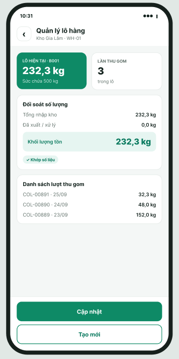

# Screen Spec: S-F04-02 Batch and mass-balance management

| Field | Value |
|---|---|
| Screen ID | S-F04-02 |
| Screen name | Batch and mass-balance management |
| Actor | Warehouse Staff |
| Priority | Must |
| Feature | F-04 Warehouse Batch & Mass-Balance Management |
| Activity diagrams | AD-UC-04 (actions "View batch details", "Update batch", "Create new batch", "Verify mass balance") |
| Mockup image | `img/S-F04-02.png` |
| Status | Draft |

## 1. Purpose

**Shown when:** warehouse staff opens batch management for a specific warehouse (e.g., Kho Gia Lâm · WH-01) from the warehouse dashboard (S-F04-01) or after receiving a UCO collection batch to inspect inventory, mass balance, and update or create batches.

**The user leaves this screen when:** the staff taps Back, navigates to Home ("Về trang chủ"), continues receiving collections ("Tiếp tục nhập kho"), or navigates to batch creation/editing flows.

## 2. Mockup

## 3. Element inventory

| # | Element | Type | Content / data source | Required | Validation |
|---|---|---|---|---|---|
| 1 | Back | Button | static | Yes | none |
| 2 | Screen Title | Header | static: "Quản lý lô hàng" | Yes | |
| 3 | Warehouse Subtitle | Text | `warehouse.name` · `warehouse.code` (e.g., "Kho Gia Lâm · WH-01") | Yes | |
| 4 | Error Banner | Banner | static: "Không lưu được lô hàng" + "Mất kết nối mạng, dữ liệu lô hàng chưa được lưu." (Error state only) | No | |
| 5 | Current Batch Card | Highlight card | Header: "LÔ HIỆN TẠI · " + `batch.code` (e.g., `B001`); Weight: `batch.current_weight` (format: `000,0 kg`); Subtext: "Sức chứa " + `batch.capacity` (`500 kg`) | Yes | `current_weight <= capacity` |
| 6 | Collection Count Card | Metric card | Header: "LẦN THU GOM"; Count: `batch.collection_count` (e.g., `3`); Subtext: "trong lô" / "trong lô này" | Yes | `>= 0` |
| 7 | Mass-Balance Card | Card | Header: "Đối soát số lượng"; Rows: `batch.total_received` ("Tổng nhập kho"), `batch.total_dispatched` ("Đã xuất / xử lý"); Highlight box: `batch.remaining_stock` ("Khối lượng tồn"); Badge: `batch.balance_status` ("✓ Khớp số liệu") | Yes | `total_received - total_dispatched == remaining_stock` |
| 8 | Batch Collections Card | List card | Header: "Danh sách lượt thu gom"; List of items: `collection.code` · `collection.date` (`DD/MM`) and `collection.weight` (`00,0 kg`) | Yes | At least 1 item when batch exists |
| 9 | Update Batch | Primary button | Label: "Cập nhật" (Default/Empty/Loading) or "Thử lại" (Error) | Yes | Disabled in Empty and Loading states |
| 10 | Create New / Discard | Secondary button | Label: "Tạo mới" (Default state) or "Hủy thay đổi" (Error state) | Yes | |
| 11 | Empty State Card | Card | Icon + "Chưa có lô hàng" + "Lô được tạo từ các lượt thu gom đã nhận tại kho." + "Tạo mới" button (Empty state only) | No | |
| 12 | Success Card | Card | Check icon + "Đã cập nhật lô " + `batch.code` + summary `collection.code` · `+weight` + " đã được thêm vào lô." (Success state only) | No | |
| 13 | Success Summary Card | Card | `batch.total_weight` ("Tổng lô B001"), `batch.balance_status` ("Đối soát khối lượng": "✓ Khớp số liệu"), `batch.updated_at` ("Cập nhật lúc": `HH:mm · DD/MM/YYYY`) (Success state only) | No | |
| 14 | Go Home / Continue Receiving | Buttons | Primary: "Về trang chủ"; Secondary: "Tiếp tục nhập kho" (Success state only) | No | |

## 4. States

| State | What the user sees | Trigger |
|---|---|---|
| Default (1/5) | Active batch card (`B001`, `232,3 kg / 500 kg`), collection count card (`3`), mass-balance reconciliation card (`✓ Khớp số liệu`), list of collections in batch, and bottom buttons "Cập nhật" and "Tạo mới". | Screen opened for a warehouse with an active batch. |
| Empty (2/5) | Empty state card showing "Chưa có lô hàng", explanation text, and an inline "Tạo mới" button; bottom "Cập nhật" button is disabled. | Warehouse has no active or historical batches yet. |
| Loading (3/5) | Grey skeleton placeholders matching the top metric cards and two detail cards, centered text "Đang tải dữ liệu lô hàng...", and a disabled "Cập nhật" button. | Batch and mass-balance data are being fetched from the server. |
| Error (4/5) | Red alert banner at the top ("Không lưu được lô hàng — Mất kết nối mạng, dữ liệu lô hàng chưa được lưu."), current batch details preserved below, and bottom buttons changed to "Thử lại" and "Hủy thay đổi". | Batch update fails due to network loss or server rejection. |
| Success / confirmation (5/5) | Confirmation card with green checkmark ("Đã cập nhật lô B001"), updated batch summary card (total weight, mass-balance check, timestamp), and action buttons "Về trang chủ" and "Tiếp tục nhập kho". | New collection(s) or stock adjustments are successfully saved to the batch. |

## 5. Interactions and navigation

| # | Element | User action | System response | Goes to screen |
|---|---|---|---|---|
| 1 | Back | tap | Returns to the previous warehouse screen | S-F04-01 |
| 2 | Cập nhật | tap (Default state) | Commits pending collection additions/updates to the current batch; transitions to Success (5/5) or Error (4/5) state | stays |
| 3 | Tạo mới | tap (Default or Empty state) | Opens the create-new-batch modal or flow to initialize a new batch ID | S-F04-03 |
| 4 | Thử lại | tap (Error state) | Retries saving the batch update to the server | stays |
| 5 | Hủy thay đổi | tap (Error state) | Discards unsaved local changes and reverts to Default (1/5) state | stays |
| 6 | Về trang chủ | tap (Success state) | Navigates back to the warehouse staff home dashboard | S-F04-01 |
| 7 | Tiếp tục nhập kho | tap (Success state) | Navigates directly to the collection intake/receiving screen | S-F04-04 |

## 6. Screen-level rules

| Rule ID | Rule | Source |
|---|---|---|
| SR-001 | Remaining stock (`Khối lượng tồn`) must strictly equal `total_received - total_dispatched`. When balanced, display badge "✓ Khớp số liệu". | BR-08 |
| SR-002 | A batch cannot exceed its maximum physical capacity (`500 kg` for standard warehouse tanks/drums); "Cập nhật" is blocked if incoming weight exceeds remaining capacity. | BR-09 |
| SR-003 | On network failure (Error 4/5), local batch state must not be overwritten with partial data, ensuring data integrity until retry or discard. | FR-04-04 |
| SR-004 | Collection items within a batch are sorted in reverse chronological order (newest collection date at the top). | ui-conventions §3 |

## 7. Linked requirements

| FR ID | What this screen does for it |
|---|---|
| FR-04-02 | Displays active batch capacity, collection count, and itemized list of received collections in the batch. |
| FR-04-03 | Calculates and displays real-time mass-balance reconciliation (received, dispatched, remaining stock). |
| FR-04-04 | Supports updating existing batches or creating new batches with offline/error recovery and confirmation feedback. |

## 8. Responsive and accessibility notes

- Smallest supported width: 360px; the top two summary cards ("LÔ HIỆN TẠI" and "LẦN THU GOM") sit side-by-side in a 2-column grid with equal height.
- Mass-balance status ("✓ Khớp số liệu") and Error banner use both icons (`✓` / `!`) and semantic container fills rather than color alone.
- Skeleton placeholders in Loading (3/5) match the exact 2-column + 2-card layout of Default (1/5) to prevent layout shift.
- Body text contrast ratio meets at least 4.5:1 against white and tinted surfaces.

## 9. Open questions

| # | Question | Blocking? | Status |
|---|---|---|---|
| 1 | [NEEDS CLARIFICATION: Can a warehouse have multiple active batches open simultaneously, or must the current batch be closed/full before "Tạo mới" creates the next batch?] | No | Open. Default: creates a new active batch and archives/closes the previous one. |
| 2 | [NEEDS CLARIFICATION: Confirm exact Screen IDs for "Tạo mới" (assumed S-F04-03) and "Tiếp tục nhập kho" (assumed S-F04-04).] | No | Open. |

---

## Completion checklist

- [x] The mockup is a separate cropped image file, named with the Screen ID (`img/S-F04-02.png`).
- [x] Every visible element across all 5 states in the mockup appears in the element inventory.
- [x] Every input/action element has a validation rule or an explicit state behavior.
- [x] All five states (Default, Empty, Loading, Error, Success) are filled in.
- [x] Every navigation target is mapped to a Screen ID or external system action.
- [x] Every element that displays data names the field it displays.
- [x] Every linked FR and user action is covered by an interaction row.
