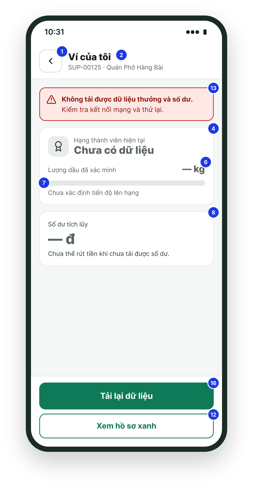

# Screen Spec: S-F05-01 Wallet

| Field             | Value                                                                                                                                  |
| ----------------- | -------------------------------------------------------------------------------------------------------------------------------------- |
| Screen ID         | S-F05-01                                                                                                                               |
| Screen name       | Loyalty and payout balance (Ví của tôi)                                                                                                                    |
| Actor             | Supplier                                                                                                                               |
| Priority          | Must                                                                                                                            |
| Feature           | F-05 Supplier Value & ESG / Green Profile                                                                                                              |
| Activity diagrams |                                                                                                               |
| Mockup images     | `img/S-F05-01-default.png` (default), `img/S-F05-01-default-numbered.png`, four state images and four numbered state images (section 2) |
| Frame width       | 370px screen inside a 390 × 844 device frame (exported at 3x with a 50px shadow margin, 1470 × 2832 pixels)                            |
| Figma frame       |                                                                                    |
| Status            | Draft                                                                                                                                  |

## 1. Purpose

**Shown when:** the supplier opens "Ví của tôi" from the home screen (S-F00-02), or returns here after creating a withdrawal request.

**The user leaves this screen when:** they go back, tap "Xem và ký giao dịch" on the pending transaction banner, tap "Rút tiền" to withdraw money, or tap "Xem hồ sơ xanh".

## 2. Mockup

**Numbered:** each number is the # of the element inventory in section 3. A number stays the same in every state. Elements 4 and 5 (Pending transaction banner and its link) appear only in the default state; element 13 (Withdrawal row) and element 14 (Success toast) appear only in the success state; element 15 (Network error banner) and element 16 ("Tải lại dữ liệu" button) appear only in the error state; element 17 (Empty history card) and element 18 (Minimum withdrawal hint) appear only in the empty state; element 19 (Loading text) appears only in the loading state. Element 7 (Tier bonus pill) appears when the tier has a bonus (default and success). The loading image numbers the header (1 to 3), the grey skeleton blocks (6, 8, 9, 10), the disabled button (11) and the loading text (19).

| Default, numbered | Empty, numbered | Loading, numbered | Error, numbered | Success, numbered |
| --- | --- | --- | --- | --- |
|  |  |  |  |  |

| State   | Image |
| ------- | ----- |
| Default | [`img/S-F05-01-default.png`](img/S-F05-01-default.png) (Hạng 2, balance 1.284.500 đ, transaction COL-00892 waiting for signature) |
| Empty   | [`img/S-F05-01-empty.png`](img/S-F05-01-empty.png) (new supplier: Hạng 1, 0 đ, no transaction) |
| Loading | [`img/S-F05-01-loading.png`](img/S-F05-01-loading.png) |
| Error   | [`img/S-F05-01-error.png`](img/S-F05-01-error.png) (reward and balance data could not be loaded) |
| Success | [`img/S-F05-01-success.png`](img/S-F05-01-success.png) (withdrawal request of 300.000 đ just created) |

All colours, fonts and corners come from the design tokens in [ui-conventions.md](../ui-conventions.md#6-design-tokens) [TBC: verify after ui-conventions is finalised].

## 3. Element inventory

Data field names are proposed; align them with the data dictionary.

| #  | Element                     | Type                    | Content / data source                                                                                                                                                                             | Required | Validation                                                                  |
| -- | --------------------------- | ----------------------- | ------------------------------------------------------------------------------------------------------------------------------------------------------------------------------------------------- | -------- | --------------------------------------------------------------------------- |
| 1  | Back                        | Icon button             | static chevron icon                                                                                                                                                                               | Yes      | none                                                                        |
| 2  | Screen title                | Header                  | static: "Ví của tôi"                                                                                                                                                                              | Yes      |                                                                             |
| 3  | Context line                | Text                    | `supplier.id` · `supplier.business_name` (example: "SUP-00125 · Quán Phở Hàng Bài")                                                                                                               | Yes      | `SUP-` + 5 digits                                                           |
| 4  | Pending transaction banner  | Warning banner          | Clock icon + Title: "Giao dịch " + `collection.id` + " đang chờ bạn ký."                                                                                                                          | No       | shown while a transaction awaits the supplier's signature                   |
| 5  | Xem và ký giao dịch         | Link (inside banner 4)  | static label                                                                                                                                                                                      | Yes      | none                                                                        |
| 6  | Tier card                   | Card                    | label "Hạng thành viên hiện tại"; `loyalty.tier` ("Hạng 2"); label "Lượng dầu đã xác minh" + `loyalty.verified_weight` (example: "842,5 kg"); progress bar; hint: "Còn " + `loyalty.weight_to_next` + " kg nữa để lên Hạng " + `loyalty.next_tier` + " (" + `loyalty.next_tier_threshold` + " kg)" | Yes      | weight with 1 decimal and decimal comma; progress = verified / threshold   |
| 7  | Tier bonus pill             | Pill                    | `loyalty.bonus_per_kg` (example: "+300 đ/kg")                                                                                                                                                     | No       | `+` + integer + " đ/kg"; hidden when the tier has no bonus (Hạng 1)         |
| 8  | Balance card                | Metric card (primary)   | label "Số dư tích lũy"; `wallet.balance` (example: "1.284.500 đ"); text "Số tiền rút tối thiểu: " + `withdrawal.min_amount` + " đ" (example: "200.000 đ")                                           | Yes      | integer >= 0; `.` as thousands separator + " đ"                             |
| 9  | Section title               | Subheader               | static: "Lịch sử giao dịch"                                                                                                                                                                       | Yes      |                                                                             |
| 10 | Transaction row (credit)    | List row                | icon "+"; Title: `transaction.type` ("Tiền dầu gốc", "Thưởng tích lũy", "Thưởng lên hạng"); Meta: `transaction.date` · `collection.id` (· `collection.actual_quantity` kg for "Tiền dầu gốc"); Amount: "+" + `transaction.amount` + " đ" in green | No       | `dd/MM/yyyy`; `COL-` + 5 digits; newest first; hidden in the empty state    |
| 11 | Rút tiền                    | Primary button          | static label                                                                                                                                                                                      | Yes      | enabled only when `wallet.balance` >= `withdrawal.min_amount`; disabled while loading and in the empty state |
| 12 | Xem hồ sơ xanh              | Secondary button        | static label                                                                                                                                                                                      | Yes      | none                                                                        |
| 13 | Withdrawal row              | List row                | arrow-up icon (grey); Title "Rút tiền"; Meta: `withdrawal.date` + status chip `withdrawal.status` ("Đã tạo yêu cầu"); Amount: "−" + `withdrawal.amount` + " đ"                                    | No       | shown for each withdrawal request, mixed with elements 10 by date           |
| 14 | Success toast               | Toast                   | check icon + "Đã tạo yêu cầu rút tiền."                                                                                                                                                           | No       | shown right after a withdrawal request is created; auto-dismisses [TBC]     |
| 15 | Network error banner        | Error banner            | warning icon + Title: "Không tải được dữ liệu thưởng và số dư."; Body: "Kiểm tra kết nối mạng và thử lại."                                                                                        | No       | shown when the API fetch fails                                              |
| 16 | Tải lại dữ liệu             | Primary button          | static label; replaces "Rút tiền" (11) in the error state                                                                                                                                         | Yes (error) | none                                                                     |
| 17 | Empty history card          | Empty state card        | clock icon + Title: "Chưa có giao dịch nào"; Description: "Sau khi bạn ký giao dịch, tiền dầu gốc và thưởng tích lũy sẽ hiện ở đây. Hãy yêu cầu thu gom để bắt đầu tích lũy."                      | No       | shown only when the supplier has no transaction                             |
| 18 | Minimum withdrawal hint     | Text                    | "Bạn có thể rút khi số dư từ " + `withdrawal.min_amount` + " đ."                                                                                                                                  | No       | shown only when button 11 is disabled because of the balance                |
| 19 | Loading text                | Text                    | static: "Đang tải số dư..."                                                                                                                                                                       | No       | shown only in the loading state                                             |

## 4. States

| State                  | What the user sees | Trigger |
| ---------------------- | ------------------ | ------- |
| Default                | Header "Ví của tôi", "SUP-00125 · Quán Phở Hàng Bài"; amber banner "Giao dịch COL-00892 đang chờ bạn ký." with link "Xem và ký giao dịch"; tier card "Hạng 2" with pill "+300 đ/kg", "842,5 kg" verified, progress bar and "Còn 157,5 kg nữa để lên Hạng 3 (1.000,0 kg)"; green balance card "1.284.500 đ" with "Số tiền rút tối thiểu: 200.000 đ"; "Lịch sử giao dịch" with rows "Tiền dầu gốc +485.000 đ (17/11/2026 · COL-00891 · 48,5 kg)", "Thưởng tích lũy +14.550 đ", "Thưởng lên hạng"; fixed bottom bar with "Rút tiền" and "Xem hồ sơ xanh". | Screen opened with data and a transaction awaiting the supplier's signature |
| Empty (no data)        | Tier card "Hạng 1", "0,0 kg" verified, empty progress bar, "Cần 500,0 kg để lên Hạng 2" (no bonus pill); balance card "0 đ" with the minimum withdrawal text; "Lịch sử giao dịch" with a white card, clock icon "Chưa có giao dịch nào" and its explanation; "Rút tiền" disabled with the hint "Bạn có thể rút khi số dư từ 200.000 đ."; "Xem hồ sơ xanh" active. | The supplier has no signed transaction yet (balance 0 đ) |
| Loading                | Header visible; three white cards with grey skeleton bars in place of the tier card, the balance card and the history list, plus a grey bar for the section title; text "Đang tải số dư..."; bottom bar shows only the disabled "Rút tiền". | Screen opened, or "Tải lại dữ liệu" tapped, while fetching reward and balance data |
| Error                  | Red banner "Không tải được dữ liệu thưởng và số dư. Kiểm tra kết nối mạng và thử lại."; tier card "Chưa có dữ liệu" with "— kg", empty progress bar and "Chưa xác định tiến độ lên hạng"; white balance card "— đ" with "Chưa thể rút tiền khi chưa tải được số dư."; no history; bottom bar shows "Tải lại dữ liệu" (primary) and "Xem hồ sơ xanh". | Network connection lost or API timeout when fetching reward and balance data |
| Success / confirmation | Dark toast "Đã tạo yêu cầu rút tiền." above the bottom bar; balance card at the top shows "984.500 đ" (1.284.500 đ minus 300.000 đ); new first history row "Rút tiền −300.000 đ" dated 19/11/2026 with chip "Đã tạo yêu cầu"; tier card unchanged ("Hạng 2", "+300 đ/kg" pill, "842,5 kg"); the pending transaction banner is not shown. | Returned to this screen immediately after a withdrawal request was created |

## 5. Interactions and navigation

Target Screen IDs other than S-F00-02 are still to be taken from the Screen List.

| #  | Element                          | User action | System response                                                                  | Goes to screen                                          |
| -- | -------------------------------- | ----------- | -------------------------------------------------------------------------------- | ------------------------------------------------------- |
| 1  | Back (1)                         | tap         | Returns without changes                                                          | S-F00-02 (Supplier home) [TBC: previous screen]         |
| 2  | Xem và ký giao dịch (5)          | tap         | Opens the signing screen for the pending transaction `COL-00892`                 | [TBC: Sign transaction]                                 |
| 3  | Rút tiền (11), enabled           | tap         | Starts a withdrawal request                                                      | [TBC: Withdraw money]                                   |
| 4  | Rút tiền (11), disabled          | tap         | Nothing; the hint under the button explains the minimum                          | stays                                                   |
| 5  | Xem hồ sơ xanh (12)              | tap         | Opens the supplier's green profile                                               | [TBC: Green profile]                                    |
| 6  | Tải lại dữ liệu (16)             | tap         | Re-fetches reward and balance data                                               | stays (loading, then default/empty or error state)      |
| 7  | Transaction rows (10, 13)        | tap         | Nothing; display only [TBC]                                                      | stays                                                   |
| 8  | Screen content                   | pull down   | Triggers a manual refresh [TBC]                                                  | stays (loading, then updated state)                     |

## 6. Screen-level rules

| Rule ID | Rule | Source |
| ------- | ---- | ------ |
| SR-001  | The supplier only sees the balance, tier and transactions that belong to their own `supplier.id`. | [TBC: FR / BR] |
| SR-002  | The minimum withdrawal amount is 200.000 đ; "Rút tiền" is enabled only when the balance reaches it. | [TBC: BR] |
| SR-003  | When a withdrawal request is created, its amount leaves the balance immediately and shows as a "Rút tiền" row with status "Đã tạo yêu cầu". | [TBC: BR] |
| SR-004  | Tier thresholds shown in the progress hint come from the server: Hạng 2 from 500,0 kg and Hạng 3 from 1.000,0 kg verified UCO. Hạng 2 gives a bonus of +300 đ/kg. | [TBC: BR] |
| SR-005  | The bonus for a collection is shown as a separate "Thưởng tích lũy" row next to the "Tiền dầu gốc" row of the same `collection.id`. | [TBC: BR] |
| SR-006  | When data cannot be loaded, figures are replaced by "—" (never by 0) and withdrawal is not offered; the primary button becomes "Tải lại dữ liệu". | Error state |
| SR-007  | While loading, "Rút tiền" cannot be tapped. | Loading state |
| SR-008  | All status banners (warning, error, success) use an icon + bold title + descriptive text, never colour alone; withdrawal and credit rows differ by sign, icon and colour. | ui-conventions §5 |

## 7. Linked requirements

| FR ID           | What this screen does for it |
| --------------- | ---------------------------- |
| [TBC: FR-xx-xx] | Displays the accumulated balance, minimum withdrawal amount and the transaction history |
| [TBC: FR-xx-xx] | Displays the loyalty tier, verified UCO weight and progress to the next tier |
| [TBC: FR-xx-xx] | Provides the entry to withdraw money and shows the new withdrawal request |
| [TBC: FR-xx-xx] | Shows the transaction awaiting signature and links to the signing screen |

## 8. Responsive and accessibility notes

- Smallest supported width: 360px [TBC]; cards use the full width minus screen padding, amounts stay on one line and long meta text (date · COL id · kg) wraps onto a second line.
- The bottom bar (buttons 11 and 12 or 16 and 12) is fixed; the history list scrolls behind it.
- Touch targets at least 44 × 44 [TBC: verify]: back button, both bottom buttons, inline link "Xem và ký giao dịch".
- Credit and withdrawal rows differ by icon ("+" vs arrow up) and sign (+ vs −), not by colour alone; the progress bar is also given as text ("Còn 157,5 kg nữa...").
- The toast is announced to screen readers; banners use icons (clock, warning triangle) alongside text with contrast of at least 4.5:1 [TBC: verify].

## 9. Open questions

| # | Question | Blocking? | Status |
| - | -------- | --------- | ------ |
| 1 | [NEEDS CLARIFICATION: In the success mockup the balance card is above the tier card; in default, empty and error it is below. Which order is correct?] | No | Open. Default: tier card first, then balance card (3 of 4 states). |
| 2 | [NEEDS CLARIFICATION: The bonus pill reads "+300 đ/L" in the success mockup and "+300 đ/kg" in default. Which unit is correct?] | No | Open. Default: "đ/kg", since UCO is weighed in kg. |
| 3 | [NEEDS CLARIFICATION: The data of S-F00-02 and S-F05-01 for the same supplier SUP-00125 differ (COL-00891 is 32,5 kg / 334.750 đ and awaiting signature on the home screen, but 48,5 kg and already credited here; balance and verified weight also differ). Should the mockup data be aligned?] | No | Open. Default: keep as is until the sample data is aligned across screens. |
| 4 | [NEEDS CLARIFICATION: Does a pending transaction (banner 4) block "Rút tiền"?] | No | Open. Default: no, withdrawal depends only on the balance. |
| 5 | [NEEDS CLARIFICATION: How long does the toast stay, and does the withdrawal row change status later (for example "Đã chuyển")?] | No | Open. Default: toast disappears after 4 seconds; later statuses are out of scope of this screen. |
| 6 | [NEEDS CLARIFICATION: Do history rows open a detail or receipt, and does the screen support pull-to-refresh?] | No | Open. Default: no row detail, pull down refreshes. |
| 7 | [NEEDS CLARIFICATION: In the error state "Rút tiền" is replaced by "Tải lại dữ liệu". Should the error banner (red) and the home error banner (amber, S-F00-02) use the same style?] | No | Open. Default: keep as designed. |
| 8 | [NEEDS CLARIFICATION: Screen IDs of the targets, FR IDs and the activity diagram] | Yes | Open. Fill from project documents. |

---

## Completion checklist

- [x] The mockup is a separate cropped image file, named with the Screen ID, at the frame width.
- [x] The numbered image exists, and its numbers match the # column of the element inventory.
- [x] Every visible element in the mockup appears in the element inventory.
- [ ] Every colour in the mockup is a design token from ui-conventions.md.
- [x] Every input element has a validation rule or an explicit "none".
- [x] All five states are filled in.
- [ ] Every navigation target is a Screen ID that exists in the Screen List.
- [x] Every element that displays data names the field it displays (proposed names).
- [ ] Every linked FR exists in the Function List, and every action of this screen in its activity diagram is covered by an interaction row.
