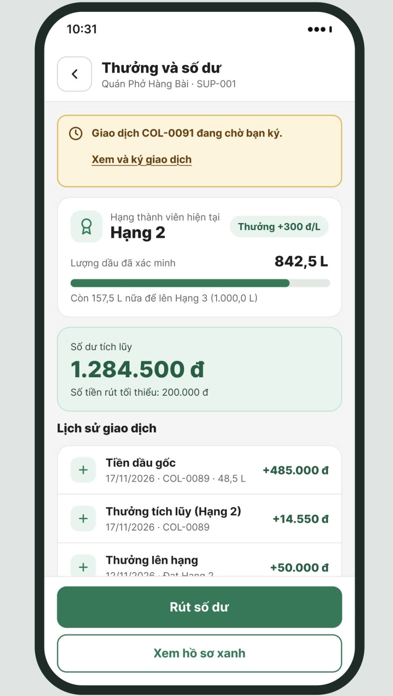

# Screen Spec: S-F05-01 Loyalty and payout balance

| Field | Value |
|---|---|
| Screen ID | S-F05-01 |
| Screen name | Loyalty and payout balance |
| Actor | Supplier |
| Priority | Must |
| Feature | F-05 Supplier Value & ESG / Green Profile |
| Activity diagrams | AD-UC-12 (actions "Request loyalty & payout overview", "See loyalty tier & history details", "See withdrawal result & updated payout status and balance") |
| Mockup image | `img/S-F05-01.png` |
| Status | Draft |

## 1. Purpose

**Shown when:** the supplier opens "Thưởng và số dư" from the Supplier main menu, goes back from S-F03-02 ("Về số dư tích lũy"), or returns from S-F05-02 after a withdrawal request is created.

**The user leaves this screen when:** the supplier taps "Rút số dư" (S-F05-02), "Xem hồ sơ xanh" (S-F05-03), "Xem và ký giao dịch" (S-F03-01), or Back to the Supplier main menu.

## 2. Mockup

## 3. Element inventory

| # | Element | Type | Content / data source | Required | Validation |
|---|---|---|---|---|---|
| 1 | Back | Button | static | Yes | none |
| 2 | Title | Header | static: "Thưởng và số dư" | Yes | |
| 3 | Supplier subtitle | Text | `supplier.business_name` · `supplier.id` (e.g., "Quán Phở Hàng Bài · SUP-001") | Yes | `SUP-` + 3 digits |
| 4 | Awaiting-signature banner | Banner | "Giao dịch " + `transaction.collection_code` + " đang chờ bạn ký." (e.g., "COL-0091") | No | shown only while a transaction awaits signature |
| 5 | Banner link | Link | static: "Xem và ký giao dịch" | No | 44 px high touch target |
| 6 | Error banner | Banner | static: "Không tải được dữ liệu thưởng và số dư." + "Kiểm tra kết nối mạng và thử lại." (Error state only) | No | |
| 7 | Tier icon | Icon tile | static medal icon | Yes | |
| 8 | Current tier | Text | "Hạng thành viên hiện tại" + `supplier.loyalty_tier` (e.g., "Hạng 2") | Yes | |
| 9 | Bonus pill | Pill | "Thưởng " + `loyalty.bonus_rate` (format `+000 đ/L`, e.g., "Thưởng +300 đ/L") | No | hidden when no bonus applies and in Error state |
| 10 | Verified volume | Key-value row | "Lượng dầu đã xác minh" + `supplier.verified_volume` (format: 1 decimal + `L`, e.g., "842,5 L") | Yes | `>= 0` |
| 11 | Tier progress bar | Progress bar | `supplier.verified_volume` / `loyalty.next_tier_threshold` | Yes | 0–100%; empty bar when volume is 0 |
| 12 | Tier progress caption | Text | "Còn " + `next_tier_threshold − verified_volume` + " L nữa để lên Hạng " + next tier + " (" + threshold + ")"; at the top tier: "Bạn đã đạt hạng cao nhất" | Yes | 1 decimal + `L` |
| 13 | Balance card | Card | "Số dư tích lũy" + `payout_balance.accumulated` (format: integer with thousand separator + `đ`, e.g., "1.284.500 đ") | Yes | `>= 0` |
| 14 | Minimum note | Text | "Số tiền rút tối thiểu: " + `config.min_withdrawal` (e.g., "200.000 đ") | Yes | BR-05 |
| 15 | History header | Subheader | static: "Lịch sử giao dịch" | Yes | |
| 16 | Transaction row | List row | icon + `transaction.type` ("Tiền dầu gốc", "Thưởng tích lũy (Hạng n)", "Thưởng lên hạng", "Rút tiền") + `transaction.date` · `collection.code` · `collection.volume` + signed `transaction.amount` (e.g., "+485.000 đ", "−300.000 đ") | Yes | `dd/MM/yyyy`; `COL-` + 4 digits; newest first; row at least 44 px high |
| 17 | Withdrawal status badge | Badge | `withdrawal.status`: "Đã tạo yêu cầu" (Created), "Đang xử lý" (Processing), "Hoàn tất" (Completed), "Thất bại" (Failed); each with its own icon | No | only on "Rút tiền" rows; text + icon, never color alone |
| 18 | Empty history card | Card | icon + "Chưa có giao dịch nào" + "Sau khi bạn ký giao dịch, tiền dầu gốc và thưởng tích lũy sẽ hiện ở đây. Hãy yêu cầu thu gom để bắt đầu tích lũy." (Empty state only) | No | |
| 19 | Loading skeletons | Skeleton | grey placeholders for tier card, balance card, history; text "Đang tải số dư…" (Loading state only) | No | mirror the Default layout |
| 20 | Success toast | Toast | static: "Đã tạo yêu cầu rút tiền." (Success state only) | No | auto-dismisses after 4 seconds |
| 21 | Withdraw button | Primary button | "Rút số dư" (Default, Success, Loading, Empty); "Tải lại dữ liệu" (Error) | Yes | "Rút số dư" disabled in Loading and Empty and whenever `payout_balance.accumulated < config.min_withdrawal` |
| 22 | Disabled hint | Text | static: "Bạn có thể rút khi số dư từ 200.000 đ." (Empty state only) | No | |
| 23 | Green Profile button | Secondary button | static: "Xem hồ sơ xanh" | Yes | |

## 4. States

| State | What the user sees | Trigger |
|---|---|---|
| Default (1/5) | Awaiting-signature banner (when applicable), tier card with progress to the next tier, balance card with the minimum withdrawal, transaction history (base payment, loyalty bonus, tier upgrade bonus, withdrawals), enabled "Rút số dư" and "Xem hồ sơ xanh". The mockup shows this state; the history list scrolls under the fixed footer. | Screen opened, data loaded |
| Empty (2/5) | "Hạng 1", "0,0 L", empty progress bar "Cần 500,0 L để lên Hạng 2", balance "0 đ", card "Chưa có giao dịch nào"; "Rút số dư" disabled with the hint "Bạn có thể rút khi số dư từ 200.000 đ." | Supplier has no signed transaction yet |
| Loading (3/5) | Grey skeletons of the tier card, balance card and history, text "Đang tải số dư…", disabled "Rút số dư" | Loyalty and payout data are being fetched |
| Error (4/5) | Red banner "Không tải được dữ liệu thưởng và số dư. Kiểm tra kết nối mạng và thử lại."; tier shows "Chưa có dữ liệu", volume "— L", balance "— đ" with "Chưa thể rút tiền khi chưa tải được số dư."; primary button becomes "Tải lại dữ liệu" | The request failed (network or server) |
| Success / confirmation (5/5) | Toast "Đã tạo yêu cầu rút tiền." and the updated balance (e.g., 984.500 đ); a new "Rút tiền" row with badge "Đã tạo yêu cầu" at the top of the history | Supplier returns from S-F05-02 after a withdrawal request was created (FR-05-02) |

## 5. Interactions and navigation

| # | Element | User action | System response | Goes to screen |
|---|---|---|---|---|
| 1 | Back | tap | Returns to the supplier home | Supplier main menu |
| 2 | Xem và ký giao dịch | tap | Opens the draft agreement awaiting signature | S-F03-01 |
| 3 | Rút số dư | tap (enabled) | Opens the withdrawal form | S-F05-02 |
| 4 | Rút số dư | tap (disabled) | Nothing; the hint explains the minimum balance | stays |
| 5 | Xem hồ sơ xanh | tap | Opens the Green Profile | S-F05-03 |
| 6 | Tải lại dữ liệu | tap (Error state) | Fetches loyalty and payout data again; shows Loading, then Default or Error | stays |
| 7 | History list | scroll | Shows older transactions | stays |

## 6. Screen-level rules

| Rule ID | Rule | Source |
|---|---|---|
| SR-001 | The supplier sees only their own tier, balance and transactions (`supplier.id`). | FR-06-03 |
| SR-002 | Tier, verified volume and balance are read-only; the system updates them after a signed transaction and after a withdrawal request. | FR-05-01 |
| SR-003 | "Rút số dư" is enabled only when `payout_balance.accumulated` is at least the minimum withdrawal (200.000 đ). | BR-05 |
| SR-004 | The history lists base payment, loyalty bonus, tier upgrade bonus and withdrawals, newest first. | FR-05-01 |
| SR-005 | Withdrawal status is shown with text and icon, never by colour alone. | ui-conventions §5 |
| SR-006 | The awaiting-signature banner stays visible until the transaction is signed and carries an action link. | ui-conventions §3 |
| SR-007 | The toast disappears after 4 seconds. | ui-conventions §3 |
| SR-008 | Amounts use thousand separators and `đ`; volumes use 1 decimal and `L`; dates use `dd/MM/yyyy`. | ui-conventions §2 |
| SR-009 | The screen shows the accumulated balance only; the actual bank transfer is outside ReFeed Release 1. | ADR-003, W0 |
| SR-010 | At most one Primary button on the screen. | ui-conventions §3 |

## 7. Linked requirements

| FR ID | What this screen does for it |
|---|---|
| FR-05-01 | Displays the current tier, verified UCO volume with progress to the next tier, accumulated payout balance and transaction history |
| FR-05-02 | Provides the entry to the withdrawal ("Rút số dư") and shows the result after a request is created (Success state) |
| FR-03-01 | Links to the transaction awaiting signature (S-F03-01) |
| FR-06-03 | Restricts the data shown to the signed-in supplier |

## 8. Responsive and accessibility notes

- Designed at 390 × 844; smallest supported width 360 px. The content scrolls and the two footer buttons stay fixed (Primary 52 px, Secondary 48 px high).
- Touch targets at least 44 × 44: back button 44 × 44, banner link row 44 px, history rows at least 44 px high.
- Progress is shown by the bar and by the caption text; the bar has an accessible name "Tiến độ lên Hạng n".
- Withdrawal status badges use text plus icon; the error banner uses an icon and a distinct border, not colour alone.
- Body text and badge text contrast at least 4.5:1.

## 9. Open questions

| # | Question | Blocking? | Status |
|---|---|---|---|
| 1 | [NEEDS CLARIFICATION: tier thresholds and bonus rates (BR-05) are not in the repository. The mockup uses placeholders: Hạng 2 = +300 đ/L, next tier at 1.000,0 L, Hạng 2 at 500,0 L. The S-F03-02 mockup shows Hạng 1 = +300 đ/kg.] | No | Open. Default: placeholder values. |
| 2 | [NEEDS CLARIFICATION: ui-conventions §2 sets volume in `L`; S-F03-01 and S-F03-02 show `kg` and `đ/kg`.] | No | Open. Default: `L`, as in ui-conventions. |
| 3 | [NEEDS CLARIFICATION: minimum withdrawal. AD-UC-13 uses 200.000 VND; W5 handover question 3 asks about 100.000 VND.] | No | Open. Default: 200.000 đ. |
| 4 | [NEEDS CLARIFICATION: the Supplier main menu has no Screen ID in the Screen List. Add one?] | No | Open. Default: Back goes to the "Supplier main menu" node. |
| 5 | [NEEDS CLARIFICATION: should a history row open a detail (for example the receipt S-F03-02)?] | No | Open. Default: rows are not tappable. |

---

## Completion checklist

- [x] The mockup is a separate cropped image file, named with the Screen ID (`img/S-F05-01.png`).
- [x] Every visible element across all 5 states appears in the element inventory.
- [x] Every input/action element has a validation rule or an explicit state behavior.
- [x] All five states (Default, Empty, Loading, Error, Success) are filled in.
- [ ] Every navigation target is a Screen ID that exists in the Screen List (the Supplier main menu has no ID: open question 4).
- [x] Every element that displays data names the field it displays.
- [x] Every linked FR exists in the Function List, and every action of this screen in AD-UC-12 is covered by an interaction row.
