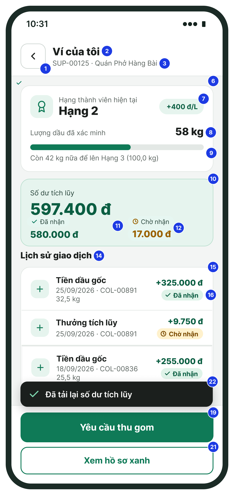

# Screen Spec: S-F05-01 Wallet

| Field             | Value |
| ----------------- | ----- |
| Screen ID         | S-F05-01 |
| Screen name       | Loyalty and payout balance (Ví của tôi) |
| Actor             | Supplier |
| Priority          | Must |
| Feature           | F-05 Supplier Value & ESG / Green Profile |
| Activity diagrams | AD-UC-12 (Manage loyalty status and accumulated payout balance). |
| Mockup images     | `img/S-F05-01-default.png` (default), `img/S-F05-01-default-numbered.png`, four state images and four numbered state images (section 2) |
| Frame width       | 370px screen inside a 390 × 844 device frame (exported at 3x with a 50px shadow margin, 1470 × 2832 pixels) |
| Figma frame       | Frames "S-F05-01 / 1" to "S-F05-01 / 5", page "4 màn × 5 trạng thái" in the ReFeed Figma file |
| Status            | Draft |

## 1. Purpose

**Shown when:** the supplier opens "Ví của tôi" from the home screen (S-F00-02), or returns here after creating a withdrawal request.

**The user leaves this screen when:** they go back, tap "Xem và ký giao dịch" on the pending transaction banner, tap "Rút tiền" to withdraw money, or tap "Xem hồ sơ xanh".

## 2. Mockup

**Numbered:** each number is the # of the element inventory in section 3. A number stays the same in every state. Element 3 (Pending transaction banner) appears only in the default state; elements 18 (Success toast) and 19 (Withdrawal status badge) appear only in the success state; elements 13 (Network error banner) and 16 ("Tải lại dữ liệu" button) appear only in the error state; elements 14 (Empty history card) and 15 (Minimum withdrawal hint) appear only in the empty state; element 17 (Loading text) appears only in the loading state. Element 5 (Tier bonus pill) appears when the tier has a bonus (default and success). The loading image numbers the header (1, 2), the loading text (17) and the disabled button (11); grey skeleton blocks stand in place of elements 4 to 10.

| Default, numbered | Empty, numbered | Loading, numbered | Error, numbered | Success, numbered |
| --- | --- | --- | --- | --- |
|  |  |  |  |  |

| State   | Image |
| ------- | ----- |
| Default | [`img/S-F05-01-default.png`](img/S-F05-01-default.png) (Hạng 2, balance 1.284.500 đ, transaction COL-00891 waiting for signature) |
| Empty   | [`img/S-F05-01-empty.png`](img/S-F05-01-empty.png) (new supplier: Hạng 1, 0 đ, no transaction) |
| Loading | [`img/S-F05-01-loading.png`](img/S-F05-01-loading.png) |
| Error   | [`img/S-F05-01-error.png`](img/S-F05-01-error.png) (reward and balance data could not be loaded) |
| Success | [`img/S-F05-01-success.png`](img/S-F05-01-success.png) (withdrawal request of 681.300 đ just created) |

Colours, fonts and corners follow the design tokens in [ui-conventions.md](../ui-conventions.md#6-design-tokens). A pixel check of the state images found shades that are not in the token table (open question 9).

## 3. Element inventory

Data field names are proposed; align them with the data dictionary.

| #  | Element | Type | Content / data source | Required | Validation |
| -- | ------- | ---- | --------------------- | -------- | ---------- |
| 1  | Back | Icon button | static chevron icon | Yes | none |
| 2  | Title and context line | Header | static "Ví của tôi"; `supplier.id` · `supplier.business_name` (example: "SUP-00125 · Quán Phở Hàng Bài") | Yes | `SUP-` + 5 digits |
| 3  | Pending transaction banner | Warning banner | clock icon; "Giao dịch " + `collection.id` + " đang chờ bạn ký."; link "Xem và ký giao dịch" | No | shown while a transaction awaits the supplier's signature |
| 4  | Tier card | Card | award icon; label "Hạng thành viên hiện tại"; `loyalty.tier` (example: "Hạng 2"); "Chưa có dữ liệu" in Error | Yes | tier is a whole number |
| 5  | Tier bonus pill | Pill | `loyalty.bonus_per_kg` (example: "+300 đ/kg") | No | `+` + integer + " đ/kg"; hidden when the tier has no bonus (Hạng 1) |
| 6  | Verified weight | Text | label "Lượng dầu đã xác minh" + `loyalty.verified_weight` (example: "842,5 kg"); "— kg" in Error | Yes | 1 decimal with decimal comma + " kg" |
| 7  | Tier progress | Progress bar + text | bar = verified / threshold; "Còn " + `loyalty.weight_to_next` + " kg nữa để lên Hạng " + `loyalty.next_tier` + " (" + `loyalty.next_tier_threshold` + " kg)"; Empty: "Cần 500,0 kg để lên Hạng 2"; Error: "Chưa xác định tiến độ lên hạng" | Yes | 1 decimal + " kg" |
| 8  | Balance card | Metric card | label "Số dư tích lũy"; `wallet.balance` (example: "1.284.500 đ"); "Số tiền rút tối thiểu: " + `withdrawal.min_amount` + " đ"; Error: "— đ" and "Chưa thể rút tiền khi chưa tải được số dư." | Yes | integer >= 0; `.` as thousands separator + " đ" |
| 9  | Section title | Subheader | static: "Lịch sử giao dịch" | Yes | |
| 10 | Transaction list | List | credit rows: icon "+", `transaction.type` ("Tiền dầu gốc", "Thưởng tích lũy", "Thưởng lên hạng"), `transaction.date` · `collection.id` (· `collection.actual_quantity` kg for "Tiền dầu gốc"), "+" + `transaction.amount` + " đ" in green; withdrawal rows: arrow-up icon, "Rút tiền", `withdrawal.date`, "−" + `withdrawal.amount` + " đ" | No | `dd/MM/yyyy`; `COL-` + 5 digits; newest first; hidden in the empty and error states |
| 11 | Rút tiền | Primary button | static label | Yes | enabled only when `wallet.balance` >= `withdrawal.min_amount`; disabled while loading and in the empty state |
| 12 | Xem hồ sơ xanh | Secondary button | static label | Yes | none |
| 13 | Network error banner | Error banner | warning icon; "Không tải được dữ liệu thưởng và số dư."; "Kiểm tra kết nối mạng và thử lại." | No | shown when the API fetch fails |
| 14 | Empty history card | Empty state card | clock icon; "Chưa có giao dịch nào"; "Sau khi bạn ký giao dịch, tiền dầu gốc và thưởng tích lũy sẽ hiện ở đây. Hãy yêu cầu thu gom để bắt đầu tích lũy." | No | shown only when the supplier has no transaction |
| 15 | Minimum withdrawal hint | Text | "Bạn có thể rút khi số dư từ " + `withdrawal.min_amount` + " đ." | No | shown only when button 11 is disabled because of the balance |
| 16 | Tải lại dữ liệu | Primary button | static label; replaces "Rút tiền" (11) in the error state | Yes (error) | none |
| 17 | Loading text | Text | static: "Đang tải số dư..." | No | shown only in the loading state |
| 18 | Success toast | Toast | check icon + "Đã tạo yêu cầu rút tiền." | No | shown right after a withdrawal request is created; auto-dismisses after 4 seconds |
| 19 | Withdrawal status badge | Status badge (in a withdrawal row of 10) | icon + `withdrawal.status` (example: "Đã tạo yêu cầu") | No | text + icon, never colour alone |

## 4. States

| State | What the user sees | Trigger |
| ----- | ------------------ | ------- |
| Default | Header "Ví của tôi", "SUP-00125 · Quán Phở Hàng Bài"; amber banner "Giao dịch COL-00891 đang chờ bạn ký." with link "Xem và ký giao dịch"; tier card "Hạng 2" with pill "+300 đ/kg", "842,5 kg" verified, progress bar and "Còn 157,5 kg nữa để lên Hạng 3 (1.000,0 kg)"; balance card "1.284.500 đ" with "Số tiền rút tối thiểu: 200.000 đ"; "Lịch sử giao dịch" with rows "Tiền dầu gốc +206.000 đ (03/09/2026 · COL-00836 · 20.6 kg)", "Thưởng tích lũy +6.180 đ (03/09/2026 · COL-00836)", "Thưởng lên hạng" (cut by the bottom bar); fixed bottom bar with "Rút tiền" and "Xem hồ sơ xanh". | Screen opened with data and a transaction awaiting the supplier's signature |
| Empty (no data) | Tier card "Hạng 1", "0,0 kg" verified, empty progress bar, "Cần 500,0 kg để lên Hạng 2" (no bonus pill); balance card "0 đ" with the minimum withdrawal text; "Lịch sử giao dịch" with a white card, clock icon "Chưa có giao dịch nào" and its explanation; "Rút tiền" disabled with the hint "Bạn có thể rút khi số dư từ 200.000 đ."; "Xem hồ sơ xanh" active. | The supplier has no signed transaction yet (balance 0 đ) |
| Loading | Header visible; three white cards with grey skeleton bars in place of the tier card, the balance card and the history list, plus a grey bar for the section title; text "Đang tải số dư..."; bottom bar shows only the disabled "Rút tiền". | Screen opened, or "Tải lại dữ liệu" tapped, while fetching reward and balance data |
| Error | Red banner "Không tải được dữ liệu thưởng và số dư. Kiểm tra kết nối mạng và thử lại."; tier card "Chưa có dữ liệu" with "— kg", empty progress bar and "Chưa xác định tiến độ lên hạng"; white balance card "— đ" with "Chưa thể rút tiền khi chưa tải được số dư."; no history; bottom bar shows "Tải lại dữ liệu" and "Xem hồ sơ xanh". | Network connection lost or API timeout when fetching reward and balance data |
| Success / confirmation | Balance card "603.200 đ" (1.284.500 đ minus 681.300 đ), shown above the tier card (open question 1); tier card "Hạng 2", pill "+300 đ/L" (open question 2), "842,5 kg"; new first history row "Rút tiền −681.300 đ" dated 14/09/2026 with badge "Đã tạo yêu cầu", then "Tiền dầu gốc +206.000 đ (20,6 kg)" and "Thưởng tích lũy +6.180 đ"; dark toast "Đã tạo yêu cầu rút tiền." above the bottom bar; the pending transaction banner is not shown. | Returned to this screen immediately after a withdrawal request was created |

## 5. Interactions and navigation

Target Screen IDs come from the Screen List and the Screen Transition diagram.

| # | Element | User action | System response | Goes to screen |
| - | ------- | ----------- | --------------- | -------------- |
| 1 | Back (1) | tap | Returns without changes | S-F00-02 (Supplier home) |
| 2 | "Xem và ký giao dịch" in banner 3 | tap | Opens the signing screen for the pending transaction `COL-00891` | S-F03-01 |
| 3 | Rút tiền (11), enabled | tap | Starts a withdrawal request | S-F05-02 |
| 4 | Rút tiền (11), disabled | tap | Nothing; hint 15 explains the minimum | stays |
| 5 | Xem hồ sơ xanh (12) | tap | Opens the supplier's green profile | S-F05-03 |
| 6 | Tải lại dữ liệu (16) | tap | Re-fetches reward and balance data | stays (loading, then default/empty or error state) |
| 7 | Transaction list (10) | tap a row | Nothing; display only (open question 6) | stays |
| 8 | Screen content | pull down | Triggers a manual refresh (open question 6) | stays (loading, then updated state) |

## 6. Screen-level rules

| Rule ID | Rule | Source |
| ------- | ---- | ------ |
| SR-001 | The supplier only sees the balance, tier and transactions that belong to their own `supplier.id`. | FR-06-03 |
| SR-002 | The minimum withdrawal amount is 200.000 đ; "Rút tiền" is enabled only when the balance reaches it. | FR-05-02; BR-PAY-01 (value not yet defined in the repository, open question 10) |
| SR-003 | When a withdrawal request is created, its amount leaves the balance immediately and shows as a "Rút tiền" row with status "Đã tạo yêu cầu". | FR-05-02 |
| SR-004 | Tier thresholds shown in the progress hint come from the server: Hạng 2 from 500,0 kg and Hạng 3 from 1.000,0 kg verified UCO. Hạng 2 gives a bonus of +300 đ/kg (open question 10). | FR-05-01; BR-05 |
| SR-005 | The bonus for a collection is shown as a separate "Thưởng tích lũy" row next to the "Tiền dầu gốc" row of the same `collection.id`. | FR-05-01 |
| SR-006 | When data cannot be loaded, figures are replaced by "—" (never by 0) and withdrawal is not offered; the primary button becomes "Tải lại dữ liệu". | Error state |
| SR-007 | While loading, "Rút tiền" cannot be tapped. | Loading state |
| SR-008 | All status banners (warning, error, success) use an icon + bold title + descriptive text, never colour alone; withdrawal and credit rows differ by sign, icon and colour. | ui-conventions §5 |

## 7. Linked requirements

| FR ID | What this screen does for it |
| ----- | ---------------------------- |
| FR-05-01 | Displays the accumulated balance, minimum withdrawal amount and the transaction history |
| FR-05-01 | Displays the loyalty tier, verified UCO weight and progress to the next tier |
| FR-05-02 | Provides the entry to withdraw money and shows the new withdrawal request |
| FR-03-01 | Shows the transaction awaiting signature and links to the signing screen |
| FR-05-03 | Provides the entry to the Green Profile ("Xem hồ sơ xanh") |
| FR-06-03 | Restricts the data to the signed-in supplier |

## 8. Responsive and accessibility notes

- Designed on a 370 × 824 screen inside a 390 × 844 device frame; smallest supported width 360 px; cards use the full width minus screen padding, amounts stay on one line and long meta text (date · COL id · kg) wraps onto a second line.
- The bottom bar (buttons 11 and 12, or 16 and 12) is fixed; the history list scrolls behind it.
- Touch targets at least 44 × 44 (ui-conventions §5): back button, both bottom buttons, inline link "Xem và ký giao dịch".
- Credit and withdrawal rows differ by icon ("+" vs arrow up) and sign (+ vs −), not by colour alone; the progress bar is also given as text ("Còn 157,5 kg nữa...").
- The toast is announced to screen readers; banners use icons (clock, warning triangle) alongside text with contrast of at least 4.5:1 (ui-conventions §5).

## 9. Open questions

| # | Question | Blocking? | Status |
| - | -------- | --------- | ------ |
| 1 | [NEEDS CLARIFICATION: In the success mockup the balance card is above the tier card; in default, empty and error it is below. Which order is correct?] | No | Open. Default: tier card first, then balance card (3 of 4 states). |
| 2 | [NEEDS CLARIFICATION: The bonus pill reads "+300 đ/L" in the success mockup and "+300 đ/kg" in default. Which unit is correct?] | No | Open. Default: "đ/kg", since UCO is weighed in kg. |
| 3 | [NEEDS CLARIFICATION: The figures of S-F00-02 and S-F05-01 for the same supplier SUP-00125 differ: the home screen shows a balance of 603.200 đ at 9:41 while this screen shows 1.284.500 đ at 10:31 (603.200 đ is the balance after the withdrawal of 681.300 đ); the default row shows "20.6 kg" with a decimal point instead of "20,6 kg".] | No | Open. Default: align the sample data across screens and use the decimal comma. |
| 4 | [NEEDS CLARIFICATION: Does a pending transaction (banner 3) block "Rút tiền"?] | No | Open. Default: no, withdrawal depends only on the balance. |
| 5 | [NEEDS CLARIFICATION: How long does the toast stay, and does the withdrawal row change status later (for example "Đã chuyển")?] | No | Open. Default: toast disappears after 4 seconds; later statuses are out of scope of this screen. |
| 6 | [NEEDS CLARIFICATION: Do history rows open a detail or receipt, and does the screen support pull-to-refresh?] | No | Open. Default: no row detail, pull down refreshes. |
| 7 | [NEEDS CLARIFICATION: In the error state "Rút tiền" is replaced by "Tải lại dữ liệu". Should the error banner (red) and the home error banner (amber, S-F00-02) use the same style?] | No | Open. Default: keep as designed. |
| 8 | [NEEDS CLARIFICATION: The mockups call the wallet area "Ví của tôi", while other project documents call it "Tích lũy".] | No | Open. Default: "Ví của tôi" as in the mockups. |
| 9 | [NEEDS CLARIFICATION: Shades in the state images (for example #0B5E42, #5B6460, #254238) are not in the ui-conventions §6 token table.] | No | Open. Default: tokens are the rule; redraw the images from Figma. |
| 10 | [NEEDS CLARIFICATION: BR-05 and BR-PAY-01 do not define the tier thresholds, the tier bonus (+300 đ/kg for Hạng 2 here, +300 đ/kg for Hạng 1 on S-F03-01 and +400 đ/kg in ui-conventions §2) or the minimum withdrawal in the repository.] | No | Open. Default: 500/1.000 kg, +300 đ/kg and 200.000 đ as in the mockups. |
| 11 | [NEEDS CLARIFICATION: S-F05-03 returns here by "Về ví của tôi", but the Screen Transition diagram has no arrow S-F05-03 → S-F05-01.] | No | Open. Default: add the arrow. |

---

## Completion checklist

- [x] The mockup is a separate cropped image file, named with the Screen ID, at the frame width.
- [x] The numbered image exists, and its numbers match the # column of the element inventory.
- [x] Every visible element in the mockup appears in the element inventory.
- [ ] Every colour in the mockup is a design token from ui-conventions.md.
- [x] Every input element has a validation rule or an explicit "none".
- [x] All five states are filled in.
- [x] Every navigation target is a Screen ID that exists in the Screen List.
- [x] Every element that displays data names the field it displays (proposed names).
- [x] Every linked FR exists in the Function List, and every action of this screen in AD-UC-12 is covered by an interaction row.
