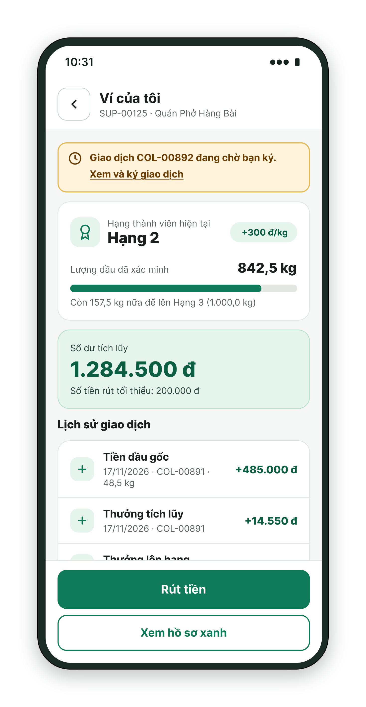
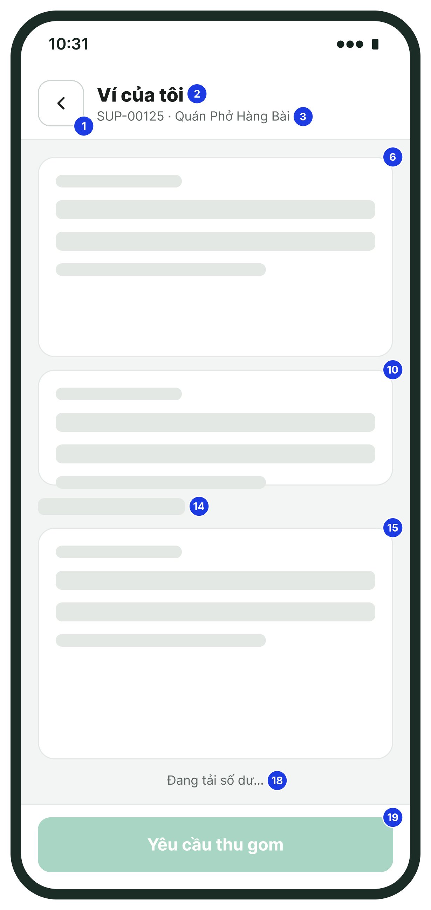

# Screen Spec: S-F05-01 My wallet (loyalty tier and payout balance)

| Field             | Value |
| ----------------- | ----- |
| Screen ID         | S-F05-01 |
| Screen name       | Loyalty and payout balance |
| Actor             | Supplier |
| Priority          | Must |
| Feature           | F-05 Loyalty, payout balance and Green Profile|
| Activity diagrams | [TBC: AD not checked; the screen is read-only, and no withdrawal flow exists any more] |
| Mockup images     | `img/S-F05-01-default.png` (default), `img/S-F05-01-default-numbered.png`, four state images and four numbered state images (section 2) |
| Frame width       | 370px screen inside a 390 × 844 device frame, exported at 3x; state images are 1170 × 2532 pixels, numbered images are 1230 × 2592 pixels (30px transparent padding so that the number badges have room) |
| Figma frame       | Board "S-F05-01 · Loyalty and payout balance - 5 stages", five frames, one per state (not re-checked against the Figma file in this version) |
| Status            | Draft |

**Scope change in this version.** The app has no connection to a bank, so the supplier **cannot withdraw money** here. The former screen "Payout withdrawal" (and its confirmation modal and "withdrawal requested" result) is removed. This screen only shows the accumulated balance, the loyalty tier, and whether each amount has been **received** (`Đã nhận`) or is **pending** (`Chờ nhận`).

## 1. Purpose

**Shown when:** the supplier taps the tab "Ví của tôi" (or a link to the wallet), or comes back from the Green Profile (S-F05-02).

**The user leaves this screen when:** they tap the back button, tap "Xem và ký giao dịch" on the pending transaction banner, tap "Yêu cầu thu gom", tap "Xem hồ sơ xanh", or tap "Tải lại dữ liệu" after an error (the screen stays and reloads).

## 2. Mockup

**Numbered:** each number is the # of the element inventory in section 3. An element keeps the same number in every state.

| State | Numbers shown on the image |
| ----- | -------------------------- |
| Default | 1–4, 6–12, 14–16, 19, 21 |
| Empty | 1–3, 6–10, 14, 17, 19, 21 |
| Loading | 1–3, 6, 10, 14, 15, 18, 19 (6, 10, 14 and 15 on the skeleton blocks) |
| Error | 1–3, 5, 6, 8–10, 13, 20, 21 |
| Success | 1–3, 6–12, 14–16, 19, 21, 22 (the stray check mark at the top left is not an element and has no number; open question 4) |

In the Loading image, the number on a grey block names the element the block holds the place of; the block shows no data and cannot be tapped. The pending transaction banner (4) has no block.

| Default, numbered | Empty, numbered | Loading, numbered | Error, numbered | Success, numbered |
| --- | --- | --- | --- | --- |
|  |  |  |  |  |

| State   | Image |
| ------- | ----- |
| Default | [`img/S-F05-01-default.png`](img/S-F05-01-default.png) (has a transaction awaiting signature, COL-00891; one collection already paid in the history) |
| Empty   | [`img/S-F05-01-empty.png`](img/S-F05-01-empty.png) (new supplier, no signed transaction yet) |
| Loading | [`img/S-F05-01-loading.png`](img/S-F05-01-loading.png) |
| Error   | [`img/S-F05-01-error.png`](img/S-F05-01-error.png) (reward and balance data could not be loaded) |
| Success | [`img/S-F05-01-success.png`](img/S-F05-01-success.png) (data loaded again after the error; COL-00891 now counted) |

Colours, fonts and corners follow the design tokens in ui-conventions.md section 6. [TBC: the conventions file could not be read in this version, so no pixel check against the token table was made; open question 14.]

## 3. Element inventory

Data field names are proposed; align them with the data dictionary.

| #  | Element | Type | Content / data source | Required | Validation |
| -- | ------- | ---- | --------------------- | -------- | ---------- |
| 1  | Back button | Icon button | chevron-left | Yes | none |
| 2  | Screen title | Header | static "Ví của tôi" | Yes | |
| 3  | Context line | Text | `supplier.id` · `supplier.business_name` (example: "SUP-00125 · Quán Phở Hàng Bài") | Yes | `SUP-` + 5 digits |
| 4  | Pending transaction banner | Warning banner | clock icon; title "Giao dịch " + `collection.id` + " đang chờ bạn ký."; link "Xem và ký giao dịch" | No | shown while at least one transaction awaits the signature |
| 5  | Error banner | Error banner | triangle icon; "Không tải được dữ liệu thưởng và số dư."; "Kiểm tra kết nối mạng và thử lại." | No | shown only in the error state |
| 6  | Tier card | Card | badge icon; label "Hạng thành viên hiện tại"; "Hạng " + `loyalty.tier` (example: "Hạng 1"); error: "Chưa có dữ liệu" with a grey icon | Yes | tier is a whole number |
| 7  | Tier bonus pill | Pill | "+" + `loyalty.bonus_per_kg` + " đ/kg" (example: "+300 đ/kg") | No | integer; unit "đ/kg"; hidden in the error state |
| 8  | Verified weight | Text row | label "Lượng dầu đã xác minh"; `loyalty.verified_weight` + " kg" (example: "25,5 kg"); error: "— kg" | Yes | 1 decimal with decimal comma (open question 9) |
| 9  | Tier progress | Progress bar + hint | bar = `loyalty.verified_weight` ÷ `loyalty.next_tier_threshold`; hint "Còn " + remaining + " kg nữa để lên Hạng " + next tier + " (" + threshold + " kg)"; empty: "Cần 50,0 kg để lên Hạng 2"; error: empty grey bar and "Chưa xác định tiến độ lên hạng" | Yes | 0–100 %; remaining = threshold − verified weight |
| 10 | Balance card | Metric card (primary) | label "Số dư tích lũy"; `wallet.balance` (example: "262.650 đ"); error: "— đ" in a white card | Yes | integer >= 0; `.` as thousands separator + " đ"; always equals 11 + 12 |
| 11 | Received amount | Metric | check icon + "Đã nhận"; `wallet.received_amount` (example: "255.000 đ") | No | integer >= 0; hidden in the empty and error states |
| 12 | Pending amount | Metric | clock icon + "Chờ nhận"; `wallet.pending_amount` (example: "7.650 đ"), amber | No | integer >= 0; hidden in the empty and error states |
| 13 | Balance helper text | Text | error only: "Chưa thể hiển thị số dư khi chưa tải được dữ liệu." (the mockup still shows an old sentence about withdrawing; open question 6) | No | static |
| 14 | History title | Section title | static "Lịch sử giao dịch" | No | hidden in the error state |
| 15 | Transaction row | List row | "+" icon; title `transaction.type_label` ("Tiền dầu gốc" or "Thưởng tích lũy"); meta `transaction.date` · `collection.id` and, for "Tiền dầu gốc", · `collection.actual_quantity` + " kg"; amount "+" + `transaction.amount` + " đ" | No | `dd/MM/yyyy`; `COL-` + 5 digits; newest first |
| 16 | Payout status chip | Chip | `transaction.payout_status`: "✓ Đã nhận" (green) or "◷ Chờ nhận" (amber) | Yes, on every row | enum: received, pending |
| 17 | Empty history card | Empty state card | clock icon; "Chưa có giao dịch nào"; "Sau khi bạn ký giao dịch, tiền dầu gốc và thưởng tích lũy sẽ hiện ở đây. Hãy yêu cầu thu gom để bắt đầu tích lũy." | No | shown only when the supplier has no transaction |
| 18 | Loading text | Text | static "Đang tải số dư..." | No | shown only in the loading state |
| 19 | Yêu cầu thu gom | Primary button | static label | Yes | none; not tappable while loading |
| 20 | Tải lại dữ liệu | Primary button | static label; replaces button 19 in the error state | No | none |
| 21 | Xem hồ sơ xanh | Secondary button | static label | Yes | none; hidden while loading |
| 22 | Success toast | Toast | check icon + "Đã tải lại số dư tích lũy" (same pattern as "Đã tải lại hồ sơ xanh." on S-F05-02) | No | shown after a successful reload; floats above the buttons and may cover the last visible history row |

## 4. States

| State | What the user sees | Trigger |
| ----- | ------------------ | ------- |
| Default | Header "Ví của tôi", "SUP-00125 · Quán Phở Hàng Bài". Amber banner "Giao dịch COL-00891 đang chờ bạn ký." with link "Xem và ký giao dịch". Tier card "Hạng 1", pill "+300 đ/kg", "25,5 kg", bar at 51 %, "Còn 24,5 kg nữa để lên Hạng 2 (50,0 kg)". Balance card "262.650 đ", "Đã nhận 255.000 đ", "Chờ nhận 7.650 đ". History: "Tiền dầu gốc · 18/09/2026 · COL-00836 · 25,5 kg · +255.000 đ" with chip "Đã nhận"; "Thưởng tích lũy · 18/09/2026 · COL-00836 · +7.650 đ" with chip "Chờ nhận". Buttons "Yêu cầu thu gom" and "Xem hồ sơ xanh". | Screen opened with data and at least one transaction awaiting the supplier's signature |
| Empty (no data) | No banner. Tier card "Hạng 1", pill "+300 đ/kg", "0,0 kg", empty bar, "Cần 50,0 kg để lên Hạng 2". Balance card "0 đ" without the two amounts. Title "Lịch sử giao dịch" and the empty card "Chưa có giao dịch nào". Buttons "Yêu cầu thu gom" (must be active, open question 7) and "Xem hồ sơ xanh". | The supplier has no signed transaction yet |
| Loading | Header (1–3) visible. Three grey skeleton blocks and one short grey bar: block for the tier card (6), block for the balance card (10), a bar for the history title (14), a block for the history list (15). Centred text "Đang tải số dư..." (18). Only one button, "Yêu cầu thu gom", greyed out (19). No banner, no figures. | Initial screen load, or "Tải lại dữ liệu" tapped, while fetching |
| Error | Red banner "Không tải được dữ liệu thưởng và số dư." / "Kiểm tra kết nối mạng và thử lại.". Grey tier card "Chưa có dữ liệu", "— kg", empty bar, "Chưa xác định tiến độ lên hạng". White balance card "— đ" and the helper text (13). No history. Buttons "Tải lại dữ liệu" and "Xem hồ sơ xanh". | Network connection lost or API timeout when fetching the wallet data |
| Success / confirmation | Toast "Đã tải lại số dư tích lũy" above the buttons (22). No pending banner. Tier card "Hạng 2", pill "+400 đ/kg" (the mockup shows "+400 đ/L"), "58 kg", bar at 58 %, "Còn 42 kg nữa để lên Hạng 3 (100,0 kg)". Balance card "597.400 đ", "Đã nhận 580.000 đ", "Chờ nhận 17.400 đ" (the mockup shows 17.000 đ). History, newest first: "Tiền dầu gốc · 25/09/2026 · COL-00891 · 32,5 kg · +325.000 đ" with chip "Đã nhận"; "Thưởng tích lũy · 25/09/2026 · COL-00891 · +9.750 đ" with chip "Chờ nhận"; "Tiền dầu gốc · 18/09/2026 · COL-00836 · 25,5 kg · +255.000 đ" with chip "Đã nhận", partly covered by the toast; the fourth row (COL-00836 "Thưởng tích lũy", see the sample data check) is below and reached by scrolling. Buttons "Yêu cầu thu gom" and "Xem hồ sơ xanh". | The supplier tapped "Tải lại dữ liệu" in the error state and the data loaded |

**Sample data check:**
- Default: 255.000 + 7.650 = 262.650 đ; 25,5 kg × 10.000 đ = 255.000 đ; 25,5 kg × 300 đ = 7.650 đ.
- Success: balance 262.650 + 334.750 = 597.400 đ (334.750 = 325.000 for COL-00891 + 9.750 bonus, as on S-F00-02); verified weight 25,5 + 32,5 = 58,0 kg; "Đã nhận" 255.000 + 325.000 = 580.000 đ; "Chờ nhận" 7.650 + 9.750 = **17.400 đ**. The mockup shows 17.000 đ (open question 4).
- History rows for Success, newest first: COL-00891 "Tiền dầu gốc" +325.000 đ "Đã nhận"; COL-00891 "Thưởng tích lũy" +9.750 đ "Chờ nhận"; COL-00836 "Tiền dầu gốc" +255.000 đ "Đã nhận"; COL-00836 "Thưởng tích lũy" +7.650 đ "Chờ nhận". The first three are drawn in the Success image; the fourth is not visible in the image (hidden below the toast and the button area). Row sums match the card: Đã nhận 325.000 + 255.000 = 580.000 đ; Chờ nhận 9.750 + 7.650 = 17.400 đ.

## 5. Interactions and navigation

Target Screen IDs come from the Screen List and the Screen Transition diagram [TBC: not re-checked in this version]. Withdrawal is removed, so no interaction leads to a withdrawal screen.

| #  | Element | User action | System response | Goes to screen |
| -- | ------- | ----------- | --------------- | -------------- |
| 1  | Back button (1) | tap | Returns to the previous screen | previous screen (S-F00-02 when opened from the home tab; open question 16) |
| 2  | "Xem và ký giao dịch" in banner 4 | tap | Opens the signing screen for the pending transaction `COL-00891` | S-F03-01 |
| 3  | Yêu cầu thu gom (19) | tap | Opens the pickup request form | S-F01-03 |
| 4  | Xem hồ sơ xanh (21) | tap | Opens the supplier's Green Profile | S-F05-02 |
| 5  | Tải lại dữ liệu (20) | tap | Re-fetches the wallet data | stays (loading, then default, empty, success or error state) |
| 6  | Balance card (10), tier card (6), chips (16) | tap | Display only; nothing can be changed or withdrawn from here | stays |
| 7  | Transaction row (15) | tap | Display only [TBC: open question 15] | stays |
| 8  | Screen body | pull down | Re-fetches the data and shows the Loading state [TBC: open question 5] | stays |

## 6. Screen-level rules

| Rule ID | Rule | Source |
| ------- | ---- | ------ |
| SR-001 | The supplier only sees the balance, tier and transactions that belong to their own `supplier.id`. | FR-06-04 |
| SR-002 | Balance, verified weight, tier and bonus change only after a transaction is signed and verified; the screen displays the values the system returns and never calculates money itself. | FR-05-03, FR-05-04, FR-05-05 |
| SR-003 | The screen is read-only. It has no withdrawal button, no bank account field and no bank connection. | Scope change (no bank API) |
| SR-004 | `wallet.balance` = `wallet.received_amount` + `wallet.pending_amount`. Each transaction has exactly one `payout_status`: received or pending. The status is set by the system; the supplier cannot change it here. | Screen design |
| SR-005 | The pending transaction banner (4) stays above the tier card until the transaction is signed. | Screen design |
| SR-006 | If fetching fails, the screen never shows zeros in place of real figures: it shows "—", "Chưa có dữ liệu" and the error banner (5). | Offline resilience convention |
| SR-007 | While loading, skeleton blocks keep the layout of the loaded screen, show one line of loading text, cannot be tapped, and the buttons cannot be used. | ui-conventions §3 (Skeleton) |
| SR-008 | In the Empty state "Yêu cầu thu gom" stays active so the first booking can be made from this screen. | Screen design |
| SR-009 | Status banners and chips use an icon + text, never colour alone (✓ Đã nhận, ◷ Chờ nhận, clock, triangle, check). | ui-conventions §5 |

## 7. Linked requirements

FR IDs below are taken from the S-F00-02 spec. [TBC: names and wording must be checked against the W1 Function List, which could not be read in this version.]

| FR ID | What this screen does for it |
| ----- | ---------------------------- |
| FR-05-01 | Shows the supplier's loyalty tier, the progress to the next tier and the accumulated payout balance |
| FR-05-03 / FR-05-04 / FR-05-05 | Displays the balance, verified weight and tier after a signed transaction (display only) |
| FR-05-06 | Displays the tier bonus when the system returns it (open question 12) |
| FR-06-04 | Opens only for a role that has the supplier permission |

**Related functions, entry only** (carried out on the target screen): FR-01-11 (pickup form, S-F01-03), FR-03-01 (draft awaiting signature, S-F03-01), FR-05-07 (Green Profile, S-F05-02). [TBC: if W1 still has a payout withdrawal function, mark it as removed; open question 1.]

## 8. Responsive and accessibility notes

- Designed on a 370 × 824 screen inside a 390 × 844 device frame; smallest supported width 360 px; the two amounts "Đã nhận" and "Chờ nhận" stay in two equal columns; values do not truncate.
- Vertical scroll is enabled when the banner and the history make the content longer than the screen; the button area stays fixed at the bottom.
- Touch targets at least 44 × 44 (ui-conventions §5): back button, both buttons; the inline link "Xem và ký giao dịch" needs extra vertical padding to reach a 44px hit area.
- Banners and chips use different icons alongside the text: clock (pending banner, "Chờ nhận"), triangle (error), check ("Đã nhận", toast); text contrast at least 4.5:1, including amber text on the amber chip (ui-conventions §5).

## 9. Open questions

| # | Question | Blocking? | Status |
| - | -------- | --------- | ------ |
| 1 | [NEEDS CLARIFICATION: The withdrawal screen was removed. Do the Function List, Screen List, Screen Transition and the S-F05 numbering also change (Green Profile S-F05-03 → S-F05-02, ESG reports S-F05-04 → S-F05-03)?] | No | Open. Default: yes; this spec uses S-F05-02 for the Green Profile and S-F05-03 for ESG reports. |
| 2 | [NEEDS CLARIFICATION: Who sets "Đã nhận" / "Chờ nhận", and when? ReFeed Staff after a manual transfer, an accounting import, or the supplier's own confirmation?] | No | Open. Default: the system or ReFeed Staff sets it; the supplier only reads it. |
| 3 | [NEEDS CLARIFICATION: In the mockups the base amount ("Tiền dầu gốc") is "Đã nhận" and the bonus ("Thưởng tích lũy") is "Chờ nhận". Is that a rule or only sample data?] | No | Open. Default: sample data; the status is stored per transaction. |
| 4 | [NEEDS CLARIFICATION: The updated Success mockup now has the history rows and the toast, but still shows "Chờ nhận 17.000 đ" (the rows add up to 17.400 đ), the pill "+400 đ/L", and a stray check mark at the top left above the tier card. Also, the toast covers part of the third row and the fourth row is not visible.] | No | Open. Default: redraw with 17.400 đ and "+400 đ/kg", delete the stray check mark, and keep the toast "Đã tải lại số dư tích lũy"; the list scrolls under the toast. |
| 5 | [NEEDS CLARIFICATION: Is there a pull-to-refresh on this screen? The Success state is reached after "Tải lại dữ liệu" in the Error state; no other reload control is drawn.] | No | Open. Default: yes, pull down re-fetches and shows the Loading state. |
| 6 | [NEEDS CLARIFICATION: The Error mockup helper text still says "Chưa thể rút tiền khi chưa tải được số dư."] | No | Open. Default: change to "Chưa thể hiển thị số dư khi chưa tải được dữ liệu." |
| 7 | [NEEDS CLARIFICATION: In the Empty mockup the button "Yêu cầu thu gom" is greyed out, although the text asks the supplier to request a collection.] | No | Open. Default: the button is active (SR-008). |
| 8 | [NEEDS CLARIFICATION: The Loading mockup does not match the loaded layout: the last bar of the second block runs outside the block, a stray bar sits between block 2 and block 3, and block heights are larger than the content.] | No | Open. Default: redraw per SR-007: tier block, balance block, title bar, list block, each as high as its content. |
| 9 | [NEEDS CLARIFICATION: Weight format differs from ui-conventions §2 (1 decimal, decimal comma): Success shows "58 kg".] | No | Open. Default: "25,5 kg", "0,0 kg", "58,0 kg". |
| 10 | [NEEDS CLARIFICATION: The pending banner says COL-00891 awaits the supplier's signature, while S-F05-02 Default lists COL-00891 as "Đang chờ xác minh" (warehouse verification). Which comes first: signature or verification?] | No | Open. Default: follow the mockups; define one lifecycle for a collection and use the same wording on both screens. |
| 11 | [NEEDS CLARIFICATION: When two or more transactions await the signature, does banner 4 show only the oldest, a count, or several banners?] | No | Open. Default: as S-F00-02: count and the oldest transaction. |
| 12 | [NEEDS CLARIFICATION: Tier 2 pays "+400 đ/kg", but the bonus of COL-00891 in the sample is 9.750 đ (32,5 kg × 300). Is the bonus rate the one of the tier at the time of the collection? Is there a tier upgrade bonus (FR-05-06)?] | No | Open. Default: the screen shows whatever balance the system returns. |
| 13 | [NEEDS CLARIFICATION: S-F00-02 links the Green Profile and the tab "Xanh" to S-F05-03.] | No | Open. Default: change S-F00-02 to S-F05-02 after the renumbering (question 1). |
| 14 | [NEEDS CLARIFICATION: The design token table could not be read, so the colours of the images (green, mint, amber, red, greys) were not checked against ui-conventions §6.] | No | Open. Default: tokens are the rule; redraw if a shade is not a token. |
| 15 | [NEEDS CLARIFICATION: Does tapping a transaction row open the receipt (S-F03-02)?] | No | Open. Default: no; rows are display only. |
| 16 | [NEEDS CLARIFICATION: The five frames show no bottom tab bar, while S-F00-02 has one (with the tab "Ví của tôi"). Is this screen a detail screen without tabs, and where does the back button go?] | No | Open. Default: no tab bar, as in the mockups; back returns to the previous screen. |

---

## Completion checklist

- [x] The mockup is a separate cropped image file, named with the Screen ID, at the frame width (`img/S-F05-01-<state>.png`).
- [x] The numbered images exist for all five states, and their numbers match the # column of the element inventory.
- [ ] Every visible element in the mockup appears in the element inventory. (The Success image has a stray check mark at the top left that belongs to no element: open question 4.)
- [ ] Every colour in the mockup is a design token from ui-conventions.md. (Not checked: open question 14.)
- [x] Every input element has a validation rule or an explicit "none".
- [x] All five states are filled in.
- [ ] Every navigation target is a Screen ID that exists in the Screen List. (Not checked after the renumbering: open question 1.)
- [x] Every element that displays data names the field it displays (proposed names).
- [ ] Every linked FR exists in the Function List. (Not checked: open question list above, section 7.)
