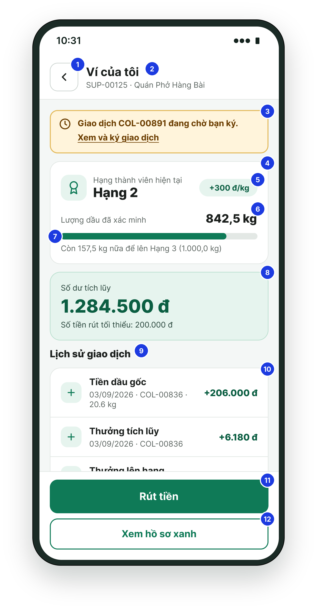
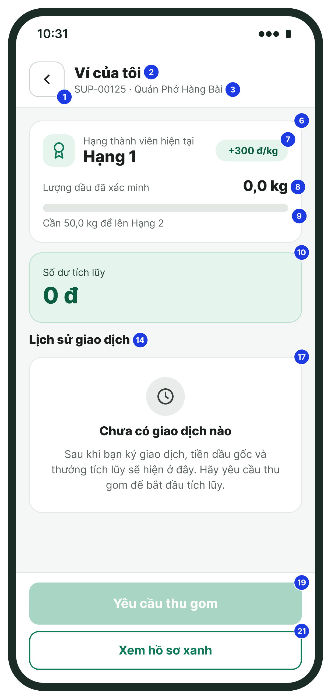

# Screen Spec: S-F05-01 Loyalty and payout balance

| Field             | Value |
| ----------------- | ----- |
| Screen ID         | S-F05-01 |
| Screen name       | Loyalty and payout balance (Vietnamese title: "Ví của tôi") |
| Actor             | Supplier |
| Priority          | Must |
| Feature           | F-05 Supplier Value & ESG / Green Profile |
| Use case          | UC-12 Manage loyalty status and accumulated payout balance |
| Activity diagrams | [AD-UC-12](../../activity/AD-UC-12.md) (open the Loyalty and Payout section; no withdrawal) |
| Mockup images     | `img/S-F05-01-default.png` (default), `img/S-F05-01-default-numbered.png`, four state images and four numbered state images (section 2) |
| Frame width       | 370px screen inside a 390 × 844 device frame, exported at 3x; state images are 1170 × 2532 pixels, numbered images are 1230 × 2592 pixels (30px transparent padding so that the number badges have room) |
| Figma frame       | Board "S-F05-01 · Loyalty and payout balance - 5 stages", five frames, one per state. The repository holds no Figma link for this board, so the images in `img/` are the reference |
| Status            | Draft |

**Scope change in this version.** The app has no connection to a bank, so the supplier **cannot withdraw money** here. The former screen "Payout withdrawal" (and its confirmation modal and "withdrawal requested" result) is removed. This screen only shows the accumulated balance, the loyalty tier, and whether each amount has been **received** (`Đã nhận`) or is **pending** (`Chờ nhận`).

## 1. Purpose

**Shown when:** the supplier taps the bottom navigation tab "Ví của tôi" on the supplier home (S-F00-02) or a link to the wallet, comes back from the transaction receipt (S-F03-02) or the Green Profile (S-F05-02), or taps "Xem lịch sử giao dịch" in the empty state of S-F03-01.

**The user leaves this screen when:** they tap the back button, tap a transaction row, tap "Xem và ký giao dịch" on the pending transaction banner, tap "Yêu cầu thu gom", tap "Xem hồ sơ xanh", or tap "Tải lại dữ liệu" after an error (the screen stays and reloads).

## 2. Mockup

**Numbered:** each number is the # of the element inventory in section 3. An element keeps the same number in every state.

| State | Numbers shown on the image |
| ----- | -------------------------- |
| Default | 1–4, 6–12, 14–16, 19, 21 |
| Empty | 1–3, 6–10, 14, 17, 19, 21 |
| Loading | 1–3, 6, 10, 14, 15, 18, 19 (6, 10, 14 and 15 on the skeleton blocks) |
| Error | 1–3, 5, 6, 8–10, 13, 20, 21 |
| Success | 1–3, 6–12, 14–16, 19, 21, 22 (the stray check mark at the top left is not an element and has no number; open question 4) |

In the Loading image, the number on a grey block names the element the block holds the place of; the block shows no data and cannot be tapped. The pending transaction banner (4) has no block.

| Default, numbered | Empty, numbered | Loading, numbered | Error, numbered | Success, numbered |
| --- | --- | --- | --- | --- |
|  |  |  |  |  |

| State   | Image |
| ------- | ----- |
| Default | [`img/S-F05-01-default.png`](img/S-F05-01-default.png) (has a transaction awaiting signature, COL-00891; one collection already paid in the history) |
| Empty   | [`img/S-F05-01-empty.png`](img/S-F05-01-empty.png) (new supplier, no signed transaction yet) |
| Loading | [`img/S-F05-01-loading.png`](img/S-F05-01-loading.png) |
| Error   | [`img/S-F05-01-error.png`](img/S-F05-01-error.png) (reward and balance data could not be loaded) |
| Success | [`img/S-F05-01-success.png`](img/S-F05-01-success.png) (data loaded again after the error; COL-00891 now counted) |

Colours, fonts and corners must follow the design tokens in [ui-conventions.md](../ui-conventions.md#6-design-tokens). Pixel check of the five state images: white `color/surface` matches; `#F4F7F6` matches `color/background`. Other large areas differ from the tokens, for example `#1B2B26` (token `color/ink` `#14231E`), `#E6F4EE` (`color/green-light` `#E6F6F1`), `#0F7A57` (`color/green-dark` `#0B7A5F`) and `#A9D6C4` (no close token). The tokens are the rule; the images need to be redrawn. The images are 1170 × 2532 pixels, while ui-conventions §6 states 1470 × 2832 pixels with a shadow margin.

## 3. Element inventory

Data field names are defined by this spec; the repository has no data dictionary.

| #  | Element | Type | Content / data source | Required | Validation |
| -- | ------- | ---- | --------------------- | -------- | ---------- |
| 1  | Back button | Icon button | chevron-left | Yes | none |
| 2  | Screen title | Header | static "Ví của tôi" | Yes | |
| 3  | Context line | Text | `supplier.id` · `supplier.business_name` (example: "SUP-00125 · Quán Phở Hàng Bài") | Yes | `SUP-` + 5 digits |
| 4  | Pending transaction banner | Warning banner | clock icon; title "Giao dịch " + `collection.id` + " đang chờ bạn ký."; link "Xem và ký giao dịch" | No | shown while at least one transaction awaits the signature |
| 5  | Error banner | Error banner | triangle icon; "Không tải được dữ liệu thưởng và số dư."; "Kiểm tra kết nối mạng và thử lại." | No | shown only in the error state |
| 6  | Tier card | Card | badge icon; label "Hạng thành viên hiện tại"; "Hạng " + `loyalty.tier` (example: "Hạng 1"); error: "Chưa có dữ liệu" with a grey icon | Yes | tier is a whole number |
| 7  | Tier bonus pill | Pill | "+" + `loyalty.bonus_per_kg` + " đ/kg" (example: "+300 đ/kg") | No | integer; unit "đ/kg"; hidden in the error state |
| 8  | Verified weight | Text row | label "Lượng dầu đã xác minh"; `loyalty.verified_weight` + " kg" (example: "25,5 kg"); error: "— kg" | Yes | 1 decimal with decimal comma (open question 9) |
| 9  | Tier progress | Progress bar + hint | bar = `loyalty.verified_weight` ÷ `loyalty.next_tier_threshold`; hint "Còn " + remaining + " kg nữa để lên Hạng " + next tier + " (" + threshold + " kg)"; empty: "Cần 50,0 kg để lên Hạng 2"; error: empty grey bar and "Chưa xác định tiến độ lên hạng" | Yes | 0–100 %; remaining = threshold − verified weight |
| 10 | Balance card | Metric card (primary) | label "Số dư tích lũy"; `wallet.balance` (example: "262.650 đ"); error: "— đ" in a white card | Yes | integer >= 0; `.` as thousands separator + " đ"; always equals 11 + 12 |
| 11 | Received amount | Metric | check icon + "Đã nhận"; `wallet.received_amount` (example: "255.000 đ") | No | integer >= 0; hidden in the empty and error states |
| 12 | Pending amount | Metric | clock icon + "Chờ nhận"; `wallet.pending_amount` (example: "7.650 đ"), amber | No | integer >= 0; hidden in the empty and error states |
| 13 | Balance helper text | Text | error only: "Chưa thể hiển thị số dư khi chưa tải được dữ liệu." (the mockup still shows an old sentence about withdrawing; open question 6) | No | static |
| 14 | History title | Section title | static "Lịch sử giao dịch" | No | hidden in the error state |
| 15 | Transaction row | List row | "+" icon; title `transaction.type_label` ("Tiền dầu gốc", "Thưởng tích lũy" or, for a tier upgrade bonus, "Thưởng lên hạng"); meta `transaction.date` · `collection.id` and, for "Tiền dầu gốc", · `collection.actual_quantity` + " kg"; amount "+" + `transaction.amount` + " đ" | No | `dd/MM/yyyy`; `COL-` + 5 digits; newest first |
| 16 | Payout status chip | Chip | `transaction.payout_status`: "✓ Đã nhận" (green) or "◷ Chờ nhận" (amber) | Yes, on every row | enum: received, pending |
| 17 | Empty history card | Empty state card | clock icon; "Chưa có giao dịch nào"; "Sau khi bạn ký giao dịch, tiền dầu gốc và thưởng tích lũy sẽ hiện ở đây. Hãy yêu cầu thu gom để bắt đầu tích lũy." | No | shown only when the supplier has no transaction |
| 18 | Loading text | Text | static "Đang tải số dư..." | No | shown only in the loading state |
| 19 | Yêu cầu thu gom | Primary button | static label | Yes | none; not tappable while loading |
| 20 | Tải lại dữ liệu | Primary button | static label; replaces button 19 in the error state | No | none |
| 21 | Xem hồ sơ xanh | Secondary button | static label | Yes | none; hidden while loading |
| 22 | Success toast | Toast | check icon + "Đã tải lại số dư tích lũy" (same pattern as "Đã tải lại hồ sơ xanh." on S-F05-02) | No | shown after a successful reload; dismisses after 4 seconds (ui-conventions §3); floats above the buttons and may cover the last visible history row |

## 4. States

| State | What the user sees | Trigger |
| ----- | ------------------ | ------- |
| Default | Header "Ví của tôi", "SUP-00125 · Quán Phở Hàng Bài". Amber banner "Giao dịch COL-00891 đang chờ bạn ký." with link "Xem và ký giao dịch". Tier card "Hạng 1", pill "+300 đ/kg", "25,5 kg", bar at 51 %, "Còn 24,5 kg nữa để lên Hạng 2 (50,0 kg)". Balance card "262.650 đ", "Đã nhận 255.000 đ", "Chờ nhận 7.650 đ". History: "Tiền dầu gốc · 18/09/2026 · COL-00836 · 25,5 kg · +255.000 đ" with chip "Đã nhận"; "Thưởng tích lũy · 18/09/2026 · COL-00836 · +7.650 đ" with chip "Chờ nhận". Buttons "Yêu cầu thu gom" and "Xem hồ sơ xanh". | Screen opened with data and at least one transaction awaiting the supplier's signature |
| Empty (no data) | No banner. Tier card "Hạng 1", pill "+300 đ/kg", "0,0 kg", empty bar, "Cần 50,0 kg để lên Hạng 2". Balance card "0 đ" without the two amounts. Title "Lịch sử giao dịch" and the empty card "Chưa có giao dịch nào". Buttons "Yêu cầu thu gom" (must be active, open question 7) and "Xem hồ sơ xanh". | The supplier has no signed transaction yet |
| Loading | Header (1–3) visible. Three grey skeleton blocks and one short grey bar: block for the tier card (6), block for the balance card (10), a bar for the history title (14), a block for the history list (15). Centred text "Đang tải số dư..." (18). Only one button, "Yêu cầu thu gom", greyed out (19). No banner, no figures. | Initial screen load, or "Tải lại dữ liệu" tapped, while fetching |
| Error | Red banner "Không tải được dữ liệu thưởng và số dư." / "Kiểm tra kết nối mạng và thử lại.". Grey tier card "Chưa có dữ liệu", "— kg", empty bar, "Chưa xác định tiến độ lên hạng". White balance card "— đ" and the helper text (13). No history. Buttons "Tải lại dữ liệu" and "Xem hồ sơ xanh". | Network connection lost or API timeout when fetching the wallet data |
| Success / confirmation | Toast "Đã tải lại số dư tích lũy" above the buttons (22). No pending banner. Tier card "Hạng 2", pill "+400 đ/kg" (the mockup shows "+400 đ/L"), "58 kg", bar at 58 %, "Còn 42 kg nữa để lên Hạng 3 (100,0 kg)". Balance card "597.400 đ", "Đã nhận 580.000 đ", "Chờ nhận 17.400 đ" (the mockup shows 17.000 đ). History, newest first: "Tiền dầu gốc · 25/09/2026 · COL-00891 · 32,5 kg · +325.000 đ" with chip "Đã nhận"; "Thưởng tích lũy · 25/09/2026 · COL-00891 · +9.750 đ" with chip "Chờ nhận"; "Tiền dầu gốc · 18/09/2026 · COL-00836 · 25,5 kg · +255.000 đ" with chip "Đã nhận", partly covered by the toast; the fourth row (COL-00836 "Thưởng tích lũy", see the sample data check) is below and reached by scrolling. Buttons "Yêu cầu thu gom" and "Xem hồ sơ xanh". | The supplier tapped "Tải lại dữ liệu" in the error state and the data loaded |

**Sample data check:**
- Default: 255.000 + 7.650 = 262.650 đ; 25,5 kg × 10.000 đ = 255.000 đ; 25,5 kg × 300 đ = 7.650 đ.
- Success: balance 262.650 + 334.750 = 597.400 đ (334.750 = 325.000 for COL-00891 + 9.750 bonus, as on S-F00-02); verified weight 25,5 + 32,5 = 58,0 kg; "Đã nhận" 255.000 + 325.000 = 580.000 đ; "Chờ nhận" 7.650 + 9.750 = **17.400 đ**. The mockup shows 17.000 đ (open question 4).
- History rows for Success, newest first: COL-00891 "Tiền dầu gốc" +325.000 đ "Đã nhận"; COL-00891 "Thưởng tích lũy" +9.750 đ "Chờ nhận"; COL-00836 "Tiền dầu gốc" +255.000 đ "Đã nhận"; COL-00836 "Thưởng tích lũy" +7.650 đ "Chờ nhận". The first three are drawn in the Success image; the fourth is not visible in the image (hidden below the toast and the button area). Row sums match the card: Đã nhận 325.000 + 255.000 = 580.000 đ; Chờ nhận 9.750 + 7.650 = 17.400 đ.

## 5. Interactions and navigation

Target Screen IDs were checked against [screen-list.md](../screen-list.md) and [screen-transition.md](../screen-transition.md). Withdrawal is removed, so no interaction leads to a withdrawal screen.

| #  | Element | User action | System response | Goes to screen |
| -- | ------- | ----------- | --------------- | -------------- |
| 1  | Back button (1) | tap | Returns to the previous screen; if there is none, opens the supplier home | previous screen, or S-F00-02 |
| 2  | "Xem và ký giao dịch" in banner 4 | tap | Opens the signing screen for the pending transaction `COL-00891` | S-F03-01 |
| 3  | Yêu cầu thu gom (19) | tap | Opens the pickup request form | S-F01-03 |
| 4  | Xem hồ sơ xanh (21) | tap | Opens the supplier's Green Profile | S-F05-02 |
| 5  | Tải lại dữ liệu (20) | tap | Re-fetches the wallet data | stays (loading, then default, empty, success or error state) |
| 6  | Balance card (10), tier card (6), chips (16) | tap | Display only; nothing can be changed or withdrawn from here | stays |
| 7  | Transaction row (15) | tap | Opens the receipt of the signed transaction of that row | S-F03-02 |
| 8  | Screen body | pull down | Re-fetches the data and shows the Loading state (open question 5) | stays |

## 6. Screen-level rules

| Rule ID | Rule | Source |
| ------- | ---- | ------ |
| SR-001 | The supplier only sees the balance, tier and transactions that belong to their own `supplier.id`. | FR-06-04 |
| SR-002 | Balance, verified UCO volume, tier and bonus change only after a transaction is signed; the screen displays the values the system returns and never calculates money itself. Warehouse verification does not change the balance. | FR-05-03, FR-05-04, FR-05-05, FR-05-06; S-F03-02 SR-003 |
| SR-003 | The screen is read-only. It has no withdrawal button, no bank account field and no bank connection. | Scope change (no bank API) |
| SR-004 | `wallet.balance` = `wallet.received_amount` + `wallet.pending_amount`. Each transaction has exactly one `payout_status`: received or pending. The status is set by the system; the supplier cannot change it here. | Screen design |
| SR-005 | The pending transaction banner (4) stays above the tier card until the transaction is signed. | Screen design |
| SR-006 | If fetching fails, the screen never shows zeros in place of real figures: it shows "—", "Chưa có dữ liệu" and the error banner (5). | Offline resilience convention |
| SR-007 | While loading, skeleton blocks keep the layout of the loaded screen, show one line of loading text, cannot be tapped, and the buttons cannot be used. | ui-conventions §3 (Skeleton) |
| SR-008 | In the Empty state "Yêu cầu thu gom" stays active so the first booking can be made from this screen. | Screen design |
| SR-009 | Status banners and chips use an icon + text, never colour alone (✓ Đã nhận, ◷ Chờ nhận, clock, triangle, check). | ui-conventions §5 |

## 7. Linked requirements

FR IDs and the function names in quotes are copied from [w1-function-list.md](../../function-list/w1-function-list.md).

| FR ID | What this screen does for it |
| ----- | ---------------------------- |
| FR-05-01 "Retrieve Loyalty Tier & Payout Balance" | Shows the supplier's loyalty tier, the progress to the next tier and the accumulated payout balance |
| FR-05-02 "Display Loyalty Tier & History Details" | Shows the current tier, verified UCO volume, progress and the itemized base-payment, loyalty-bonus and tier-upgrade-bonus history directly on the screen (open question 17) |
| FR-05-03 "Add signed transaction payment to payout balance" / FR-05-04 "Add signed transaction quantity to verified UCO volume" / FR-05-05 "Upgrade loyalty tier" | Displays the balance, verified volume and tier after a signed transaction (display only) |
| FR-05-06 "Award tier upgrade bonus" | Displays the tier upgrade bonus in the history when the system returns it (open question 12) |
| FR-06-04 "Check role permission for protected action" | Opens only for a role that has the supplier permission |

**Related functions, entry only** (carried out on the target screen): FR-01-11 "Validate pickup location, estimated volume and time window" (pickup form, S-F01-03), FR-03-01 "Retrieve supplier draft agreement" (S-F03-01), FR-03-11 "Check receipt ownership and signed status" (S-F03-02), FR-05-07 "View Green Profile and UCO contribution history" (S-F05-02). W1 has no payout withdrawal function.

## 8. Responsive and accessibility notes

- Designed on a 370 × 824 screen inside a 390 × 844 device frame; smallest supported width 360 px; the two amounts "Đã nhận" and "Chờ nhận" stay in two equal columns; values do not truncate.
- Vertical scroll is enabled when the banner and the history make the content longer than the screen; the button area stays fixed at the bottom.
- Touch targets at least 44 × 44 (ui-conventions §5): back button, both buttons; the inline link "Xem và ký giao dịch" needs extra vertical padding to reach a 44px hit area.
- Banners and chips use different icons alongside the text: clock (pending banner, "Chờ nhận"), triangle (error), check ("Đã nhận", toast); text contrast at least 4.5:1, including amber text on the amber chip (ui-conventions §5).

## 9. Open questions

"Closed (source)" is settled by a repository document. "Closed for this spec" applies a design default so that the spec has no gap; the team or client has not confirmed it, and the last column says what is still to be done.

| # | Question | Blocking? | Status and decision |
| - | -------- | --------- | ------------------- |
| 1 | Does the removal of the withdrawal screen change the Function List, Screen List and numbering? | No | Closed (source). W1, the Screen List and the Screen Transition have no withdrawal and use S-F05-02 Green Profile and S-F05-03 ESG contribution reports. Still to update: usage-flow.md, activity-index.md, use-case-diagram.md and the "Rút tiền" examples in ui-conventions.md. |
| 2 | Who sets "Đã nhận" / "Chờ nhận", and when? | No | Closed for this spec. ADR-003: the finance team pays outside the app. The supplier only reads `transaction.payout_status`. No W1 FR records the payment status, and AD-UC-12 question 1 covers this gap; the W1 owner needs to confirm who updates it. |
| 3 | Is "base amount received, bonus pending" a rule? | No | Closed for this spec: it is sample data only; the status is stored per transaction. |
| 4 | The Success mockup shows "Chờ nhận 17.000 đ", the pill "+400 đ/L" and a stray check mark; the toast covers part of the history. | No | Closed for this spec: the correct values are 17.400 đ and "+400 đ/kg" (ui-conventions §2), with no stray check mark. The toast stays and the list scrolls under it. The image still needs to be redrawn. |
| 5 | Is there a pull-to-refresh? | No | Closed for this spec: yes, pull down re-fetches and shows the Loading state. |
| 6 | The Error mockup helper text mentions withdrawing money. | No | Closed (source: no withdrawal, AD-UC-12). The text is "Chưa thể hiển thị số dư khi chưa tải được dữ liệu." The image still needs to be redrawn. |
| 7 | In the Empty mockup "Yêu cầu thu gom" is greyed out. | No | Closed for this spec: the button is active (SR-008). The image still needs to be redrawn. |
| 8 | The Loading mockup does not match the loaded layout. | No | Closed (source: ui-conventions §3 Skeleton, same layout as the loaded screen). The image still needs to be redrawn. |
| 9 | Success shows "58 kg". | No | Closed (source: ui-conventions §2). The format is "58,0 kg"; likewise "42,0 kg" in the progress hint. The image still needs to be redrawn. |
| 10 | Which comes first for a collection: signature or warehouse verification? | No | Closed (source). Signature first: FR-04-01 receives only UCO whose transaction has been signed. The names of the warehouse states after "Received" are still open (W3 D-08). |
| 11 | What does banner 4 show when two or more transactions await the signature? | No | Closed for this spec: as on S-F00-02, the count and the oldest transaction. |
| 12 | Which bonus rate applies to COL-00891, and where is the tier upgrade bonus? | No | Closed for this spec. FR-05-03 adds the locked bonus of the signed transaction (9.750 đ = 32,5 kg × 300 đ). A tier upgrade bonus (FR-05-06) appears as its own row when returned. The sample data contains none, and its amount and the BR-05 thresholds are not defined in the repository; the screen shows what the system returns. |
| 13 | Which screen ID do the Green Profile links on S-F00-02 use? | No | Closed (source: Screen List). S-F05-02. screen-spec-S-F00-02.md still points to S-F05-03 and needs to be corrected. |
| 14 | Do the mockup colours match the design tokens? | No | Closed: checked, not passed (section 2). Redraw the images with the tokens. |
| 15 | What does tapping a transaction row do? | No | Closed (source). It opens the receipt S-F03-02 (Screen Transition "History: View receipt"; Screen List entry point of S-F03-02). |
| 16 | The frames have no bottom navigation, and ui-conventions §3 names the third tab "Tích lũy". | No | Closed for this spec: no tab bar, as in the mockups; the tab is called "Ví của tôi", as on S-F00-02. ui-conventions §3 needs to be aligned. |
| 17 | FR-05-02 starts with "View tier and history details", but no such control is drawn. | No | Closed for this spec: the details are shown directly on this screen. The W1 owner needs to confirm. |
| 18 | ui-conventions §4 has a "Balance not updated" banner and another empty-list text for this screen. | No | Closed for this spec: the five mockup states and their texts are kept; the "Balance not updated" banner is not part of this version. The team needs to align ui-conventions §4 or the mockups. |

---

## Completion checklist

- [x] The mockup is a separate cropped image file, named with the Screen ID, at the frame width (`img/S-F05-01-<state>.png`).
- [x] The numbered images exist for all five states, and their numbers match the # column of the element inventory.
- [ ] Every visible element in the mockup appears in the element inventory. **Checked, not passed:** the Success image has a stray check mark (open question 4).
- [ ] Every colour in the mockup is a design token from ui-conventions.md. **Checked, not passed:** see section 2.
- [x] Every input element has a validation rule or an explicit "none".
- [x] All five states are filled in.
- [x] Every navigation target is a Screen ID that exists in the Screen List (S-F00-02, S-F01-03, S-F03-01, S-F03-02, S-F05-02).
- [x] Every element that displays data names the field it displays.
- [x] Every linked FR exists in the Function List.
