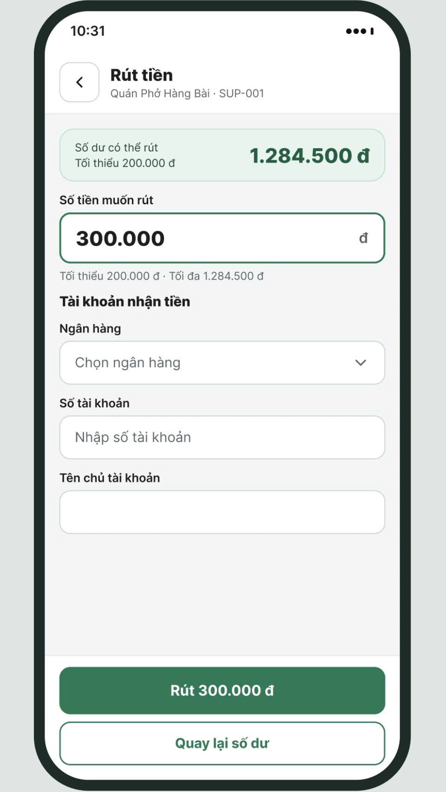

# Screen Spec: S-F05-02 Payout withdrawal

| Field | Value |
|---|---|
| Screen ID | S-F05-02 |
| Screen name | Payout withdrawal |
| Actor | Supplier |
| Priority | Should |
| Feature | F-05 Supplier Value & ESG / Green Profile |
| Activity diagrams | AD-UC-13 (actions "Submit withdrawal request", "Validate withdrawal eligibility"); AD-UC-12 (actions "Request balance withdrawal", "See existing balance & withdrawal rejection reason", "See withdrawal result & updated payout status and balance") |
| Mockup image | `img/S-F05-02.png` |
| Status | Draft |

## 1. Purpose

**Shown when:** the supplier taps "Rút số dư" on S-F05-01 to withdraw part or all of the accumulated payout balance.

**The user leaves this screen when:** the withdrawal request is created (success state, then "Về số dư tích lũy"), or the supplier taps "Quay lại số dư" or Back without creating a request.

## 2. Mockup

## 3. Element inventory

| # | Element | Type | Content / data source | Required | Validation |
|---|---|---|---|---|---|
| 1 | Back | Button | static | Yes | none |
| 2 | Title | Header | static: "Rút tiền" | Yes | |
| 3 | Supplier subtitle | Text | `supplier.business_name` · `supplier.id` (e.g., "Quán Phở Hàng Bài · SUP-001") | Yes | `SUP-` + 3 digits |
| 4 | Message banner | Banner | Empty state: "Số dư chưa đủ để rút." + "Số dư 120.000 đ thấp hơn mức rút tối thiểu 200.000 đ."; Error state: "Chưa tạo được yêu cầu rút tiền." + "Mất kết nối khi gửi yêu cầu. Số dư chưa bị trừ. Kiểm tra mạng và thử lại." or "Hồ sơ của bạn chưa được xác minh." | No | |
| 5 | Verification link | Link | static: "Hoàn thiện hồ sơ" (shown only with the "chưa được xác minh" message) | No | 44 px high touch target |
| 6 | Balance card | Card | "Số dư có thể rút" + `payout_balance.accumulated` (format: integer with thousand separator + `đ`, e.g., "1.284.500 đ"); "Tối thiểu " + `config.min_withdrawal` (e.g., "200.000 đ") | Yes | `>= 0` |
| 7 | Amount label | Label | static: "Số tiền muốn rút" | Yes | |
| 8 | Amount input | Number input | `withdrawal.amount` (displayed with thousand separator, suffix "đ", e.g., "300.000") | Yes | integer; `>= config.min_withdrawal`; `<= payout_balance.accumulated`; disabled when the balance is below the minimum |
| 9 | Amount helper | Text | "Tối thiểu 200.000 đ · Tối đa " + `payout_balance.accumulated` (e.g., "1.284.500 đ") | Yes | |
| 10 | Bank section header | Subheader | static: "Tài khoản nhận tiền" | Yes | |
| 11 | Bank dropdown | Dropdown | label "Ngân hàng"; placeholder "Chọn ngân hàng"; `bank_account.bank_name` | Yes | one bank from the list |
| 12 | Account number input | Text input | label "Số tài khoản"; placeholder "Nhập số tài khoản"; `bank_account.number` | Yes | digits only; length to be confirmed (open question 3) |
| 13 | Account holder input | Text input | label "Tên chủ tài khoản"; placeholder "Nhập tên không dấu"; `bank_account.holder_name`; helper "Nhập đúng tên như trên thẻ ngân hàng." | Yes | letters and spaces, without diacritics, not empty |
| 14 | Withdraw button | Primary button | "Rút " + amount (e.g., "Rút 300.000 đ") when valid; "Rút tiền" when disabled; "Thử lại rút 300.000 đ" (Error state) | Yes | disabled until amount and the three bank fields are valid; disabled in Empty and Loading |
| 15 | Back button | Secondary button | static: "Quay lại số dư" | Yes | |
| 16 | Loading skeletons | Skeleton | grey placeholders for balance card, amount field and bank fields; text "Đang tải thông tin rút tiền…" (Loading state only) | No | mirror the Default layout |
| 17 | Success card | Card | check icon + "Đã tạo yêu cầu rút tiền" + "Số dư của bạn đã được trừ " + amount + ". Bạn có thể theo dõi trạng thái trong lịch sử giao dịch." (Success state only) | No | |
| 18 | Summary card | Card | rows: "Số tiền rút" `withdrawal.amount`; "Tài khoản nhận" `bank_name · account number`; "Chủ tài khoản" `holder_name`; "Thời điểm tạo" `withdrawal.created_at` (format `HH:mm · dd/MM/yyyy`); "Trạng thái" badge `withdrawal.status`; "Số dư còn lại" `payout_balance.accumulated` (Success state only) | No | |
| 19 | Status badge | Badge | "Đã tạo yêu cầu" (Created) with icon | No | text + icon, never color alone |
| 20 | Back to balance button | Primary button | static: "Về số dư tích lũy" (Success state only) | No | |
| 21 | Confirm modal | Modal | title "Xác nhận rút tiền?"; text "Kiểm tra lại thông tin trước khi tạo yêu cầu rút tiền."; summary rows "Số tiền rút", "Ngân hàng", "Số tài khoản", "Chủ tài khoản", "Số dư còn lại"; Primary "Xác nhận rút " + amount; Secondary "Quay lại" | Yes | opens on every valid tap of the Withdraw button |

## 4. States

| State | What the user sees | Trigger |
|---|---|---|
| Default (1/5) | Balance card, amount field (focused, e.g., "300.000"), the bank section with "Ngân hàng", "Số tài khoản" and "Tên chủ tài khoản", the Withdraw button and "Quay lại số dư". The Withdraw button becomes enabled only when every field is valid. | Screen opened from S-F05-01 with a balance at or above the minimum |
| Empty (2/5) | Amber banner "Số dư chưa đủ để rút. Số dư 120.000 đ thấp hơn mức rút tối thiểu 200.000 đ."; amount and bank fields disabled and empty; "Rút tiền" disabled | The balance is below the minimum withdrawal (rejection reason of AD-UC-12) |
| Loading (3/5) | Grey skeletons of the balance card and the form, text "Đang tải thông tin rút tiền…", disabled "Rút tiền" | Balance and eligibility are being fetched |
| Error (4/5) | Red banner "Chưa tạo được yêu cầu rút tiền. Mất kết nối khi gửi yêu cầu. Số dư chưa bị trừ. Kiểm tra mạng và thử lại."; the form keeps the entered values; primary button becomes "Thử lại rút 300.000 đ". Second error: "Hồ sơ của bạn chưa được xác minh." with link "Hoàn thiện hồ sơ" (BR-PAY-02) | The request failed, or the supplier is not verified |
| Success / confirmation (5/5) | Check mark, "Đã tạo yêu cầu rút tiền", summary card (amount, account, holder, created time, badge "Đã tạo yêu cầu", remaining balance) and the button "Về số dư tích lũy" | Withdrawal Transaction created in state Created and the balance deducted (FR-05-02) |

## 5. Interactions and navigation

| # | Element | User action | System response | Goes to screen |
|---|---|---|---|---|
| 1 | Back / Quay lại số dư | tap | Returns without creating a request | S-F05-01 |
| 2 | Amount input | type | Formats with thousand separators; shows the message "Số tiền rút tối thiểu là 200.000 đ. Vui lòng nhập số tiền hợp lệ." or "Số tiền rút không được vượt quá số dư." when invalid; updates the button label | stays |
| 3 | Bank dropdown | tap | Opens the bank list; selecting one fills the field | stays |
| 4 | Account number, Account holder inputs | type | Validates the value | stays |
| 5 | Rút 300.000 đ | tap (valid) | Opens the modal "Xác nhận rút tiền?" | stays (modal) |
| 6 | Rút 300.000 đ | tap (invalid) | Not tappable while disabled; invalid fields show their message | stays |
| 7 | Xác nhận rút 300.000 đ (modal) | tap | Creates the Withdrawal Transaction in state Created, deducts the balance and updates the payout status (FR-05-02); shows the Success state, or the Error / Empty state when rejected | stays (success or error state) |
| 8 | Quay lại (modal) | tap | Closes the modal; nothing is created | stays |
| 9 | Thử lại rút 300.000 đ | tap (Error state) | Sends the request again | stays |
| 10 | Hoàn thiện hồ sơ | tap (not-verified message) | Opens the supplier profile | S-F01-02 |
| 11 | Về số dư tích lũy | tap (Success state) | Opens the balance with the toast "Đã tạo yêu cầu rút tiền." | S-F05-01 |

## 6. Screen-level rules

| Rule ID | Rule | Source |
|---|---|---|
| SR-001 | The amount must be at least the minimum withdrawal (200.000 đ) and at most the accumulated balance. | BR-05, BR-PAY-01 |
| SR-002 | Only a verified supplier can withdraw; otherwise the request is rejected with the reason shown. | BR-PAY-02 |
| SR-003 | The Withdraw button is enabled only when the amount and all three bank fields are valid. | FR-05-02 |
| SR-004 | Every request goes through the confirmation modal "Xác nhận rút tiền?" before it is created. | Screen List (modals); ui-conventions §3 |
| SR-005 | On success the Withdrawal Transaction is created in state Created, the balance is reduced by the amount and the payout status is updated. If creation fails, the balance does not change. | AD-UC-12, AD-UC-13 (FR-05-02) |
| SR-006 | Rejected attempts are recorded by the system and the supplier sees the reason. | SD-UC-13 |
| SR-007 | The screen records the withdrawal request only; the actual bank transfer is outside ReFeed Release 1. | ADR-003, W0 |
| SR-008 | Error messages state what is wrong and the valid rule. | ui-conventions §4 |
| SR-009 | Status is shown with text and icon, never by colour alone. | ui-conventions §5 |
| SR-010 | The Primary button label names the action and the amount; no generic "OK" or "Submit". | ui-conventions §1 |

## 7. Linked requirements

| FR ID | What this screen does for it |
|---|---|
| FR-05-02 | Collects the amount and bank details, validates eligibility, creates the withdrawal transaction and shows the updated status and balance |
| FR-05-01 | Shows the accumulated balance used for validation and the balance after the withdrawal |
| FR-06-03 | Restricts the balance and data to the signed-in supplier |

## 8. Responsive and accessibility notes

- Designed at 390 × 844; smallest supported width 360 px. The content scrolls and the footer buttons stay fixed.
- Touch targets at least 44 × 44: back button 44 × 44, inputs 48 px high (amount 56 px), dropdown 48 px, footer buttons 52 px and 48 px.
- Each input has a visible label above it, not only a placeholder.
- Error and rejection banners use an icon and a distinct border, not colour alone; the disabled fields keep their labels.
- Body text contrast at least 4.5:1.

## 9. Open questions

| # | Question | Blocking? | Status |
|---|---|---|---|
| 1 | [NEEDS CLARIFICATION: the Default mockup shows empty bank fields with an enabled "Rút 300.000 đ" button. By SR-003 the button must be disabled until all fields are valid.] | No | Open. Default: follow SR-003; update the mockup. |
| 2 | [NEEDS CLARIFICATION: is the bank account entered every time, or saved and pre-filled for the next withdrawal?] | No | Open. Default: entered every time. |
| 3 | [NEEDS CLARIFICATION: the bank list source and the account number length are not defined.] | No | Open. Default: a fixed list of banks; digits only, 6–19 digits. |
| 4 | [NEEDS CLARIFICATION: minimum withdrawal. AD-UC-13 uses 200.000 VND; W5 handover question 3 asks about 100.000 VND.] | No | Open. Default: 200.000 đ. |
| 5 | [NEEDS CLARIFICATION: withdrawal fees (AD-UC-12 and AD-UC-13 open question).] | No | Open. Default: no fee is shown. |
| 6 | [NEEDS CLARIFICATION: AD-UC-12 "Screens touched" calls S-F05-02 a "Withdrawal Request Modal", and AD-UC-13 still cites SCR-SUPP-05 / SCR-SUPP-06. The Screen List defines S-F05-02 as a screen with the modal "Confirm withdrawal".] | No | Open. Default: follow the Screen List; update both AD files. |

---

## Completion checklist

- [x] The mockup is a separate cropped image file, named with the Screen ID (`img/S-F05-02.png`).
- [x] Every visible element across all 5 states appears in the element inventory.
- [x] Every input/action element has a validation rule or an explicit state behavior.
- [x] All five states (Default, Empty, Loading, Error, Success) are filled in.
- [x] Every navigation target is a Screen ID that exists in the Screen List.
- [x] Every element that displays data names the field it displays.
- [x] Every linked FR exists in the Function List, and every action of this screen in AD-UC-12 and AD-UC-13 is covered by an interaction row.
