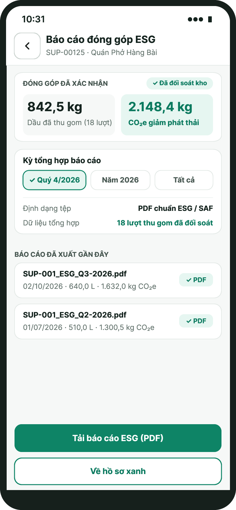
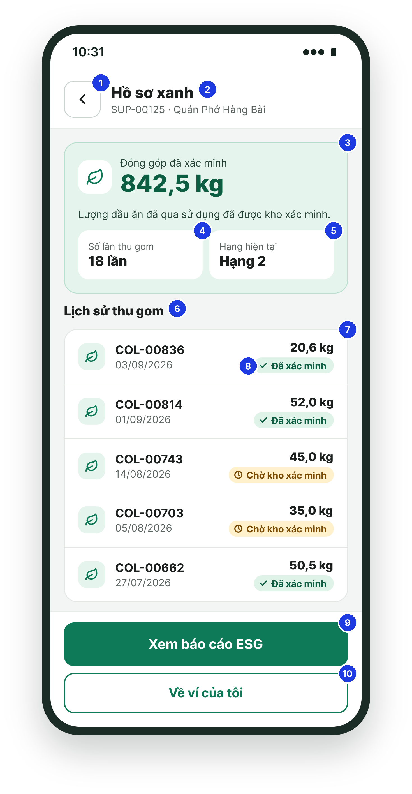
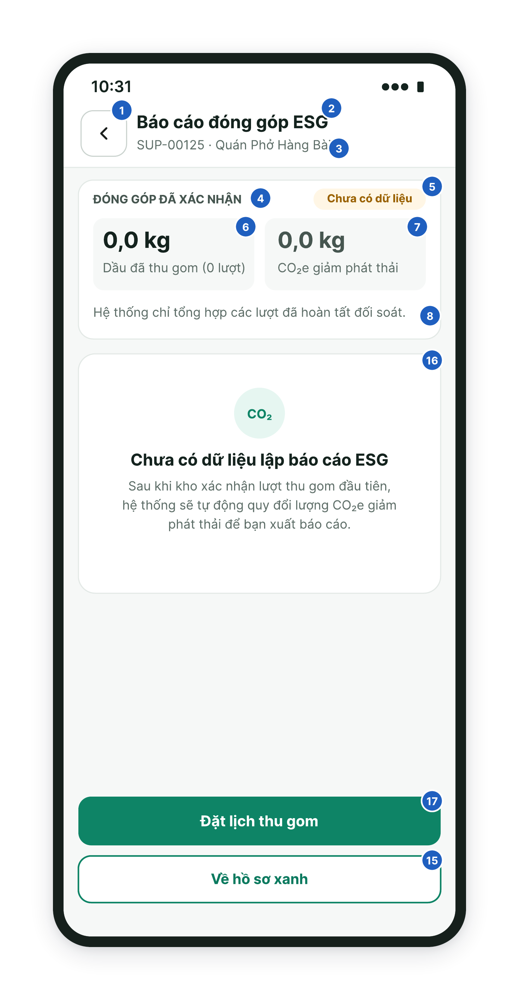
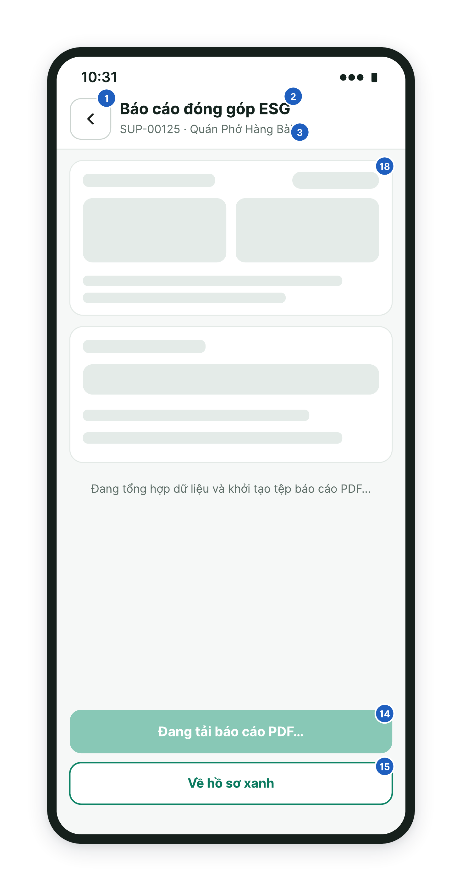
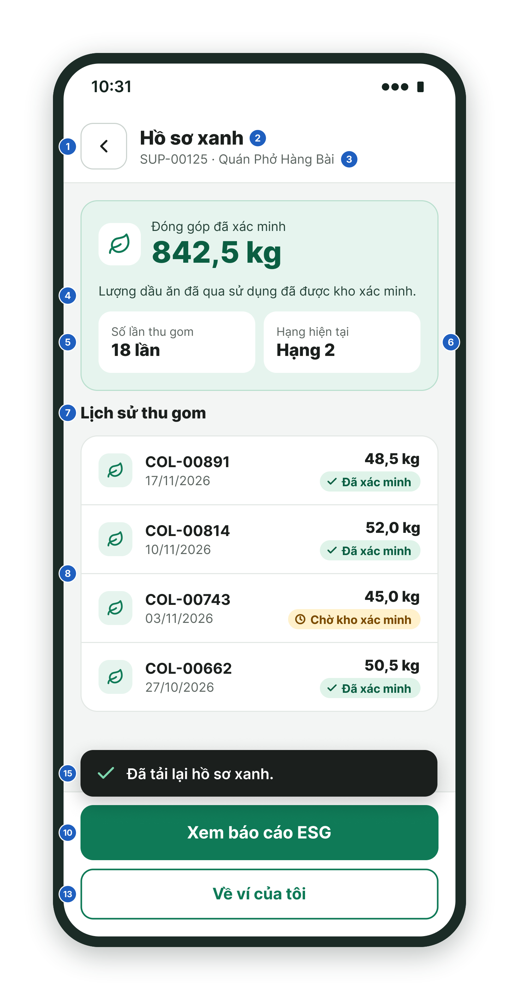

# Screen Spec: S-F05-03 Green Profile

| Field | Value |
|---|---|
| Screen ID | S-F05-03 |
| Screen name | Green Profile |
| Actor | Supplier |
| Priority | Could |
| Feature | F-05 Supplier Value & ESG / Green Profile |
| Activity diagrams | None: the usage flow marks UC-14 as a read-only query, no activity diagram needed |
| Mockup images | `img/S-F05-03-default.png`, `img/S-F05-03-default-numbered.png`, four other state images and their numbered versions (section 2) |
| Frame width | 370px screen inside a 390 × 844 device frame, exported at 3x with a 50px shadow margin, 1470 × 2832 pixels |
| Figma frame | Frames "S-F05-03 / 1" to "S-F05-03 / 5" in the ReFeed Figma file |
| Status | Draft |

## 1. Purpose

**Shown when:** the supplier opens "Xanh" in the bottom bar or the UCO-delivered card of S-F00-02, or taps "Xem hồ sơ xanh" on S-F05-01, to see the verified UCO contribution and the collection history.

**The user leaves this screen when:** the supplier taps "Xem báo cáo ESG" (S-F05-04), "Về ví của tôi" (S-F05-01), "Yêu cầu thu gom" in the Empty state (S-F01-03), or Back.

## 2. Mockup

**Numbered:** each number is the # of the element inventory in section 3. A number stays the same in every state. Element 9 is the primary button in every state: "Xem báo cáo ESG" (Default, Loading, Success), "Yêu cầu thu gom" (Empty) and "Tải lại hồ sơ xanh" (Error). The list (7) and its verification badges (8) appear in the Default and Success states; element 11 (Error banner) appears only in the Error state; 12 (Empty history card) only in the Empty state; 13 (Loading text) only in the Loading state; 14 (Toast) only in the Success state. The Loading image numbers the header (1, 2), the loading text (13) and the disabled primary button (9); grey skeleton blocks stand in place of elements 3 to 8.

| Default, numbered | Empty, numbered | Loading, numbered | Error, numbered | Success, numbered |
| --- | --- | --- | --- | --- |
|  |  |  |  |  |

| State | Image |
|---|---|
| Default | [`img/S-F05-03-default.png`](img/S-F05-03-default.png) (842,5 kg, 18 lần, Hạng 2, five collections) |
| Empty | [`img/S-F05-03-empty.png`](img/S-F05-03-empty.png) (new supplier) |
| Loading | [`img/S-F05-03-loading.png`](img/S-F05-03-loading.png) |
| Error | [`img/S-F05-03-error.png`](img/S-F05-03-error.png) |
| Success | [`img/S-F05-03-success.png`](img/S-F05-03-success.png) (reloaded after an error) |

Colours, fonts and corners follow the design tokens in [ui-conventions.md](../ui-conventions.md#6-design-tokens). A pixel check found shades that are not in the token table (open question 7).

## 3. Element inventory

Data field names are proposed; align them with the data dictionary.

| # | Element | Type | Content / data source | Required | Validation |
|---|---|---|---|---|---|
| 1 | Back | Icon button | static chevron icon | Yes | none |
| 2 | Title and context line | Header | static "Hồ sơ xanh"; `supplier.id` · `supplier.business_name` (example: "SUP-00125 · Quán Phở Hàng Bài") | Yes | `SUP-` + 5 digits |
| 3 | Contribution card | Card | leaf icon; label "Đóng góp đã xác minh"; `green_profile.verified_volume` (example: "842,5 kg"); note "Lượng dầu ăn đã qua sử dụng đã được kho xác minh." | Yes | `>= 0`; 1 decimal + " kg"; "— kg" in Error |
| 4 | Collection count tile | Stat tile | label "Số lần thu gom" + `green_profile.collection_count` (example: "18 lần") | Yes | integer `>= 0`; "—" in Error |
| 5 | Current tier tile | Stat tile | label "Hạng hiện tại" + `loyalty.tier` (example: "Hạng 2") | Yes | whole number; "—" in Error |
| 6 | History header | Subheader | static: "Lịch sử thu gom" | Yes | |
| 7 | Collection list | List | rows: leaf icon + `collection.id` + `collection.date` + `collection.actual_quantity` | Yes | `COL-` + 5 digits; `dd/MM/yyyy`; 1 decimal + " kg"; newest first; row at least 44 px high |
| 8 | Verification badge | Status badge (in each row of 7) | "Đã xác minh" (check icon) or "Chờ kho xác minh" (clock icon) from `collection.warehouse_status` | Yes | text + icon, never colour alone |
| 9 | Primary button | Primary button | "Xem báo cáo ESG" (Default, Loading, Success); "Yêu cầu thu gom" (Empty); "Tải lại hồ sơ xanh" (Error) | Yes | disabled in Loading |
| 10 | Về ví của tôi | Secondary button | static label | Yes | not shown in Loading |
| 11 | Error banner | Banner | warning icon + "Không tải được hồ sơ xanh." + "Kiểm tra kết nối mạng và thử lại." (Error only) | No | |
| 12 | Empty history card | Empty state card | leaf icon + "Chưa có lần thu gom nào được xác minh" + "Sau khi kho xác minh, các lần thu gom của bạn sẽ hiện ở đây." (Empty only) | No | |
| 13 | Loading text | Text | static: "Đang tải hồ sơ xanh..." (Loading only) | No | |
| 14 | Refresh toast | Toast | check icon + "Đã tải lại hồ sơ xanh." (Success only) | No | auto-dismisses after 4 seconds |

## 4. States

| State | What the user sees | Trigger |
|---|---|---|
| Default (1/5) | Contribution card "842,5 kg", tiles "18 lần" and "Hạng 2", "Lịch sử thu gom" with COL-00836 (03/09/2026, 20,6 kg, Đã xác minh), COL-00814 (01/09/2026, 52,0 kg, Đã xác minh), COL-00743 (14/08/2026, 45,0 kg, Chờ kho xác minh), COL-00703 (05/08/2026, 35,0 kg, Chờ kho xác minh) and COL-00662 (27/07/2026, 50,5 kg, Đã xác minh); "Xem báo cáo ESG" and "Về ví của tôi". The mockup shows this state. | Screen opened, data loaded |
| Empty (2/5) | Contribution card "0,0 kg", tiles "0 lần" and "Hạng 1", card "Chưa có lần thu gom nào được xác minh", primary button "Yêu cầu thu gom" and "Về ví của tôi" | The supplier has no verified collection yet |
| Loading (3/5) | Grey skeletons of the contribution card, the history header and the list, text "Đang tải hồ sơ xanh...", disabled "Xem báo cáo ESG"; no "Về ví của tôi" | Contribution and history are being fetched |
| Error (4/5) | Red banner "Không tải được hồ sơ xanh. Kiểm tra kết nối mạng và thử lại."; "— kg" and "—" in the card and tiles; no history; "Tải lại hồ sơ xanh" and "Về ví của tôi" | The request failed (network or server) |
| Success / confirmation (5/5) | Contribution card "875 kg", tiles "19 lần" and "Hạng 2"; list starts with COL-00891 (25/09/2026, 48,5 kg, Đã xác minh), then COL-00814 (30/08/2026), COL-00743, COL-00703, COL-00662; toast "Đã tải lại hồ sơ xanh." above the buttons | The supplier taps "Tải lại hồ sơ xanh" and the data loads. The screen is read-only, so this is its only confirmation. |

## 5. Interactions and navigation

| # | Element | User action | System response | Goes to screen |
|---|---|---|---|---|
| 1 | Back (1) | tap | Returns to the previous screen | S-F05-01 or the caller (S-F00-02) |
| 2 | Primary button (9), "Xem báo cáo ESG" | tap | Opens the ESG contribution reports | S-F05-04 |
| 3 | Về ví của tôi (10) | tap | Opens the loyalty and payout balance | S-F05-01 |
| 4 | Primary button (9), "Yêu cầu thu gom" | tap (Empty) | Opens the pickup request form | S-F01-03 |
| 5 | Primary button (9), "Tải lại hồ sơ xanh" | tap (Error) | Fetches the data again; shows Loading, then Default with the toast, or Error | stays |
| 6 | Collection list (7) | scroll | Shows older collections | stays |

## 6. Screen-level rules

| Rule ID | Rule | Source |
|---|---|---|
| SR-001 | The supplier sees only their own contribution and collections (`supplier.id`). | FR-06-03 |
| SR-002 | The screen is read-only: no value can be edited. | FR-05-03 |
| SR-003 | The history shows collections newest first, each with its warehouse verification status. | FR-05-03 |
| SR-004 | Verification status is shown with text and icon, never by colour alone. | ui-conventions §5 |
| SR-005 | "Đóng góp đã xác minh" equals the verified volume on S-F05-01, so both screens show the same figure. | FR-05-01, FR-05-03 |
| SR-006 | The toast disappears after 4 seconds. | ui-conventions §3 |
| SR-007 | Volumes use 1 decimal and kg; dates use `dd/MM/yyyy`; collection IDs use `COL-` + 5 digits. | ui-conventions §2 |
| SR-008 | At most one Primary button on the screen. | ui-conventions §3 |

## 7. Linked requirements

| FR ID | What this screen does for it |
|---|---|
| FR-05-03 | Displays the verified UCO contribution and the collection history |
| FR-05-04 | Provides the entry to the ESG contribution reports ("Xem báo cáo ESG") |
| FR-05-01 | Shows the same verified volume and tier as the wallet |
| FR-06-03 | Restricts the data to the signed-in supplier |

## 8. Responsive and accessibility notes

- Designed on a 370 × 824 screen inside a 390 × 844 device frame; smallest supported width 360 px. The content scrolls and the footer buttons stay fixed.
- Touch targets at least 44 × 44: back button 44 × 44, collection rows at least 44 px high, footer buttons 52 px and 48 px.
- Verification badges use text plus icon; the error banner uses an icon and a distinct border, not colour alone.
- Skeletons in Loading mirror the Default layout to avoid layout shift.
- Body text and badge text contrast at least 4.5:1.

## 9. Open questions

| # | Question | Blocking? | Status |
|---|---|---|---|
| 1 | [NEEDS CLARIFICATION: FR-05-01 adds the quantity to the verified volume when the supplier signs, while FR-05-03 speaks of volume verified by the warehouse. Are these the same figure? The list also shows collections "Chờ kho xác minh" under the title "Đóng góp đã xác minh".] | No | Open. Default: one figure on S-F05-01 and here (SR-005); collections waiting for verification are listed but not counted in card 3. |
| 2 | [NEEDS CLARIFICATION: the screen shows no environmental figures (for example CO₂ saved) because the repository defines none.] | No | Open. Default: none; the reports are on S-F05-04. |
| 3 | [NEEDS CLARIFICATION: should the history filter by period?] | No | Open. Default: no filter. |
| 4 | [NEEDS CLARIFICATION: the Success state is added to keep the five-state format; UC-14 has no write action.] | No | Open. Default: toast after a successful reload. |
| 5 | [NEEDS CLARIFICATION: the Screen Transition diagram has no arrow S-F05-03 → S-F05-01 ("Về ví của tôi"). The Screen List labels the entry from S-F05-03 to S-F05-04 "Reports", while the mockup says "Xem báo cáo ESG". The Empty button says "Yêu cầu thu gom" while other screens say "Đặt lịch thu gom" for the same target S-F01-03.] | No | Open. Default: add the arrow; keep "Xem báo cáo ESG"; use "Đặt lịch thu gom". |
| 6 | [NEEDS CLARIFICATION: FR-05-03 is "Should" in the Function List (W1) but "Could" in the Screen List.] | No | Open. Default: Could, as in the Screen List. |
| 7 | [NEEDS CLARIFICATION: shades in the state images (for example #0B5E42, #FFF1CC) are not in the ui-conventions §6 token table.] | No | Open. Default: tokens are the rule. |
| 8 | [NEEDS CLARIFICATION: the Success mockup shows COL-00891 as 48,5 kg, but S-F03-01 and S-F00-02 show 32,5 kg; the total "875 kg" lacks the decimal ("875,0 kg"); COL-00814 is dated 01/09/2026 in Default and 30/08/2026 in Success.] | No | Open. Default: align the sample data with S-F03-01 (32,5 kg) and use 1 decimal. |

---

## Completion checklist

- [x] The mockup is a separate cropped image file, named with the Screen ID, at the frame width (`img/S-F05-03-<state>.png`).
- [x] The numbered images exist, and their numbers match the # column of the element inventory.
- [x] Every visible element across all 5 states appears in the element inventory.
- [ ] Every colour in the mockup is a design token from ui-conventions.md. (Open question 7.)
- [x] Every input/action element has a validation rule or an explicit state behavior.
- [x] All five states (Default, Empty, Loading, Error, Success) are filled in.
- [x] Every navigation target is a Screen ID that exists in the Screen List.
- [x] Every element that displays data names the field it displays (proposed names).
- [x] Every linked FR exists in the Function List; UC-14 has no activity diagram ("not needed" in the usage flow), so every action is covered by an interaction row.
