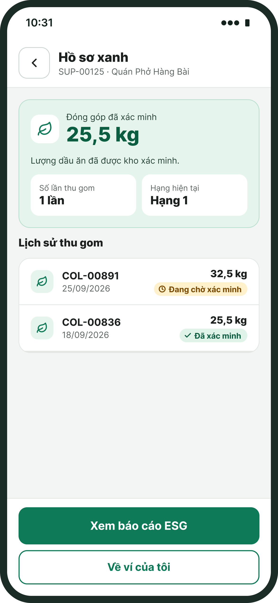
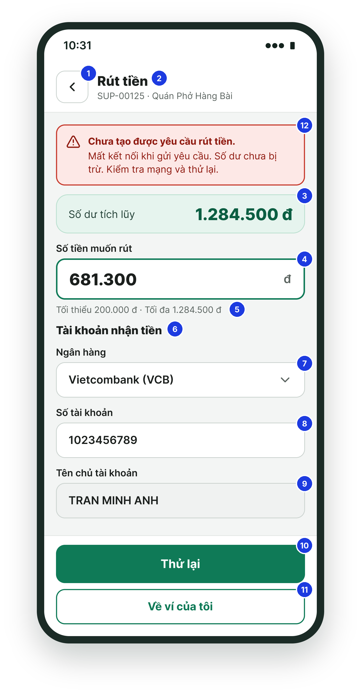

# Screen Spec: S-F05-02 Green Profile

| Field             | Value |
| ----------------- | ----- |
| Screen ID         | S-F05-02 |
| Screen name       | Green Profile (Vietnamese title: "Hồ sơ xanh") |
| Actor             | Supplier |
| Priority          | Must [TBC: confirm in the Screen List] |
| Feature           | F-05 Loyalty, payout balance and Green Profile [TBC: confirm the feature name in the Function List] |
| Activity diagrams | [TBC: AD not checked; the screen is read-only] |
| Mockup images     | `img/S-F05-02-default.png` (default), `img/S-F05-02-default-numbered.png`, four state images and four numbered state images (section 2) |
| Frame width       | 370px screen inside a 390 × 844 device frame, exported at 3x; state images are 1170 × 2532 pixels, numbered images are 1230 × 2592 pixels (30px transparent padding so that the number badges have room) |
| Figma frame       | Board "Green Profile - 5 stages", five frames, one per state. The board was named S-F05-03 before the withdrawal screen was removed; rename it to S-F05-02 (not re-checked against the Figma file in this version) |
| Status            | Draft |

**Scope change in this version.** The withdrawal screen was removed (no bank connection), so the former S-F05-03 "Green Profile" becomes **S-F05-02**. The content of the screen is unchanged; only the ID and the button "Về ví của tôi" (back to S-F05-01) matter for navigation.

## 1. Purpose

**Shown when:** the supplier taps "Xem hồ sơ xanh" on the wallet (S-F05-01), taps the card "UCO đã giao" on the home screen, or taps the tab "Xanh".

**The user leaves this screen when:** they tap the back button, tap "Xem báo cáo ESG", tap "Yêu cầu thu gom" (empty state), tap "Về ví của tôi", or tap "Tải lại hồ sơ xanh" after an error (the screen stays and reloads).

## 2. Mockup

**Numbered:** each number is the # of the element inventory in section 3. An element keeps the same number in every state.

| State | Numbers shown on the image |
| ----- | -------------------------- |
| Default | 1–3, 5–11, 14, 17 |
| Empty | 1–3, 5–9, 12, 15, 17 |
| Loading | 1–3, 5, 9, 10, 13, 14 (5, 9 and 10 on the skeleton blocks) |
| Error | 1–8, 16, 17 |
| Success | 1–3, 5–11, 14, 17, 18 |

In the Loading image, the number on a grey block names the element the block holds the place of; the block shows no data and cannot be tapped.

| Default, numbered | Empty, numbered | Loading, numbered | Error, numbered | Success, numbered |
| --- | --- | --- | --- | --- |
|  |  |  |  |  |

| State   | Image |
| ------- | ----- |
| Default | [`img/S-F05-02-default.png`](img/S-F05-02-default.png) (one verified collection, COL-00836, and one waiting for verification, COL-00891) |
| Empty   | [`img/S-F05-02-empty.png`](img/S-F05-02-empty.png) (no collection verified yet) |
| Loading | [`img/S-F05-02-loading.png`](img/S-F05-02-loading.png) |
| Error   | [`img/S-F05-02-error.png`](img/S-F05-02-error.png) (the Green Profile could not be loaded) |
| Success | [`img/S-F05-02-success.png`](img/S-F05-02-success.png) (reloaded after the error; both collections verified) |

Colours, fonts and corners follow the design tokens in ui-conventions.md section 6. [TBC: the conventions file could not be read in this version, so no pixel check against the token table was made; open question 9.]

## 3. Element inventory

Data field names are proposed; align them with the data dictionary.

| #  | Element | Type | Content / data source | Required | Validation |
| -- | ------- | ---- | --------------------- | -------- | ---------- |
| 1  | Back button | Icon button | chevron-left | Yes | none |
| 2  | Screen title | Header | static "Hồ sơ xanh" | Yes | |
| 3  | Context line | Text | `supplier.id` · `supplier.business_name` (example: "SUP-00125 · Quán Phở Hàng Bài") | Yes | `SUP-` + 5 digits |
| 4  | Error banner | Error banner | triangle icon; "Không tải được hồ sơ xanh."; "Kiểm tra kết nối mạng và thử lại." | No | shown only in the error state |
| 5  | Contribution card | Metric card (primary) | leaf icon; label "Đóng góp đã xác minh"; `uco.verified_weight` + " kg" (example: "25,5 kg"); error: "— kg" | Yes | 1 decimal with decimal comma (open question 6) |
| 6  | Card description | Text | static "Lượng dầu ăn đã được kho xác minh." | Yes | |
| 7  | Collection count | Stat box | label "Số lần thu gom"; `uco.verified_collection_count` + " lần" (example: "1 lần"); error: "—" | Yes | integer >= 0 |
| 8  | Current tier | Stat box | label "Hạng hiện tại"; "Hạng " + `loyalty.tier` (example: "Hạng 1"); error: "—" | Yes | tier is a whole number |
| 9  | History title | Section title | static "Lịch sử thu gom" | No | hidden in the error state |
| 10 | Collection row | List row | leaf icon; `collection.id` (example: "COL-00891"); `collection.date` (example: "25/09/2026"); `collection.actual_quantity` + " kg" (example: "32,5 kg") | No | `COL-` + 5 digits; `dd/MM/yyyy`; 1 decimal; newest first |
| 11 | Verification chip | Chip | `collection.verification_status`: "✓ Đã xác minh" (green) or "◷ Đang chờ xác minh" (amber) | Yes, on every row | enum: verified, waiting |
| 12 | Empty history card | Empty state card | leaf icon in a grey circle; "Chưa có lần thu gom nào được xác minh"; "Sau khi kho xác minh, lịch sử thu gom của bạn sẽ hiện ở đây." | No | shown only when no collection is verified |
| 13 | Loading text | Text | static "Đang tải hồ sơ xanh..." | No | shown only in the loading state |
| 14 | Xem báo cáo ESG | Primary button | static label | Yes (default, loading, success) | none; not tappable while loading |
| 15 | Yêu cầu thu gom | Primary button | static label; replaces button 14 in the empty state | No | none |
| 16 | Tải lại hồ sơ xanh | Primary button | static label; replaces button 14 in the error state | No | none |
| 17 | Về ví của tôi | Secondary button | static label | Yes | none; hidden while loading |
| 18 | Success toast | Toast | check icon + "Đã tải lại hồ sơ xanh." | No | shown after a successful reload |

## 4. States

| State | What the user sees | Trigger |
| ----- | ------------------ | ------- |
| Default | Header "Hồ sơ xanh", "SUP-00125 · Quán Phở Hàng Bài". Mint card: "Đóng góp đã xác minh", **25,5 kg**, "Lượng dầu ăn đã được kho xác minh.", boxes "Số lần thu gom 1 lần" and "Hạng hiện tại Hạng 1". Title "Lịch sử thu gom". Rows: "COL-00891 · 25/09/2026 · 32,5 kg" with chip "Đang chờ xác minh"; "COL-00836 · 18/09/2026 · 25,5 kg" with chip "Đã xác minh". Buttons "Xem báo cáo ESG" and "Về ví của tôi". | Screen opened with data |
| Empty (no data) | Mint card with **0,0 kg**, "0 lần", "Hạng 1". Title "Lịch sử thu gom" and the empty card "Chưa có lần thu gom nào được xác minh". Buttons "Yêu cầu thu gom" and "Về ví của tôi". | No collection of the supplier has been verified yet |
| Loading | Header (1–3) visible. Skeleton block for the contribution card (5), a short bar for the history title (9), a block for the history list (10). Centred text "Đang tải hồ sơ xanh..." (13). Only one button, "Xem báo cáo ESG", greyed out (14). No banner, no figures. | Initial screen load, or "Tải lại hồ sơ xanh" tapped, while fetching |
| Error | Red banner "Không tải được hồ sơ xanh." / "Kiểm tra kết nối mạng và thử lại.". Mint card with "— kg", "—", "—". No history. Buttons "Tải lại hồ sơ xanh" and "Về ví của tôi". | Network connection lost or API timeout when fetching the Green Profile |
| Success / confirmation | Toast "Đã tải lại hồ sơ xanh." above the buttons (18). Mint card **58 kg**, "2 lần", "Hạng 2". Rows: "COL-00891 · 25/09/2026 · 32,5 kg" and "COL-00836 · 18/09/2026 · 25,5 kg", both with chip "Đã xác minh". Buttons "Xem báo cáo ESG" and "Về ví của tôi". | The supplier tapped "Tải lại hồ sơ xanh" in the error state and the data loaded |

**Sample data check:** verified weight 25,5 + 32,5 = 58,0 kg; verified collections 1 + 1 = 2; tier 1 → 2 at 50,0 kg (S-F05-01: "Còn 24,5 kg nữa để lên Hạng 2 (50,0 kg)"). In Default only COL-00836 (verified) counts toward 25,5 kg and "1 lần"; COL-00891 is listed but not counted. The success image shows "58 kg"; the proposed format is "58,0 kg" (open question 6).

## 5. Interactions and navigation

Target Screen IDs come from the Screen List and the Screen Transition diagram [TBC: not re-checked in this version].

| #  | Element | User action | System response | Goes to screen |
| -- | ------- | ----------- | --------------- | -------------- |
| 1  | Back button (1) | tap | Returns to the previous screen | previous screen (S-F05-01 or S-F00-02) |
| 2  | Xem báo cáo ESG (14) | tap | Opens the ESG reports of the supplier | S-F05-03 [TBC: ESG reports after the renumbering; open question 1] |
| 3  | Yêu cầu thu gom (15) | tap | Opens the pickup request form | S-F01-03 |
| 4  | Về ví của tôi (17) | tap | Opens the wallet with the balance and payout status | S-F05-01 |
| 5  | Tải lại hồ sơ xanh (16) | tap | Re-fetches the Green Profile | stays (loading, then default, empty, success or error state) |
| 6  | Contribution card (5), stat boxes (7, 8), chips (11) | tap | Display only | stays |
| 7  | Collection row (10) | tap | Display only [TBC: open question 8] | stays |
| 8  | Screen body | pull down | Re-fetches the data and shows the Loading state [TBC: open question 4] | stays |

## 6. Screen-level rules

| Rule ID | Rule | Source |
| ------- | ---- | ------ |
| SR-001 | The supplier only sees the collections, weight and tier that belong to their own `supplier.id`. | FR-06-04 |
| SR-002 | Only collections verified by the warehouse count toward the verified weight, the collection count and the tier; collections waiting for verification are listed with the chip "Đang chờ xác minh" but not counted. | FR-05-04, FR-05-05 |
| SR-003 | The screen is read-only and displays the values the system returns; it never calculates weight or tier itself. | FR-05-07 |
| SR-004 | The history is sorted newest first and every row shows exactly one verification chip. | Screen design |
| SR-005 | In the Empty state the primary button is "Yêu cầu thu gom" so the first booking can start from this screen. | Screen design |
| SR-006 | If fetching fails, the screen never shows zeros in place of real figures: it shows "—" and the error banner (4). | Offline resilience convention |
| SR-007 | While loading, skeleton blocks keep the layout of the loaded screen, show one line of loading text, cannot be tapped, and the buttons cannot be used. | ui-conventions §3 (Skeleton) |
| SR-008 | Banners and chips use an icon + text, never colour alone (✓ Đã xác minh, ◷ Đang chờ xác minh, triangle, check). | ui-conventions §5 |

## 7. Linked requirements

FR IDs below are taken from the S-F00-02 spec. [TBC: names and wording must be checked against the W1 Function List, which could not be read in this version.]

| FR ID | What this screen does for it |
| ----- | ---------------------------- |
| FR-05-07 | Shows the supplier's Green Profile: verified contribution, collection count, tier and collection history |
| FR-05-04 / FR-05-05 | Displays the verified weight and the tier after the warehouse verifies a collection (display only) |
| FR-06-04 | Opens only for a role that has the supplier permission |

**Related functions, entry only** (carried out on the target screen): FR-01-11 (pickup form, S-F01-03), the ESG report function (S-F05-03; ID not found in the docs read so far).

## 8. Responsive and accessibility notes

- Designed on a 370 × 824 screen inside a 390 × 844 device frame; smallest supported width 360 px; the two stat boxes stay in one row with equal width; collection ID, date, weight and chip do not truncate.
- Vertical scroll is enabled when the history is longer than the screen; the button area stays fixed at the bottom.
- Touch targets at least 44 × 44 (ui-conventions §5): back button and both buttons.
- Chips use different icons alongside the text: check ("Đã xác minh"), clock ("Đang chờ xác minh"); the banner uses a triangle icon; text contrast at least 4.5:1, including amber text on the amber chip (ui-conventions §5).

## 9. Open questions

| # | Question | Blocking? | Status |
| - | -------- | --------- | ------ |
| 1 | [NEEDS CLARIFICATION: With the withdrawal screen removed, the Green Profile moves from S-F05-03 to S-F05-02. Do the ESG reports (S-F05-04) become S-F05-03, and are the Function List, Screen List and Screen Transition updated?] | No | Open. Default: yes; this spec uses S-F05-02 and S-F05-03. |
| 2 | [NEEDS CLARIFICATION: In Default, COL-00891 is "Đang chờ xác minh" here, but on S-F05-01 the same collection is "đang chờ bạn ký". Which comes first, the signature or the verification?] | No | Open. Default: follow the mockups; use one lifecycle and the same wording on both screens. |
| 3 | [NEEDS CLARIFICATION: The Loading mockup shows two skeleton blocks that are taller than the loaded content (the list block is about 210 px high for two rows).] | No | Open. Default: redraw per SR-007 with heights that match the loaded layout. |
| 4 | [NEEDS CLARIFICATION: Is there a pull-to-refresh? The Success state is reached after "Tải lại hồ sơ xanh" in the Error state; no other reload control is drawn.] | No | Open. Default: yes, pull down re-fetches and shows the Loading state. |
| 5 | [NEEDS CLARIFICATION: Is a waiting collection counted in "Số lần thu gom"? In Default it is not (1 lần with two rows).] | No | Open. Default: only verified collections are counted (SR-002). |
| 6 | [NEEDS CLARIFICATION: Weight format differs from ui-conventions §2 (1 decimal, decimal comma): Success shows "58 kg".] | No | Open. Default: "25,5 kg", "0,0 kg", "58,0 kg". |
| 7 | [NEEDS CLARIFICATION: In Empty, a collection may exist but not be verified yet. Should the empty card then show the waiting collections?] | No | Open. Default: the empty card stays; waiting collections appear only after the first verified one. |
| 8 | [NEEDS CLARIFICATION: Does tapping a collection row open its receipt (S-F03-02)?] | No | Open. Default: no; rows are display only. |
| 9 | [NEEDS CLARIFICATION: The design token table could not be read, so the colours of the images (green, mint, amber, red, greys) were not checked against ui-conventions §6.] | No | Open. Default: tokens are the rule; redraw if a shade is not a token. |
| 10 | [NEEDS CLARIFICATION: The frames show no bottom tab bar, while S-F00-02 has one (with the tab "Xanh"). Is this a detail screen without tabs?] | No | Open. Default: no tab bar, as in the mockups. |

---

## Completion checklist

- [x] The mockup is a separate cropped image file, named with the Screen ID, at the frame width (`img/S-F05-02-<state>.png`).
- [x] The numbered images exist for all five states, and their numbers match the # column of the element inventory.
- [x] Every visible element in the mockup appears in the element inventory.
- [ ] Every colour in the mockup is a design token from ui-conventions.md. (Not checked: open question 9.)
- [x] Every input element has a validation rule or an explicit "none".
- [x] All five states are filled in.
- [ ] Every navigation target is a Screen ID that exists in the Screen List. (Not checked after the renumbering: open question 1.)
- [x] Every element that displays data names the field it displays (proposed names).
- [ ] Every linked FR exists in the Function List. (Not checked: section 7.)
