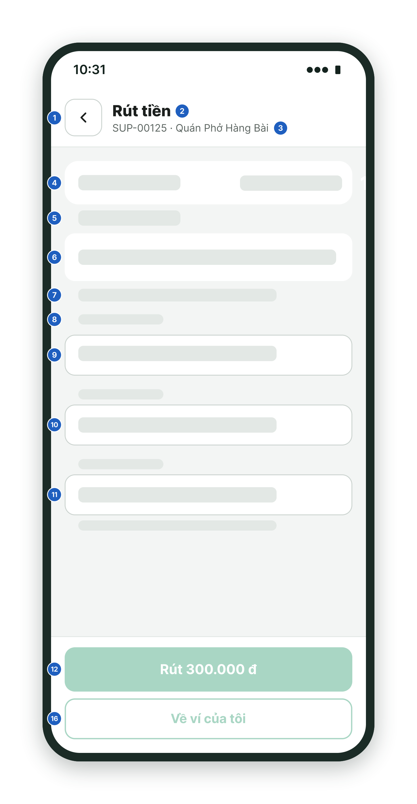
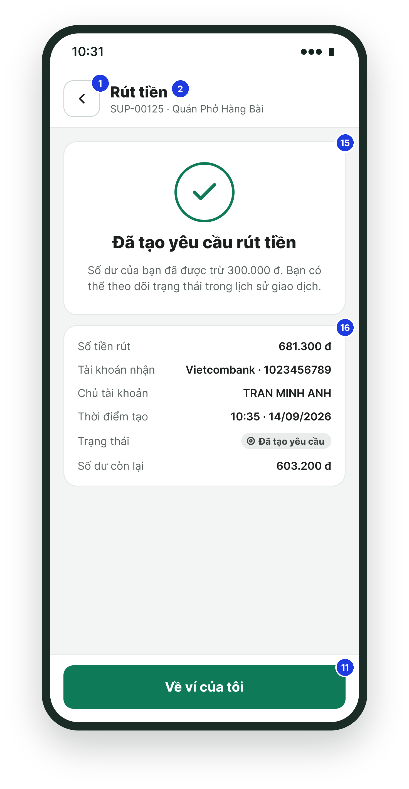
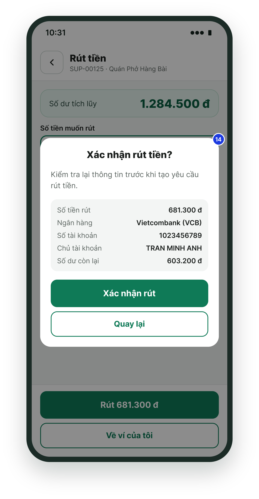

# Screen Spec: S-F05-02 Payout withdrawal

| Field | Value |
|---|---|
| Screen ID | S-F05-02 |
| Screen name | Payout withdrawal |
| Actor | Supplier |
| Priority | Should |
| Feature | F-05 Supplier Value & ESG / Green Profile |
| Activity diagrams | AD-UC-13 (actions "Submit withdrawal request", "Validate withdrawal eligibility"); AD-UC-12 (actions "Request balance withdrawal", "See existing balance & withdrawal rejection reason", "See withdrawal result & updated payout status and balance") |
| Mockup images | `img/S-F05-02-default.png`, `img/S-F05-02-default-numbered.png`, four other state images and their numbered versions, and the confirm modal `img/S-F05-02-modal.png` / `-modal-numbered.png` (section 2) |
| Frame width | 370px screen inside a 390 × 844 device frame, exported at 3x with a 50px shadow margin, 1470 × 2832 pixels |
| Figma frame | Frames "S-F05-02 / 1" to "S-F05-02 / 6" in the ReFeed Figma file |
| Status | Draft |

## 1. Purpose

**Shown when:** the supplier taps "Rút tiền" on S-F05-01 to withdraw part or all of the accumulated payout balance.

**The user leaves this screen when:** the withdrawal request is created and the supplier taps "Về ví của tôi", or the supplier taps Back, "Hủy giao dịch" or "Về ví của tôi" without creating a request, or taps "Đặt lịch thu gom" in the Empty state.

## 2. Mockup

**Numbered:** each number is the # of the element inventory in section 3. A number stays the same in every state. The form (4 to 9) appears in the Default and Error states; the Empty state shows the balance card (3), the insufficient-balance card (13) and the exit button (11). The Loading image numbers the header (1, 2) and the disabled buttons (10, 11); grey skeleton blocks stand in place of elements 3 to 9. The Error image adds the error banner (12), and button 10 reads "Thử lại". The Success image shows the success card (15), the summary card (16) and the exit button (11). The confirm modal (14) opens over the Default state when "Rút 681.300 đ" is tapped; it is a modal of this screen, not a separate screen, so its image numbers only element 14.

| Default, numbered | Empty, numbered | Loading, numbered | Error, numbered | Success, numbered | Confirm modal, numbered |
| --- | --- | --- | --- | --- | --- |
|  |  |  |  |  |  |

| State | Image |
|---|---|
| Default | [`img/S-F05-02-default.png`](img/S-F05-02-default.png) (balance 1.284.500 đ, amount 681.300) |
| Empty | [`img/S-F05-02-empty.png`](img/S-F05-02-empty.png) (balance 120.000 đ, below the minimum) |
| Loading | [`img/S-F05-02-loading.png`](img/S-F05-02-loading.png) |
| Error | [`img/S-F05-02-error.png`](img/S-F05-02-error.png) (connection lost while sending) |
| Success | [`img/S-F05-02-success.png`](img/S-F05-02-success.png) (681.300 đ requested, balance 603.200 đ) |
| Confirm modal | [`img/S-F05-02-modal.png`](img/S-F05-02-modal.png) |

Colours, fonts and corners follow the design tokens in [ui-conventions.md](../ui-conventions.md#6-design-tokens). A pixel check found shades that are not in the token table (open question 9).

## 3. Element inventory

Data field names are proposed; align them with the data dictionary.

| # | Element | Type | Content / data source | Required | Validation |
|---|---|---|---|---|---|
| 1 | Back | Icon button | static chevron icon | Yes | none |
| 2 | Title and context line | Header | static "Rút tiền"; `supplier.id` · `supplier.business_name` (example: "SUP-00125 · Quán Phở Hàng Bài") | Yes | `SUP-` + 5 digits |
| 3 | Balance card | Card | label "Số dư tích lũy" (Empty: "Số dư có thể rút") + `payout_balance.accumulated` (example: "1.284.500 đ") | Yes | integer `>= 0`; `.` as thousands separator + " đ" |
| 4 | Amount input | Number input with label | label "Số tiền muốn rút"; `withdrawal.amount` (thousand separator, suffix "đ", example: "681.300") | Yes | integer; `>= config.min_withdrawal`; `<= payout_balance.accumulated` |
| 5 | Amount helper | Text | "Tối thiểu " + `config.min_withdrawal` + " đ · Tối đa " + `payout_balance.accumulated` + " đ" | Yes | |
| 6 | Bank section header | Subheader | static: "Tài khoản nhận tiền" | Yes | |
| 7 | Bank dropdown | Dropdown | label "Ngân hàng"; placeholder "Chọn ngân hàng"; `bank_account.bank_name` (example: "Vietcombank (VCB)") | Yes | one bank from the list |
| 8 | Account number input | Text input | label "Số tài khoản"; placeholder "Nhập số tài khoản"; `bank_account.number` (example: "1023456789") | Yes | digits only; length: open question 3 |
| 9 | Account holder field | Text field (read-only) | label "Tên chủ tài khoản"; `bank_account.holder_name` (example: "TRAN MINH ANH") | Yes | not empty; source: open question 7 |
| 10 | Primary button | Primary button | "Rút " + amount (example: "Rút 681.300 đ"); "Thử lại" in the Error state | Yes | enabled only when the amount and the bank fields are valid; disabled while loading |
| 11 | Exit button | Secondary button (Empty and Success: primary) | "Hủy giao dịch" in Default; "Về ví của tôi" in Empty, Loading, Error and Success | Yes | disabled while loading |
| 12 | Error banner | Banner | warning icon; "Chưa tạo được yêu cầu rút tiền."; "Mất kết nối khi gửi yêu cầu. Số dư chưa bị trừ. Kiểm tra mạng và thử lại." (Error state only) | No | |
| 13 | Insufficient balance card | Empty state card | wallet icon; "Chưa đủ số dư để rút tiền"; "Mức rút tối thiểu là 200.000 đ. Bạn cần thêm 80.000 đ (khoảng 8,0 kg UCO ở mức 10.000 đ/kg). Số dư sẽ tăng sau mỗi lần thu gom bạn ký xác nhận."; secondary button "Đặt lịch thu gom" (Empty state only) | No | missing amount = `config.min_withdrawal` − balance |
| 14 | Confirm modal | Modal | title "Xác nhận rút tiền?"; text "Kiểm tra lại thông tin trước khi tạo yêu cầu rút tiền."; summary rows "Số tiền rút", "Ngân hàng", "Số tài khoản", "Chủ tài khoản", "Số dư còn lại"; buttons "Xác nhận rút" (primary) and "Quay lại" (secondary) | Yes | opens on every valid tap of 10; remaining balance = balance − amount |
| 15 | Success card | Card | check icon; "Đã tạo yêu cầu rút tiền"; "Số dư của bạn đã được trừ " + amount + ". Bạn có thể theo dõi trạng thái trong lịch sử giao dịch." (Success state only) | No | |
| 16 | Summary card | Card | rows "Số tiền rút" `withdrawal.amount`; "Tài khoản nhận" `bank_name · number`; "Chủ tài khoản" `holder_name`; "Thời điểm tạo" `withdrawal.created_at` (`HH:mm · dd/MM/yyyy`); "Trạng thái" badge "Đã tạo yêu cầu" (icon + text) from `withdrawal.status`; "Số dư còn lại" `payout_balance.accumulated` | No | status shown with text and icon, never colour alone |

## 4. States

| State | What the user sees | Trigger |
|---|---|---|
| Default (1/5) | Header, balance card "1.284.500 đ", amount "681.300" in focus, helper "Tối thiểu 200.000 đ · Tối đa 1.284.500 đ", bank section with an empty bank dropdown and empty account number, read-only holder field "TRAN MINH ANH", "Rút 681.300 đ" and "Hủy giao dịch". The mockup shows this state. | Screen opened from S-F05-01 with a balance at or above the minimum |
| Empty (2/5) | Balance card "Số dư có thể rút 120.000 đ", card "Chưa đủ số dư để rút tiền" with the minimum, the missing 80.000 đ and the button "Đặt lịch thu gom"; no form; "Về ví của tôi" | The balance is below the minimum withdrawal (rejection reason of AD-UC-12) |
| Loading (3/5) | Grey skeletons in place of elements 3 to 9, disabled "Rút 681.300 đ" and disabled "Về ví của tôi" | Balance and eligibility are being fetched |
| Error (4/5) | Red banner "Chưa tạo được yêu cầu rút tiền. Mất kết nối khi gửi yêu cầu. Số dư chưa bị trừ. Kiểm tra mạng và thử lại."; the form keeps the entered values (681.300, Vietcombank (VCB), 1023456789, TRAN MINH ANH); buttons "Thử lại" and "Về ví của tôi" | The request failed (network or server) |
| Success / confirmation (5/5) | Check mark, "Đã tạo yêu cầu rút tiền", summary card (681.300 đ, Vietcombank · 1023456789, TRAN MINH ANH, 10:35 · 14/09/2026, badge "Đã tạo yêu cầu", remaining 603.200 đ) and "Về ví của tôi" | Withdrawal Transaction created in state Created and the balance deducted (FR-05-02) |
| Confirm modal | Dimmed Default screen with the modal "Xác nhận rút tiền?", its summary (681.300 đ, Vietcombank (VCB), 1023456789, TRAN MINH ANH, remaining 603.200 đ), "Xác nhận rút" and "Quay lại" | The supplier taps a valid "Rút 681.300 đ" |

## 5. Interactions and navigation

| # | Element | User action | System response | Goes to screen |
|---|---|---|---|---|
| 1 | Back (1), exit button (11) except in Success | tap | Returns without creating a request | S-F05-01 |
| 2 | Amount input (4) | type | Formats with thousand separators; shows "Số tiền rút tối thiểu là 200.000 đ. Vui lòng nhập số tiền hợp lệ." or "Số tiền rút không được vượt quá số dư." when invalid; updates the label of button 10 | stays |
| 3 | Bank dropdown (7) | tap | Opens the bank list; selecting one fills the field | stays |
| 4 | Account number (8) | type | Validates the value | stays |
| 5 | Primary button (10), valid | tap | Opens the confirm modal (14) | stays (modal) |
| 6 | Primary button (10), invalid | tap | Not tappable while disabled; invalid fields show their message | stays |
| 7 | "Xác nhận rút" in modal 14 | tap | Creates the Withdrawal Transaction in state Created, deducts the balance, updates the payout status (FR-05-02); shows Success, or Error / Empty when rejected | stays (Success or Error state) |
| 8 | "Quay lại" in modal 14 | tap | Closes the modal; nothing is created | stays |
| 9 | "Thử lại" (10, Error state) | tap | Sends the request again | stays |
| 10 | "Đặt lịch thu gom" in card 13 | tap (Empty state) | Opens the pickup request form | S-F01-03 |
| 11 | "Về ví của tôi" (11, Success) | tap | Opens the balance, which shows the new withdrawal row | S-F05-01 |

## 6. Screen-level rules

| Rule ID | Rule | Source |
|---|---|---|
| SR-001 | The amount must be at least the minimum withdrawal (200.000 đ) and at most the accumulated balance. | BR-05, BR-PAY-01 |
| SR-002 | The withdrawal is accepted only for the signed-in supplier's own balance. | FR-06-03 |
| SR-003 | The primary button (10) is enabled only when the amount and the bank fields are valid. | FR-05-02 |
| SR-004 | Every request goes through the confirmation modal "Xác nhận rút tiền?" before it is created. | Screen List (modals); ui-conventions §3 |
| SR-005 | On success the Withdrawal Transaction is created in state Created, the balance is reduced by the amount and the payout status is updated. If creation fails, the balance does not change. | AD-UC-12, AD-UC-13 (FR-05-02) |
| SR-006 | Rejected attempts are recorded by the system and the supplier sees the reason. | SD-UC-13 |
| SR-007 | The screen records the withdrawal request only; the actual bank transfer is outside ReFeed Release 1. | ADR-003 |
| SR-008 | Error messages state what is wrong and the valid rule. | ui-conventions §4 |
| SR-009 | Status is shown with text and icon, never by colour alone. | ui-conventions §5 |
| SR-010 | The primary button label names the action; no generic "OK" or "Submit". | ui-conventions §1 |

## 7. Linked requirements

| FR ID | What this screen does for it |
|---|---|
| FR-05-02 | Collects the amount and bank details, validates eligibility, creates the withdrawal transaction and shows the updated status and balance |
| FR-05-01 | Shows the accumulated balance used for validation and the balance after the withdrawal |
| FR-06-03 | Restricts the balance and data to the signed-in supplier |

## 8. Responsive and accessibility notes

- Designed on a 370 × 824 screen inside a 390 × 844 device frame; smallest supported width 360 px. The content scrolls and the footer buttons stay fixed.
- Touch targets at least 44 × 44: back button 44 × 44, inputs 48 px high (amount 56 px), dropdown 48 px, footer buttons 52 px and 48 px.
- Each input has a visible label above it, not only a placeholder.
- The error banner uses an icon and a distinct border, not colour alone; the modal dims the screen behind it and keeps focus inside.
- Body text contrast at least 4.5:1.

## 9. Open questions

| # | Question | Blocking? | Status |
|---|---|---|---|
| 1 | [NEEDS CLARIFICATION: the Default image shows an empty bank dropdown and account number but an enabled "Rút 681.300 đ" button; by SR-003 it must be disabled until all fields are valid.] | No | Open. Default: follow SR-003; update the mockup. |
| 2 | [NEEDS CLARIFICATION: the exit button is "Hủy giao dịch" in Default but "Về ví của tôi" in the other states, and the modal image shows "Về ví của tôi" under the dimmed screen.] | No | Open. Default: "Hủy giao dịch" in Default and the modal, "Về ví của tôi" elsewhere. |
| 3 | [NEEDS CLARIFICATION: the bank list source and the account number length are not defined.] | No | Open. Default: a fixed list of banks; digits only, 6–19 digits. |
| 4 | [NEEDS CLARIFICATION: minimum withdrawal. AD-UC-13 uses 200.000 VND; the W5 handover question asks about 100.000 VND. BR-PAY-01 gives no value in the repository.] | No | Open. Default: 200.000 đ. |
| 5 | [NEEDS CLARIFICATION: withdrawal fees (open question of AD-UC-12 and AD-UC-13).] | No | Open. Default: no fee is shown. |
| 6 | [NEEDS CLARIFICATION: AD-UC-12 calls S-F05-02 a "Withdrawal Request Modal" and AD-UC-13 still cites SCR-SUPP-05 / SCR-SUPP-06. The Screen List defines S-F05-02 as a screen with the modal "Confirm withdrawal".] | No | Open. Default: follow the Screen List; update both AD files. |
| 7 | [NEEDS CLARIFICATION: the holder-name field is grey (read-only) with no input in the mockup. Is it filled from the supplier profile or typed?] | No | Open. Default: filled from the supplier profile, read-only. |
| 8 | [NEEDS CLARIFICATION: the Empty card quotes "10.000 đ/kg" to convert the missing 80.000 đ into 8,0 kg; no such rate is defined in the repository.] | No | Open. Default: keep it only if the base price is confirmed; otherwise remove the kg estimate. |
| 9 | [NEEDS CLARIFICATION: shades in the state images (for example #0B5E42, #5B6460) are not in the ui-conventions §6 token table.] | No | Open. Default: tokens are the rule. |
| 10 | [NEEDS CLARIFICATION: the Screen Transition diagram has no arrow S-F05-02 → S-F01-03 for "Đặt lịch thu gom" in the Empty state.] | No | Open. Default: add the arrow. |
| 11 | [NEEDS CLARIFICATION: the Success mockup says "Số dư của bạn đã được trừ 300.000 đ" while the amount is 681.300 đ; its time 10:35 is later than the 10:31 on the status bar; the Empty card says "Số dư có thể rút" while the other states say "Số dư tích lũy".] | No | Open. Default: "đã được trừ 681.300 đ", one label "Số dư tích lũy"; update the mockups. |

---

## Completion checklist

- [x] The mockup is a separate cropped image file, named with the Screen ID, at the frame width (`img/S-F05-02-<state>.png`).
- [x] The numbered images exist, and their numbers match the # column of the element inventory.
- [x] Every visible element across all 5 states and the modal appears in the element inventory.
- [ ] Every colour in the mockup is a design token from ui-conventions.md. (Open question 9.)
- [x] Every input/action element has a validation rule or an explicit state behavior.
- [x] All five states (Default, Empty, Loading, Error, Success) are filled in.
- [x] Every navigation target is a Screen ID that exists in the Screen List.
- [x] Every element that displays data names the field it displays (proposed names).
- [x] Every linked FR exists in the Function List, and every action of this screen in AD-UC-12 and AD-UC-13 is covered by an interaction row.
