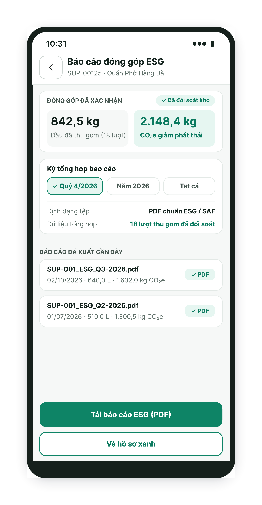

# Screen Spec: S-F05-03 Green Profile

| Field | Value |
|---|---|
| Screen ID | S-F05-03 |
| Screen name | Green Profile |
| Actor | Supplier |
| Priority | Could |
| Feature | F-05 Supplier Value & ESG / Green Profile |
| Activity diagrams | None: the usage flow marks UC-14 as a read-only query, no activity diagram needed |
| Mockup image | `img/S-F05-03.png` |
| Status | Draft |

## 1. Purpose

**Shown when:** the supplier opens "Hồ sơ xanh" from the Supplier main menu or taps "Xem hồ sơ xanh" on S-F05-01, to see the verified UCO contribution and the collection history.

**The user leaves this screen when:** the supplier taps "Xem báo cáo ESG" (S-F05-04), "Về số dư tích lũy" (S-F05-01), "Yêu cầu thu gom" in the empty state (S-F01-03), or Back.

## 2. Mockup

## 3. Element inventory

| # | Element | Type | Content / data source | Required | Validation |
|---|---|---|---|---|---|
| 1 | Back | Button | static | Yes | none |
| 2 | Title | Header | static: "Hồ sơ xanh" | Yes | |
| 3 | Supplier subtitle | Text | `supplier.business_name` · `supplier.id` (e.g., "Quán Phở Hàng Bài · SUP-001") | Yes | `SUP-` + 3 digits |
| 4 | Error banner | Banner | static: "Không tải được hồ sơ xanh." + "Kiểm tra kết nối mạng và thử lại." (Error state only) | No | |
| 5 | Contribution icon | Icon tile | static leaf icon | Yes | |
| 6 | Verified contribution | Text | "Đóng góp đã xác minh" + `green_profile.verified_volume` (format: 1 decimal + `L`, e.g., "842,5 L") | Yes | `>= 0`; "— L" in Error state |
| 7 | Contribution note | Text | static: "Lượng dầu ăn đã qua sử dụng đã được kho xác minh." | Yes | |
| 8 | Collection count | Stat tile | "Số lần thu gom" + `green_profile.collection_count` (e.g., "18 lần") | Yes | integer `>= 0` |
| 9 | Current tier | Stat tile | "Hạng hiện tại" + `supplier.loyalty_tier` (e.g., "Hạng 2") | Yes | |
| 10 | History header | Subheader | static: "Lịch sử thu gom" | Yes | |
| 11 | Collection row | List row | leaf icon + `collection.code` + `collection.date` + `collection.actual_volume` | Yes | `COL-` + 4 digits; `dd/MM/yyyy`; 1 decimal + `L`; newest first; row at least 44 px high |
| 12 | Verification badge | Badge | `collection.warehouse_status`: "Đã xác minh" (check icon) or "Chờ kho xác minh" (clock icon) | Yes | text + icon, never color alone |
| 13 | Empty history card | Card | icon + "Chưa có lần thu gom nào được xác minh" + "Sau khi kho xác minh, các lần thu gom của bạn sẽ hiện ở đây." (Empty state only) | No | |
| 14 | Loading skeletons | Skeleton | grey placeholders for the contribution card and history; text "Đang tải hồ sơ xanh…" (Loading state only) | No | mirror the Default layout |
| 15 | Refresh toast | Toast | static: "Đã tải lại hồ sơ xanh." (Success state only) | No | auto-dismisses after 4 seconds |
| 16 | Primary button | Primary button | "Xem báo cáo ESG" (Default, Success, Loading); "Yêu cầu thu gom" (Empty); "Tải lại hồ sơ xanh" (Error) | Yes | "Xem báo cáo ESG" disabled in Loading |
| 17 | Balance button | Secondary button | static: "Về số dư tích lũy" (Default, Empty, Error, Success) | No | |

## 4. States

| State | What the user sees | Trigger |
|---|---|---|
| Default (1/5) | Contribution card ("842,5 L", "18 lần", "Hạng 2"), the history "Lịch sử thu gom" with verified and awaiting-verification collections, "Xem báo cáo ESG" and "Về số dư tích lũy". The mockup shows this state. | Screen opened, data loaded |
| Empty (2/5) | Contribution card with "0,0 L", "0 lần", "Hạng 1"; card "Chưa có lần thu gom nào được xác minh"; primary button "Yêu cầu thu gom" | The supplier has no collection yet |
| Loading (3/5) | Grey skeletons of the contribution card and the history, text "Đang tải hồ sơ xanh…", disabled "Xem báo cáo ESG" | Contribution and history are being fetched |
| Error (4/5) | Red banner "Không tải được hồ sơ xanh. Kiểm tra kết nối mạng và thử lại."; contribution values show "—"; primary button "Tải lại hồ sơ xanh" | The request failed (network or server) |
| Success / confirmation (5/5) | The Default content with the toast "Đã tải lại hồ sơ xanh." | The supplier taps "Tải lại hồ sơ xanh" in the Error state and the data loads. The screen is read-only, so this is its only confirmation. |

## 5. Interactions and navigation

| # | Element | User action | System response | Goes to screen |
|---|---|---|---|---|
| 1 | Back | tap | Returns to the previous screen | S-F05-01 (or caller) |
| 2 | Xem báo cáo ESG | tap | Opens the ESG contribution reports | S-F05-04 |
| 3 | Về số dư tích lũy | tap | Opens the loyalty and payout balance | S-F05-01 |
| 4 | Yêu cầu thu gom | tap (Empty state) | Opens the pickup request form | S-F01-03 |
| 5 | Tải lại hồ sơ xanh | tap (Error state) | Fetches the data again; shows Loading, then Default with the toast or Error | stays |
| 6 | History list | scroll | Shows older collections | stays |

## 6. Screen-level rules

| Rule ID | Rule | Source |
|---|---|---|
| SR-001 | The supplier sees only their own contribution and collections (`supplier.id`). | FR-06-03 |
| SR-002 | The screen is read-only: no value can be edited. | FR-05-03 |
| SR-003 | The history shows collections newest first, each with its warehouse verification status. | FR-05-03 |
| SR-004 | Verification status is shown with text and icon, never by colour alone. | ui-conventions §5 |
| SR-005 | The total "Đóng góp đã xác minh" equals the verified volume on S-F05-01, so both screens show the same figure. | FR-05-01, FR-05-03 |
| SR-006 | The toast disappears after 4 seconds. | ui-conventions §3 |
| SR-007 | Volumes use 1 decimal and `L`; dates use `dd/MM/yyyy`; collection IDs use `COL-` + 4 digits. | ui-conventions §2 |
| SR-008 | At most one Primary button on the screen. | ui-conventions §3 |

## 7. Linked requirements

| FR ID | What this screen does for it |
|---|---|
| FR-05-03 | Displays the verified UCO contribution and the collection history |
| FR-05-04 | Provides the entry to the ESG contribution reports ("Xem báo cáo ESG") |
| FR-06-03 | Restricts the data to the signed-in supplier |

## 8. Responsive and accessibility notes

- Designed at 390 × 844; smallest supported width 360 px. The content scrolls and the footer buttons stay fixed.
- Touch targets at least 44 × 44: back button 44 × 44, collection rows at least 44 px high, footer buttons 52 px and 48 px.
- Verification badges use text plus icon; the error banner uses an icon and a distinct border, not colour alone.
- Skeleton placeholders in Loading mirror the Default layout to avoid layout shift.
- Body text and badge text contrast at least 4.5:1.

## 9. Open questions

| # | Question | Blocking? | Status |
|---|---|---|---|
| 1 | [NEEDS CLARIFICATION: FR-05-01 adds the quantity to the verified volume when the supplier signs, while FR-05-03 speaks of volume verified by the warehouse. Are these the same figure?] | No | Open. Default: one figure, shown on S-F05-01 and here (SR-005). |
| 2 | [NEEDS CLARIFICATION: the screen shows no environmental figures (for example CO₂ saved) because the repository defines none.] | No | Open. Default: none; the reports are on S-F05-04. |
| 3 | [NEEDS CLARIFICATION: should the history filter by period?] | No | Open. Default: no filter. |
| 4 | [NEEDS CLARIFICATION: the Success state is added to keep the five-state format; UC-14 has no write action.] | No | Open. Default: toast after a successful reload. |
| 5 | [NEEDS CLARIFICATION: the Supplier main menu has no Screen ID in the Screen List.] | No | Open. Default: Back goes to S-F05-01 or the caller. |

---

## Completion checklist

- [x] The mockup is a separate cropped image file, named with the Screen ID (`img/S-F05-03.png`).
- [x] Every visible element across all 5 states appears in the element inventory.
- [x] Every input/action element has a validation rule or an explicit state behavior.
- [x] All five states (Default, Empty, Loading, Error, Success) are filled in.
- [x] Every navigation target is a Screen ID that exists in the Screen List.
- [x] Every element that displays data names the field it displays.
- [x] Every linked FR exists in the Function List, and every action of this screen is covered by an interaction row (UC-14: no activity diagram, "not needed" in the usage flow).
