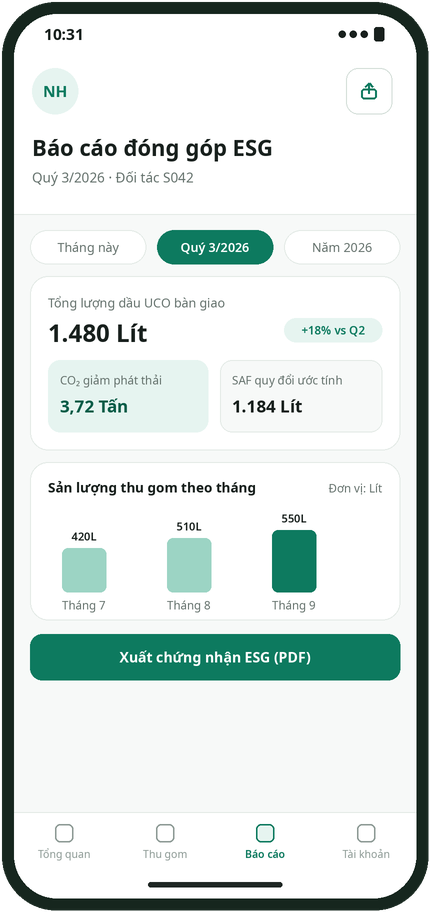
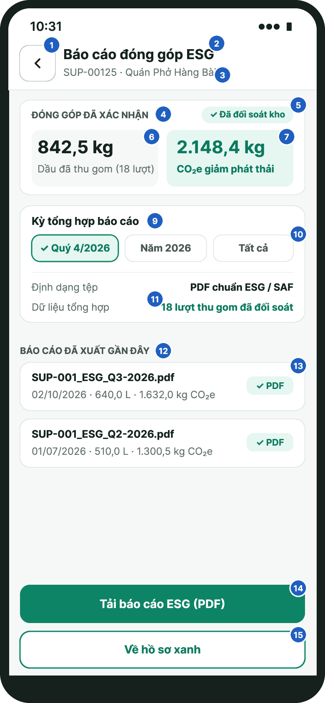
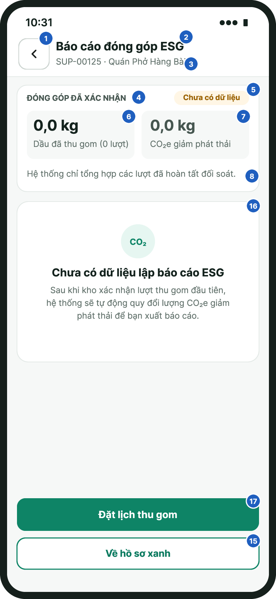

# Screen Spec: S-F05-04 ESG contribution reports

| Field | Value |
|---|---|
| Screen ID | S-F05-04 |
| Screen name | ESG contribution reports (`Báo cáo đóng góp ESG`) |
| Actor | Supplier (`Nhà cung cấp`, `SUP-001`) |
| Priority | Must |
| Feature | F-05 Green Profile & ESG Contribution Reports |
| Activity diagrams | AD-UC-05 (actions "View ESG contribution summary", "Select reporting period", "Export ESG PDF report", "Open exported report") |
| Mockup images | `img/S-F05-04-default.png` (default), five numbered state images and four state images (section 2) |
| Frame width | 390px × 844px (exported at 2x Retina, 780 × 1688 pixels) |
| Figma frame | ReFeed Mobile App – Supplier Flow (`0504.pdf`) |
| Status | Draft |

## 1. Purpose

**Shown when:** the supplier (`SUP-001`) opens the ESG contribution report screen from the Green Profile (`S-F05-01`) to review verified collected used cooking oil (UCO) volume, converted $\text{CO}_2\text{e}$ emission reduction, and export a PDF report.

**The user leaves this screen when:** the supplier taps Back (`#1`) or "Về hồ sơ xanh" (`#15`) to return to `S-F05-01`, opens an exported PDF file (`#13` or `#25`) in the system PDF viewer, or taps "Đặt lịch thu gom" (`#17`) in the empty state to schedule a pickup (`S-F02-01`).

## 2. Mockup

**Numbered:** each number is the # of the element inventory in section 3. Elements 16–17 (Empty state and "Đặt lịch thu gom") appear only in the empty state, element 18 (Loading skeleton) only in the loading state, element 19 (Error banner) only in the error state, and elements 20–25 (Success card, file metadata rows, and "Mở tệp báo cáo PDF") only in the success state, so each is numbered on that state's image. Across the states, shared elements keep their numbers: the header (1–3) and "Về hồ sơ xanh" (15) appear on all five images, the primary action button (14) appears on default, loading (disabled), and error, and the summary/period cards (4–11) appear on default, empty (4–8), and error (4, 6–11).

| Default, numbered | Empty, numbered | Loading, numbered | Error, numbered | Success, numbered |
|---|---|---|---|---|
|  |  |  |  |  |

| State | Image |
|---|---|
| Default | `img/S-F05-04-default.png` |
| Empty | `img/S-F05-04-empty.png` |
| Loading | `img/S-F05-04-loading.png` |
| Error | `img/S-F05-04-error.png` (export failed because the connection was lost while generating the PDF) |
| Success | `img/S-F05-04-success.png` |

All colours, fonts and corners come from the design tokens in [ui-conventions.md](../ui-conventions.md#6-design-tokens).

## 3. Element inventory

| # | Element | Type | Content / data source | Required | Validation |
|---|---|---|---|---|---|
| 1 | Back | Button | static icon `<` | Yes | none |
| 2 | Screen title | Header | static: "Báo cáo đóng góp ESG" | Yes | none |
| 3 | Supplier context line | Text | `supplier.code` + `supplier.name` (e.g. `SUP-00125 · Quán Phở Hàng Bài`) | Yes | none |
| 4 | Confirmed contribution heading | Header | static: "ĐÓNG GÓP ĐÃ XÁC NHẬN" (states 1, 2, 4) | Yes | none |
| 5 | Warehouse reconciliation badge | Status badge | `reconciliation.status_label` ("Đã đối soát kho" in state 1; "Chưa có dữ liệu" in state 2) | Yes | none |
| 6 | Verified UCO volume & pickups tile | Summary tile | `esg_summary.total_uco_kg` (`0,0 kg`) + `esg_summary.collection_count` (`N lượt`) (states 1, 2, 4) | Yes | $\ge 0,0\text{ kg}$ |
| 7 | $\text{CO}_2\text{e}$ reduction tile | Summary tile | `esg_summary.co2e_saved_kg` (`0,0 kg`, SAF conversion standard) (states 1, 2, 4) | Yes | $\ge 0,0\text{ kg}$ |
| 8 | SAF conversion & retention note | Text | static note (state 2: "Hệ thống chỉ tổng hợp các lượt đã hoàn tất đối soát."; state 4: "Dữ liệu tạm tính Quý 4/2026 của bạn được giữ nguyên.") | No | none |
| 9 | Reporting period heading | Header | static: "Kỳ tổng hợp báo cáo" (states 1, 4) | Yes | none |
| 10 | Reporting period selector | Chip group | `report.period_options` ("Quý 4/2026", "Năm 2026", "Tất cả") (states 1, 4) | Yes | exactly one period selected |
| 11 | File format & reconciled data row | Text row | static format "PDF chuẩn ESG / SAF" + `esg_summary.reconciled_count` ("18 lượt thu gom đã đối soát") (states 1, 4) | Yes | none |
| 12 | Recent exported reports heading | Header | static: "BÁO CÁO ĐÃ XUẤT GẦN ĐÂY" (state 1) | No | none |
| 13 | Exported report list item | List item | `exported_report.file_name`, `exported_report.exported_at`, `exported_report.uco_volume_l`, `exported_report.co2e_saved_kg`, badge `✓ PDF` (state 1; shared across Q3-2026 & Q2-2026) | No | none |
| 14 | Export / Retry report button | Primary button | dynamic label: "Tải báo cáo ESG (PDF)" (state 1), "Đang tải báo cáo PDF..." (state 3, disabled), "Thử lại xuất báo cáo" (state 4) | Yes | disabled in loading state (3) |
| 15 | Back to green profile button | Button | static secondary button: "Về hồ sơ xanh" (states 1–5) | Yes | none |
| 16 | Empty state card | Empty state | `CO2` badge icon + "Chưa có dữ liệu lập báo cáo ESG" + guidance text (state 2) | No | none |
| 17 | Schedule collection button | Primary button | static: "Đặt lịch thu gom" (state 2) | No | none |
| 18 | Loading skeleton & status | Loading state | two placeholder cards + "Đang tổng hợp dữ liệu và khởi tạo tệp báo cáo PDF..." (state 3) | No | none |
| 19 | Export error banner | Error banner | "Không thể xuất báo cáo ESG" + "Mất kết nối khi tổng hợp dữ liệu và tạo tệp PDF. Vui lòng kiểm tra mạng và thử lại." (state 4) | No | none |
| 20 | Export success card | Success card | check icon + "Xuất báo cáo ESG thành công" + period, UCO weight and $\text{CO}_2\text{e}$ summary (state 5) | No | none |
| 21 | Exported PDF file name row | Text row | `exported_report.file_name` (e.g. `SUP-001_ESG_Q4-2026.pdf`) (state 5) | No | none |
| 22 | Exported PDF file size row | Text row | `exported_report.file_size` (e.g. `245 KB`) (state 5) | No | none |
| 23 | Export timestamp row | Text row | `exported_report.exported_at` (`HH:mm · DD/MM/YYYY`) (state 5) | No | none |
| 24 | Source data & saved status row | Status row | `exported_report.source_summary` ("18 lượt thu gom (842,5 kg)") + badge `✓ Đã lưu về máy` (state 5) | No | none |
| 25 | Open PDF report button | Primary button | static: "Mở tệp báo cáo PDF" (state 5) | No | none |

## 4. States

| State | What the user sees | Trigger |
|---|---|---|
| Default | Verified contribution summary card (`842,5 kg` UCO / `18 lượt`, `2.148,4 kg` $\text{CO}_2\text{e}$, badge `✓ Đã đối soát kho`), reporting period selector ("Quý 4/2026" selected), format row (`PDF chuẩn ESG / SAF`), two recent exported reports (`Q3-2026`, `Q2-2026`), and action buttons "Tải báo cáo ESG (PDF)" and "Về hồ sơ xanh". | Screen opened when the supplier has at least one warehouse-reconciled collection. |
| Empty (no data) | Verified contribution card showing `0,0 kg` (`0 lượt`) with badge `Chưa có dữ liệu`, empty state card `CO2` ("Chưa có dữ liệu lập báo cáo ESG"), primary button "Đặt lịch thu gom", and secondary button "Về hồ sơ xanh". | Supplier has no warehouse-reconciled collections yet. |
| Loading | Two grey skeleton placeholder cards, status line "Đang tổng hợp dữ liệu và khởi tạo tệp báo cáo PDF...", and disabled primary button "Đang tải báo cáo PDF...". | User taps "Tải báo cáo ESG (PDF)" (`#14`) or report data is being fetched. |
| Error | Light-red alert banner at top ("Không thể xuất báo cáo ESG — Mất kết nối khi tổng hợp dữ liệu và tạo tệp PDF. Vui lòng kiểm tra mạng và thử lại."), selected period and provisional Q4/2026 figures preserved below, primary button changed to "Thử lại xuất báo cáo". | Network connection is lost or PDF generation fails during export. |
| Success / confirmation | Green-bordered confirmation card ("Xuất báo cáo ESG thành công" with period, UCO weight, and $\text{CO}_2\text{e}$ summary), file details card (`Tên tệp`, `Dung lượng`, `Thời điểm xuất`, `Dữ liệu gốc`, `Trạng thái tệp: ✓ Đã lưu về máy`), and primary button "Mở tệp báo cáo PDF". | PDF report is generated and saved to the device successfully. |

## 5. Interactions and navigation

| # | Element | User action | System response | Goes to screen |
|---|---|---|---|---|
| 1 | Back (`#1`) | tap | Closes the ESG report screen without exporting | S-F05-01 |
| 2 | Reporting period selector (`#10`) | tap chip ("Quý 4/2026", "Năm 2026", "Tất cả") | Updates selected chip and recalculates reconciled collection count for the period | stays |
| 3 | Exported report list item (`#13`) | tap | Opens the previously exported PDF file | System PDF Viewer |
| 4 | Tải báo cáo ESG (PDF) (`#14`) | tap (default state) | Enters Loading state (`3`), compiles data and saves PDF; transitions to Success (`5`) or Error (`4`) | stays (loading $\rightarrow$ success/error) |
| 5 | Thử lại xuất báo cáo (`#14`) | tap (error state) | Retries compiling data and generating the PDF report | stays (loading $\rightarrow$ success/error) |
| 6 | Đặt lịch thu gom (`#17`) | tap (empty state) | Opens the new UCO collection request flow | S-F02-01 |
| 7 | Mở tệp báo cáo PDF (`#25`) | tap (success state) | Opens the newly saved PDF file (`SUP-001_ESG_Q4-2026.pdf`) | System PDF Viewer |
| 8 | Về hồ sơ xanh (`#15`) | tap (all states) | Returns to the supplier Green Profile overview | S-F05-01 |

## 6. Screen-level rules

| Rule ID | Rule | Source |
|---|---|---|
| SR-001 | Only collections that have completed warehouse reconciliation (`status = RECONCILED`) are aggregated into ESG contribution totals and exported PDF reports. | BR-05-01 |
| SR-002 | $\text{CO}_2\text{e}$ emission reduction is calculated automatically using the Sustainable Aviation Fuel (SAF) conversion factor based on reconciled UCO weight ($1\text{ kg UCO} \approx 2,55\text{ kg CO}_2\text{e}$). | BR-05-02 |
| SR-003 | If PDF export fails due to a network error, the selected reporting period and provisional figures are preserved so the user can retry immediately. | FR-05-04 |
| SR-004 | Error (`#19`) and success (`#20`) banners combine distinct icons (exclamation mark / check mark) with text labels, never relying on colour alone. | ui-conventions §5 |

## 7. Linked requirements

| FR ID | What this screen does for it |
|---|---|
| FR-05-01 | Displays total verified UCO collected and cumulative $\text{CO}_2\text{e}$ emission reduction for the supplier. |
| FR-05-02 | Allows filtering and aggregating ESG contribution metrics by reporting period (Quarter, Year, All). |
| FR-05-03 | Generates, exports, and saves an ESG/SAF-compliant PDF contribution report to the device. |
| FR-05-04 | Lists recently exported ESG reports and handles empty and connection-error states safely. |

## 8. Responsive and accessibility notes

- Standard frame width: `390px` (`370px` inner viewport with `10px` device bezel), scaling down to `360px` minimum width; summary tiles `#6` and `#7` maintain a two-column side-by-side grid.
- Minimum font size across all captions and notes is `12px`, maintaining a text contrast ratio of at least `4.5:1` per `ui-conventions.md`.
- Reference number badges (`#1`–`#25`) are placed at component corners as a separate overlay layer so inner layout alignment is unaffected.

## 9. Open questions

| # | Question | Blocking? | Status |
|---|---|---|---|
| 1 | [NEEDS CLARIFICATION: Should the success state also provide a direct share sheet action (Zalo/Email) alongside "Mở tệp báo cáo PDF" (`#25`)?] | No | Open. Default: save locally and open in System PDF Viewer. |

---

## Completion checklist

- [x] The mockup is a separate cropped image file, named with the Screen ID, at the frame width (`390×844px` @2x Retina).
- [x] The numbered images exist for all five states, and their numbers match the `#` column of the element inventory (`1`–`25`).
- [x] Every visible element in the mockup appears in the element inventory.
- [x] Every colour in the mockup is a design token from `ui-conventions.md`.
- [x] Every input element has a validation rule or an explicit "none".
- [x] All five states (`Default`, `Empty`, `Loading`, `Error`, `Success`) are filled in.
- [x] Every navigation target is a Screen ID that exists in the Screen List (`S-F05-01`, `S-F02-01`).
- [x] Every element that displays data names the field it displays.
- [x] Every linked FR exists in the Function List, and every action of this screen is covered by an interaction row.