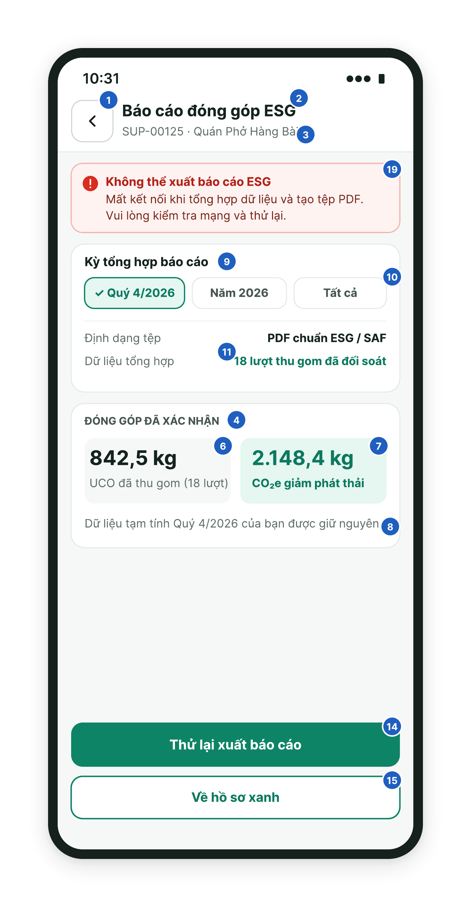
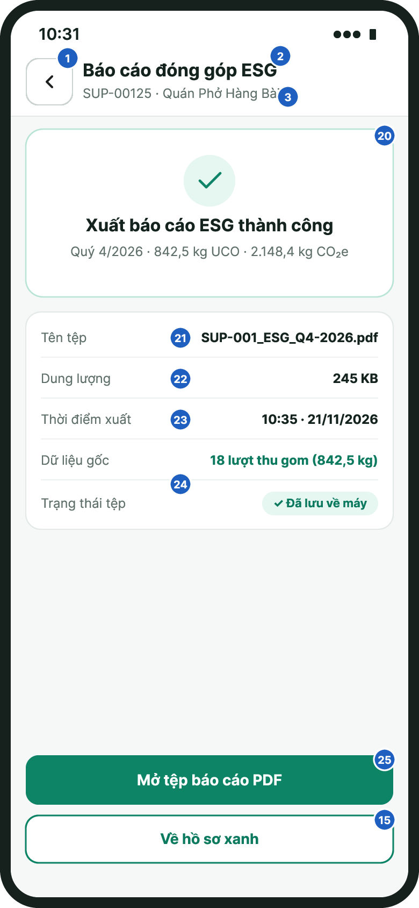

# Screen Spec: S-F05-04 Báo cáo đóng góp ESG (ESG contribution reports)

| Field | Value |
|---|---|
| Screen ID | S-F05-04 |
| Screen name | Báo cáo đóng góp ESG (ESG contribution reports) |
| Actor | Nhà cung cấp (Supplier – `SUP-001`) |
| Priority | Must |
| Feature | F-05 Hồ sơ xanh & Báo cáo đóng góp ESG |
| Activity diagrams | AD-UC-05 (actions "Xem tổng hợp đóng góp", "Chọn kỳ báo cáo", "Xuất báo cáo ESG PDF", "Mở tệp báo cáo") |
| Mockup images | `img/S-F05-04-default.png` (default), `img/S-F05-04-default-numbered.png`, four state images (section 2) |
| Frame width | 390px × 844px (exported at 2x Retina, 780 × 1688 pixels) |
| Figma frame | ReFeed Mobile App – Supplier Flow (`0504.pdf`) |
| Status | Draft |

## 1. Purpose

**Shown when:** Nhà cung cấp (`SUP-001`) mở chức năng xem và xuất báo cáo đóng góp môi trường (lượng dầu ăn đã qua sử dụng – UCO đã thu gom và lượng phát thải $\text{CO}_2\text{e}$ quy đổi giảm được) từ màn hình Hồ sơ xanh (`S-F05-01`).

**The user leaves this screen when:** Nhà cung cấp nhấn nút quay lại (`#1`), nhấn nút "Về hồ sơ xanh" (`#15`), mở tệp PDF báo cáo sau khi xuất thành công (`#25`), hoặc chuyển sang đặt lịch thu gom (`#17`) khi chưa có dữ liệu.

## 2. Mockup

**Numbered:** mỗi chữ số tương ứng với cột `#` trong bảng Element inventory ở mục 3. Các thành phần chỉ xuất hiện ở trạng thái riêng biệt được đánh số trên ảnh trạng thái tương ứng (`#16`–`#17` trên ảnh Empty, `#18` trên ảnh Loading, `#19` trên ảnh Error, `#20`–`#25` trên ảnh Success).

| Default, numbered | Empty, numbered |
|---|---|
|  |  |

| Error, numbered | Success, numbered |
|---|---|
|  |  |

| State | Image |
|---|---|
| Default | `img/S-F05-04-default.png` |
| Empty | `img/S-F05-04-empty.png` |
| Loading | `img/S-F05-04-loading.png` |
| Error | `img/S-F05-04-error.png` |
| Success | `img/S-F05-04-success.png` |

Tất cả màu sắc, kiểu chữ và bo góc tuân thủ hệ thống design tokens trong [ui-conventions.md](../ui-conventions.md#6-design-tokens) (cỡ chữ tối thiểu `12px`, khung máy `390 × 844 px`, vùng hiển thị `370 × 824 px`).

## 3. Element inventory

| # | Element | Type | Content / data source | Required | Validation |
|---|---|---|---|---|---|
| 1 | Quay lại | Button | static icon `<` | Yes | none |
| 2 | Tiêu đề màn hình | Header | static: "Báo cáo đóng góp ESG" | Yes | none |
| 3 | Nhà cung cấp · mã SUP | Text | `supplier.code` + `supplier.name` (ví dụ: `SUP-00125 · Quán Phở Hàng Bài`) | Yes | none |
| 4 | Tiêu đề Đóng góp đã xác nhận | Header | static: "ĐÓNG GÓP ĐÃ XÁC NHẬN" (hiển thị ở trạng thái `1 · 2 · 4`) | Yes | none |
| 5 | Trạng thái đối soát kho | Status badge | `reconciliation.status_label` ("Đã đối soát kho" ở trạng thái `1`; "Chưa có dữ liệu" ở trạng thái `2`) | Yes | none |
| 6 | Khối lượng UCO đã thu gom & số lượt | Summary tile | `esg_summary.total_uco_kg` (định dạng `0,0 kg`) + `esg_summary.collection_count` (`N lượt`) (trạng thái `1 · 2 · 4`) | Yes | $\ge 0,0\text{ kg}$ |
| 7 | Lượng $\text{CO}_2\text{e}$ giảm phát thải | Summary tile | `esg_summary.co2e_saved_kg` (định dạng `0,0 kg`, quy đổi chuẩn SAF) (trạng thái `1 · 2 · 4`) | Yes | $\ge 0,0\text{ kg}$ |
| 8 | Ghi chú quy đổi SAF & chênh lệch | Text | static note (trạng thái `2`: "Hệ thống chỉ tổng hợp các lượt đã hoàn tất đối soát."; trạng thái `4`: "Dữ liệu tạm tính Quý 4/2026 của bạn được giữ nguyên.") | No | none |
| 9 | Tiêu đề Kỳ tổng hợp báo cáo | Header | static: "Kỳ tổng hợp báo cáo" (trạng thái `1 · 4`) | Yes | none |
| 10 | Bộ chọn kỳ Quý / Năm / Tất cả | Chip group | `report.period_options` (`Quý 4/2026`, `Năm 2026`, `Tất cả`) (trạng thái `1 · 4`) | Yes | bắt buộc chọn đúng 1 kỳ |
| 11 | Định dạng tệp & dữ liệu tổng hợp | Text row | static format "PDF chuẩn ESG / SAF" + `esg_summary.reconciled_count` ("18 lượt thu gom đã đối soát") (trạng thái `1 · 4`) | Yes | none |
| 12 | Tiêu đề Báo cáo đã xuất gần đây | Header | static: "BÁO CÁO ĐÃ XUẤT GẦN ĐÂY" (trạng thái `1`) | No | none |
| 13 | Báo cáo đã xuất: tên tệp, ngày & số liệu | List item | `exported_report.file_name`, `exported_report.exported_at`, `exported_report.uco_volume_l`, `exported_report.co2e_saved_kg`, badge `✓ PDF` (trạng thái `1`, dùng chung cho Q3-2026 & Q2-2026) | No | none |
| 14 | Tạo & tải báo cáo / Thử lại xuất báo cáo | Primary button | label động theo trạng thái: "Tải báo cáo ESG (PDF)" (`1`), "Đang tải báo cáo PDF..." (`3`, disabled), "Thử lại xuất báo cáo" (`4`) | Yes | disabled khi đang tải (`3`) |
| 15 | Về hồ sơ xanh | Button | static secondary button: "Về hồ sơ xanh" (hiển thị xuyên suốt `1–5`) | Yes | none |
| 16 | Chưa có dữ liệu: biểu tượng & mô tả | Empty state | icon `CO2` + tiêu đề "Chưa có dữ liệu lập báo cáo ESG" + hướng dẫn quy đổi sau lượt thu gom đầu tiên (trạng thái `2`) | No | none |
| 17 | Đặt lịch thu gom | Primary button | static: "Đặt lịch thu gom" (trạng thái `2`) | No | none |
| 18 | Khối chờ tải: skeleton & thông báo | Loading state | khung xương skeleton 2 thẻ + text "Đang tổng hợp dữ liệu và khởi tạo tệp báo cáo PDF..." (trạng thái `3`) | No | none |
| 19 | Không thể xuất báo cáo ESG | Error banner | tiêu đề "Không thể xuất báo cáo ESG" + chi tiết mất kết nối khi tổng hợp dữ liệu và tạo tệp PDF (trạng thái `4`) | No | none |
| 20 | Xuất thành công: dấu tích & tóm tắt | Success card | icon `✓` + "Xuất báo cáo ESG thành công" + tóm tắt kỳ, khối lượng UCO & $\text{CO}_2\text{e}$ (trạng thái `5`) | No | none |
| 21 | Tên tệp báo cáo PDF | Text row | `exported_report.file_name` (ví dụ: `SUP-001_ESG_Q4-2026.pdf`) (trạng thái `5`) | No | none |
| 22 | Dung lượng tệp | Text row | `exported_report.file_size` (ví dụ: `245 KB`) (trạng thái `5`) | No | none |
| 23 | Thời điểm xuất | Text row | `exported_report.exported_at` (định dạng `HH:mm · DD/MM/YYYY`) (trạng thái `5`) | No | none |
| 24 | Dữ liệu gốc & trạng thái lưu tệp | Status row | `exported_report.source_summary` ("18 lượt thu gom (842,5 kg)") + badge `✓ Đã lưu về máy` (trạng thái `5`) | No | none |
| 25 | Mở tệp báo cáo PDF | Primary button | static: "Mở tệp báo cáo PDF" (trạng thái `5`) | No | none |

## 4. States

| State | What the user sees | Trigger |
|---|---|---|
| Default | Thẻ tổng hợp đóng góp đã xác nhận (`842,5 kg` UCO / `18 lượt`, `2.148,4 kg` $\text{CO}_2\text{e}$, badge `✓ Đã đối soát kho`), bộ chọn kỳ (`Quý 4/2026` đang chọn), thông tin định dạng `PDF chuẩn ESG / SAF`, danh sách 2 báo cáo đã xuất gần đây (`Q3-2026`, `Q2-2026`), cùng 2 nút "Tải báo cáo ESG (PDF)" và "Về hồ sơ xanh". | Mở màn hình khi nhà cung cấp đã có ít nhất 1 lượt thu gom hoàn tất đối soát kho. |
| Empty (no data) | Khối đóng góp hiển thị `0,0 kg` (`0 lượt`), badge `Chưa có dữ liệu`, thẻ thông báo trống `CO2` ("Chưa có dữ liệu lập báo cáo ESG"), nút chính chuyển thành "Đặt lịch thu gom" kèm nút phụ "Về hồ sơ xanh". | Nhà cung cấp chưa có lượt thu gom nào được kho xác nhận đối soát. |
| Loading | Hai khung xương (skeleton cards) thay cho vùng nội dung chính, dòng trạng thái "Đang tổng hợp dữ liệu và khởi tạo tệp báo cáo PDF...", nút chính chuyển sang trạng thái vô hiệu hóa "Đang tải báo cáo PDF...". | Người dùng nhấn "Tải báo cáo ESG (PDF)" (`#14`) hoặc hệ thống đang nạp dữ liệu kỳ báo cáo. |
| Error | Banner cảnh báo màu đỏ nhạt trên cùng ("Không thể xuất báo cáo ESG – Mất kết nối khi tổng hợp dữ liệu và tạo tệp PDF. Vui lòng kiểm tra mạng và thử lại."), giữ nguyên bộ chọn kỳ và số liệu tạm tính phía dưới, nút chính đổi thành "Thử lại xuất báo cáo". | Mất kết nối mạng hoặc dịch vụ tạo tệp PDF gặp lỗi trong lúc xuất báo cáo. |
| Success / confirmation | Thẻ xác nhận viền xanh ("Xuất báo cáo ESG thành công" kèm tóm tắt kỳ và chỉ số), bảng chi tiết tệp vừa tạo (`Tên tệp`, `Dung lượng`, `Thời điểm xuất`, `Dữ liệu gốc`, `Trạng thái tệp: ✓ Đã lưu về máy`), nút chính đổi thành "Mở tệp báo cáo PDF". | Hệ thống tổng hợp xong, lưu tệp PDF về thiết bị thành công. |

## 5. Interactions and navigation

| # | Element | User action | System response | Goes to screen |
|---|---|---|---|---|
| 1 | Quay lại (`#1`) | tap | Đóng màn hình báo cáo ESG, quay về màn hình trước đó | S-F05-01 |
| 2 | Bộ chọn kỳ (`#10`) | tap chip (`Quý 4/2026`, `Năm 2026`, `Tất cả`) | Cập nhật trạng thái chọn của chip và tính lại số lượt thu gom đối soát trong kỳ | stays |
| 3 | Báo cáo đã xuất gần đây (`#13`) | tap item | Mở trình xem tệp PDF của báo cáo kỳ trước đã lưu | System PDF Viewer |
| 4 | Tải báo cáo ESG (PDF) (`#14`) | tap (default state) | Chuyển sang trạng thái Loading (`3`), gọi API tổng hợp và lưu tệp PDF; chuyển sang Success (`5`) hoặc Error (`4`) | stays (loading $\rightarrow$ success/error) |
| 5 | Thử lại xuất báo cáo (`#14`) | tap (error state) | Chạy lại tiến trình tổng hợp dữ liệu và tạo tệp PDF | stays (loading $\rightarrow$ success/error) |
| 6 | Đặt lịch thu gom (`#17`) | tap (empty state) | Điều hướng sang luồng tạo yêu cầu thu gom UCO mới | S-F02-01 |
| 7 | Mở tệp báo cáo PDF (`#25`) | tap (success state) | Mở tệp `SUP-001_ESG_Q4-2026.pdf` vừa lưu bằng trình đọc PDF mặc định | System PDF Viewer |
| 8 | Về hồ sơ xanh (`#15`) | tap (all states) | Quay về màn hình tổng quan Hồ sơ xanh của nhà cung cấp | S-F05-01 |

## 6. Screen-level rules

| Rule ID | Rule | Source |
|---|---|---|
| SR-001 | Hệ thống chỉ tổng hợp và cho phép xuất báo cáo ESG từ các lượt thu gom đã hoàn tất đối soát kho (`status = RECONCILED`). | BR-05-01 |
| SR-002 | Hệ số quy đổi giảm phát thải $\text{CO}_2\text{e}$ được tính tự động theo chuẩn nhiên liệu hàng không bền vững (SAF) dựa trên khối lượng UCO thực nhận sau đối soát ($1\text{ kg UCO} \approx 2,55\text{ kg CO}_2\text{e}$). | BR-05-02 |
| SR-003 | Khi xảy ra lỗi kết nối lúc xuất tệp PDF, toàn bộ dữ liệu tạm tính và kỳ báo cáo người dùng đã chọn phải được giữ nguyên để có thể thử lại ngay. | FR-05-04 |
| SR-004 | Các thẻ thông báo lỗi (`#19`) và thành công (`#20`) phải hiển thị đồng thời biểu tượng trực quan (dấu chấm than / dấu tích) kèm văn bản mô tả, không chỉ phân biệt bằng màu sắc. | ui-conventions §5 |

## 7. Linked requirements

| FR ID | What this screen does for it |
|---|---|
| FR-05-01 | Hiển thị tổng khối lượng UCO đã thu gom đối soát và lượng $\text{CO}_2\text{e}$ giảm phát thải tích lũy của nhà cung cấp. |
| FR-05-02 | Cho phép lọc và tổng hợp số liệu đóng góp ESG theo từng kỳ báo cáo (Quý, Năm, Tất cả). |
| FR-05-03 | Khởi tạo, xuất và lưu tệp báo cáo đóng góp môi trường định dạng PDF chuẩn ESG / SAF về thiết bị. |
| FR-05-04 | Hiển thị lịch sử các báo cáo ESG đã xuất gần đây và xử lý trạng thái rỗng / mất kết nối an toàn. |

## 8. Responsive and accessibility notes

- Chiều rộng khung thiết kế chuẩn: `390px` (vùng hiển thị nội dung `370px`, viền ngoài `10px`), hỗ trợ co giãn linh hoạt từ `360px` trở lên; hai thẻ chỉ số `#6` và `#7` giữ bố cục 2 cột ngang bằng nhau.
- Cỡ chữ tối thiểu cho toàn bộ nhãn phụ và ghi chú là `12px`, đảm bảo độ tương phản văn bản tối thiểu `4.5:1` theo `ui-conventions.md`.
- Nhãn số tham chiếu (`#1`–`#25`) được đặt ở góc thẻ/thành phần để không làm xô lệch bố cục nội dung gốc.

## 9. Open questions

| # | Question | Blocking? | Status |
|---|---|---|---|
| 1 | [NEEDS CLARIFICATION: Có cần bổ sung tùy chọn chia sẻ trực tiếp tệp PDF qua email/Zalo ngay tại màn hình Success (`#25`) hay chỉ mở bằng trình đọc PDF hệ thống?] | No | Open. Default: lưu về máy và mở bằng System PDF Viewer. |

---

## Completion checklist

- [x] The mockup is a separate cropped image file, named with the Screen ID, at the frame width (`390×844px` @2x Retina).
- [x] The numbered image exists, and its numbers match the `#` column of the element inventory (`1`–`25`).
- [x] Every visible element in the mockup appears in the element inventory.
- [x] Every colour in the mockup is a design token from `ui-conventions.md`.
- [x] Every input element has a validation rule or an explicit "none".
- [x] All five states (`Default`, `Empty`, `Loading`, `Error`, `Success`) are filled in.
- [x] Every navigation target is a Screen ID that exists in the Screen List (`S-F05-01`, `S-F02-01`).
- [x] Every element that displays data names the field it displays.
- [x] Every linked FR exists in the Function List, and every action of this screen is covered by an interaction row.