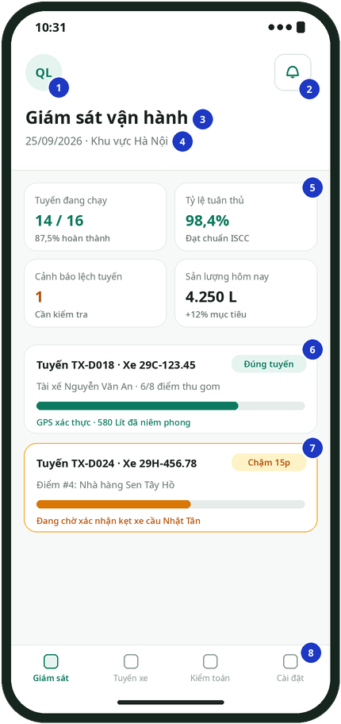
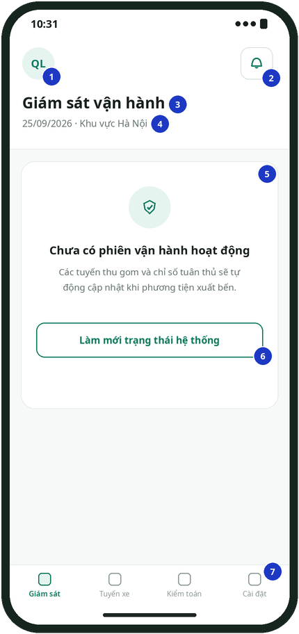
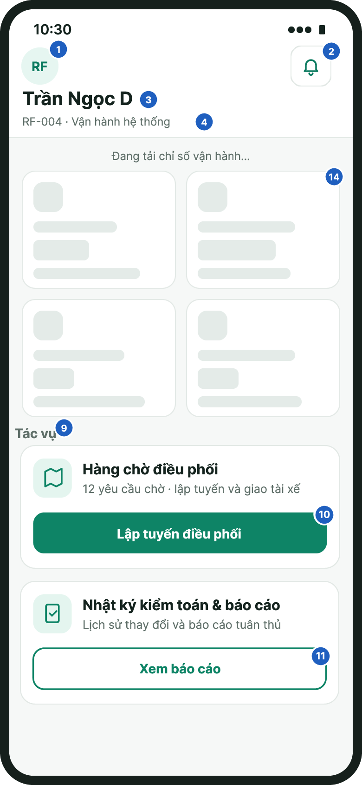
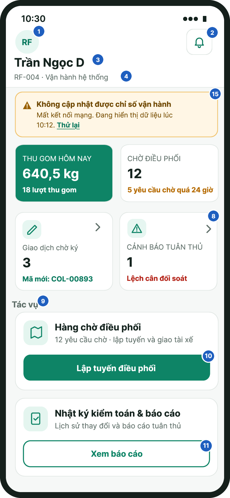
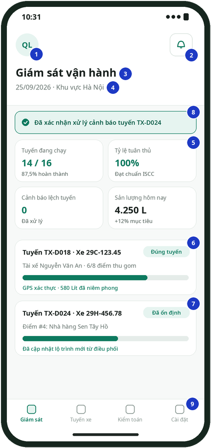

# Screen Spec: S-F06-01 Operations and compliance monitoring

| Field | Value |
|---|---|
| Screen ID | S-F06-01 |
| Screen name | Operations and compliance monitoring (`Giám sát vận hành & tuân thủ`) |
| Actor | ReFeed Staff (`Nhân viên ReFeed`, `RF-004`) |
| Priority | Must |
| Feature | F-06 Operations & Compliance Monitoring |
| Activity diagrams | AD-UC-06 (actions "Monitor daily operational KPIs", "Review pending signatures & compliance alerts", "Navigate to dispatch queue", "Navigate to audit log & reports") |
| Mockup images | `img/S-F06-01-default.png` (default), five numbered state images and four state images (section 2) |
| Frame width | 370px screen inside a 390 × 844 device frame (exported at 3x with a 50px shadow margin, 1470 × 2832 pixels) |
| Figma frame | ReFeed Mobile App – ReFeed Staff Flow (`06012.pdf`, Page 1) |
| Status | Draft |

## 1. Purpose

**Shown when:** ReFeed operations staff (`RF-004`) logs into the staff workspace or navigates to the operations dashboard to monitor daily UCO collection volume, pending dispatch requests, unsigned transactions, and compliance reconciliation alerts.

**The user leaves this screen when:** the staff member taps "Lập tuyến điều phối" (`#10`) to open the dispatch queue (`S-F02-01`), taps "Xem báo cáo" (`#11`) or the Compliance alert tile (`#8`) to inspect the audit log & compliance reports (`S-F06-02`), taps the Pending signatures tile (`#7`) to review unsigned handovers, or opens the staff menu (`#1`) / system notifications (`#2`).

## 2. Mockup

**Numbered:** each number is the # of the element inventory in section 3. Elements 12–13 (Empty state and "Làm mới dữ liệu") appear only in the empty state, element 14 (Loading skeleton) only in the loading state, element 15 (Error banner) only in the error state, and element 16 (Success sync banner) only in the success state, so each is numbered on that state's image. Across the states, shared elements keep their numbers: the header (1–4) and task navigation section (9–11) appear on all five images, while the four KPI/shortcut tiles (5–8) appear in default (6–8), error (cached values with badge 8), and success (5–8).

| Default, numbered | Empty, numbered | Loading, numbered | Error, numbered | Success, numbered |
|---|---|---|---|---|
|  |  |  |  |  |

| State | Image |
|---|---|
| Default | `img/S-F06-01-default.png` |
| Empty | `img/S-F06-01-empty.png` |
| Loading | `img/S-F06-01-loading.png` |
| Error | `img/S-F06-01-error.png` (sync failed because the connection was lost; cached metrics from `10:12` shown) |
| Success | `img/S-F06-01-success.png` |

All colours, fonts and corners come from the design tokens in [ui-conventions.md](../ui-conventions.md#6-design-tokens).

## 3. Element inventory

| # | Element | Type | Content / data source | Required | Validation |
|---|---|---|---|---|---|
| 1 | Staff identity avatar & menu trigger | Avatar button | `staff.initials` (static badge `RF`) (states 1–5) | Yes | none |
| 2 | System notifications button | Icon button | static bell icon with unread alert indicator (states 1–5) | Yes | none |
| 3 | Screen title (Staff name) | Header | `staff.full_name` (e.g. `Trần Ngọc D`) (states 1–5) | Yes | none |
| 4 | Staff ID & operational scope line | Text | `staff.code` + `staff.scope_label` (`RF-004 · Vận hành hệ thống`) (states 1–5) | Yes | none |
| 5 | Today's collection KPI card | KPI card | `ops_kpi.today_collected_kg` (`640,5 kg` $\rightarrow$ `715,0 kg`) + `ops_kpi.today_pickups_count` (`18 lượt thu gom` $\rightarrow$ `20 lượt thu gom (+2 mới)`) (states 1, 4, 5) | Yes | $\ge 0,0\text{ kg}$ |
| 6 | Pending dispatch info card | KPI card | `ops_kpi.pending_dispatch_count` (`12` $\rightarrow$ `14 +2 mới`) + `ops_kpi.overdue_24h_count` (`5 yêu cầu chờ quá 24 giờ`) (states 1, 4, 5) | Yes | $\ge 0$ |
| 7 | Pending signatures shortcut tile | Shortcut tile | `ops_kpi.pending_signature_count` (`3` $\rightarrow$ `4 +1 mới`) + `ops_kpi.latest_pending_col` (`Mã mới: COL-00893`) (states 1, 4, 5) | Yes | $\ge 0$ |
| 8 | Compliance alerts shortcut tile | Shortcut tile | `ops_kpi.compliance_alert_count` (`1`) + `ops_kpi.top_alert_reason` (`Lệch cân đối soát`) (states 1, 4, 5) | Yes | $\ge 0$ |
| 9 | Task / detail section label | Section label | static label: "Tác vụ" (`XEM CHI TIẾT` navigation group) (states 1–5) | Yes | none |
| 10 | Dispatch queue navigation card | Navigation row | static title "Hàng chờ điều phối" + `ops_kpi.pending_dispatch_summary` ("12 yêu cầu chờ · lập tuyến và giao tài xế") + primary button "Lập tuyến điều phối" (states 1–5) | Yes | none |
| 11 | Audit log & reports navigation card | Navigation row | static title "Nhật ký kiểm toán & báo cáo" + static subtitle "Lịch sử thay đổi và báo cáo tuân thủ" + secondary button "Xem báo cáo" (states 1–5) | Yes | none |
| 12 | Empty metrics state card | Empty state | minus icon + "Chưa có chỉ số vận hành" + "Chưa phát sinh yêu cầu thu gom, giao dịch hoặc cảnh báo tuân thủ trong ca làm việc này." (state 2) | No | none |
| 13 | Refresh data button | Primary button | static: "Làm mới dữ liệu" (state 2) | No | none |
| 14 | Loading skeleton grid | Loading state | status line "Đang tải chỉ số vận hành..." + four grey skeleton cards (state 3) | No | none |
| 15 | Offline error banner & retry link | Error banner + button | warning icon + "Không cập nhật được chỉ số vận hành" + "Mất kết nối mạng. Đang hiển thị dữ liệu lúc 10:12." + inline action "Thử lại" (state 4) | No | none |
| 16 | Sync confirmation banner | Success banner | check icon + `ops_sync.confirmed_text` ("Đã cập nhật số liệu mới nhất lúc 10:32") (state 5) | No | none |

## 4. States

| State | What the user sees | Trigger |
|---|---|---|
| Default | Header with staff avatar `RF`, name `Trần Ngọc D` (`RF-004 · Vận hành hệ thống`), 2×2 KPI & shortcut grid (`640,5 kg` collected / `18 lượt thu gom`, `12` pending dispatch with `5 yêu cầu chờ quá 24 giờ` warning, `3` pending signatures with `Mã mới: COL-00893`, `1` compliance alert `Lệch cân đối soát`), and two task cards ("Hàng chờ điều phối" and "Nhật ký kiểm toán & báo cáo"). | Screen opened and current shift operational metrics are loaded. |
| Empty (no data) | Header (`#1`–`#4`), central empty state card ("Chưa có chỉ số vận hành" with guidance text and primary button "Làm mới dữ liệu"), while the two task navigation cards (`#10`, `#11`) remain accessible below. | No collection requests, signature tasks, or compliance alerts have occurred in the current shift. |
| Loading | Header (`#1`–`#4`), status label "Đang tải chỉ số vận hành..." above four grey skeleton placeholder cards (`#14`), while task navigation cards (`#10`, `#11`) remain visible below. | Screen initially fetches metrics or user triggers a manual refresh (`#13` / `#15`). |
| Error | Amber warning banner at top (`#15`: "Không cập nhật được chỉ số vận hành — Mất kết nối mạng. Đang hiển thị dữ liệu lúc 10:12. Thử lại"), followed by the last cached 2×2 KPI grid (`640,5 kg`, `12`, `3`, `1`) and task cards. | Network request fails while refreshing operational KPIs; locally cached snapshot is preserved. |
| Success / confirmation | Green confirmation banner (`#16`: "Đã cập nhật số liệu mới nhất lúc 10:32"), updated 2×2 KPI grid showing delta indicators (`715,0 kg` / `+2 mới`, `14` / `+2 mới`, `4` / `+1 mới`, `1` compliance alert), and task cards. | Live data synchronization succeeds after a manual refresh or real-time update. |

## 5. Interactions and navigation

| # | Element | User action | System response | Goes to screen |
|---|---|---|---|---|
| 1 | Staff avatar (`#1`) | tap | Opens staff account & shift switcher drawer | Account / Shift Drawer |
| 2 | System notifications (`#2`) | tap | Opens system alerts and compliance notification center | Notifications View |
| 3 | Pending signatures tile (`#7`) | tap | Filters or opens list of unconfirmed collection handovers (`COL-00893`) | Pending Signatures List |
| 4 | Compliance alerts tile (`#8`) | tap | Opens audit log filtered to reconciliation discrepancies (`Đối soát`) | S-F06-02 |
| 5 | Lập tuyến điều phối (`#10`) | tap | Opens pending collection requests queue to assign routes and drivers | S-F02-01 |
| 6 | Xem báo cáo (`#11`) | tap | Opens full SHA-256 audit log & ISCC compliance export screen | S-F06-02 |
| 7 | Làm mới dữ liệu (`#13`) | tap (empty state) | Triggers Loading state (`3`) and fetches latest shift metrics | stays (loading $\rightarrow$ default/empty/error) |
| 8 | Thử lại (`#15`) | tap (error state) | Re-attempts network sync from cached state (`4`) | stays (loading $\rightarrow$ success/error) |

## 6. Screen-level rules

| Rule ID | Rule | Source |
|---|---|---|
| SR-001 | Pending dispatch requests waiting longer than 24 hours (`5 yêu cầu chờ quá 24 giờ`) must be highlighted in amber warning text on card `#6` to prioritize route assignment. | BR-06-01 |
| SR-002 | Warehouse weight reconciliation discrepancies (`Lệch cân đối soát`) immediately increment the compliance alert counter (`#8`) in red alert text and link directly to `S-F06-02`. | BR-06-02 |
| SR-003 | If a metric refresh fails due to network loss, the screen never blanks out existing data; it displays the cached timestamp (`10:12`) in banner `#15` alongside the cached KPI cards. | FR-06-01 |
| SR-004 | Task navigation cards (`#10` and `#11`) remain enabled across all five states (including Empty, Loading, and Error) so staff can always access dispatch and audit workflows. | ui-conventions §4 |

## 7. Linked requirements

| FR ID | What this screen does for it |
|---|---|
| FR-06-01 | Displays real-time daily operational KPIs (collected UCO weight, pickup count, pending dispatches, overdue >24h alerts). |
| FR-06-02 | Surfaces actionable shortcuts for unsigned handovers (`Giao dịch chờ ký`) and reconciliation compliance alerts (`Cảnh báo tuân thủ`). |
| FR-06-03 | Provides direct navigation entry points to Dispatch Queue (`S-F02-01`) and Audit Log & ISCC Reports (`S-F06-02`). |
| FR-06-04 | Handles empty shift states, loading skeletons, offline cached fallback, and sync confirmation states. |

## 8. Responsive and accessibility notes

* Standard frame width: `390px` (`370px` inner viewport with `10px` device bezel), scaling down to `360px` minimum width; the four KPI/shortcut cards (`#5`–`#8`) maintain a 2×2 grid layout.
* Minimum font size across all labels and warning notes is `12px`, maintaining at least `4.5:1` contrast ratio per `ui-conventions.md`.
* Status banners (`#15` error and `#16` success) and shortcut cards (`#7`, `#8`) pair distinct icons (warning triangle, pencil, check circle) with text labels rather than relying on colour alone.

## 9. Open questions

| # | Question | Blocking? | Status |
|---|---|---|---|
| 1 | [NEEDS CLARIFICATION: Should the 4 KPI cards auto-poll every 60 seconds in the foreground, or only refresh on screen focus and manual pull/tap?] | No | Open. Default: refresh on screen focus and manual retry/refresh action. |

---

## Completion checklist

- [x] The mockup is a separate cropped image file, named with the Screen ID, at the frame width (`390×844px` @2x Retina).
- [x] The numbered images exist for all five states, and their numbers match the `#` column of the element inventory (`1`–`16`).
- [x] Every visible element in the mockup appears in the element inventory.
- [x] Every colour in the mockup is a design token from `ui-conventions.md`.
- [x] Every input element has a validation rule or an explicit "none".
- [x] All five states (`Default`, `Empty`, `Loading`, `Error`, `Success`) are filled in.
- [x] Every navigation target is a Screen ID that exists in the Screen List (`S-F02-01`, `S-F06-02`).
- [x] Every element that displays data names the field it displays.
- [x] Every linked FR exists in the Function List, and every action of this screen is covered by an interaction row.
