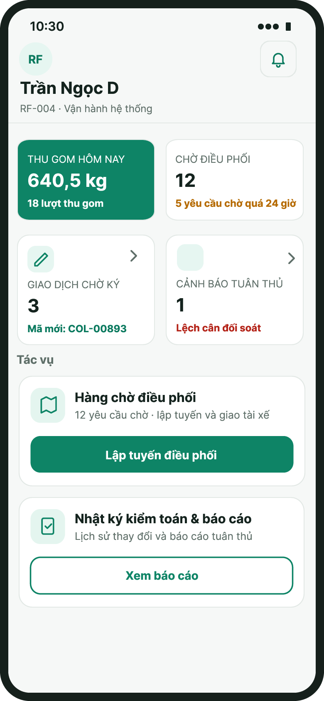

# Screen Spec: S-F06-01 Operations and compliance monitoring

| Field | Value |
|---|---|
| Screen ID | S-F06-01 |
| Screen name | Operations and compliance monitoring |
| Actor | ReFeed Staff (Operations / Compliance Staff) |
| Priority | Should |
| Feature | F-06 Operations, Audit & Compliance |
| Use cases / Flows | UC-16 · `admin-monitoring-flow` · `operations-flow` (no separate activity diagram; operational oversight query view) |
| Mockup image | `img/S-F06-01-default.png` (annotated: `img/S-F06-01-default-numbered.png`) |
| Status | Draft |

## 1. Purpose

**Shown when:** authorised ReFeed operations or compliance staff sign in (`S-F00-01` staff home) or select the `"Giám sát"` (Monitoring) tab to oversee active collection routes, daily collected UCO volume, ISCC compliance rates, and route/schedule exceptions in real time.

**The user leaves this screen when:** staff acknowledge/resolve an operational alert (transitioning to the success state), drill down into the dispatch queue (`S-F02-01`) or audit trail & compliance reports (`S-F06-02`), or sign out (`S-F00-01`).

## 2. Mockup

## 3. Element inventory

| # | Element | Type | Content / data source | Required | Validation |
|---|---|---|---|---|---|
| 1 | Staff role initials badge | Avatar badge | Derived role initials from authenticated staff profile (e.g., `"QL"` for Quản lý) | Yes | none |
| 2 | Alerts & notifications button | Icon button | Static bell icon; displays active compliance/route alerts drawer or triggers status refresh | Yes | disabled in Loading state |
| 3 | Title | Header | Static: `"Giám sát vận hành"` (Operations monitoring) | Yes | none |
| 4 | Date & region subtitle | Subtitle text | `monitor.current_date` + `" · Khu vực "` + `monitor.region_name` (e.g., `25/09/2026 · Khu vực Hà Nội`) | Yes | formats from `ui-conventions` |
| 5 | Operational & compliance KPI grid | 2×2 metric card grid | `monitor.active_routes_count` / `monitor.total_routes_count` (`14 / 16`, `87,5% hoàn thành`); `monitor.iscc_compliance_pct` (`98,4%`, `Đạt chuẩn ISCC`); `monitor.deviation_alerts_count` (`1`, `Cần kiểm tra`); `monitor.daily_collected_litres` (`4.250 L`, `+12% mục tiêu`) | Yes | aggregated strictly from verified system records for the active date and region |
| 6 | On-track route monitoring card | Status card | `route.route_code` (`TX-D018`), `vehicle.plate_number` (`29C-123.45`), `route.status_badge` (`"Đúng tuyến"`), `driver.full_name` (`Nguyễn Văn An`), `route.completed_stops` / `route.total_stops` (`6/8`), progress bar, `route.gps_verified` & `route.sealed_volume_litres` (`580 Lít`) | Yes | progress bar width = `completed_stops / total_stops` |
| 7 | Exception / delayed route card | Interactive alert card | `route.route_code` (`TX-D024`), `vehicle.plate_number` (`29H-456.78`), `route.alert_badge` (`"Chậm 15p"` in Default; `"Đã ổn định"` in Success), `stop.supplier_name` (`Nhà hàng Sen Tây Hồ`), progress bar, `route.alert_note` | Yes | highlighted with amber border (`#F59E0B`) while `route.has_unresolved_alert = true` |
| 8 | Alert resolution banner | Banner | Confirmation message with acknowledged route code `route.route_code` (e.g., `"Đã xác nhận xử lý cảnh báo tuyến TX-D024"`) or inline action error | No | shown only in Success state after staff acknowledge/resolve a route alert |
| 9 | Bottom navigation bar | Tab bar | Static tabs: `"Giám sát"` (`S-F06-01`), `"Tuyến xe"` (`S-F02-01`), `"Kiểm toán"` (`S-F06-02`), `"Cài đặt"` (`S-F00-01`) | Yes | highlights active `"Giám sát"` tab; badge numbered `8` when banner #8 is hidden, `9` when banner #8 is visible |

## 4. States

| State | What the user sees | Trigger |
|---|---|---|
| Default | Header with `"QL"` badge, notification bell, title `"Giám sát vận hành"`, and date/region line; 2×2 KPI grid (`14 / 16` active routes, `98,4%` ISCC compliance, `1` deviation alert, `4.250 L` collected today); on-track route card `TX-D018` (green `"Đúng tuyến"`); exception route card `TX-D024` (amber border and `"Chậm 15p"` badge); bottom navigation bar. | Screen opened by authorised ReFeed staff and operational telemetry loaded (`total_routes_count > 0`) |
| Empty (no data) | Empty-state card with green shield-check icon, title `"Chưa có phiên vận hành hoạt động"`, helper text explaining routes and compliance metrics update automatically once vehicles depart, and outlined button `"Làm mới trạng thái hệ thống"`. KPI grid and route cards are hidden. | No routes dispatched or active for the current date/region |
| Loading | Grey skeleton placeholders for header avatar/title, filter bar, 2×2 KPI summary card, route list cards, action bar, and bottom navigation tabs; all interactive controls disabled. | Initial telemetry fetch or manual status refresh is in progress |
| Error | Error card with red alert triangle icon, title `"Mất kết nối dữ liệu giám sát"`, message `"Không thể đồng bộ tín hiệu GPS và trạng thái tuân thủ tuyến thu gom thời gian thực."`, and solid green button `"Kết nối lại"`. | Backend aggregation query or real-time telemetry sync fails / times out |
| Success / confirmation | Green confirmation banner `#8` (`"Đã xác nhận xử lý cảnh báo tuyến TX-D024"`), KPI grid updated (`Tỷ lệ tuân thủ: 100%`, `Cảnh báo lệch tuyến: 0 · Đã xử lý`), route card `TX-D024` border reset to neutral with green pill `"Đã ổn định"` and updated dispatch note. | Staff acknowledge/resolve an active route alert (`FR-06-01`) |

## 5. Interactions and navigation

| # | Element | User action | System response | Goes to screen |
|---|---|---|---|---|
| 1 | Exception route card `TX-D024` (`#7`) | tap | Opens alert acknowledgement action / confirms dispatch resolution for the delayed route, updates compliance KPIs, and transitions to Success state (`FR-06-01`) | stays (success or error state) |
| 2 | Notifications bell button (`#2`) | tap | Refreshes live operational alerts and route compliance statuses (`FR-06-01`) | stays |
| 3 | KPI card `"Tuyến đang chạy"` (`#5`) | tap | Drills down into pending pickup requests and route dispatch queue | S-F02-01 |
| 4 | KPI card `"Tỷ lệ tuân thủ"` (`#5`) | tap | Drills down into historical audit logs and ISCC compliance reports | S-F06-02 |
| 5 | `"Làm mới trạng thái hệ thống"` button (Empty state) | tap | Triggers Loading state and re-queries active routes for the current date | stays |
| 6 | `"Kết nối lại"` button (Error state) | tap | Triggers Loading state and retries telemetry synchronization | stays |
| 7 | Tab `"Giám sát"` (`#9`) | tap | Stays on operations monitoring dashboard or scrolls to top | S-F06-01 |
| 8 | Tab `"Tuyến xe"` (`#9`) | tap | Opens dispatch queue for pending pickup requests and route planning | S-F02-01 |
| 9 | Tab `"Kiểm toán"` (`#9`) | tap | Opens audit trail and compliance reports view | S-F06-02 |
| 10 | Tab `"Cài đặt"` / Staff avatar (`#9` / `#1`) | tap | Opens staff session / sign-out screen (`S-F00-01`) | S-F00-01 |

## 6. Screen-level rules

| Rule ID | Rule | Source |
|---|---|---|
| SR-001 | Only users authenticated with an authorised ReFeed Staff / Admin / Compliance role may access `S-F06-01`; unauthorised role requests are blocked and logged in the security audit trail. | FR-06-01, FR-06-03 |
| SR-002 | Operational KPIs (`active_routes_count`, `iscc_compliance_pct`, `deviation_alerts_count`, `daily_collected_litres`) MUST reflect live aggregated states across suppliers, pickups, collections, and transactions without manual override of raw collection volumes. | FR-06-01 |
| SR-003 | Every alert acknowledgement or route exception resolution recorded on this screen logs the acting `staff_id` and timestamp for audit traceability. | FR-06-01, FR-06-02 |
| SR-004 | Route compliance statuses and alerts always pair explicit text badges (`"Đúng tuyến"`, `"Chậm 15p"`, `"Đã ổn định"`), icons, and numeric progress indicators with colour fills—never relying on colour alone. | `ui-conventions` §5 |

## 7. Linked requirements

| FR ID | What this screen does for it |
|---|---|
| FR-06-01 | Provides authorised staff with a consolidated monitoring dashboard displaying active routes, supplier pickups, collected volumes, ISCC compliance rates, and real-time route/schedule alerts (`UC-16`). |
| FR-06-02 | Connects operational compliance exceptions directly to the audit trail (`S-F06-02`) for historical review and compliance reporting (`UC-17`). |
| FR-06-03 | Enforces role-based access control so only authorised ReFeed staff can view operational telemetry and acknowledge compliance alerts. |

## 8. Responsive and accessibility notes

- Smallest supported viewport width: `360px` (mockup baseline `430×912px`); the 2×2 KPI grid (`#5`) retains two columns down to `360px` with compact card padding, and route card status badges wrap cleanly below the route title if needed.
- On tablet/desktop viewports (`>= 768px`), the 2×2 KPI cards expand into a single 4-column horizontal row above a two-column route monitoring list.
- Progress bars include text indicators (`6/8 điểm thu gom`) and status pills so screen readers announce exact completion counts rather than visual bar percentages alone.
- All body text, KPI values, and warning badges (`#B45309` on `#FEF3C7`) maintain at least a `4.5:1` contrast ratio.

## 9. Open questions

| # | Question | Blocking? | Status |
|---|---|---|---|
| 1 | [NEEDS CLARIFICATION: Should `S-F06-01` auto-poll telemetry every 30 seconds in the background, or refresh strictly on screen open and manual tap of button `#2`?] | No | Open. Default: refresh on open and manual tap of button `#2` for Release 1/2. |
| 2 | [NEEDS CLARIFICATION: When staff tap an on-track route card (`#6`), should it open a read-only route detail drawer or navigate to `S-F02-02` (Route review and dispatch)?] | No | Open. Default: drill down to `S-F02-01` / `S-F02-02` for route-level inspection. |

---

## Completion checklist

- [x] The mockup is a separate cropped image file, named with the Screen ID (`img/S-F06-01-default.png` and `img/S-F06-01-default-numbered.png`).
- [x] Every visible element in the mockup appears in the element inventory (`#1`–`#9`).
- [x] Every input/interactive element has a validation rule or an explicit `"none"`.
- [x] All five states (`Default`, `Empty`, `Loading`, `Error`, `Success`) are filled in and match the generated PNG mockups.
- [x] Every navigation target (`S-F02-01`, `S-F06-02`, `S-F06-01`, `S-F00-01`) is a valid Screen ID in `screen-list.md`.
- [x] Every element that displays data names the field it displays.
- [x] Every linked FR (`FR-06-01`, `FR-06-02`, `FR-06-03`) exists in the Function List.