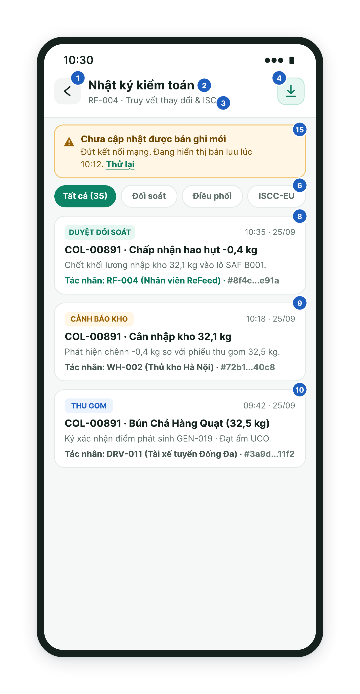
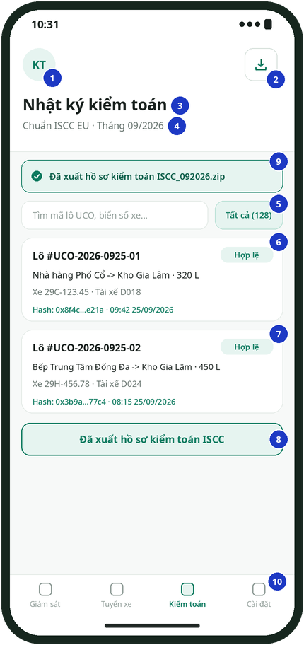

# Screen Spec: S-F06-02 Audit log & compliance reports

| Field | Value |
| ----- | ----- |
| Screen ID | S-F06-02 |
| Screen name | Audit log & compliance reports (`Nhật ký kiểm toán & báo cáo tuân thủ`) |
| Actor | ReFeed Staff (`Nhân viên ReFeed`, `RF-004`) |
| Priority | Must |
| Feature | F-06 Operations & Compliance Monitoring |
| Activity diagrams | AD-UC-06 (actions "Inspect audit log entries", "Search & filter audit trail", "Verify SHA-256 integrity", "Export compliance report (.CSV / ISCC)") |
| Mockup images | `img/S-F06-02-default.png` (default), five numbered state images and four state images (section 2) |
| Frame width | 370px screen inside a 390 × 844 device frame (exported at 3x with a 50px shadow margin, 1470 × 2832 pixels) |
| Figma frame | ReFeed Mobile App – ReFeed Staff Flow (`06012.pdf`, Page 2) |
| Status | Draft |

## 1. Purpose

**Shown when:** ReFeed operations staff (`RF-004`) taps "Xem báo cáo" (`#11`) or the Compliance alerts tile (`#8`) on `S-F06-01` to inspect immutable SHA-256 signed audit log entries, trace UCO collection, warehouse reconciliation, and ISCC-EU batch closing events, and export compliance reports (`.CSV / ISCC`).

**The user leaves this screen when:** the staff member taps Back (`#1`) to return to `S-F06-01`, or taps the export button (`#4`) to download a signed `.CSV` compliance report to the device.

## 2. Mockup

**Numbered:** each number is the # of the element inventory in section 3. Elements 12–13 (Empty state message and "Xóa bộ lọc") appear only in the empty state, element 14 (Loading skeleton) only in the loading state, element 15 (Error banner) only in the error state, and element 16 (Success export card) only in the success state, so each is numbered on that state's image. Across the states, shared elements keep their numbers: the header (1–4) appears on all five images, the search input (5) appears on default, empty, and success, the filter chips (6) and log cards (8–10) appear on default, error, and success, and the SHA-256 integrity strip (7) and ISCC trace card (11) appear on default and success.

| Default, numbered | Empty, numbered | Loading, numbered | Error, numbered | Success, numbered |
| :---: | :---: | :---: | :---: | :---: |
|  |  |  |  |  |

| State | Image |
| ----- | ----- |
| Default | `img/S-F06-02-default.png` |
| Empty | `img/S-F06-02-empty.png` |
| Loading | `img/S-F06-02-loading.png` |
| Error | `img/S-F06-02-error.png` (sync failed because the connection was lost; cached snapshot from `10:12` shown) |
| Success | `img/S-F06-02-success.png` |

All colours, fonts and corners come from the design tokens in [ui-conventions.md](../ui-conventions.md#6-design-tokens).

## 3. Element inventory

| \# | Element | Type | Content / data source | Required | Validation |
| ----- | ----- | ----- | ----- | ----- | ----- |
| 1 | Back | Button | static icon `<` (states 1–5) | Yes | none |
| 2 | Screen title | Header | static: "Nhật ký kiểm toán" (states 1–5) | Yes | none |
| 3 | Context subtitle | Text | `staff.code` + static scope label (`RF-004 · Truy vết thay đổi & ISCC`) (states 1–5) | Yes | none |
| 4 | Export compliance report button | Button | static download icon trigger for `.CSV / ISCC` export (states 1–5) | Yes | disabled while loading (state 3) |
| 5 | Search input | Search input | `filter.query` with placeholder "Tìm mã COL, lô B001, nhân viên..." (states 1, 2, 5; shows `COL-99999` in state 2) | No | max 64 characters; alphanumeric and `-` |
| 6 | Workflow filter chip group | Button | `filter.category` options: `Tất cả (35)`, `Đối soát`, `Điều phối`, `ISCC-EU` (states 1, 4, 5) | Yes | exactly one chip selected |
| 7 | SHA-256 integrity confirmation row | Status / row | check icon + `audit_batch.date` + `audit_batch.verified_count` (`25/09/2026 · 35 bản ghi toàn vẹn chữ ký SHA-256`) (states 1, 5) | Yes | all displayed records match valid SHA-256 chain |
| 8 | Reconciliation approval log card | List item | badge `DUYỆT ĐỐI SOÁT`, `event.timestamp` (`10:35 · 25/09`), `event.title` (`COL-00891 · Chấp nhận hao hụt -0,4 kg`), `event.detail`, `event.actor` + `event.sha256_short` (`#8f4c...e91a`) (states 1, 4, 5) | No | none |
| 9 | Warehouse alert log card | List item | badge `CẢNH BÁO KHO`, `event.timestamp` (`10:18 · 25/09`), `event.title` (`COL-00891 · Cân nhập kho 32,1 kg`), `event.detail`, `event.actor` (`WT-01234` / `WH-002`) + `event.sha256_short` (`#72b1...40c8`) (states 1, 4, 5) | No | none |
| 10 | Collection handover log card | List item | badge `THU GOM`, `event.timestamp` (`09:42 · 25/09`), `event.title` (`COL-00891 · Bún Chả Hàng Quạt (32,5 kg)`), `event.detail`, `event.actor` (`DRV-011`) + `event.sha256_short` (`#3a9d...11f2`) (states 1, 4, 5) | No | none |
| 11 | ISCC trace batch log card | List item | badge `TRUY VẾT ISCC`, `event.timestamp` (`08:50 · 25/09`), `event.title` (`BATCH-B001 · Khóa sổ chứng từ lô SAF`), `event.detail`, `event.actor` (`RF-004`) + `event.sha256_short` (`#19e0...9b7d`) (states 1, 5) | No | none |
| 12 | Empty state card | Empty state | shield-check icon + "Không tìm thấy bản ghi kiểm toán" + "Chưa có lịch sử truy vết nào khớp với mã hoặc nhóm nghiệp vụ bạn đang chọn." (state 2) | No | none |
| 13 | Clear filter button | Button | static: "Xóa bộ lọc" (state 2) | No | none |
| 14 | Loading skeleton list | Loading state | status line "Đang tải nhật ký & kiểm tra chữ ký SHA-256..." + three grey skeleton cards (state 3) | No | none |
| 15 | Offline error banner | Error banner | warning icon + "Chưa cập nhật được bản ghi mới" + "Đứt kết nối mạng. Đang hiển thị bản lưu lúc 10:12." + inline action "Thử lại" (state 4) | No | none |
| 16 | Report export success card | Success card | check icon + `export.file_name` (`Đã xuất báo cáo · audit_log_25092026.csv`) + `export.summary` ("35 bản ghi kiểm toán kèm chữ ký SHA-256 đã tải xuống thành công lúc 10:37 · 25/09/2026.") (state 5) | No | none |

## 4. States

| State | What the user sees | Trigger |
| ----- | ----- | ----- |
| Default | Header with Back (`#1`), title "Nhật ký kiểm toán" (`#2`), subtitle `RF-004 · Truy vết thay đổi & ISCC` (`#3`), export icon button (`#4`); search input (`#5`), filter chips (`#6`: `Tất cả (35)` selected), SHA-256 integrity strip (`#7`), and chronological audit cards (`#8`–`#11`). | Screen opened and audit records pass SHA-256 integrity verification. |
| Empty (no data) | Header (`#1`–`#4`), search input (`#5`) showing active query `COL-99999`, and central empty state card (`#12`: "Không tìm thấy bản ghi kiểm toán") with secondary button "Xóa bộ lọc" (`#13`). | Search query or selected workflow category filter matches zero audit records. |
| Loading | Header (`#1`–`#4`), status label "Đang tải nhật ký & kiểm tra chữ ký SHA-256..." above three grey skeleton placeholder cards (`#14`). | Screen initially loads audit trail or verifies SHA-256 hashes after refresh. |
| Error | Amber warning banner at top (`#15`: "Chưa cập nhật được bản ghi mới — Đứt kết nối mạng. Đang hiển thị bản lưu lúc 10:12. Thử lại"), filter chips (`#6`), and locally cached audit cards (`#8`–`#10`). | Network connection is lost while fetching new audit records; locally cached snapshot is preserved. |
| Success / confirmation | Green confirmation card at top (`#16`: "Đã xuất báo cáo · audit_log_25092026.csv — 35 bản ghi kiểm toán kèm chữ ký SHA-256 đã tải xuống thành công lúc 10:37 · 25/09/2026."), followed by search input (`#5`), filter chips (`#6`), SHA-256 integrity strip (`#7`), and audit cards (`#8`–`#11`). | Staff taps export (`#4`) and the `.CSV` compliance report with SHA-256 signatures downloads successfully. |

## 5. Interactions and navigation

| \# | Element | User action | System response | Goes to screen |
| ----- | ----- | ----- | ----- | ----- |
| 1 | Back (`#1`) | tap | Returns to the operations and compliance monitoring dashboard | S-F06-01 |
| 2 | Export compliance report (`#4`) | tap | Generates and downloads `.CSV` audit log with SHA-256 signatures; shows Success card (`#16`) | stays (default $\rightarrow$ success) |
| 3 | Search input (`#5`) | type / submit | Filters audit log cards by `COL` code, batch ID (`B001`), or actor ID; transitions to Empty (`2`) if count $= 0$ | stays |
| 4 | Workflow filter chips (`#6`) | tap chip (`Tất cả (35)`, `Đối soát`, `Điều phối`, `ISCC-EU`) | Updates selected chip and filters displayed audit log cards | stays |
| 5 | Audit log card (`#8`–`#11`) | tap | Opens full event payload and SHA-256 signature verification detail sheet | Audit Event Detail Sheet |
| 6 | Xóa bộ lọc (`#13`) | tap (empty state) | Clears search input (`#5`) and resets filter chip (`#6`) to `Tất cả (35)` | stays (empty $\rightarrow$ default) |
| 7 | Thử lại (`#15`) | tap (error state) | Re-attempts network fetch and SHA-256 verification from cached state (`4`) | stays (loading $\rightarrow$ default/error) |

## 6. Screen-level rules

| Rule ID | Rule | Source |
| ----- | ----- | ----- |
| SR-001 | All audit trail records are append-only and cryptographically signed; banner `#7` confirms batch integrity (`35 bản ghi toàn vẹn chữ ký SHA-256`) whenever records are verified online. | BR-06-03 |
| SR-002 | Every audit card (`#8`–`#11`) displays a top row with workflow badge (`DUYỆT ĐỐI SOÁT`, `CẢNH BÁO KHO`, `THU GOM`, `TRUY VẾT ISCC`) and timestamp (`HH:mm · DD/MM`), an independent bold title line, description, and actor ID with truncated SHA-256 hash. | BR-06-04 |
| SR-003 | If network connectivity fails while syncing new entries, the screen displays banner `#15` with the last cached timestamp (`10:12`) and preserves cached audit cards (`#8`–`#10`) so compliance evidence remains inspectable offline. | FR-06-08 |
| SR-004 | Workflow category badges and status banners (`#15`, `#16`) pair distinct icons and text labels with semantic fills, never relying on colour alone. | ui-conventions §5 |

## 7. Linked requirements

| FR ID | What this screen does for it |
| ----- | ----- |
| FR-06-05 | Displays chronological, SHA-256 hash-verified audit trail entries across collection, warehouse reconciliation, dispatch, and ISCC-EU batch closing. |
| FR-06-06 | Provides real-time search by COL code, batch code, or staff/driver/warehouse ID alongside workflow category filter chips. |
| FR-06-07 | Exports signed compliance audit reports (`.CSV` / ISCC-EU format) with SHA-256 signatures and download confirmation. |
| FR-06-08 | Handles empty search/filter results, SHA-256 verification loading states, and offline cached fallback states safely. |

## 8. Responsive and accessibility notes

* Standard frame width: `390px` (`370px` inner viewport with `10px` device bezel), scaling down to `360px` minimum width; filter chips (`#6`) scroll horizontally without wrapping or clipping labels.
* Card layout uses a dedicated top metadata row (status badge on the left, `HH:mm · DD/MM` timestamp on the right) above an independent title row so long titles (`COL-00891 · Bún Chả Hàng Quạt (32,5 kg)`) never collide with timestamps.
* Minimum font size across all captions, actor lines, and hashes is `12px`, maintaining at least `4.5:1` text contrast ratio per `ui-conventions.md`.

## 9. Open questions

| \# | Question | Blocking? | Status |
| ----- | ----- | ----- | ----- |
| 1 | \[NEEDS CLARIFICATION: Should tapping an audit card (`#8`–`#11`) also allow copying the full 64-character SHA-256 digest to the clipboard for external ISCC-EU auditor verification?\] | No | Open. Default: open Audit Event Detail Sheet with full hash and copy action. |

## Completion checklist

* \[x\] The mockup is a separate cropped image file, named with the Screen ID, at the frame width (`390x844px` @2x Retina).
* \[x\] The numbered images exist for all five states, and their numbers match the `#` column of the element inventory (`1`–`16`).
* \[x\] Every visible element in the mockup appears in the element inventory.
* \[x\] Every colour in the mockup is a design token from `ui-conventions.md`.
* \[x\] Every input element has a validation rule or an explicit "none".
* \[x\] All five states (`Default`, `Empty`, `Loading`, `Error`, `Success`) are filled in.
* \[x\] Every navigation target is a Screen ID that exists in the Screen List (`S-F06-01`).
* \[x\] Every element that displays data names the field it displays.
* \[x\] Every linked FR exists in the Function List, and every action of this screen is covered by an interaction row.
