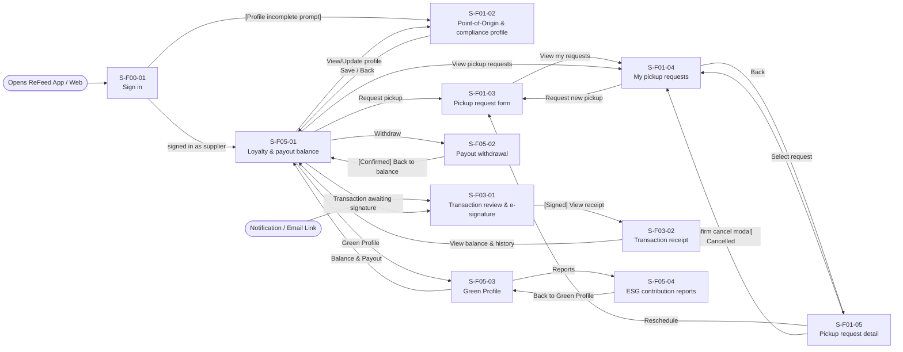
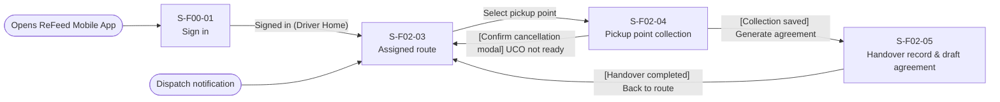
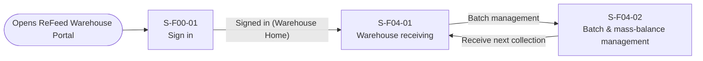
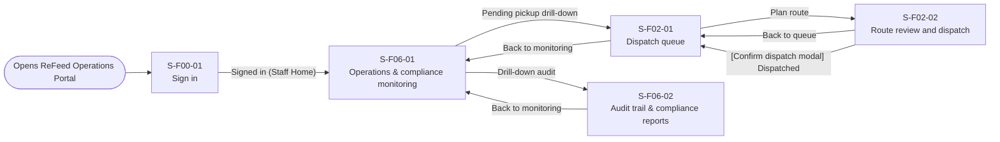

# Screen Transition Diagram: ReFeed System

---

## 1. Supplier

---

## 2. Driver / Collector

---

## 3. Warehouse Staff

---

## 4. ReFeed Staff

---

## Checks

- **Every screen in the Screen List appears:** Yes (21/21 screens).
  - Supplier: S-F00-01, S-F01-01, S-F01-02, S-F01-03, S-F01-04, S-F01-05, S-F03-01, S-F03-02, S-F05-01, S-F05-02, S-F05-03, S-F05-04 (12 screens).
  - Driver / Collector: S-F00-01, S-F02-03, S-F02-04, S-F02-05 (4 screens).
  - Warehouse Staff: S-F00-01, S-F04-01, S-F04-02 (3 screens).
  - ReFeed Staff: S-F00-01, S-F02-01, S-F02-02, S-F06-01, S-F06-02 (5 screens).
- **Every screen reachable from an entry point:** Yes.
- **No dead ends:** Yes, all workflow branches return to parent screens or role dashboards.
- **Usage-flow paths:** Every core use case path mapped below.
- **Sign in sharing:** S-F00-01 is shared across all actors, redirecting to each actor's specific homepage upon authentication.

---

## Usage-flow paths

| Actor | Usage-flow / Use Case | Path on this diagram |
|---|---|---|
| **Supplier** | UC-01 Supplier Registration | `entry` → `S-F00-01 Sign in` → `S-F01-01 Supplier registration` → `S-F00-01 Sign in` |
| **Supplier** | UC-02 Point-of-Origin & Compliance | `S-F05-01 Loyalty & payout balance` → `S-F01-02 Point-of-Origin and compliance profile` |
| **Supplier** | UC-03, UC-04 Request Pickup & Track | `S-F05-01` → `S-F01-03 Pickup request form` → `S-F01-04 My pickup requests` → `S-F01-05 Pickup request detail` |
| **Supplier** | UC-08, UC-09 Review Transaction & E-sign | `notif` / `S-F05-01` → `S-F03-01 Transaction review and e-signature` → `S-F03-02 Transaction receipt` → `S-F05-01` |
| **Supplier** | UC-13 Payout Withdrawal | `S-F05-01 Loyalty & payout balance` → `S-F05-02 Payout withdrawal` → `S-F05-01` |
| **Supplier** | UC-14, UC-15 Green Profile & ESG Reports | `S-F05-01` → `S-F05-03 Green Profile` → `S-F05-04 ESG contribution reports` |
| **Driver / Collector** | UC-06 Pickup Point Collection | `S-F02-03 Assigned route` → `S-F02-04 Pickup point collection` → `S-F02-03` (if UCO not ready) / `S-F02-05` |
| **Driver / Collector** | UC-07 Handover Record & Draft | `S-F02-04 Pickup point collection` → `S-F02-05 Handover record and draft agreement` → `S-F02-03 Assigned route` |
| **Warehouse Staff** | UC-10 Warehouse Receiving | `S-F00-01 Sign in` → `S-F04-01 Warehouse receiving` |
| **Warehouse Staff** | UC-11 Batch & Mass-balance | `S-F04-01 Warehouse receiving` → `S-F04-02 Batch and mass-balance management` |
| **ReFeed Staff** | UC-05 Route Planning & Dispatch | `S-F06-01 Monitoring` → `S-F02-01 Dispatch queue` → `S-F02-02 Route review and dispatch` → `S-F02-01` |
| **ReFeed Staff** | UC-16, UC-17 Compliance & Audit | `S-F06-01 Monitoring` → `S-F06-02 Audit trail and compliance reports` |
