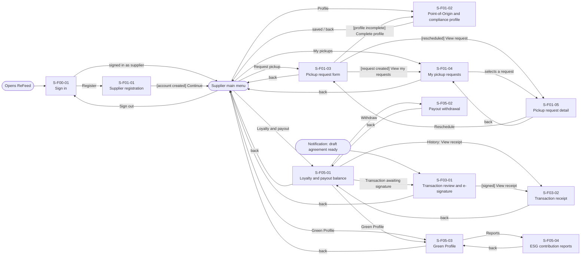
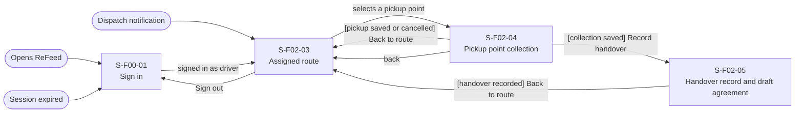
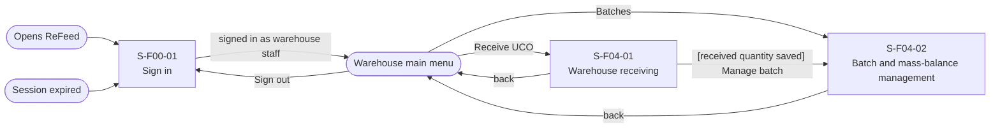
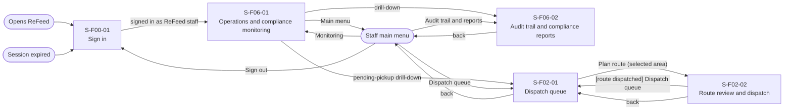

# Screen Transition Diagram: ReFeed System

## 1. Supplier

Main task "request a pickup": Supplier main menu → S-F01-03 → success state (request ID shown). One screen from the main menu.

## 2. Driver / Collector

Main task "collect UCO at a pickup point": S-F02-03 → S-F02-04 → S-F02-05. Two screens from the start screen (the assigned route is the driver's home).

## 3. Warehouse Staff

Main task "receive a collection": Warehouse main menu → S-F04-01 → result state (match or discrepancy alert). One screen from the main menu.

## 4. ReFeed Staff

Main task "dispatch a route": Staff main menu → S-F02-01 → S-F02-02 → dispatched. Two screens from the main menu.

## Checks

- Every screen in the Screen List appears: yes (21 of 21). S-F00-01 appears in all four diagrams and is counted once (12 + 3 + 2 + 4 = 21 distinct screens).
- Every screen reachable from an entry point: yes.
- No dead ends: yes. Every screen has at least one outgoing arrow.
- Entry points of the Screen List are all drawn: system launch, sign out, session expired, the four main menus, the dispatch notification, the draft-agreement notification, and each screen-to-screen entry.
- Modals are not nodes (5 of 5 listed in the Screen List stay on their screen): "Cancel this pickup request?" on S-F01-05, "Confirm route and dispatch?" on S-F02-02, "UCO not ready: cancel this pickup?" on S-F02-04, "Confirm and e-sign" on S-F03-01, "Confirm withdrawal" on S-F05-02.
- Usage-flow paths: every arrow of [usage-flow.md](usage-flow.md) has a path (table below).
- Sign in is shared; a signed-out user who opens a notification link sees S-F00-01 first and then returns to the screen they asked for (screen-level rule in S-F00-01).

## Usage-flow paths

| Actor | Usage-flow arrow | Path on this diagram |
|---|---|---|
| Supplier | UC-01 to UC-02 | Same screen: S-F01-01 Supplier registration (Point-of-Origin data entered at registration); later edits on S-F01-02 |
| Supplier | UC-01 to UC-03 | S-F01-01 → Supplier main menu → S-F01-03 Pickup request form ("Request pickup") |
| Supplier | UC-02 to UC-03 | S-F01-02 Profile → Supplier main menu → S-F01-03 ("Request pickup") |
| Supplier | UC-03 to UC-02 | S-F01-03 → S-F01-02 ("[profile incomplete] Complete profile") |
| Supplier | UC-03 to UC-04 | S-F01-03 → S-F01-04 My pickup requests ("[request created] View my requests") |
| Supplier | UC-04 to UC-03 | S-F01-05 Pickup request detail → S-F01-03 ("Reschedule") |
| Supplier | UC-04 to cancel | Same screen: S-F01-05, modal "Cancel this pickup request?" |
| Supplier | UC-08 to UC-09 | S-F03-01 → S-F03-02 Transaction receipt ("[signed] View receipt") |
| Supplier | UC-09 to UC-12 | S-F03-02 → S-F05-01 Loyalty and payout balance ("back") |
| Supplier | UC-12 to UC-08 | S-F05-01 → S-F03-01 ("Transaction awaiting signature") |
| Supplier | UC-12 to UC-13 | S-F05-01 → S-F05-02 Payout withdrawal ("Withdraw") |
| Supplier | UC-12 to UC-14 | S-F05-01 → S-F05-03 Green Profile ("Green Profile") |
| Supplier | UC-14 to UC-15 | S-F05-03 → S-F05-04 ESG contribution reports ("Reports") |
| Driver / Collector | UC-06 to UC-07 | S-F02-04 → S-F02-05 ("[collection saved] Record handover") |
| Driver / Collector | UC-07 to UC-06 | S-F02-05 → S-F02-03 ("[handover recorded] Back to route") |
| Driver / Collector | UC-06 to UC-06 (next point) | S-F02-04 → S-F02-03 → S-F02-04 |
| Warehouse Staff | UC-10 to UC-11 | S-F04-01 → S-F04-02 ("[received quantity saved] Manage batch") |
| ReFeed Staff | UC-16 to UC-05 | S-F06-01 → S-F02-01 Dispatch queue ("pending-pickup drill-down") |
| ReFeed Staff | UC-16 to UC-17 | S-F06-01 → S-F06-02 Audit trail and compliance reports ("drill-down") |
| ReFeed Staff | UC-05 (plan to dispatch) | S-F02-01 → S-F02-02 ("Plan route"), modal "Confirm route and dispatch?" |
| Supplier to Staff | UC-03 to UC-05 | Actor changes; the request created on S-F01-03 appears in the staff dispatch queue S-F02-01 |
| Staff to Driver | UC-05 to UC-06 | Actor changes; entry point "Dispatch notification" → S-F02-03 |
| Driver to Supplier | UC-07 to UC-08 | Actor changes; entry point "Notification: draft agreement ready" → S-F03-01 |
| Driver to Warehouse | UC-06 to UC-10 | The driver delivers the UCO to the warehouse; the warehouse staff opens S-F04-01 from the Warehouse main menu |

ReFeed has 21 screens, so a single diagram would be crowded; it keeps one per actor because the four actors share only the sign-in screen.

