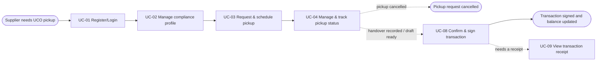
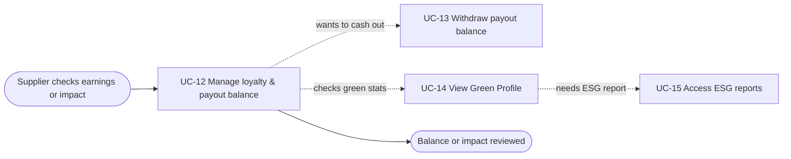
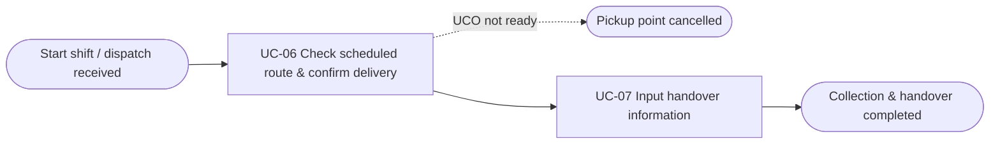
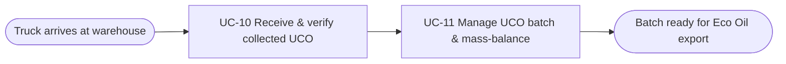

# Usage Flow: ReFeed System

> Usage flows for ReFeed System across key actors (Release 1 scope).

| Field | Value |
|---|---|
| Product | ReFeed System |
| Version | v1.3 |
| Sources | W0 Table 1 (use case inventory); W4 Prioritization; Use Case Diagram v2.1; `docs/activity/activity-index.md`; `screen-transition.md` |

## Before you draw: is Lesson 4 still true?

- [x] Every row of the Inputs check table in `docs/activity/activity-index.md` is "Done" or logged
      as an open question. Cross-actor handoffs (Supplier to Operations Staff, Operations Staff to
      Driver / Collector, Driver / Collector to Supplier and Warehouse Staff) are aligned with
      `screen-transition.md` entry points and notifications.

## Supplier: Schedule UCO pickup and sign transaction

| Step | Use case | Activity diagram | Screens |
|---|---|---|---|
| 1 | UC-01 Register/Login as a UCO supplier | not needed | S-F00-01, S-F01-01, S-F00-02 |
| 2 | UC-02 Manage Point-of-Origin and compliance profile | `AD-UC-02.md` | S-F01-06, S-F01-02 |
| 3 | UC-03 Request and schedule a UCO pickup | `AD-UC-03.md` | S-F01-03 |
| 4 | UC-04 Manage and track an existing pickup status | `AD-UC-04.md` | S-F01-04, S-F01-05 (modal "Cancel this pickup request?"), S-F01-03 (edit mode, reschedule) |
| 5 | UC-08 Confirm and sign a UCO transaction | `AD-UC-08.md` | S-F03-01 (modal "Confirm and e-sign") |
| (alt) | UC-09 View or download transaction receipt | not needed | S-F03-02 |

## Supplier: Manage payout balance and ESG profile

| Step | Use case | Activity diagram | Screens |
|---|---|---|---|
| 1 | UC-12 Manage loyalty status and accumulated payout balance | `AD-UC-12.md` | S-F00-02, S-F05-01 |
| (alt) | UC-13 Withdraw accumulated payout balance | `AD-UC-13.md` | S-F05-02 (modal "Confirm withdrawal") |
| (alt) | UC-14 View Green Profile and UCO contribution history | not needed | S-F05-03 |
| (alt) | UC-15 Access ESG / environmental contribution reports | not needed | S-F05-04 |

## Driver / Collector: Execute collection route and handover

| Step | Use case | Activity diagram | Screens |
|---|---|---|---|
| 1 | UC-06 Check scheduled collection route and Confirm Delivery to supplier points | `AD-UC-06.md` | S-F00-01, S-F02-03, S-F02-04 (modal "UCO not ready: cancel this pickup?") |
| 2 | UC-07 Input Handover Information | `AD-UC-07.md` | S-F02-05 |

## Warehouse Staff: Verify inbound UCO and manage batch traceability

| Step | Use case | Activity diagram | Screens |
|---|---|---|---|
| 1 | UC-10 Receive and verify collected UCO at warehouse | `AD-UC-10.md` | S-F00-01, S-F00-03, S-F04-01 |
| 2 | UC-11 Manage UCO batch and mass-balance records | `AD-UC-11.md` | S-F04-02 |

## ReFeed Staff: Monitor operations, dispatch routes and review audit trail

| Step | Use case | Activity diagram | Screens |
|---|---|---|---|
| 1 | UC-16 Monitor operations and compliance status *(Admin / Operations / Compliance Staff)* | not needed | S-F00-01, S-F06-01 |
| 2 | UC-05 Plan and dispatch a UCO collection route *(Operations Staff)* | `AD-UC-05.md` | S-F02-01, S-F02-02 (modal "Confirm route and dispatch?") |
| (alt) | UC-17 Review audit trail and generate compliance reports *(Admin / Compliance Staff)* | not needed | S-F06-02 |

Driver / Collector and Warehouse Staff each come for one goal, so each has one flow. Supplier comes
with two distinct goals—scheduling UCO pickups/signing transactions versus managing payout balances
and ESG reports—so Supplier is given one flow per goal. Internal ReFeed Staff roles (Operations,
Compliance, and Admin Staff) share the same operational portal (`S-F06-01`) and are grouped into one
consolidated flow with specific sub-roles noted per step.

## Use cases without a flow

No Release 1 use case is excluded: `UC-01` to `UC-17` all appear in an actor flow above. Note that
end-to-end supply chain tracing under `UC-16` (`FR-04-03` in `W4_Prioritization`) is prioritized as
**Won't-have** for Release 1 and is therefore omitted from the flow above.

## Checks before you save

- [x] Every actor that starts a use case has at least one flow.
- [x] An actor with clearly different goals has one flow per goal; no flow has more than about
      9 boxes (Supplier pickup/transaction 6 use cases, Supplier payout/ESG 4, Driver / Collector 2,
      Warehouse Staff 2, ReFeed Staff 3).
- [x] Every actor name matches the Use Case Diagram, Context Diagram, and `W0_Scope`.
- [x] Coverage: `UC-01` to `UC-17` each appear in a flow with the same ID and name; no Won't-have
      feature (`FR-04-03`) appears.
- [x] No box is a click or a screen; no box tells two use cases.
- [x] Every flow renders on mermaid.live.
- [x] Every step has at least one screen, and every screen in `screen-list.md` / `screen-transition.md`
      appears in some step (24 of 24 screens covered).
